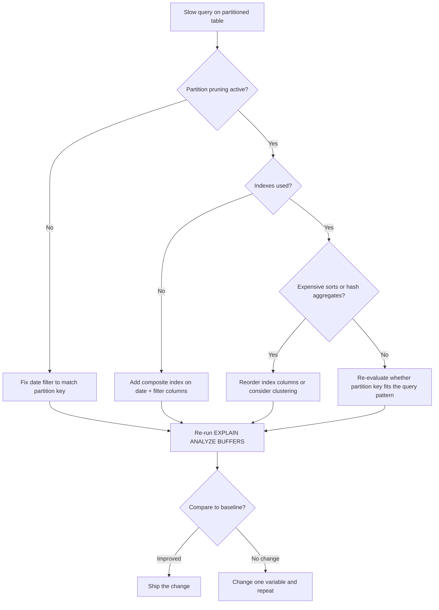

| Difficulty | Channel | Tags |
|---|---|---|
| intermediate | database | explain, query-plan, partitioning |

A PostgreSQL table was quietly marching toward a hard ceiling, and nobody noticed until the write path started gasping. Tines watched its output_payloads table grow to nearly 17TB on its largest cloud cluster, closing in on PostgreSQL's 32TB per-table limit where writes would simply stop [1]. Cleanup jobs timed out, autovacuum on the JSON TOAST table evicted hot data from the buffer cache, and I/O pressure kept demanding pricier hardware [1]. The fix was not a bigger server; it was understanding what the query planner was actually doing, one EXPLAIN line at a time.

---

> ### Real-World Case — Tines
>
> Tines' `output_payloads` table on its largest cloud cluster was approaching 17TB, closing in on PostgreSQL's 32TB hard table limit where writes would simply stop. Cleanup jobs were timing out, massive autovacuum jobs on the JSON TOAST table were evicting other tables from the buffer cache, and I/O pressure was forcing more expensive hardware — all while ingesting 6TB/day and serving over 1 billion action runs a week.
>
> | | |
> |---|---|
> | **Challenge** | Find a partitioning strategy that kept id-based point queries fast and still supported retention/range access, then diagnose why queries against the new partitioned parent table were still slower than the old flat table even after partition pruning and index scans were working. |
> | **Solution** | They compared four strategies with EXPLAIN (ANALYZE, BUFFERS): date partitioning produced an Append scanning every daily partition because queries couldn't filter on `created_at` (no pruning), hash-on-id and hash-on-story each broke either retention or the 'hot partition' problem, so they landed on two-level hash partitioning (root_story_id, then id — 128 partitions). EXPLAIN showed missing `root_story_id` filters caused 95ms index scans across all partitions, so every query was changed to carry the partition key. When parent-table routing still cost extra CPU via pg_class/pg_inherits catalog lookups and hash calculations, they reverse-engineered PostgreSQL's `hashint8extended` function in Ruby to compute the exact child partition name and query it directly. |
> | **Outcome** | Querying the derived partition directly was 20-40x faster than routing through the parent table; a representative EXPLAIN went from 95.379 ms to 0.041 ms once the partition key filter was added; they averted the 32TB write-stopping wall and migrated with zero customer downtime using dual writes and GitHub Scientist shadow reads. |
> | **Lesson** | Partitioning doesn't automatically make queries fast — you must verify pruning and index usage in EXPLAIN, ensure queries actually carry the partition key, and beware hidden planner overhead (catalog lookups, hash routing, generic-plan lock acquisition) that can make a partitioned parent slower than the original unpartitioned table. |

---

## Hook — The Moment a Table Becomes a Ticking Clock

Picture this: your busiest PostgreSQL cluster is ingesting 6TB every single day and serving more than 1 billion action runs a week [1]. Now imagine discovering that your largest table is approaching 17TB, with PostgreSQL's 32TB hard limit looming like a cliff edge [1]. Many developers assume partitioning alone solves this. It does not. The real story lives inside the EXPLAIN plan, and the gap between a query that scans everything and one that touches a single partition can be the difference between 95 milliseconds and 0.04 milliseconds [1]. So what exactly is the planner doing behind your back?

## Problem — When Partitioning Stops Being Magic

Building on those stakes, here is the uncomfortable truth: partitioning is not a performance feature by itself; it is a storage and maintenance feature that only pays off when the planner cooperates. PostgreSQL's partitioning support has matured over many releases, but maturity is not the same as automatic speed [2]. Teams often assume that slicing a table by date makes every date-filtered query fast. However, if the query does not filter on the partition key in a way the planner recognizes, PostgreSQL may still touch every partition, turning a supposed speedup into extra overhead.

Many developers discover this only after a cleanup job times out or autovacuum starts evicting hot pages from the buffer cache [1]. The stakes are concrete: at 6TB per day of ingestion, a plan that scans one partition too many is not a mild inefficiency; it is a queue of work that never drains [1].

Here is what you need to know:
- Partition pruning only happens when the WHERE clause matches the partition key expression.
- Planning time grows with the number of partitions, so thousands of partitions can hurt short queries.
- Indexes on the parent do not always translate into efficient access on every child.
- TOAST tables for JSON payloads have their own autovacuum dynamics that can starve the buffer cache.

## Real-World Case — Tines

Nowhere is this clearer than in Tines' own experience. On its largest cloud cluster, the output_payloads table was approaching 17TB and closing in on PostgreSQL's 32TB hard table limit, the point where writes stop entirely [1]. The symptoms stacked up fast: cleanup jobs timed out, massive autovacuum jobs on the JSON TOAST table evicted other tables from the buffer cache, and I/O pressure pushed the team toward more expensive hardware [1]. All of this was happening while the platform ingested 6TB per day and served over 1 billion action runs a week [1].

The twist came when the team tested the obvious assumption. Querying the derived partition directly turned out to be 20-40x faster than routing through the parent table [1]. A representative EXPLAIN went from 95.379 ms to 0.041 ms the moment the partition key filter was added [1]. That is not a tuning tweak; that is a different universe.

But wait, it gets better. The migration still had to happen with zero customer downtime. Tines used dual writes combined with GitHub Scientist shadow reads to verify correctness before flipping the switch [1]. The lesson is not simply 'partition your big table.' It is that the plan tells the truth, and the truth is measurable.

## Deep Dive — Reading the EXPLAIN Plan Like a Detective

Building on that discovery, the EXPLAIN plan becomes your primary diagnostic instrument. When a date-range query stays slow, three things deserve your attention first.

**1. Is partition pruning actually happening?** Look at how many partitions appear in the plan. If PostgreSQL scans every child, the filter is not aligning with the partition key. This is the single highest-leverage check, and the pruning logic itself is open for inspection in the PostgreSQL source [7].

**2. Are indexes being used, or is a sequential scan winning?** A sequential scan on a narrow date slice is often a smell. Check whether an existing index is ignored because the predicate is not sargable, or because statistics are stale [4][5].

**3. Where are the expensive sorts and hash aggregates?** Even with perfect pruning, a large sort can dominate runtime. Column order in a composite index can eliminate a sort entirely [6].

💡 Insight: A composite index on (date, filtered_column) serves double duty. The leading date column supports range pruning and index scans, while the second column narrows the result before a sort is needed.

When would you actually use this? Reach for composite indexes when your WHERE clause consistently pairs a date range with one or two high-selectivity columns. If queries filter only on date, a single-column index may be enough. If they filter on status alone across all dates, the partition key itself might be wrong [3]. In managed environments such as Amazon RDS for PostgreSQL, remember that concurrent index builds and maintenance windows interact with the service's backup and storage behavior [8].

Here is the real tradeoff:

| Option | Best For | Cost / Risk |
|---|---|---|
| Composite index (date, status) | Mixed date + status filters | Slower writes, extra disk |
| CLUSTER by index | Physically co-locating related rows | Blocks writes, one-time sort |
| Repartition by new key | Query patterns that changed | Complex migration, dual writes |

⚠️ Watch Out: CLUSTER is a one-time operation, not a maintenance habit. It does not keep data clustered as new rows arrive, and it takes an access exclusive lock. Pair it with a strategy, not a hope.

🔥 Hot Take: Adding RAM rarely fixes a bad plan. Tines' I/O pressure was a symptom of plan shape and TOAST bloat, not a hardware deficiency [1].

## Workflow — From Slow Query to Verified Fix

This leads naturally to a repeatable workflow rather than random tinkering. The visual story below maps the decision path from a slow query to a confirmed fix, and each step follows directly from the one before it.

1. Reproduce the slow query with EXPLAIN (ANALYZE, BUFFERS) so you see actual rows, timing, and buffer hits.
2. Count the partitions in the plan. If pruning failed, fix the predicate to match the partition key before touching indexes.
3. Inspect index usage. If a sequential scan persists on a narrow slice, create a composite index concurrently.
4. Hunt for sorts and hash aggregates. Reorder index columns or consider clustering if physical layout matters.
5. Re-run the exact same EXPLAIN and compare numbers. If latency resembles Tines' 95.379 ms to 0.041 ms drop, the plan changed for the right reason [1].

🎯 Key Point: Always change one thing at a time between EXPLAIN runs. Otherwise you will never know which fix earned the win.

The Mermaid flowchart referenced here captures this exact path: slow query, pruning check, index check, sort check, and verification.

## Code Example — The Production-Ready Playbook

Building on the workflow above, here is how the plan translates into production commands. The full script lives in the code example field, but the logic deserves a careful read.

First, the script captures a baseline with EXPLAIN (ANALYZE, BUFFERS, VERBOSE). VERBOSE exposes the exact columns and output lists, which helps confirm that pruning is happening on the intended partition. Second, it creates the composite index on (event_date, status) using CONCURRENTLY, so the table keeps accepting writes during the build, a detail that matters when ingestion runs at 6TB per day [1]. Third, it runs ANALYZE so the planner's statistics reflect the new index. Fourth, it repeats the identical EXPLAIN to verify the change.

⚠️ Watch Out: CREATE INDEX CONCURRENTLY cannot run inside a transaction block. If a migration tool wraps statements in BEGIN/COMMIT, run this step outside that wrapper or use a tool that understands concurrent builds.

When would you actually use this script? Use it as a template whenever a date-filtered query on a partitioned table refuses to speed up. Swap the table and column names, keep the measure-change-measure rhythm, and let the numbers decide.

## Lessons Learned — Battle Scars and the Road Ahead

Building on everything uncovered so far, the journey from a 17TB time bomb to a sub-millisecond query is really a story about skepticism toward assumptions.

Here are the battle scars worth keeping:
- Partitioning without pruning is just expensive table organization. Verify the plan, not the intention.
- Composite indexes earn their keep when the WHERE clause pairs a date range with selective filters, but they slow writes.
- CLUSTER is a one-time physical reorder, not a permanent guarantee; new rows will drift.
- TOAST tables and autovacuum can quietly evict hot pages, so watch buffer cache behavior, not just query time [1].
- Dual writes and shadow reads are how serious teams migrate without downtime [1].

💡 Insight: The most valuable habit is measuring before and after with the exact same EXPLAIN command. Optimization without a baseline is just guessing with extra steps.

So what should change tomorrow? Add a plan-review step to your definition of done for any query touching a large partitioned table. Make EXPLAIN (ANALYZE, BUFFERS) as routine as a code review, and teams will catch the next 17TB problem while it is still a 17GB problem.

---

## Query Optimization Decision Flow

<strong>Original Interview Question</strong>

**Q:** You have a PostgreSQL table with 100M rows partitioned by date. A query filtering on a specific date range is still slow. What would you check in the EXPLAIN plan and how would you optimize it?

**A:** Check partition pruning effectiveness, index utilization patterns, and expensive sort operations. Create composite indexes on (date, filtered_columns) and evaluate clustering strategies for optimal data access.

## Conclusion

The 17TB table that nearly stopped writes did not need a heroic hardware purchase; it needed a closer look at a single EXPLAIN line [1]. From partition pruning to composite indexes, the journey from 95.379 ms to 0.041 ms is proof that the planner will tell the truth if you ask the right questions [1]. The memorable insight to share with your team is simple: partitioning sets the stage, but the query plan writes the ending. Next time a date-range query feels slow, do not reach for a bigger instance first. Open EXPLAIN, verify pruning, fix the index, and let the numbers tell the story.

---

## References

1. [Tines incident report](https://www.tines.com/blog/futureproofing-tines-partitioning-a-17tb-table-in-postgresql/) — article
2. [PostgreSQL - Wikipedia](https://en.wikipedia.org/wiki/PostgreSQL) — documentation
3. [Partition (database) - Wikipedia](https://en.wikipedia.org/wiki/Partition_(database)) — documentation
4. [Database index - Wikipedia](https://en.wikipedia.org/wiki/Database_index) — documentation
5. [Query optimization - Wikipedia](https://en.wikipedia.org/wiki/Query_optimization) — documentation
6. [B-tree - Wikipedia](https://en.wikipedia.org/wiki/B-tree) — documentation
7. [postgres/postgres - GitHub](https://github.com/postgres/postgres) — documentation
8. [Amazon RDS for PostgreSQL - AWS Documentation](https://docs.aws.amazon.com/AmazonRDS/latest/UserGuide/CHAP_PostgreSQL.html) — documentation

---

**Author:** Satishkumar Dhule — [GitHub](https://github.com/satishkumar-dhule) · [LinkedIn](https://linkedin.com/in/satishkumar-dhule) · [Website](https://satishkumar-dhule.github.io)
