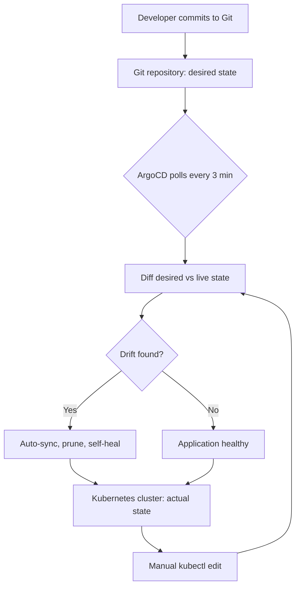

| Difficulty | Channel | Tags |
|---|---|---|
| beginner | devops | argocd, flux, declarative |

When Adobe set out to retire Moonbeam, its legacy internal continuous-delivery platform, the company faced roughly 10,400 pipelines spread across 100+ teams and 3,000+ developers [1]. The old queue-based, imperative workflow demanded manual intervention, bred configuration drift, and had grown hard to scale, secure, and operate reliably [1]. In 2H 2024, that sprawl became the opening chapter of a very public GitOps migration [1]. If a quick kubectl edit has ever 'fixed' a cluster—only for the change to vanish or quietly stick—this journey is yours.

---

> ### Real-World Case — Adobe
>
> In 2H 2024 Adobe set out to retire Moonbeam, its legacy internal continuous-delivery platform, which had become hard to scale, secure, and operate reliably across hundreds of engineering teams. The old queue-based, imperative workflow required manual intervention, produced configuration drift, and spanned roughly 10,400 pipelines that had to be either moved or shut down.
>
> | | |
> |---|---|
> | **Challenge** | Migrate thousands of services and 100+ teams to a governed, self-service delivery platform without breaking production, while establishing Git as the single source of truth with automated reconciliation, auditability, faster rollbacks, and consistent security controls at enterprise scale. |
> | **Solution** | Adobe built Flex on Kubernetes and the Argo ecosystem: Argo CD for Git-based delivery and continuous reconciliation of live state against declared manifests, Argo Workflows for CI/CD pipelines and long-running migration orchestration, plus Argo Events and Argo Rollouts for progressive delivery. Because rolling out the technology alone created friction for early adopters, the team added a Node.js/React self-service migration interface with explicit start/pause/continue/end controls, state management, tracking, and notifications. |
> | **Outcome** | 10,400 pipelines were migrated or decommissioned across 100+ teams and 3,000+ developers. Flex now manages 6,000+ services across nearly 50,000 environments, including ~19,000 production environments running 3,300+ production services. A surprise win: the migration surfaced thousands of stale, abandoned, or duplicate services, and about 80% of previously identified services were retired, contributing meaningful infrastructure cost savings alongside shorter deployment queue times. |
> | **Lesson** | At scale, adopting Argo CD is the easy part — Adobe's biggest regret was not investing in end-to-end migration tooling and governance from day one ('scripts alone were not sufficient'). The counterintuitive payoff was platform hygiene: a GitOps migration becomes a forcing function to inventory and delete dead services. And mandates created urgency, but the GitOps value — declarative delivery, reconciliation, auditability — is what actually drove adoption. |

---

## Hook — 10,400 Pipelines and a Reckoning

Here is a number that should make any platform engineer sit up: 10,400 [1]. That was the count of pipelines Adobe had to either move or shut down when Moonbeam reached the end of its road [1]. Every one of those pipelines represented a team, a release process, and a fresh opportunity for drift to creep in. The uncomfortable truth is that imperative automation scales your problems faster than it scales your delivery. Add more pipelines to a brittle workflow and you do not get speed—you get a faster queue to the same outage. Sound familiar? The tension is set; the real surprise, however, is what the cleanup uncovered. That discovery is waiting in the case study.

## Problem — The Imperative Trap

Building on that tension, the core pain is deceptively simple: a cluster has no memory of how it got there. An imperative command such as `kubectl set image` changes the live state immediately, but it leaves no durable record in version control [5]. Consequently, the next deploy, the next on-call rotation, and the next environment all start guessing. Many developers discover this the hard way when a 'temporary' hotfix survives for months, or when staging and production quietly diverge. Here is what you need to know about the imperative trap:
- Changes bypass the Git repository, so the audit trail lives in shell history at best.
- Drift accumulates across environments, making 'it works on my cluster' a genuine diagnostic dead end.
- Rollbacks become manual archaeology instead of a single revert.
- Collaboration suffers because nobody can review a command the way a pull request gets reviewed.
For a sense of the stakes, history offers a brutal reminder: Knight Capital's 2012 trading glitch, triggered by a botched code deployment, erased roughly $440 million in under an hour [11]. Infrastructure as code exists precisely to replace this guesswork with reviewable, repeatable definitions [7]. But what does a single source of truth actually look like when 3,000+ developers depend on it? That is where the real-world case earns its keep.

## Real-World Case — Adobe

This leads directly to Adobe's 2H 2024 migration, and the numbers are almost comical in scale [1]. Moonbeam, the legacy internal continuous-delivery platform, had become hard to scale, secure, and operate reliably across hundreds of engineering teams, so the company set out to retire it [1]. The old queue-based workflow spanned roughly 10,400 pipelines that had to be migrated or decommissioned across 100+ teams and 3,000+ developers [1]. The replacement, Flex, now manages 6,000+ services across nearly 50,000 environments—including about 19,000 production environments running 3,300+ production services [1]. Here is the plot twist nobody expected: the migration surfaced thousands of stale, abandoned, or duplicate services, and roughly 80% of previously identified services were retired [1]. That cleanup delivered meaningful infrastructure cost savings alongside shorter deployment queue times [1]. Think about that for a second—the biggest win was not a faster pipeline; it was discovering how much dead weight the imperative sprawl had been hiding. Declarative systems force inventory into the open because a service that is not in Git cannot quietly exist. Sound like the kind of skeleton your own cluster might be hiding? The next section explains the mechanism that makes such skeletons impossible to ignore.

## Deep Dive — Declarative vs. Imperative, Explained

Building on Adobe's inventory surprise, the mechanism is reconciliation: ArgoCD holds a desired state in Git and continuously compares it with the live cluster [2]. An Application custom resource points at a Git repository, a path, and a target cluster, making Git the single source of truth [3]. When drift appears, auto-sync and self-healing push the cluster back toward the declared state, typically on a 1–5 minute interval with three minutes being a common default. Declarative configuration means YAML manifests, Helm charts, or Kustomize overlays describe the complete desired state, and every change arrives as a commit [7]. Imperative configuration means kubectl commands mutate the cluster directly, bypassing version control [5]. Here is the real tradeoff:

| Aspect | Declarative (GitOps with ArgoCD) | Imperative (kubectl commands) |
| --- | --- | --- |
| Source of truth | Git repository | Live cluster |
| Audit trail | Git commits and pull requests | Shell history, if lucky |
| Drift handling | Self-healed automatically | Accumulates silently |
| Rollback | One `git revert` | Manual reconstruction |
| One-off fix speed | Slower, needs a commit | Fast and immediate |
| Best for | Production, shared teams, audits | Debugging, emergencies, exploration |

💡 Insight: Many developers think declarative means 'slower.' Actually, the commit is a feature—it is the review, the audit, and the rollback button rolled into one.
⚠️ Watch Out: Self-healing can fight an operator that legitimately mutates state. Use `ignoreDifferences` in the Application spec for controller-managed fields.
🔥 Hot Take: Imperative kubectl is not the enemy; making it the source of truth is. Keep it as a debugging scalpel, not a deployment strategy.
When would you actually use each? Choose declarative for anything shared, long-lived, or production-facing; reach for imperative only during a live incident where seconds matter, then write the change back into Git immediately. Kubernetes objects are inherently declarative by design [6]. So how does a commit become a healthy pod without anyone pressing a button? Follow the flow.

## Workflow — From Commit to Healthy Cluster

This leads to the seven-step loop shown in the GitOps sync flow diagram below. First, a developer commits a manifest or Helm value change to the Git repository. Second, the ArgoCD Application CRD notices the new revision, either by polling every three minutes or through a webhook [3]. Third, ArgoCD renders the manifests and diffs the desired state against the live cluster [2]. Fourth, if differences exist, auto-sync applies them; `prune: true` removes resources deleted from Git. Fifth, self-healing reverts any manual kubectl drift so the cluster cannot wander off-script. Sixth, health checks confirm deployments are available before the app is marked healthy. Seventh, the loop repeats forever—a reconciler that never sleeps. The diagram tells the visual story:



⚠️ Watch Out: A three-minute poll is fine for most teams, but large monorepos benefit from webhooks to cut unnecessary API calls [3].
🎯 Key Point: The loop is closed only when self-healing is enabled; without it, drift detection alone is just a very expensive notification.
If the flow feels abstract, the next section turns it into a runnable bootstrap you can adapt for one of your own services.

## Code Example — Bootstrapping Auto-Sync

Building on that flow, the script below creates an ArgoCD Application that auto-syncs a production service from Git, enables pruning and self-healing, then waits for health. Bash is used because this is exactly the kind of bootstrap a platform team runs from a terminal or CI job.

```bash
#!/usr/bin/env bash
# GitOps bootstrap: create an ArgoCD Application that auto-syncs from Git.
set -euo pipefail

REPO_URL='https://github.com/acme/platform-manifests.git'
APP_NAME='checkout-service'
NAMESPACE='argocd'

# Render the Application CRD with the Git source and automation policy.
cat <<EOF | kubectl apply -f -
apiVersion: argoproj.io/v1alpha1
kind: Application
metadata:
  name: ${APP_NAME}
  namespace: ${NAMESPACE}
spec:
  source:
    repoURL: ${REPO_URL}
    targetRevision: HEAD
    path: apps/${APP_NAME}
  destination:
    server: https://kubernetes.default.svc
    namespace: production
  syncPolicy:
    automated:
      prune: true        # delete resources removed from Git
      selfHeal: true     # revert manual kubectl drift
    syncOptions:
      - CreateNamespace=true
EOF

# Force immediate reconciliation instead of waiting for the 3-minute poll.
argocd app sync "${APP_NAME}"
argocd app wait "${APP_NAME}" --health --timeout 180
```

Step by step: `set -euo pipefail` makes the script fail fast on errors, which matters when you are touching production. The variables define the Git source and the target namespace, so the same script can bootstrap many services. The heredoc emits an ArgoCD Application custom resource whose `source` points at Git and whose `destination` points at the in-cluster API server [3]. `prune: true` removes resources that disappear from Git, while `selfHeal: true` is the setting that reverts unauthorized manual changes—the very behavior Adobe's old workflow lacked [1]. Finally, `argocd app sync` triggers reconciliation now rather than after the default interval, and `argocd app wait --health` blocks until the app reports healthy [3]. Swap in your own repo and service name, and the loop from the previous section is live. Ready for the scars that documentation rarely mentions?

## Lessons Learned — Battle Scars and Better Habits

Having followed the arc from Adobe's 10,400 pipelines to a three-minute reconcile loop, the takeaways are less about YAML and more about discipline. Continuous delivery is the broader practice this automation serves [8], and managed Kubernetes services such as EKS still need the same GitOps guardrails [9].
- ⚠️ Watch Out: `prune: true` deletes anything absent from Git. Test it in staging first, or a missing overlay can wipe a namespace faster than a bad `rm`.
- ⚠️ Watch Out: Self-healing can battle a HorizontalPodAutoscaler or an operator that legitimately rewrites fields. Declare `ignoreDifferences` for those fields instead of disabling self-heal entirely.
- 💡 Insight: Never commit plaintext secrets. Use a secrets operator or sealed secrets so Git stays the source of truth without becoming the leak [10].
- 🔥 Hot Take: The 'drift' Adobe found was not a tooling bug—it was an inventory problem made visible by declarative discipline [1].
- 🎯 Key Point: Start with one low-risk service, enable self-heal in staging, and measure drift incidents before expanding to 50,000 environments.
- If ArgoCD does not fit your stack, Flux provides a comparable declarative reconciliation model [4].
Pro tip after debugging this pattern many times: treat every kubectl edit as a tiny crime scene—leave a commit behind so the next developer can follow the trail. If this feels overwhelming, you are not alone; even teams with 3,000+ developers started with a single repository [1]. The transformation is complete when rollbacks become boring: a `git revert`, a three-minute reconcile, and a quiet pager.

---

## GitOps Sync Flow


<details>
<summary><strong>Original Interview Question</strong></summary>

**Q:** You're setting up GitOps for a microservices deployment. How would you configure ArgoCD to automatically sync changes from your Git repository to Kubernetes, and what's the difference between declarative and imperative approaches in this context?

**A:** I'd configure ArgoCD by setting up a Git repository containing Kubernetes manifests or Helm charts, creating an Application CRD that points to the Git repository, enabling auto-sync with a health check interval of 3 minutes, and implementing self-healing to automatically revert any manual changes. The declarative approach involves defining the desired state in Git through YAML manifests, Helm charts, or Kustomize configurations, where ArgoCD continuously reconciles the actual state with the desired state. In contrast, the imperative approach uses kubectl commands to make direct changes to the cluster, bypassing the Git repository as the single source of truth.

</details>

## Conclusion

The journey started with 10,400 pipelines and a platform that had become hard to scale, secure, and operate reliably [1]. It passed through the struggle of imperative drift, the discovery that declarative Git exposes hidden inventory, and the solution of an ArgoCD Application that auto-syncs and self-heals on a three-minute loop. The transformation Adobe saw—6,000+ services across nearly 50,000 environments and roughly 80% of services retired—was not magic; it was Git finally telling the truth [1]. So what should you do differently tomorrow? Pick one service, write its desired state into Git, enable `selfHeal` in staging, and spend a week watching what the reconciler catches. Here is the one insight to take to your next team meeting: Kubernetes will always drift, but a cluster whose source of truth lives in Git can only drift for three minutes.

---

## References

1. [Adobe incident report](https://www.cncf.io/case-studies/adobe/) — article
2. [GitOps](https://en.wikipedia.org/wiki/GitOps) — documentation
3. [Argo CD GitHub repository](https://github.com/argoproj/argo-cd) — documentation
4. [Flux CD GitHub repository](https://github.com/fluxcd/flux2) — documentation
5. [kubectl command reference](https://kubernetes.io/docs/reference/kubectl/) — documentation
6. [Working with Kubernetes objects](https://kubernetes.io/docs/concepts/overview/working-with-objects/) — documentation
7. [Infrastructure as code](https://en.wikipedia.org/wiki/Infrastructure_as_code) — documentation
8. [Continuous delivery](https://en.wikipedia.org/wiki/Continuous_delivery) — documentation
9. [What is Amazon EKS?](https://docs.aws.amazon.com/eks/latest/userguide/what-is-eks.html) — documentation
10. [Kubernetes concepts overview](https://kubernetes.io/docs/concepts/overview/) — documentation
11. [Knight Capital Group](https://en.wikipedia.org/wiki/Knight_Capital_Group) — documentation

---

**Author:** Satishkumar Dhule — [GitHub](https://github.com/satishkumar-dhule) · [LinkedIn](https://linkedin.com/in/satishkumar-dhule) · [Website](https://satishkumar-dhule.github.io)
