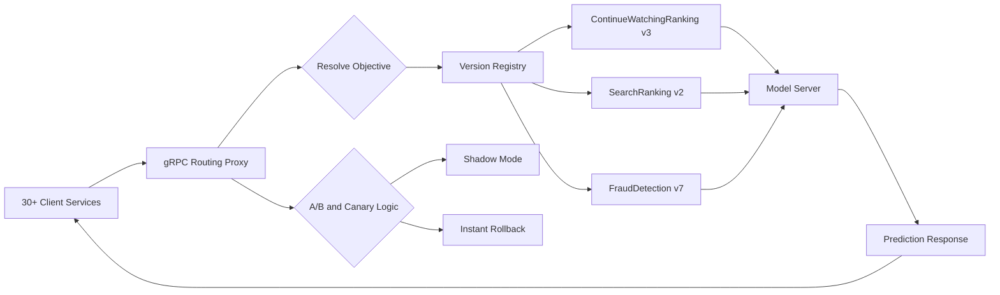

| Difficulty | Channel | Tags |
|---|---|---|
| beginner | devops | mlops, deployment |

Imagine 30+ client services all needing to know exactly which model version to call — and hardcoding cluster addresses to do it. That was the reality at Netflix, where by 2025 a central model serving platform handled hundreds of model types at roughly 1 million requests per second, powering recommendations, fraud detection, and search [1]. The fix was not a bigger GPU or a fancier algorithm. It was a routing layer that turned a brittle infrastructure problem into a simple business question: 'Which objective should this request serve?'

---

> ### Real-World Case — Netflix
>
> By 2025 Netflix's central model serving platform handled hundreds of model types and versions at roughly 1 million requests per second, powering recommendations, fraud detection, and search. To spare 30+ client services from hardcoding model/cluster VIP addresses, they built a custom gRPC proxy called Switchboard that resolved a business 'Objective' (e.g. ContinueWatchingRanking) into a model version, handling A/B allocation, canaries, shadow mode, and instant rollback.
>
> | | |
> |---|---|
> | **Challenge** | Switchboard sat directly in the critical request path. At 1M RPS it became a single point of failure (one bug or noisy tenant could degrade every ML experience), added 10–20ms of latency per request from deserializing and reserializing large payloads, amplified tail latency, and blocked test-vs-real traffic isolation needed for clean training data. |
> | **Solution** | They kept the abstraction but removed the router from the hot path. A new lightweight service, Lightbulb, consumes only minimal request context and resolves it into a routingKey header plus an ObjectiveConfig (model id + execution params) appended to the request body. Envoy — already Netflix's standard egress sidecar — reads the header and forwards the payload straight to the correct serving cluster VIP. Routing rules stay in the control plane via Netflix's Gutenberg pub/sub, with independent versioning and rollback; the payload never traverses a central proxy. |
> | **Outcome** | Eliminated the 10–20ms serialization hop and the shared-fate failure mode while preserving the single integration point, context-aware routing, traffic splitting, and second-scale rollback across 30+ clients at ~1M RPS; Netflix reports the redesign 'successfully resolved' the latency and availability challenges (no exact post-migration p99 was published). |
> | **Lesson** | This is the serving/deployment split in practice: publish routing and experiment config from the control plane, but keep the inference data path thin. Because routing rules change rarely, paying for consistency by putting a stateful service in every request is a bad trade — resolve metadata cheaply and let existing mesh infrastructure do the forwarding. |

---

## Hook — The Hidden Cost Behind Every Prediction

Ever wondered why a model that predicts in 20 milliseconds can still feel slow to the user waiting on the other end? The culprit is rarely the math. It is the distance the request travels to reach the right model, the serialization tax paid along the way, and the guesswork about which version should answer at all.

Picture thirty services asking the same question every second: 'Which model handles this?' When each one answers by hardcoding a cluster address, a single routing change becomes a coordinated thirty-service migration. That is the kind of invisible tax that turns a clean architecture diagram into a 3am incident.

Many developers discover this the hard way — the model was never the bottleneck. The path to the model was.

So what happens when traffic grows to one million requests per second? That is where the story gets interesting.

## Problem — Deployment and Serving Are Not the Same Thing

Building on that tension, the root cause is usually a vocabulary problem. Teams say 'deploy the model' when they mean three different things, and that blur hides ownership gaps until production is on fire.

Here is the distinction that matters. Deployment is the journey from code to a running, observable system: CI/CD pipelines, infrastructure provisioning, container orchestration, and rollback plans. Serving is what happens once a request arrives — runtime inference, request routing, model loading, batching, and response optimization.

Kubernetes and container tooling make the deployment side possible [2], while MLOps practices tie the whole loop together [9]. Yet a flawless deployment can still serve terrible predictions if the runtime routing is naive.

| Option | Deployment | Serving |
|---|---|---|
| Primary concern | Getting artifacts into production safely | Turning requests into predictions quickly |
| Typical tools | Kubernetes, Terraform, MLflow | TensorFlow Serving, TorchServe, BentoML |
| Success metric | Safe, repeatable releases | Low latency, high throughput, correct version |
| Failure mode | Bad rollout, no rollback | Wrong version, cold starts, timeout cascades |

⚠️ **Watch Out:** Treating serving as 'just another API' is how teams end up with no versioning strategy and no way to split traffic safely.

If deployment gets the model to the party and serving decides who talks to it, what happens when thirty guests all arrive at once?

## Real-World Case — Netflix

Netflix is the answer to that question, and the numbers are worth staring at. By 2025, its central model serving platform handled hundreds of model types and versions at roughly one million requests per second, powering recommendations, fraud detection, and search [1].

The struggle was not model accuracy. Thirty-plus client services had to know the specific model and cluster VIP address for every call. That coupling meant every version bump risked a shared-fate failure, where one bad routing change could take down many consumers at once [1].

💡 **Insight:** The platform also paid a 10–20 millisecond serialization hop on each request — tiny on paper, enormous when multiplied by a million calls per second [1].

Here is the plot twist. Instead of asking clients to become routing experts, Netflix built a custom gRPC proxy called Switchboard that resolved a business 'Objective' — such as ContinueWatchingRanking — into a specific model version. The proxy owned A/B allocation, canaries, shadow mode, and instant rollback behind a single integration point [1].

🔥 **Hot Take:** The winning move was not a faster model server. It was removing a decision from thirty teams and centralizing it.

Netflix reports the redesign 'successfully resolved' the latency and availability challenges, though no exact post-migration p99 was published [1]. Which begs the next question: what was the proxy actually doing under the hood to earn that outcome?

## Deep Dive — The Trade-offs That Actually Matter

Building on Netflix's routing layer, the real engineering work lives in a handful of trade-offs that refuse to be optimized simultaneously.

First is latency versus throughput. Real-time paths often target sub-100 millisecond responses, while batch or near-line jobs can tolerate more than a second. Model servers such as TensorFlow Serving and TorchServe expose batching knobs that trade a little waiting time for much higher throughput [3][4]. Batch more aggressively and latency climbs; batch less and you burn compute.

Second is cold starts. A new pod that has not loaded its weights yet cannot answer anything useful. Frameworks like BentoML wrap models into containers with predictable startup behavior, but GPU memory and model size still dictate how fast a replica becomes ready [5].

| Trade-off | Choose real-time when | Choose batch when |
|---|---|---|
| Latency budget | Under 100ms, interactive | Over 1s, asynchronous |
| Batching | Minimal and dynamic | Large and fixed |
| Hardware | Warm GPU replicas | CPU or spot instances |
| Example use | Recommendations, fraud checks | Nightly scoring, reports |

🎯 **Key Point:** Use real-time serving when a human is waiting on the response; use batch when the result can land in a table or cache a moment later.

Third is scaling, which splits into horizontal replicas and vertical resources. Managed platforms such as SageMaker can handle much of this plumbing for teams that want fewer moving parts [7]. Kubernetes-based stacks give finer control but demand real operational maturity [2].

⚠️ **Watch Out:** Autoscaling on CPU alone is a classic battle scar — GPU-bound inference often sits idle at low CPU while the queue quietly grows.

Sound familiar? The next step is turning these trade-offs into an actual flow rather than a checklist.

## Workflow — From Objective to Prediction

Connecting those trade-offs to Netflix's design, the workflow is less about 'calling a model' and more about resolving intent. Here is how a production request moves through a routing layer built in the spirit of Switchboard [1].

The Mermaid diagram below maps the full path, from client to objective resolution to the final prediction:



Step one: the client sends an objective name, not an address. Step two: the proxy resolves that objective into a version using a registry. Step three: traffic policy decides whether the request joins a canary, enters shadow mode, or hits the stable version. Step four: the chosen model server produces a prediction. Step five: the response returns through the same single integration point [8].

💡 **Insight:** Envoy-style proxies and gRPC make this feasible because they keep routing decisions cheap and observable [8].

Notice that rollback is a configuration flip, not a redeploy. That is the difference between a 3am panic and a boring Tuesday. But how does that logic actually look in code?

## Code Example — A Router You Can Actually Run

The workflow becomes concrete once the resolution logic is written down. The Python snippet below models the heart of a Netflix-style router: objective resolution, weighted canary allocation, shadow traffic, and version rollback.

```python
import random
from dataclasses import dataclass
from typing import Dict, List, Optional

@dataclass
class ModelEndpoint:
    name: str
    version: str
    address: str
    weight: float = 1.0

@dataclass
class RouteDecision:
    endpoint: ModelEndpoint
    shadow: Optional[ModelEndpoint] = None
    rollback_to: Optional[str] = None

class ObjectiveRouter:
    # Resolves a business objective into a concrete model version.
    def __init__(self) -> None:
        self._routes: Dict[str, List[ModelEndpoint]] = {}
        self._rollbacks: Dict[str, str] = {}

    def register(self, objective: str, endpoints: List[ModelEndpoint]) -> None:
        self._routes[objective] = endpoints

    def set_rollback(self, objective: str, version: str) -> None:
        # Flipping this value is the 'instant rollback' operation.
        self._rollbacks[objective] = version

    def resolve(self, objective: str, canary: bool = False) -> RouteDecision:
        endpoints = self._routes[objective]
        if canary:
            # Weighted choice powers A/B allocation across versions.
            chosen = random.choices(endpoints, weights=[e.weight for e in endpoints], k=1)[0]
            shadow = next((e for e in endpoints if e != chosen), None)
            return RouteDecision(endpoint=chosen, shadow=shadow)
        stable = next(
            (e for e in endpoints if e.version == self._rollbacks.get(objective)),
            endpoints[0],
        )
        return RouteDecision(endpoint=stable, rollback_to=self._rollbacks.get(objective))
```

Here is what each part does. The `ModelEndpoint` dataclass captures the identity and location of a single model version, along with a traffic `weight`. The `ObjectiveRouter` keeps a registry mapping business objectives to their candidate endpoints, so clients never touch raw addresses. The `set_rollback` method records the known-good version for an objective — flipping it is the instant rollback operation.

Inside `resolve`, the `canary` flag selects a weighted random endpoint via `random.choices`, which is the same idea behind A/B allocation. When not in canary mode, the router deliberately returns the rollback version if one is set, otherwise the first registered endpoint. The `RouteDecision` bundles the chosen endpoint with optional shadow and rollback metadata, giving callers everything needed for safe traffic splitting.

⚠️ **Watch Out:** This is a routing skeleton, not a full proxy — production needs timeouts, retries, circuit breakers, and health checks wrapped around it.

The pattern works because it moves version decisions out of thirty codebases and into one testable place. What should teams take away before their next deploy?

## Lessons Learned — Battle Scars and What to Do Tomorrow

The journey from a hardcoded cluster address to a one-million-RPS router yields a few lessons worth keeping.

First, name things by intent, not infrastructure. An objective like ContinueWatchingRanking survives model churn; a cluster VIP does not. Second, treat rollback as a routine configuration change, and track experiments in a tool such as MLflow so the decision stays auditable [6]. Third, measure latency at the routing layer, not just inside the model — that hidden serialization hop is exactly what Netflix eliminated [1].

Battle scars worth avoiding: autoscaling on the wrong signal, batching without a latency budget, shipping a new version without a shadow run, and assuming a green deployment means a correct prediction.

🎯 **Key Point:** The memorable insight is simple — serving is a routing problem wearing a model's costume.

If this feels overwhelming, start small: pick one objective, centralize its routing, and add a rollback switch. You do not need a Netflix-scale platform to borrow the pattern.

---

## Model Serving Routing Flow


<details>
<summary><strong>Original Interview Question</strong></summary>

**Q:** Explain the key differences between model serving and model deployment in ML systems, including specific technologies, scaling considerations, and real-world implementation patterns?

**A:** Deployment encompasses CI/CD pipelines, infrastructure setup, and monitoring using tools like Kubernetes, MLflow, and SageMaker. Serving focuses on runtime inference APIs with frameworks like TensorFlow Serving, TorchServe, or BentoML, handling request routing, model versioning, and autoscaling. Key trade-offs include latency vs throughput, batch vs real-time inference, and cold start optimization.

</details>

## Conclusion

The story started with thirty services guessing which model to call and ended with a single proxy answering a business question at one million requests per second [1]. The lesson is not that teams need bigger GPUs or fancier frameworks — it is that deployment gets the model to production, while serving decides who gets which prediction, and the latter is where latency and reliability are actually won or lost. Tomorrow, audit one serving path: find a hardcoded address, replace it with an objective, and add a rollback switch. That single change is the difference between a system that scales and one that merely survives.

---

## References

1. [Netflix incident report](https://netflixtechblog.com/state-of-routing-in-model-serving-16e22fe18741) — article
2. [Kubernetes Documentation — Overview](https://kubernetes.io/docs/concepts/overview/) — documentation
3. [TensorFlow Serving — GitHub Repository](https://github.com/tensorflow/serving) — documentation
4. [TorchServe — GitHub Repository](https://github.com/pytorch/serve) — documentation
5. [BentoML — GitHub Repository](https://github.com/bentoml/BentoML) — documentation
6. [MLflow — GitHub Repository](https://github.com/mlflow/mlflow) — documentation
7. [Amazon SageMaker Documentation](https://docs.aws.amazon.com/sagemaker/) — documentation
8. [Envoy Proxy — GitHub Repository](https://github.com/envoyproxy/envoy) — documentation
9. [MLOps — Wikipedia](https://en.wikipedia.org/wiki/MLOps) — documentation

---

**Author:** Satishkumar Dhule — [GitHub](https://github.com/satishkumar-dhule) · [LinkedIn](https://linkedin.com/in/satishkumar-dhule) · [Website](https://satishkumar-dhule.github.io)
