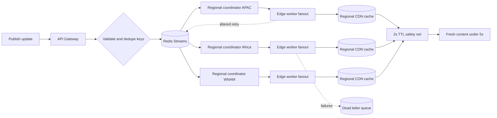

| Difficulty | Channel | Tags |
|---|---|---|
| intermediate | system-design | edge, caching, purging |

Picture a customer in Australia publishing a breaking-news update while readers keep seeing yesterday's headline — because the invalidation has to crawl across the Pacific to a core data center and back. That was the daily reality of Cloudflare's decade-old purge system, which funneled every invalidation through a handful of central cores via its Quicksilver config-distribution system [1]. As the network grew past 330 cities, millions of daily API calls pushed Quicksilver against its write ceiling, and the Kafka queues bolted on to cope only added more latency [1]. The fix did not involve faster cables; it involved moving the decision itself to the edge, and the results rewrote what teams consider an acceptable 5-second SLA.

---

> ### Real-World Case — Cloudflare
>
> Cloudflare's decade-old cache purge system routed every invalidation through a few central 'core' data centers via its Quicksilver config-distribution system. As the network grew past 270 then 330 cities, a customer in Australia had to send a purge across the Pacific and back before local content updated, while millions of daily API calls saturated Quicksilver's write limit — so Kafka queues and heavier batching were bolted on, adding even more latency.
>
> | | |
> |---|---|
> | **Challenge** | Deliver near-speed-of-light global propagation (they set a 200ms theoretical target) and scale throughput, while purge-history storage replicated to every machine was eating disk space that should have been caching customer content, and maintain consistency despite data centers going offline or being unreachable. |
> | **Solution** | They built 'Coreless Purge': API Gateway and Purge Ingest Workers moved auth/validation to the nearest edge and filtered out the >50% of purge URLs that weren't even cacheable for that zone; dozens of regional Durable Objects per region acted as persistent, replayable purge queues with a Regional Autoscaler keeping each one in its throughput 'goldilocks zone'; regional Purge Fanout Workers fan requests out to per-region data centers, and CacheDB — a Rust sidecar on every machine built on RocksDB — indexes cached files by tag/host/URL so purges actively delete from disk and a quick pending-purge-queue check on each cache HIT forces a MISS instantly even for multi-million-file purges. |
> | **Outcome** | Global purge-by-tag/host/prefix P50 fell from 1,570ms to 149ms (a 90.5% improvement) by Aug 2024, across 330+ cities in 120+ countries — e.g. Africa 1,420ms→303ms, APAC 1,300ms→199ms, WNAM 1,000ms→115ms. The fanout worker alone cut end-to-end latency 50% and tripled throughput; eliminating the lazy-purge long tail saved 10x storage, improving cache hit ratios; Enterprise now allows 5,000 purge keys/second (100 keys/request), and single-file purge P50 hit 234ms. |
> | **Lesson** | The bottleneck wasn't the code — it was centralization. Throwing out the 'core' and pushing state to regional Durable Objects plus per-machine RocksDB indexes beat trying to speed up a globally fast config system that was never meant to absorb write-heavy purge traffic. Two counterintuitive wins: over half of all purge requests were junk that could be dropped at the edge, and the last-mile fanout topology mattered more than raw compute. |

---

## Hook — The purge that crossed an ocean

Ever wondered why a 'global' purge can feel stubbornly local? Consider the Australian customer above: the origin had the new bytes, the CDN was healthy, yet stale content lingered while the invalidation made a round trip to a core data center [1]. The stakes are not academic — stale prices, leaked feature flags, or a security revocation that refuses to die can turn a routine deploy into a 3am incident. Many developers meet cache invalidation as a footnote in a caching tutorial; the old joke says it is one of the two hard problems in computer science, and it is the one that actually carries a pager. Here is the twist that sets up everything else: the bottleneck was never bandwidth. It was the shape of the system.

## Problem — 10,000 invalidations per second against a single brain

Building on that tension, the brief sounds almost unreasonable on paper: propagate globally in under 5 seconds, absorb 10,000 invalidations per second, hold 99.99% availability, and still claim strong consistency across regions. A central control plane makes those requirements fight each other. Every purge writes to a small set of core nodes, so throughput is capped by the config store's write ceiling rather than by the 330+ edge locations waiting for instructions [1][2]. Web caches trade freshness for speed by design, serving stored copies until a TTL or an invalidation says otherwise [3]. Queues help with durability but not with distance: a Kafka buffer makes the backlog orderly, not shorter [8].

⚠️ Watch Out: adding consumers to a saturated central queue is like adding lanes to a highway whose only exit is a single toll booth. The pain shows up wherever freshness is a feature — flash-sale pricing, newsroom corrections, feature-flag kill switches, compliance deletes. When would you actually use this design? Any team whose content changes faster than its TTL, or whose job depends on a credible global 'this is wrong now' signal. The uncomfortable question is whether a 5-second SLA can survive an architecture where every request asks permission from the same small room.

## Real-World Case — Cloudflare

This leads directly to Cloudflare's own reckoning. For roughly a decade, purge requests traveled through a handful of central core data centers using Quicksilver, the company's config-distribution system [1]. As the network grew past 270 and then 330 cities in 120+ countries, customers in places like Australia paid a transpacific round trip before local content updated, while millions of daily API calls pushed Quicksilver toward its write limit [1]. The team bolted on Kafka queues and heavier batching; those changes bought stability and quietly added latency — a classic case of the workaround becoming part of the problem [1][8].

Then the fix flipped the model: fanout moved to the edge, lazy-purge tail behavior was removed, and regional coordination replaced the single brain. By August 2024, global purge-by-tag/host/prefix P50 had dropped from 1,570ms to 149ms, a 90.5% improvement [1]. Region by region, the story is even more vivid: Africa fell from 1,420ms to 303ms, APAC from 1,300ms to 199ms, and Western North America from 1,000ms to 115ms [1].

🔥 Hot Take: the fanout worker alone cut end-to-end latency by 50% and tripled throughput, which suggests most 'latency problems' are really topology problems wearing a trench coat [1]. And the plot twist worth remembering: eliminating the lazy-purge long tail saved 10x storage and improved cache hit ratios. Faster invalidation made caching better. Enterprise plans now allow 5,000 purge keys per second at 100 keys per request, with single-file purge P50 at 234ms [1].

## Deep Dive — What actually makes a purge fast

However, copying that outcome requires understanding what really makes a purge slow. Three clocks matter: the time to accept and deduplicate the request, the time to fan it out to every relevant region, and the time for each cache to stop serving the old object. Most designs optimize the first clock and then act surprised when the second one dominates.

💡 Insight: treat invalidation as a data-plane problem with a thin control plane, not as a config write that happens to touch caches. Edge workers build on the service-worker execution model, running coordination logic close to users instead of in one central region [9].

A regional coordinator owns a Redis Stream consumer group, so each region keeps its own durable cursor and can lag independently without blocking its peers [7]. Edge workers perform fanout in 100-key batches — the same ceiling Cloudflare's Enterprise API exposes — turning 10,000 keys per second into roughly 100 API calls instead of 10,000 [1][4]. Wildcard prefix purges shrink payloads further, but they also widen the blast radius, so deduplicate before dispatch.

Here is the real tradeoff:

| Decision | Option A | Option B | What actually matters |
| --- | --- | --- | --- |
| Fanout | Central control plane | Regional edge coordinators | A: simple, capped by core writes. B: ~50% lower latency, 3x throughput [1] |
| Freshness | TTL only | TTL plus explicit purge | A: cheap but stale windows. B: 2s TTL as a safety net, purge for certainty [5][6] |
| Request shape | One key per call | 100 keys per call | A: ~10,000 calls/sec. B: ~100 calls/sec, far lower API cost |
| Consistency | Strong everywhere | Eventual plus reconciliation | A: blocks on the slowest region. B: per-region P50 targets plus repair loop [10] |

⚠️ Watch Out: `Cache-Control: max-age=2, must-revalidate` is a seatbelt, not a strategy — HTTP caching semantics still require revalidation, so a purge that never arrives leaves a two-second stale window by design [5][6].

Battle scars from real deployments, and how to dodge them:
- Purging `/*` because it is easy: triggers stampedes and evicts hot objects. Purge the narrowest prefix that is actually wrong.
- Retrying immediately: synchronized retries turn a single 429 into a self-inflicted DDoS. Use full jitter and cap retries at three [4].
- Treating all regions identically: a purge for EU content does not need an APAC fanout. Smart invalidation cuts cross-region traffic.
- Assuming strong consistency: partitions happen. Reconciliation loops, the kind Kubernetes controllers formalize, repair drift after the partition heals [10].

🎯 Key Point: if one region misses a purge, the system must converge without taking every other region down with it.

## Workflow — From publish event to 149ms

Building on those trade-offs, the workflow is less like a broadcast and more like a well-organized relay race. The Mermaid diagram labeled 'Invalidation Flow' below traces the path from a publish event to fresh bytes in under five seconds.

1. Accept and validate — the API gateway authenticates the request and rejects overly broad patterns before they reach any queue.
2. Deduplicate and enqueue — repeated keys collapse into one entry; Redis Streams consumer groups give each region an independent cursor [7].
3. Regional coordination — coordinators for APAC, Africa, and WNAM pull concurrently, so the slowest ocean does not hold the others hostage.
4. Edge fanout — each coordinator hands 100 keys to an edge worker, which calls the CDN provider's purge API in parallel [4].
5. Cache response — CloudFront or Cloudflare invalidates matching objects, while the 2-second TTL and `must-revalidate` header cover objects the purge misses [5][6].
6. Failure handling — 429s and 5xx responses retry with exponential backoff and jitter; after five consecutive failures the circuit opens, and poison entries land in a dead letter queue for replay.
7. Reconciliation — a periodic sweep compares expected purge state against regional state and repairs drift, the same controller pattern Kubernetes uses [10].

Notice step 3 is the real plot twist: the system stops asking 'how fast can the center tell everyone?' and starts asking 'how fast can everyone act on what they already know?' That question is exactly what the next section answers in code.

## Code Example — A batch purger that survives bad days

This leads to an implementation you can adapt rather than admire from a distance. The complete JavaScript lives in the codeExample block; here is the walkthrough, line by line.

- `BATCH_SIZE = 100` mirrors the documented Enterprise ceiling, keeping each request small enough to be cheap and large enough to amortize overhead [1].
- `jitter()` applies full jitter so 1,000 workers waking after a 429 do not retry in lockstep.
- `purgeBatch()` posts `{ files: keys }` to a CDN purge endpoint, labels 429/5xx as retryable, and resets the failure counter on success [4].
- `purgeWithRetry()` allows three retries, then writes the keys and region to a dead letter queue instead of looping forever.
- `consecutiveFailures` implements the circuit breaker: five failures in a row fail fast, protecting both the CDN and the queue consumers.
- `drainQueue()` reads in batches, fans out to every regional endpoint, and acknowledges only after a region confirms success.

The important design decision is acknowledgement discipline: a purge is not 'done' when it is queued, it is done when the region confirms it. That single choice trades a little duplicate work for a system that can actually explain itself during an incident. Sound familiar if you have ever debugged a queue that claimed success while users disagreed?

## Lessons Learned — Topology, tails, and trust

Looking back at the journey — from a stale headline in Australia to a 149ms global P50 — the lessons are less about any single CDN and more about where decisions live.

- Topology beats tuning. Moving fanout to the edge cut latency 50% and tripled throughput; no amount of queue tweaking would have done that [1].
- Measure per region. A single global average hides the 1,420ms Africa tail that users actually feel [1].
- Batch aggressively, but narrowly. 100 keys per request cuts roughly 90% of API cost without turning every purge into a cache-wide eviction [1][4].
- Keep a TTL safety net. Two seconds of `max-age=2, must-revalidate` is cheap insurance against the purge that never lands [5][6].
- Design for partitions. Eventual consistency plus reconciliation is not a compromise; it is the only honest contract across 330+ cities [1][10].

Battle scars worth writing on a sticky note: never retry without jitter, never acknowledge before confirmation, never purge a wildcard you cannot defend in code review, and never let a central config store become the heartbeat of the data plane.

🎯 Key Point: caches fail in the gaps between intention and propagation. The job is to shrink those gaps and make the remaining ones observable.

---

## Invalidation Flow

<strong>Original Interview Question</strong>

**Q:** How would you design a multi-region CDN cache purging system that guarantees content propagation within 5 seconds while handling 10,000 concurrent invalidations per second?

**A:** Implement Cloudflare API + AWS CloudFront with distributed invalidation queue, edge compute coordination, and 2-second TTL. Use batch invalidation, exponential backoff, and regional cache headers for 5-second SLA.

## Conclusion

The Australian customer's stale headline was never a bandwidth problem; it was an architecture that made every edge ask a distant core for permission. Cloudflare's 1,570ms-to-149ms journey proves that when purges become a data-plane concern — regional coordinators, edge fanout, 100-key batches, jittered retries, and a 2-second safety net — a 5-second SLA stops being a wish and becomes a measurement [1]. Here is the one insight to take into your next design review: purging is a data-plane problem wearing a control-plane costume. Tomorrow, instrument purge P50 per region, narrow batches to 100 keys, move fanout as close to the edge as the provider allows, and add a reconciliation loop before the next incident does it for you. The 3am page is optional; the architecture chosen today decides whether it ever arrives.

---

## References

1. [Cloudflare incident report](https://blog.cloudflare.com/instant-purge) — article
2. [Content delivery network - Wikipedia](https://en.wikipedia.org/wiki/Content_delivery_network) — documentation
3. [Web cache - Wikipedia](https://en.wikipedia.org/wiki/Web_cache) — documentation
4. [Amazon CloudFront - Invalidating files](https://docs.aws.amazon.com/AmazonCloudFront/latest/DeveloperGuide/Invalidation.html) — documentation
5. [MDN - Cache-Control header](https://developer.mozilla.org/en-US/docs/Web/HTTP/Headers/Cache-Control) — documentation
6. [RFC 9111 - HTTP Caching](https://datatracker.ietf.org/doc/html/rfc9111) — documentation
7. [Redis - Wikipedia](https://en.wikipedia.org/wiki/Redis) — documentation
8. [Apache Kafka - Wikipedia](https://en.wikipedia.org/wiki/Apache_Kafka) — documentation
9. [MDN - Service Worker API](https://developer.mozilla.org/en-US/docs/Web/API/Service_Worker_API) — documentation
10. [Kubernetes - Controller pattern](https://kubernetes.io/docs/concepts/architecture/controller/) — documentation

---

**Author:** Satishkumar Dhule — [GitHub](https://github.com/satishkumar-dhule) · [LinkedIn](https://linkedin.com/in/satishkumar-dhule) · [Website](https://satishkumar-dhule.github.io)
