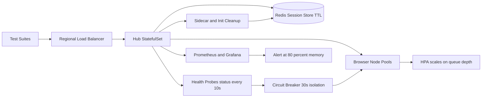

| Difficulty | Channel | Tags |
|---|---|---|
| advanced | system-design | selenium, webdriver, grid |

Picture 350 Jenkins executors grinding through 9,000 UI tests, stale browsers hanging around like uninvited houseguests, and suites that took hours to finish. That was Expedia Group's reality until late 2014, when orphaned browsers wedged their executors and turned a 300-test suite into a 90-minute ordeal [1]. The team set a goal that sounded almost reckless: run every UI test within the runtime of the slowest single test case. What they built—a distributed automation platform that later grew to 90+ hubs and 150,000+ tests per day—is the blueprint every team scaling Selenium Grid eventually rediscovers [1].

---

> ### Real-World Case — Expedia Group
>
> Until late 2014, Expedia's ~9,000 UI automation tests ran directly on 350+ Jenkins executors; stale browsers hung on those executors and made them unusable, and suites took hours. The team set a goal of running every UI test within the runtime of the slowest single test case.
>
> | | |
> |---|---|
> | **Challenge** | Build a Selenium Grid that could elastically provision hundreds of browser nodes on demand, recover from hung/stale sessions, avoid resource leaks between runs, and keep costs down instead of paying for idle capacity. |
> | **Solution** | They built SeleniumGridScaler (Selenium Grid wired to the AWS EC2 API): a hub accepts a requested thread count, spins up exactly the needed nodes, attaches them, and terminates them when idle or on demand; a 'reaper' thread kills unregistered instances so leaked nodes can't accumulate. They later moved the same pattern to Kubernetes/Docker/Helm/Traefik (DA Kube) with disposable nodes created per test and destroyed afterward. Counterintuitively, they packed 15 Chrome/Firefox sessions per EC2 box rather than one, and discovered the Dockerized hub itself caused stability failures at high concurrency, so they reverted to running the hub as a plain Java process. |
> | **Outcome** | From hundreds of Jenkins jobs taking hours to ~1,000 UI tests in about 5 minutes; a typical 300-test suite dropped from ~90 minutes to minutes. The platform grew to 90+ hubs owned by different teams running 150,000+ tests per day, with nodes billed per second and torn down after each run (pay only for what you use). |
> | **Lesson** | At high concurrency, the grid infrastructure itself becomes the bottleneck: node lifecycle, disposal, and hub networking matter more than raw CPU. Treat browser sessions as disposable cloud capacity with guaranteed teardown — fresh node per test beats trying to clean up a long-lived one. |

---

## Hook — The Browser That Never Left

Ever found yourself staring at a hung browser at 3 AM, wondering why a suite that should take minutes is still churning hours later? That browser—stale, orphaned, and stubbornly refusing to die—is the villain in almost every Selenium Grid horror story [2]. The stakes are bigger than a slow build: when UI tests become unreliable, teams stop trusting them, and a safety net quietly turns into a trapdoor. 💡 Insight: the hard part of running 10,000 concurrent sessions is not starting them—it is finishing them cleanly, every single time. So what does it actually take to keep a grid healthy at that scale? The answer starts with understanding the problem underneath the problem.

## Problem — When Success Becomes the Bottleneck

Building on that tension, the real challenge is not browser automation itself—Selenium has handled that for years [2]. The headache begins when thousands of sessions collide with finite CPU, memory, and network capacity across multiple data centers. Picture 10,000 concurrent test sessions: each browser eats roughly 2GB of RAM, connections churn constantly, and one leaked session can cascade into node exhaustion. Many developers discover the hard way that a grid without strict lifecycle management leaks memory like a faucet nobody turned off. ⚠️ Watch Out: stale sessions are silent killers—they rarely throw errors, they just quietly consume resources until everything grinds to a halt. Moreover, nodes fail, networks partition, and deploy days get interesting fast. The question becomes: how does a system stay alive when its own parts refuse to cooperate?

## Real-World Case — Expedia Group

This is where the Expedia Group story earns its place. Until late 2014, roughly 9,000 UI automation tests hammered away on 350+ Jenkins executors [1]. Stale browsers latched onto those executors and rendered them unusable, and suites dragged on for hours. The team set a goal that sounded almost reckless: run every UI test within the runtime of the slowest single test case. 🔥 Hot Take: the winning move was not 'more hardware'—it was treating browsers as disposable, billed-per-second resources torn down after every run. The result was dramatic: about 1,000 UI tests ran in roughly 5 minutes, and a typical 300-test suite fell from ~90 minutes to a handful of minutes [1]. Over time that platform grew to 90+ hubs owned by different teams, executing 150,000+ tests per day. But scaling from a clever internal tool into a multi-team platform introduced a whole new set of monsters—which is exactly where the architecture deep dive begins.

## Deep Dive — The Architecture Behind the Numbers

Building on Expedia's trajectory, the architecture that survives this growth rests on a handful of deliberate decisions. First, the hub-node pattern places a central hub—managed by Kubernetes StatefulSets—over browser nodes spread across availability zones [4]. Second, session state lives in Redis with TTL-based expiration, so forgotten sessions evaporate instead of accumulating [5]. Here is the tradeoff that trips up most teams:

| Option | Why it looks good | The real tradeoff |
| --- | --- | --- |
| Static node pool | Predictable and simple | Wastes money at 3 AM, collapses under 10,000-session spikes |
| HPA on queue depth [3] | Scales with demand | Needs careful metrics or it oscillates like a yo-yo |
| Redis TTL sessions [5] | Auto-cleanup, no leaks | Adds a network hop and a new failure domain |
| Rolling restarts [8] | Curbs memory creep | Must respect disruption budgets or capacity disappears |

Now the numbers, because architecture without arithmetic is just opinion. At 50 sessions per node, 10,000 sessions demand 200 nodes minimum. At 2GB each, that is 400GB baseline memory, plus a 30% buffer for roughly 520GB cluster memory. Availability of 99.9% allows only about 43 minutes of downtime per month—hence multi-AZ failover and Pod Disruption Budgets that preserve at least 85% capacity [7]. 🎯 Key Point: circuit breakers [9] isolate a sick node for a 30-second recovery window instead of letting it poison the entire grid. Prometheus scrapes memory metrics continuously [6], while probes check the /status endpoint every 10 seconds, removing a node after three consecutive failures [10]. When would you actually use all this? Any time flaky UI tests cost more than the platform—think release trains, compliance suites, or anywhere a red build blocks shipping.

## Workflow — From Test Submission to Clean Teardown

Consequently, the solution is less a single component and more a choreographed flow. The Mermaid diagram below maps the journey from test submission to clean teardown:

1. Incoming suites hit a regional load balancer using weighted round-robin based on node capacity and response time.
2. The hub, running as a StatefulSet [4], registers each session in Redis with a TTL so abandoned work self-expires [5].
3. The scheduler picks a healthy node, while the horizontal pod autoscaler watches queue depth and expands node pools in step with demand [3].
4. Health probes poll /status every 10 seconds; three failures trip the circuit breaker and isolate that node for 30 seconds [9] [10].
5. Sidecar and init containers scrub stale volumes, and Prometheus feeds Grafana dashboards that alert at 80% memory [6].
6. On completion—success or failure—the session key is deleted and the node is released back to the pool.

💡 Insight: network partitions are handled with leader election to prevent split-brain, and canary deployments split traffic for new node versions so a zero-day bug never takes the whole fleet at once. But orchestration alone cannot save you if the cleanup logic is wrong—which brings the discussion down to actual code.

## Code Example — Session Lifecycle with TTL and Circuit Breaking

Bringing this to life, the snippet below models the session lifecycle and node isolation pattern used earlier. It is illustrative Python, but it mirrors production patterns: Redis-backed TTL sessions, explicit cleanup, and a 30-second circuit breaker.

```python
import time
import redis

# Redis client for distributed session state with TTL expiry
r = redis.Redis(host='redis-cluster', port=6379, db=0, decode_responses=True)

SESSION_TTL = 300  # seconds before a forgotten session auto-expires

class NodeStats:
    def __init__(self):
        self.sessions = 0
        self.memory_pct = 0.0
        self.failures = 0
        self.isolated_until = 0.0

class GridNodePool:
    def __init__(self, nodes):
        self.nodes = {name: NodeStats() for name in nodes}

    def register(self, node, session_id):
        # TTL keeps zombie sessions from leaking memory on the node
        r.setex('session:' + session_id, SESSION_TTL, node)
        self.nodes[node].sessions += 1

    def release(self, node, session_id):
        # Explicit cleanup on BOTH success and failure paths
        r.delete('session:' + session_id)
        self.nodes[node].sessions = max(0, self.nodes[node].sessions - 1)

    def is_healthy(self, node):
        s = self.nodes[node]
        # Circuit breaker: 30s cooldown after three strikes
        if time.time() < s.isolated_until:
            return False
        return s.memory_pct < 80 and s.failures < 3

    def record_failure(self, node):
        s = self.nodes[node]
        s.failures += 1
        if s.failures == 3:
            s.isolated_until = time.time() + 30
```

⚠️ Watch Out: calling `release()` in a `finally` block is non-negotiable—forgetting the failure path is exactly how the Expedia-style stale-browser problem returns. The walkthrough below explains each section in detail.

## Lessons Learned — Battle Scars and the Next Move

After tracing the whole journey, a few truths stand out. 🎯 Key Point: capacity planning without cleanup is just expensive theater—200 nodes mean nothing if stale sessions eat 30% of them. Common battle scars include autoscalers flapping because queue-depth metrics were never smoothed, Redis TTLs set longer than test duration, and circuit breakers with no half-open recovery probe. Many teams also skip Pod Disruption Budgets, then wonder why a routine rolling update dropped them below 85% capacity [7]. 💡 Insight: the counterintuitive lesson is that aggressive teardown—not aggressive provisioning—is what buys reliability; ephemeral, billed-per-second nodes turn failures into cheap events instead of incidents. HPA, probes, and dashboards are not extras here, they are the guardrails that make 99.9% uptime believable [3] [6] [10]. So what changes tomorrow? Start by measuring session lifetime and memory drift on one grid, add a TTL you can trust, and put a circuit breaker around your least-stable node pool.

---

## Scalable Selenium Grid Architecture



<details>
<summary><strong>Original Interview Question</strong></summary>

**Q:** Design a scalable Selenium Grid architecture to handle 10,000 concurrent test sessions with 99.9% uptime, ensuring zero memory leaks through automatic session lifecycle management, real-time monitoring, and graceful node failure recovery across multiple data centers?

**A:** Deploy Kubernetes cluster with auto-scaling node pools, Redis session store with TTL policies, Prometheus metrics for memory monitoring, circuit breakers for node isolation, and sidecar containers for session cleanup. Implement health checks, resource quotas, and rolling updates.

</details>

## Conclusion

The journey began with a hung browser at 3 AM and a team staring at 9,000 tests that took hours [1]. It ends with a different mental model: browsers are disposable, sessions have an expiry date, and nodes earn the right to stay in the pool by passing constant health checks. Expedia Group proved the payoff—~1,000 tests in ~5 minutes and 150,000+ tests a day across 90+ hubs [1]. The one memorable insight to share with your team: reliability at 10,000 concurrent sessions comes from how aggressively you clean up, not how much hardware you throw at the problem. Tomorrow, pick one grid, measure session lifetime and memory drift, add a TTL you trust, and wrap your flakiest node pool in a circuit breaker—then watch the 3 AM pages quietly disappear.

---

## References

1. [Expedia Group incident report](https://medium.com/expedia-group-tech/distributed-automation-how-to-run-1000-ui-automation-tests-in-5mins-cf9a84ca32d1) — article
2. [Selenium (software) - Wikipedia](https://en.wikipedia.org/wiki/Selenium_(software)) — documentation
3. [Horizontal Pod Autoscaling - Kubernetes Documentation](https://kubernetes.io/docs/tasks/run-application/horizontal-pod-autoscale/) — documentation
4. [StatefulSets - Kubernetes Documentation](https://kubernetes.io/docs/concepts/workloads/controllers/statefulset/) — documentation
5. [redis/redis GitHub Repository](https://github.com/redis/redis) — documentation
6. [prometheus/prometheus GitHub Repository](https://github.com/prometheus/prometheus) — documentation
7. [Specifying a Disruption Budget - Kubernetes Documentation](https://kubernetes.io/docs/tasks/run-application/configure-pdb/) — documentation
8. [Resource Management for Pods and Containers - Kubernetes Documentation](https://kubernetes.io/docs/concepts/configuration/manage-resources-containers/) — documentation
9. [Circuit breaker design pattern - Wikipedia](https://en.wikipedia.org/wiki/Circuit_breaker_design_pattern) — documentation
10. [Configure Liveness, Readiness and Startup Probes - Kubernetes Documentation](https://kubernetes.io/docs/tasks/configure-pod-container/configure-liveness-readiness-startup-probes/) — documentation

---

**Author:** Satishkumar Dhule — [GitHub](https://github.com/satishkumar-dhule) · [LinkedIn](https://linkedin.com/in/satishkumar-dhule) · [Website](https://satishkumar-dhule.github.io)
