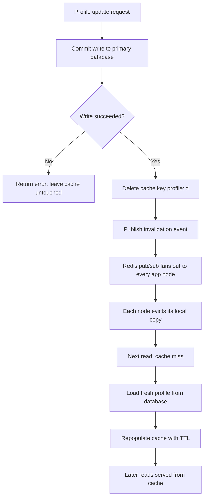

| Difficulty | Channel | Tags |
|---|---|---|
| beginner | backend | redis, memcached, cache-invalidation |

Picture a home feed quietly consuming 30% of an entire company's database budget. That was Shopify's Shop app: millions of merchants and dozens of carriers feeding one screen, until a naive cache gave up under a relentless stream of writes [1]. Six weeks later, database load fell 15%, GraphQL latency dropped about 20%, and stale data stayed at zero. The lesson is not that caching is easy — it is that invalidation is where architectures either grow up or fall over.

---

> ### Real-World Case — Shopify
>
> Shopify's Shop app (tens of millions of users) had a home feed aggregating orders from millions of merchants and dozens of carriers that consumed 30% of the company's entire database load, degrading performance across the whole application. Naive read-through caching was useless because the feed was updated by a constant stream of concurrent writes.
>
> | | |
> |---|---|
> | **Challenge** | Build a cache that would not be invalidated on every write yet never serve stale data, while handling simultaneous order updates for the same user from multiple worker machines and safely recovering from workers that crash mid-write. |
> | **Solution** | They built a custom write-through cache on Memcached that marks a user's feed invalid BEFORE the database write and revalidates it after success, using a 'pending writes' counter key incremented/decremented around each write so the cache is only valid at zero, plus a short-TTL sentinel key to detect crashed workers that failed to decrement. They deliberately chose Memcached over Redis because they needed simple, low-overhead key/value operations rather than Redis's complex data structures, and wired it in transparently via Active Record concerns. |
> | **Outcome** | Built in about six weeks: database load dropped 15%, overall app/GraphQL latency fell about 20%, and CPU usage fell by a double-digit percentage, with a staged experiment confirming zero stale-data discrepancies before global rollout. |
> | **Lesson** | Counterintuitively, invalidating before the write (and tracking in-flight writes with a counter) beats delete-after-write for high-update-rate data; and the 'more powerful' cache isn't always right — Shopify rejected Redis pub/sub and data structures in favor of simpler Memcached with application-level coordination. |

---

## Hook — The dashboard that looked fine until it wasn't

Everything looked healthy. The feed rendered, the graphs were green, and then the database started groaning. Shopify's Shop app had grown into a home feed aggregating orders from millions of merchants and dozens of carriers, and that single screen was consuming roughly 30% of the company's entire database load [1]. A cache had been added. It did almost nothing. Why? Because the feed was being rewritten continuously while a plain read-through cache politely waited for misses that never stayed missed. Sound familiar? Teams have all been there: staring at a calm dashboard while latency quietly climbs.

## Problem — Caching is easy until writes show up

Building on that tension, here is the uncomfortable truth: caching a read-heavy endpoint is the easy part, and keeping it correct under write pressure is the real job. A cache-aside read path looks elegant on a whiteboard — check the cache, hit the database on a miss, fill the cache, move on [2]. However, the moment profiles start changing constantly, that same path becomes a stale-data factory. Moreover, every invalidation decision is a bet: delete too eagerly and the database eats the load; delete too rarely and users see last week's bio. 💡 Insight: the hard part is not storing data closer to users, it is deciding when that copy is no longer allowed to exist. Even HTTP caching has wrestled with this freshness problem for decades [5], and the rules are just as unforgiving in a backend service. So what happens when thousands of updates per minute make the decision for you?

## Real-World Case — Shopify

This leads directly to Shopify's six-week experiment. The Shop app's home feed stitched together order data from millions of merchants and dozens of carriers, and that aggregate work alone accounted for about 30% of total database load [1]. Naive read-through caching collapsed because the feed changed faster than any sensible TTL could track. Instead of accepting the load, the team built a custom caching layer shaped around how the feed actually updated. Managed data stores alone were not the answer — the coordination logic was [6]. Consequently, database load fell by roughly 15%, overall app and GraphQL latency dropped around 20%, and CPU usage fell by a double-digit percentage. 🔥 Hot Take: the most impressive number was not the speedup, it was that a staged rollout confirmed zero stale-data discrepancies before going global. That is the bar: not 'looks fine,' but 'proven fresh.'

## Deep Dive — Write-through, TTLs, and the Redis vs Memcached split

However, Shopify's fix only makes sense once the invalidation vocabulary is clear. Write-through caching means the write path updates the database and the cache together, so a successful update leaves no old copy behind [3]. Cache-aside handles reads: on a miss, load from the database and repopulate with a TTL. But here is the twist that trips up even experienced developers: deleting the key on update is usually safer than overwriting it. Two concurrent writers can race, and an overwrite from the slower writer can resurrect stale values. 🎯 Key Point: 'delete, do not update' is the cheapest correctness insurance in caching. TTLs act as the seatbelt — 5 to 30 minutes for profiles means a missed invalidation event self-heals instead of haunting production forever [9].

Option A vs Option B — here is the real tradeoff:

| Concern | Redis | Memcached |
|---|---|---|
| Distributed invalidation | Pub/sub fans out automatically to every node [3] | Manual coordination across nodes [4] |
| Persistence | Optional durability, so a restart need not mean a cold cache | Pure in-memory, no persistence |
| Data model | Strings, hashes, sets, streams | Simple key-value strings |
| Memory overhead | Higher | Lower and leaner for raw caching |
| Scaling story | Rich clustering tooling [7] | Straightforward horizontal scaling [8] |
| Best fit | Complex invalidation patterns and durability | High-volume, no-frills key-value reads |

⚠️ Watch Out: 'Redis is faster' is a lazy take. For pure string gets, Memcached's simpler architecture is often cheaper and quicker; Redis wins when invalidation logic is the problem, not the get itself. Managed platforms blur this further — AWS ElastiCache offers both engines [6] — so the decision is really about coordination complexity, not benchmark theater. When would each apply? Choose Redis when several app servers must agree instantly on what is stale. Choose Memcached when one cache does one job and extra features would be dead weight.

## Workflow — From update request to fresh read

Building on those tradeoffs, the end-to-end flow is deliberately boring — and that is the point. The diagram below, Cache Invalidation Flow, traces one profile update from request to fresh read. 1) The update lands and the database commits first. 2) The service deletes the cache key rather than rewriting it. 3) An invalidation event is published so every node drops its local copy — exactly the fan-out Redis pub/sub was built for [3]. 4) The next read misses, reloads from the database, and repopulates with a TTL. 5) Later reads are served from cache until the next event or expiry. Shopify's staged rollout followed this discipline before going globally live [1]. 💡 Insight: ordering matters. Commit first, invalidate second; reversing it can delete a key for data that never reached the database. Managed Redis makes the fan-out convenient [6], but the correctness discipline is entirely yours.

## Code Example — A production-shaped Python implementation

Here is the thing though: patterns only earn their keep in code. The implementation in the codeExample field uses Python with redis-py and mirrors the workflow above. get_profile implements cache-aside — cache.get tries the fast path, and on a miss db.fetch_profile pays the database cost before cache.setex stores the value with a 15-minute TTL. update_profile implements write-through: db.update_profile commits first, cache.delete removes the stale entry instead of overwriting it, and cache.publish broadcasts the user id so other nodes can evict. listen_for_invalidations subscribes to that channel and pops the user's entry from each node's in-process dictionary. 🔥 Hot Take: publishing after delete is not redundancy — shared Redis and a local in-process cache are two different layers, and both must be told. redis-py's pub/sub primitives keep this compact [7], and the same channel pattern works with any Redis client [3].

## Lessons Learned — The battle scars worth keeping

Consequently, the journey from a groaning feed to a 20% latency drop is mostly a series of small, unglamorous decisions. Battle scars worth remembering: first, never invalidate before the database commit, or a rollback leaves a cache confidently serving fiction. Second, treat TTL as a backstop, not a strategy — 5 to 30 minutes for profiles keeps missed events from becoming permanent staleness [9]. Third, do not assume the faster key-value store is the better cache; Memcached's simplicity is a feature until coordination becomes the bottleneck [4]. Fourth, measure hit rates and staleness separately — Shopify's staged rollout proved zero discrepancies before global traffic [1]. When would developers actually use this? Any multi-node service with user profiles, product catalogs, or settings that update often enough that a stale copy is worse than a database hit. 🎯 Key Point: the line to share at the next standup — 'cache invalidation is not a cache problem, it is a write-path problem.'

---

## Cache Invalidation Flow

<strong>Original Interview Question</strong>

**Q:** You're building a user profile service that caches frequently accessed profiles. How would you implement cache invalidation when a user updates their profile, and what trade-offs would you consider between Redis and Memcached?

**A:** Implement write-through caching with TTL-based expiration. On profile update, invalidate the cache by deleting the key and writing new data to both the database and cache. Redis offers pub/sub for automatic distributed invalidation, while Memcached requires manual coordination across nodes.

## Conclusion

Circle back to that home feed eating 30% of Shopify's database [1]. The transformation was not a heroic rewrite — it was recognizing that reads were never the real problem; writes were. The journey ran from a green-but-lying dashboard, through stale-data fear, to a flow of commit, delete, publish, expire, and out the other side into 15% less load and 20% lower latency. Tomorrow, audit one write path, delete instead of overwrite, set a sane TTL, and publish an invalidation event. Your database — and your on-call rotation — will notice. The next time someone says 'just add Redis,' ask which copy is allowed to be wrong, and for how long.

---

## References

1. [Shopify incident report](https://shopify.engineering/shop-app-custom-caching-solution) — article
2. [Cache (computing) — Wikipedia](https://en.wikipedia.org/wiki/Cache_(computing)) — documentation
3. [Redis — Wikipedia](https://en.wikipedia.org/wiki/Redis) — documentation
4. [Memcached — Wikipedia](https://en.wikipedia.org/wiki/Memcached) — documentation
5. [HTTP caching — MDN Web Docs](https://developer.mozilla.org/en-US/docs/Web/HTTP/Caching) — documentation
6. [What is Amazon ElastiCache? — AWS Documentation](https://docs.aws.amazon.com/elasticache/latest/developerguide/what-is.html) — documentation
7. [redis/redis — GitHub repository](https://github.com/redis/redis) — documentation
8. [memcached/memcached — GitHub repository](https://github.com/memcached/memcached) — documentation
9. [RFC 9111: HTTP Caching](https://datatracker.ietf.org/doc/html/rfc9111) — documentation

---

**Author:** Satishkumar Dhule — [GitHub](https://github.com/satishkumar-dhule) · [LinkedIn](https://linkedin.com/in/satishkumar-dhule) · [Website](https://satishkumar-dhule.github.io)
