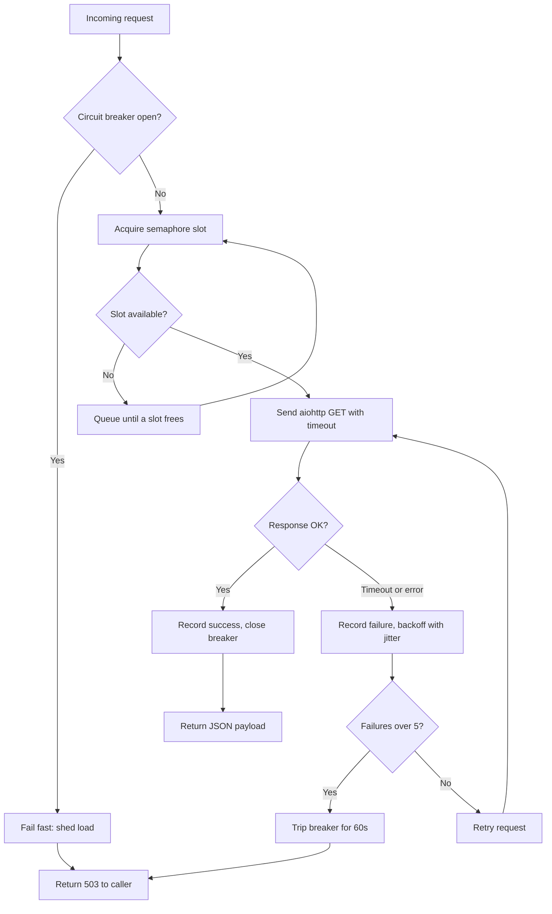

| Difficulty | Channel | Tags |
|---|---|---|
| advanced | backend | asyncio, aiohttp, concurrency |

Around 2011, Netflix's API was swallowing more than one billion incoming calls a day and fanning each one out roughly sixfold into dozens of backend subsystems, peaking above 100,000 dependency requests per second across thousands of EC2 instances [1]. The terrifying part was not the volume; it was that one slow dependency could pin every Tomcat request thread in seconds and take the whole API down. That is the moment the team stopped trusting infrastructure to absorb failure and started engineering fault tolerance into the architecture itself [1]. Sound familiar? If you have ever watched a healthy service collapse because one downstream call got sleepy, the rest of this story is yours.

---

> ### Real-World Case — Netflix
>
> Around 2011, Netflix's API handled over 1 billion incoming calls per day, fanning out at a 1:6 ratio into several billion calls to dozens of backend subsystems, with peaks above 100,000 dependency requests per second across thousands of EC2 instances. Because a single latent dependency could block every Tomcat request thread in seconds and take down the whole API, the team had to engineer fault tolerance into the architecture rather than trust infrastructure to absorb it.
>
> | | |
> |---|---|
> | **Challenge** | Prevent cascading failures and thread/connection exhaustion when one downstream service becomes slow or fails, while limiting concurrency per dependency, enforcing timeouts, retrying transient failures, and still returning useful responses instead of errors. |
> | **Solution** | They built DependencyCommand, open-sourced in 2012 as Hystrix: every network call is wrapped in a command running on a small per-dependency thread pool or semaphore. Crucially the semaphore uses a non-blocking tryAcquire rather than a blocking acquire, so saturated pools reject immediately instead of queueing. Network connect/read timeouts plus one or two retries are tuned just above the 99.5th percentile latency and contained inside a ~300ms overall command timeout. A circuit breaker tracks rolling windows of successes, failures, timeouts and rejections, short-circuits unhealthy dependencies, and periodically probes for recovery; fallbacks (cached data, empty lists, default values) serve gracefully degraded responses. Thread pools are deliberately tiny — 30+ pools at 10 threads, two at 20, one at 25 — because the pool is the load-shedding mechanism, not a throughput maximizer. |
> | **Outcome** | Netflix now executes tens of billions of thread-isolated and hundreds of billions of semaphore-isolated calls through Hystrix daily; the API alone runs 10+ billion Hystrix commands per day with thread isolation. The team documented a dramatic improvement in uptime and resilience, avoiding the math they cited where 30 dependencies at 99.99% uptime yield 99.7% uptime — 3,000,000 failures per billion requests and 2+ hours of downtime per month. Measured thread overhead was only 0.05ms at the median and 2.52ms at the 90th percentile, and parallel execution on those threads actually reduced end-to-end latency. |
> | **Lesson** | When a pool is saturated, blocking callers is the dangerous default: fail fast with non-blocking admission control and shed load, because piled-up requests are what turn one slow dependency into a total outage. Keep pools small and intentionally, use timeouts tuned to real percentiles plus bounded retries, and combine them with a circuit breaker and fallbacks so degradation is graceful rather than a hard failure. |

---

## Hook — The 3 a.m. Cascade Nobody Planned For

Building on Netflix's billion-call morning, picture the pager going off at 3 a.m. for a service that was perfectly healthy ten minutes earlier. No deploy, no database migration, no traffic spike - just one dependency that started answering in 900ms instead of 9ms. Within seconds, every worker thread is parked waiting on that one call, the queue behind it grows without bound, and the API that handled a billion calls yesterday is now returning timeouts to everyone. Many developers discover this the hard way: the system did not crash because of too much load, it crashed because it had no way to say 'not right now.' ⚠️ **Watch Out:** latency is a resource, and it is just as exhaustible as memory or CPU. So why do sensible timeouts still let the whole house fall over?

## Problem — When a Bounded Pool Becomes an Unbounded Queue

That question leads straight into the heart of the problem: an aiohttp client is absurdly easy to write and surprisingly easy to break under load. By default, aiohttp caps connections at 100 per host [5], but that single number says nothing about how many coroutines you allow to pile up waiting, how long a request may live, or what happens when the downstream service starts timing out. Consequently, a naive wrapper turns a slow dependency into a thread-starvation event - the same failure mode Netflix saw, just with event loops instead of Tomcat threads [1]. ⚠️ **Watch Out:** the classic mistakes are connection leaks from responses that are never released, SSL contexts that quietly skip validation, timeouts set to 'whatever the default was,' and sessions that are never closed on shutdown. Each one is boring on its own; together they are an outage with a good PR attached.

Here is what you need to know about the failure surface:
- **Concurrency without a ceiling** turns 10,000 incoming requests into 10,000 simultaneous sockets.
- **Retries without backoff** create a retry storm that hammers a service already on its knees [4].
- **No circuit breaker** means every caller keeps paying the price of a dependency that has already given up [2].
- **No cleanup hook** leaks file descriptors until the process hits its limit.

But wait, it gets better - the fix is not simply 'raise the timeout.' So what actually breaks the cascade?

## Real-World Case — Netflix

The answer to that question is written in the annals of high-volume APIs: nowhere was this math made more explicit than at Netflix, where engineers watched a 1:6 fanout turn one billion daily edge calls into several billion dependency calls, with peaks above 100,000 per second across thousands of EC2 instances [1]. The stakes were brutally clear: with thirty dependencies each sitting at 99.99% uptime, the composed availability is about 99.7%, which works out to roughly 3,000,000 failures per billion requests and more than two hours of downtime every month [1]. No doctorate in mathematics is required to feel the problem - a mechanism is needed that stops one latent dependency from blocking every Tomcat request thread in seconds.

🔥 **Hot Take:** the counterintuitive twist is that adding threads and isolating them actually reduced end-to-end latency instead of adding overhead. Netflix measured thread handoff at just 0.05ms at the median and 2.52ms at the 90th percentile, and parallel execution on those isolated threads made the system faster, not slower [1]. That is the kind of result that makes architecture reviews interesting.

The team responded by engineering fault tolerance directly into the call path with Hystrix, which today executes tens of billions of thread-isolated and hundreds of billions of semaphore-isolated calls daily; the API alone runs more than 10 billion Hystrix commands per day with thread isolation [1], [8]. 💡 **Insight:** the lesson was not 'buy bigger servers,' it was 'make failure cheap and local.' Sound familiar? The same idea maps almost one-to-one onto an async Python pool - but how, exactly, does a semaphore become a circuit breaker's partner rather than its competitor?

## Deep Dive — Semaphores, Breakers, and the Backoff Trap

Building on Netflix's isolation lesson, three primitives do the heavy lifting in an aiohttp pool: a semaphore, a timeout, and a circuit breaker [3], [2]. A semaphore is simply a counter that says 'only N coroutines may pass' - Python exposes it as asyncio.Semaphore, and it is the async cousin of the thread-isolation idea Netflix popularized [7], [8]. 🎯 **Key Point:** use a semaphore when the dependency is fast and only a concurrency cap is needed; use thread isolation when time must be bounded as well as count, because a semaphore cannot forcibly preempt a stuck coroutine.

Here is the real tradeoff, stripped of marketing:

| Option | What it bounds | Cost | When to use it |
| --- | --- | --- | --- |
| Semaphore [7] | Number of in-flight calls | Near-zero overhead | Cheap, fast dependencies where a ceiling is enough |
| Thread isolation [8] | Time and count | ~0.05ms median handoff [1] | Slow or flaky dependencies that can pin a worker |
| Circuit breaker [2] | Failure blast radius | Small state machine | Any dependency that has ever returned a 503 at 2 a.m. |
| Exponential backoff [4] | Retry pressure | Added latency on failure | Transient faults, never deterministic 4xx errors |

💡 **Insight:** exponential backoff alone is not enough - without jitter, every client wakes at the exact same moment and retries in a synchronized swarm [9]. Adding randomness (full jitter) is the difference between 'recovering' and 'DDoSing your own dependency.'

Here is the thing though: a circuit breaker has three states, and most homegrown versions implement only two. Closed means traffic flows; open means fail fast; half-open lets a single probe through to test the water [2]. Skipping half-open means a recovered service stays fenced off forever, which is a different kind of outage. ⚠️ **Watch Out:** trip on consecutive failures within a window, reset on success, and always wrap the call in aiohttp.ClientTimeout so a hung socket cannot hold a semaphore slot indefinitely [5], [6]. The HTTP status code returned while shedding load matters too - 503 with a Retry-After header is the honest signal [10]. But how does all of this stack up in a single request's lifecycle?

## Workflow — One Request Through the Gauntlet

This leads to the workflow, which is easier to follow as a picture than as prose. The diagram below traces a single request from arrival to response, including the two places where the system is allowed to give up gracefully.

Read it top to bottom:
- **Admission:** the call checks the breaker first; if it is open, it fails fast with a 503 rather than burning a slot [2], [10].
- **Bounded entry:** the semaphore admits the call only if a slot is free; otherwise the coroutine waits in a queue that can be explicitly time-boxed [7].
- **Guarded I/O:** the actual session.get runs under a total timeout, so a hung socket cannot squat on a slot forever [5], [6].
- **Success path:** a 2xx response resets the failure counter and closes the breaker [2].
- **Failure path:** timeouts and ClientError increment the counter, apply exponential backoff with jitter, and may trip the breaker after five failures [4], [9].

💡 **Insight:** notice that the semaphore and breaker are not competitors - the semaphore protects your process, while the breaker protects the dependency and gives it room to breathe. Sound familiar? This is exactly the isolation boundary Netflix drew with Hystrix, translated into async Python [1], [8]. Ready to see the code that makes this concrete?

## Code Example — A Pool That Knows When to Quit

Building on that flow, the implementation below turns the diagram into something you can actually run. The codeExample block holds the full class; here is why each piece exists.

- start() builds a single ClientSession with a TCPConnector, so keep-alive reuses TCP connections instead of paying the handshake tax on every call [5].
- The asyncio.Semaphore(max_connections) is the admission gate; the async with line is where excess coroutines wait, and it is deliberately outside the retry loop so one logical request never occupies two slots [7].
- _breaker_tripped() checks a 60-second window; _record_failure() trips the breaker after more than five failures, and _record_success() closes it again [2].
- make_request() calls raise_for_status(), reads JSON inside the context manager, and retries only on TimeoutError or ClientError - never on a deterministic 4xx [10].
- await asyncio.sleep(2 ** attempt + random.random()) is exponential backoff with jitter, the detail that prevents a synchronized retry swarm [4], [9].
- close() is not optional: without it, sockets leak and the process eventually hits its file-descriptor ceiling [5].

⚠️ **Watch Out:** the original interview snippet returned the ClientResponse after its context manager had closed - a classic trap that yields a 'response is closed' error. Reading the body inside the async with block fixes it. 🔥 **Hot Take:** a circuit breaker without a half-open state is just a very polite permanent outage; add a single probe request before declaring the dependency healthy again [2]. Want to see what this looks like when tuned with real numbers?

## Lessons Learned — Battle Scars and the Morning After

Consequently, the real takeaways are habits, not syntax. First, treat concurrency as a budget: a semaphore is the cheapest guardrail you can add, and it maps directly to the 100-connection default aiohttp already exposes [5], [7]. Second, treat time as a first-class resource - a total timeout protects the semaphore slot, just as Netflix's thread isolation protected the Tomcat request thread [1], [6]. Third, let failure be cheap and local: a breaker that sheds load in microseconds is worth more than a retry loop that spends seconds begging a dead dependency [2], [9].

Battle scars worth remembering:
- Forgetting close() on shutdown - the leak that hides until a deploy.
- Retrying 4xx responses - no amount of backoff fixes a bad API key [10].
- Setting one giant timeout for every call - tune per dependency, then watch the p99, not the mean [9].
- Copying a circuit breaker that never half-opens - recovery becomes a manual chore [2].

🎯 **Key Point:** the teams that survive high load are not the ones with the biggest pools; they are the ones who decided in advance exactly how each request is allowed to fail. If this feels overwhelming, start with just the semaphore and the timeout - the breaker can come next week. The question is no longer 'can the pool handle the load?' but 'how gracefully does it say no?'

---

## Request Flow Through the Pool

<strong>Original Interview Question</strong>

**Q:** How would you implement a connection pool manager for aiohttp that handles graceful degradation under high load and connection timeouts?

**A:** Implement a connection pool manager for aiohttp using a semaphore to limit concurrent connections, exponential backoff for retrying failed requests, and circuit breaker pattern to gracefully degrade under high load and connection timeouts.

## Conclusion

The same arithmetic Netflix faced around 2011 - thirty dependencies, 99.99% each, and 3,000,000 failures per billion requests - is still running in your service today [1]. The journey from that 3 a.m. cascade to a bounded, breaker-protected aiohttp pool is really a journey from hoping for the best to deciding, explicitly, how failure behaves. Tomorrow, add one semaphore, one total timeout, and a breaker with a half-open state, then measure the p99 instead of the average [2], [6], [9]. Leave your team with this one sentence: a graceful pool is not one that never fails, it is one that fails fast, fails locally, and lives to serve the next request.

---

## References

1. [Netflix incident report](https://netflixtechblog.com/fault-tolerance-in-a-high-volume-distributed-system-91ab4faae74a) — article
2. [Circuit breaker design pattern](https://en.wikipedia.org/wiki/Circuit_breaker_design_pattern) — documentation
3. [Semaphore (programming)](https://en.wikipedia.org/wiki/Semaphore_(programming)) — documentation
4. [Exponential backoff](https://en.wikipedia.org/wiki/Exponential_backoff) — documentation
5. [aio-libs/aiohttp GitHub repository](https://github.com/aio-libs/aiohttp) — documentation
6. [Python asyncio documentation](https://docs.python.org/3/library/asyncio.html) — documentation
7. [Python asyncio synchronization primitives](https://docs.python.org/3/library/asyncio-sync.html) — documentation
8. [Netflix Hystrix GitHub repository](https://github.com/Netflix/Hystrix) — documentation
9. [Timeouts, retries, and backoff with jitter](https://docs.aws.amazon.com/builders-library/timeouts-retries-and-backoff-with-jitter.html) — documentation
10. [RFC 7231: Hypertext Transfer Protocol (HTTP/1.1)](https://datatracker.ietf.org/doc/html/rfc7231) — documentation

---

**Author:** Satishkumar Dhule — [GitHub](https://github.com/satishkumar-dhule) · [LinkedIn](https://linkedin.com/in/satishkumar-dhule) · [Website](https://satishkumar-dhule.github.io)
