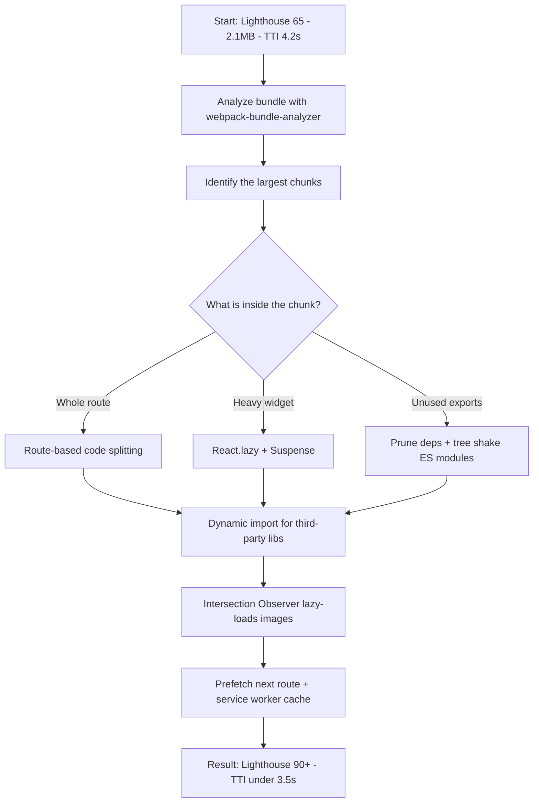

| Difficulty | Channel | Tags |
|---|---|---|
| intermediate | frontend | lighthouse, bundle, lazy-loading |

Picture this: a page whose entire job is to display marketing copy and one signup button ships roughly 300kB of JavaScript, including client-side React, Lodash, and hydration data. That was Netflix's logged-out homepage, and on a simulated 3G connection Lighthouse showed a seven-second load — a brutal greeting for every new signup [1]. The fix was not a rewrite; it was a disciplined shedding of weight that removed over 200kB from the initial load. What follows is the playbook for doing the same to a React app stuck at a Lighthouse 65 with a 2.1MB bundle and a 4.2-second Time to Interactive.

---

> ### Real-World Case — Netflix
>
> Netflix's logged-out homepage — the entry point for every new signup — shipped roughly 300kB of JavaScript, including client-side React, Lodash, and hydration data. On a simulated 3G connection Lighthouse showed a 7-second load, unacceptable for a page whose job is mainly to display marketing content and a signup button.
>
> | | |
> |---|---|
> | **Challenge** | Cut Time to Interactive and JavaScript payload on the most heavily A/B-tested, localized page in the signup flow (supporting ~200 countries) without abandoning the shared React component architecture used by the rest of the single-page signup app. |
> | **Solution** | Instead of code-splitting the React app, engineers disabled JavaScript in the browser to see what still worked, then rewrote the few required interactions (tabs, language switcher, cookie banner, analytics logging, ad-attribution bootstrap) in under 300 lines of vanilla JavaScript and kept React server-side only. They then used `` plus XHR prefetching (95% cache-success rate) to download the React/Redux bundle and CSS for the next signup page while users lingered on the fast landing page. |
> | **Outcome** | Over 200kB of JavaScript removed from the initial load; loading and TTI dropped by more than 50% (desktop TTI under 3.5s in Lighthouse), FID was fast for 97% of desktop users in CrUX, and prefetching cut TTI another 30% on the subsequent signup page. Users clicked the signup button at a higher rate. |
> | **Lesson** | The fastest bundle is the one you never ship: audit whether a framework is actually needed on a given route, ship minimal vanilla JS for the critical path, and prefetch the heavy framework during idle time so downstream React pages still feel instant. |

---

## Hook — The Seven-Second Front Door

Building on that opening scene, the stakes become clear when the page is stripped to its essentials: a headline, a hero image, and one button. Nothing about that page needed a client-side router, yet React and Lodash arrived anyway, along with hydration data the browser had to parse before anything could be clicked. On a fast laptop the delay is a shrug; on a simulated 3G connection it is seven seconds of silence [1]. The gap between a snappy local build and a sluggish phone is exactly where performance work earns its keep. Here is the uncomfortable question: if a page with almost no interactivity can carry 300kB, what is hiding inside a real application bundle?

## Problem — When the Bundle Becomes the Bottleneck

Once the shock wears off, the real problem comes into focus: a 2.1MB bundle and a 4.2-second Time to Interactive rarely fail because developers are careless. They fail because modern tooling makes it effortless to ship everything at once. Lighthouse rewards pages that load fast, respond fast, and stay visually stable, and a monolithic JavaScript payload attacks all three simultaneously [7]. Every kilobyte must be downloaded, parsed, compiled, and executed before the main thread can even listen for a tap. Many developers discover this the hard way when a single dashboard route drags in a charting library that only two percent of users ever open — the other 98 percent still pay for it in full. Consequently, slow interaction correlates with higher bounce rates, and scores under 90 tend to raise eyebrows in code reviews and client demos. So where does the weight actually live?

## Real-World Case — Netflix

The Netflix story answers that question with unusual clarity because the page was so simple. The logged-out homepage was the front door for every new signup, yet it carried roughly 300kB of JavaScript — client-side React, Lodash, and hydration data — and took about seven seconds to load on simulated 3G [1]. Engineers did not rewrite the product; they removed what the page did not need. More than 200kB came out of the initial load as the client-side framework and hydration payload gave way to server-rendered HTML with a thin layer of JavaScript. Therefore, loading and Time to Interactive fell by more than half, with desktop TTI landing under 3.5 seconds in Lighthouse. Field data echoed the lab results: First Input Delay was fast for 97 percent of desktop users in the Chrome UX Report [1]. Then came the plot twist nobody expected. Prefetching the signup page on link hover cut its TTI by another 30 percent, and users clicked the signup button more often. Speed here was not a vanity metric; it was the conversion funnel itself.

## Deep Dive — Code Splitting, Tree Shaking, and the Lazy Loading Spectrum

This leads directly to the toolkit, but the order matters more than the tools. Many teams reach for React.lazy() first and then wonder why the score barely moved. The counterintuitive truth is that splitting a bundle without knowing its composition is like dieting without a scale — intuition is rarely right.

💡 Insight: Measure before slicing. webpack-bundle-analyzer turns an abstract 2.1MB into named rectangles developers can actually argue with [6].

Here is the real tradeoff:

| Technique | Best for | Cost / tradeoff |
| --- | --- | --- |
| Route-based splitting | Distinct pages with separate dependency graphs | Extra chunk on first navigation |
| Component-based splitting (React.lazy) | Heavy widgets below the fold | Suspense fallback must be designed |
| Tree shaking with ES modules | Libraries with many unused exports | Silently defeated by CommonJS imports |
| Dynamic import for third-party libs | Analytics, editors, charts | Deferred initialization logic |
| Image lazy loading via Intersection Observer | Galleries and long feeds | Needs intrinsic sizes to avoid layout shift |

⚠️ Watch Out: A lazy component that renders immediately is not lazy in any meaningful sense. If the fallback flashes for 30 milliseconds, the split added a network round trip and bought nothing.

Specifically, route-based splitting is the move when each URL owns its own dependency graph, so the first route ships only what it needs [4]. Component-based splitting shines for a chart, map, or rich text editor sitting below the fold — use Intersection Observer to load it as it approaches the viewport [3]. Tree shaking pays off when dependencies are imported as ES modules; a CommonJS import can quietly keep an entire library in the output, so verify with a build rather than assumptions [5]. Dynamic import() is the primitive underneath React.lazy(), and understanding it explains why chunks appear on demand rather than at startup [2].

🔥 Hot Take: Deleting a dependency is a bigger performance win than cleverly splitting it. The fastest code is the code that never ships.

But wait, it gets better. Once the initial payload is lean, prefetching the next likely route turns the remaining latency into a rounding error — the same trick that shaved another 30 percent off Netflix's follow-up page [1].

## Workflow — From 2.1MB to 90+: The Optimization Runbook

Building on those tradeoffs, the workflow becomes a repeatable runbook rather than a heroic one-off. Each step feeds the next, and skipping the first one is the classic mistake.

1. **Baseline** the app with Lighthouse on a throttled connection; record the score, bundle size, and TTI [7].
2. **Analyze** composition with webpack-bundle-analyzer and name the top three offenders [6].
3. **Prune** unused dependencies and switch imports to ES module form so tree shaking can work [5].
4. **Split** by route first, then by heavy component with React.lazy() and Suspense [4].
5. **Defer** third-party libraries behind dynamic import() and load images with Intersection Observer [2][3].
6. **Prefetch** the next likely route and add a service worker cache for repeat visits [8].
7. **Re-measure** under identical throttling; confirm the score, not just the build output.

The visual story of that runbook is captured in the Bundle Optimization Flow diagram below. Notice how every branch converges on the same destination — a smaller critical path — which is the only thing that changes what a user actually feels.

🎯 Key Point: Re-run the same throttled Lighthouse configuration every time. Changing the config between runs is how teams convince themselves they improved something.

## Code Example — Route Splitting With Suspense and a Safety Net

With the runbook in hand, the implementation becomes almost anticlimactic — which is exactly how it should be. The complete snippet in the codeExample block shows route-based splitting wrapped in a Suspense boundary and an error boundary, plus a hover prefetch that makes the next click feel instant [4][2]. The Suspense fallback is the visible handshake while a chunk arrives, and the error boundary catches the production reality that a network request can fail. The heavy chart is lazy as well, so it never occupies the initial chunk, and the prefetch function warms the analytics module before the click rather than after it. When would this be used? Any app with more than one route or any component expensive enough to be noticed on a mid-range phone. A single-page landing page rarely needs it; a dashboard with four sections almost always does. Measure first, split second, and keep the fallback visually calm so loading never feels like a glitch.

## Lessons Learned — Battle Scars and the Next Morning

After the diagrams, the table, and the diff, the journey circles back to that seven-second front door. The lesson from Netflix is not "remove React" — it is that every byte on the critical path must justify its presence [1]. Speed work is mostly subtraction disguised as engineering.

Battle scars worth remembering:

- **Splitting without measuring.** Teams celebrate a 40 percent chunk reduction while the real culprit was one uncompressed hero image.
- **Fallback flicker.** A Suspense spinner that appears for a fraction of a second creates jank; preload the chunk or delay the fallback.
- **Broken tree shaking.** A stray CommonJS import keeps a whole library in the bundle; trust the analyzer, not the intentions [5].
- **No field data.** Lab scores improve while CrUX stays flat; always compare Lighthouse with real-user metrics [7].
- **Prefetch storms.** Prefetching every route on a mobile connection burns the bandwidth that was just saved; prefetch only the next likely step [1].

Every concept here has a home: route splitting for page boundaries, component splitting for below-the-fold weight, tree shaking for unused exports, image lazy loading for long feeds, and prefetching for the click that comes next. If this feels overwhelming, start with one step — the analyzer. It turns guesswork into a list.

But here is the thing though: the metric that matters is not the score. It is whether the signup button gets clicked. That is the story the Netflix numbers were really telling all along.

---

## Bundle Optimization Flow

<strong>Original Interview Question</strong>

**Q:** You're tasked with improving a React app's Lighthouse performance score from 65 to 90+. The bundle size is 2.1MB and Time to Interactive is 4.2s. What specific steps would you take to optimize the bundle and implement lazy loading?

**A:** Implement code splitting with React.lazy() and Suspense, analyze bundle composition with webpack-bundle-analyzer to identify largest chunks, remove unused dependencies and optimize imports, add dynamic imports for heavy components and third-party libraries, implement route-based splitting for better initial load times, and utilize tree shaking with proper ES module configuration.

## Conclusion

The Netflix front door opened in seven seconds because nobody questioned the JavaScript riding along with a marketing page. Teams that question it — with an analyzer in hand and a throttled Lighthouse run as the scoreboard — routinely turn 2.1MB into a fraction of itself and push TTI under 3.5 seconds [1][7]. The journey from problem to transformation was never about a magic library; it was about measuring, subtracting, splitting, and prefetching in that order. Tomorrow, open the bundle analyzer, find the single largest rectangle, and ask whether the first screen truly needs it. That one question is the entire playbook, and it is worth sharing with the team before the next deploy. Speed is not the reward — the click is.

---

## References

1. [Netflix incident report](https://medium.com/dev-channel/a-netflix-web-performance-case-study-c0bcde26a9d9) — article
2. [MDN: import() dynamic import operator](https://developer.mozilla.org/en-US/docs/Web/JavaScript/Reference/Operators/import) — documentation
3. [MDN: Intersection Observer API](https://developer.mozilla.org/en-US/docs/Web/API/Intersection_Observer_API) — documentation
4. [React source repository on GitHub](https://github.com/facebook/react) — documentation
5. [webpack source repository on GitHub](https://github.com/webpack/webpack) — documentation
6. [webpack-bundle-analyzer repository](https://github.com/webpack-contrib/webpack-bundle-analyzer) — documentation
7. [Lighthouse repository by GoogleChrome](https://github.com/GoogleChrome/lighthouse) — documentation
8. [MDN: Web Performance](https://developer.mozilla.org/en-US/docs/Web/Performance) — documentation

---

**Author:** Satishkumar Dhule — [GitHub](https://github.com/satishkumar-dhule) · [LinkedIn](https://linkedin.com/in/satishkumar-dhule) · [Website](https://satishkumar-dhule.github.io)
