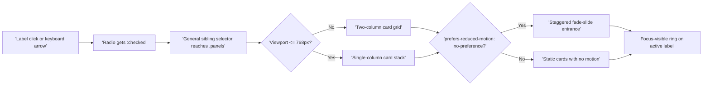

| Difficulty | Channel | Tags |
|---|---|---|
| beginner | frontend | css, flexbox, grid, animations |

Microsoft's Office Engineering and Experiences team spent two years rebuilding Fluent 2, then needed a docs home that could keep up with a Figma-driven workflow; earlier framework and CMS attempts were rigid, painful to migrate, and out of sync [1]. The result was a static docs site where 200+ pages shipped in 10 months, new pages took half the time, and a simple Figma design could be implemented in 20-30 minutes [1]. The uncomfortable question for frontend teams is whether small UI decisions, like tabs, quietly add the same friction. This article follows that thread into a CSS-only tab panel that stays fast, accessible, and responsive.

---

> ### Real-World Case — Microsoft
>
> Microsoft's Office Engineering and Experiences team spent two years rebuilding Fluent 2, the design system used across Office, Windows and Teams, and needed a home for its design documentation. Previous attempts at a docs site on other frameworks and CMSs were too rigid, hard to maintain, painful to migrate, and out of sync with their Figma-driven workflow.
>
> | | |
> |---|---|
> | **Challenge** | Build a large design-system docs site that stayed lightweight and low-maintenance, supported the React-based Fluent component library, shipped fully static output for security and scalability, and let designers turn Figma designs into pages fast — the same 'let native HTML/CSS do the work, ship little or no JavaScript' philosophy behind a CSS-only tab panel. |
> | **Solution** | They rebuilt the Fluent 2 docs with Astro, which ships zero JavaScript by default via island architecture, while still supporting their React design-system components and legacy Storybook iframes during migration. Content follows a Figma-to-Markdown workflow and is generated as fully static files hosted on Azure, trusting HTML/CSS for the bulk of the UI and reserving JavaScript for the few spots that genuinely need it. |
> | **Outcome** | The team built over 200 pages in 10 months, new pages took half the time compared with the previous stack, and a simple Figma design could be implemented in 20–30 minutes. Fully static output also removed backend/DDoS exposure, and Fluent 2 rolled out across Office, Windows and Teams. |
> | **Lesson** | For a design-system docs page, the lightest stack wins: default to zero JavaScript and lean on native HTML/CSS (radio-driven tabs, Grid, aspect-ratio, focus-visible, reduced-motion), adding script only where state truly demands it. |

---

## Hook — What if the fastest UI is the one that never boots?

What if the tab strip in your design-system docs could switch panels before a single JavaScript bundle parses? Radio inputs already carry mutual exclusion natively: one choice per shared name, no state library required [10].

Here is the twist: the radio is not really the tab. It is the state machine. The label is the tab your visitors see and click, and CSS is the wiring between them [2]. Many developers reach for JavaScript because tabs feel interactive, but interactivity and JavaScript are not synonyms.

💡 Insight: A static docs page with three tabs does not need a framework runtime. It needs predictable DOM order, a selector that can reach forward, and respect for the people navigating with a keyboard.

## Problem — When a tab needs to work without JavaScript

Building on that tension, the real pain is not toggling visibility. Anyone can hide a section. The pain is doing it without breaking keyboard focus, without shipping hydration just for a tab, and without turning a 16:9 media grid into a layout that jitters on mobile.

Here is what you need to know:

- Radios with the same `name` behave like a single-choice control, so only one tab can be active [10].
- A `` lets the visible tab activate the visually hidden input [4].
- The `:checked` pseudo-class exposes that state to CSS [2].
- The general sibling combinator `~` reaches later siblings, which is why DOM order becomes part of your API [3].
- Grid handles the 2x2 card layout, while a media query collapses it to one column at 768px [5].

⚠️ Watch Out: Hiding the input with `display: none` removes it from the keyboard interaction model. Use a visually hidden but focusable input, then draw the focus ring on its label with `:focus-visible` [8].

The stakes are modest in isolation and large in aggregate. Add one JavaScript tab widget to 200 docs pages, and the bundle tax becomes a design-system tax.

## Real-World Case — Microsoft

That aggregate tax is exactly what Microsoft's Fluent 2 team tried to avoid. The Office Engineering and Experiences team had spent two years on Fluent 2, the system used across Office, Windows, and Teams, but previous docs attempts on other frameworks and CMSs felt too rigid, hard to maintain, and awkward to migrate [1].

Consequently, the team reassessed the architecture instead of blaming the content editors. Their pages relied on custom components that did not fit a CMS mold, and the workflow had to stay close to Figma [1].

| Pressure | What broke | What changed |
| --- | --- | --- |
| Framework and CMS rigidity | Migration was painful and maintenance dragged | Fully static output with Astro |
| Figma-driven design stories | Custom components were hard to reuse | HTML, CSS, and JavaScript stayed in the open |
| Backend exposure | DDoS risk came with backend dependence | Static files hosted on Azure |

The numbers make the lesson concrete: 200+ pages in 10 months, page creation cut to half the previous time, and simple Figma implementations down to 20-30 minutes [1].

🔥 Hot Take: The Microsoft story is not really about a framework. It is about removing friction from the tiny repeated decisions that designers and engineers make every day. A CSS-only tab is one of those decisions.

## Deep Dive — Radio state, sibling selectors, and layout math

Building on Microsoft's preference for lightweight, static output, the CSS-only tab pattern works because each primitive already has a narrow job. The radio stores one bit of state, the label provides a clickable and focusable surface, and the selector decides which panel gets `display: grid`.

The selector is where most implementations get hurt. A tempting rule like `input:not(:checked) ~ .panel { display: none; }` looks clever until there are three tabs: unchecked radios earlier in the document will hide panels that belong to the checked one. The safer pattern hides every panel first, then reveals the panel paired with the checked radio through an explicit rule [3].

| Option | What it feels like | Real tradeoff |
| --- | --- | --- |
| JavaScript tabs | Flexible and easy to extend | Runtime, state sync, focus management, hydration bill |
| Radio plus sibling CSS | Zero JavaScript, native keyboard switching | DOM order constraints and no deep-link URL by default |
| `:target` tabs | Deep-linkable with anchors | Back-button behavior and scroll quirks [11] |

🎯 Key Point: Use this pattern for static docs sections with roughly two to five tabs, no async panel content, and no need for URL-addressable state. Avoid it when tabs represent application state, need dynamic insertion, or must survive full page reloads with a shareable link.

Layout adds a second layer of nuance. `grid-template-columns: repeat(2, minmax(0, 1fr))` gives a stable 2x2 grid, while `minmax(0, 1fr)` prevents long titles from forcing a column wider than its track [5]. The image area uses `aspect-ratio: 16 / 9`, which reserves space before media loads and avoids the classic cumulative layout shift party nobody RSVPed to [6].

Motion is the final layer. Animating cards with a 100ms stagger creates a sense of sequence, but the animation must live inside `@media (prefers-reduced-motion: no-preference)`, because vestibular motion preferences are a real accessibility requirement, not a decoration option [7]. Focus rings then keep keyboard users oriented, with `:focus-visible` showing an outline only when focus should be visible [8].

## Workflow — From click to visible panel

This leads to a simple mental model: click the label, the radio becomes checked, CSS reads that state, and the matching panel enters the layout. The diagram below, CSS Tab State Flow, maps that path from state change to motion fallback.



Specifically, the general sibling combinator matters because all radios and labels sit before the panel wrapper [3]. That single ordering decision lets every checked radio reach the same wrapper without `:has()` or JavaScript.

Moreover, the animation is scoped to `.panel .card`, so hidden panels do not burn through keyframes in the background [9]. When the media query says motion is unwelcome, the rule simply never applies, which is cleaner than declaring an animation and then trying to cancel it later [7].

## Code Example — A production-ready CSS-only tabs scaffold

Building on the workflow, this runnable Bash snippet writes an `index.html` and `styles.css` pair. The JavaScript-shaped question is answered with a shell script only because the deployed UI itself uses zero JavaScript.

The key design decisions are explicit: radios stay focusable, labels carry the visible affordance, panels are hidden by default, and each checked radio reveals exactly one panel [2][3][4]. The 2x2 grid collapses at 768px, the media area is locked to 16:9, motion is opt-in through `no-preference`, and focus stays visible [5][6][7][8].

```bash
#!/usr/bin/env bash
set -euo pipefail

# Creates a zero-JavaScript tab scaffold for design-system docs.
cat > index.html <<'HTML'
<!doctype html>
<html lang='en'>
<head>
  <meta charset='utf-8' />
  <meta name='viewport' content='width=device-width, initial-scale=1' />
  <link rel='stylesheet' href='styles.css' />
  <title>CSS-only docs tabs</title>
</head>
<body>
  <main class='docs'>
    <h1>Design system foundations</h1>

    <!-- Radios live before panels so :checked can reach them with ~. -->
    <div class='tabs' role='group' aria-label='Documentation sections'>
      <input class='tabs__input' type='radio' name='docs-tabs' id='tab-overview' checked />
      <input class='tabs__input' type='radio' name='docs-tabs' id='tab-components' />
      <input class='tabs__input' type='radio' name='docs-tabs' id='tab-patterns' />

      <label class='tabs__label' for='tab-overview'>Overview</label>
      <label class='tabs__label' for='tab-components'>Components</label>
      <label class='tabs__label' for='tab-patterns'>Patterns</label>

      <div class='panels'>
        <section class='panel panel--overview' aria-label='Overview'>
          <article class='card'><div class='card__image'></div><h2 class='card__title'>Tokens</h2><p class='card__meta'>Color, type, spacing</p></article>
          <article class='card'><div class='card__image'></div><h2 class='card__title'>Themes</h2><p class='card__meta'>Light and dark modes</p></article>
          <article class='card'><div class='card__image'></div><h2 class='card__title'>Motion</h2><p class='card__meta'>Duration and easing</p></article>
          <article class='card'><div class='card__image'></div><h2 class='card__title'>Iconography</h2><p class='card__meta'>Stroke and grid rules</p></article>
        </section>

        <section class='panel panel--components' aria-label='Components'>
          <article class='card'><div class='card__image'></div><h2 class='card__title'>Button</h2><p class='card__meta'>Actions and intents</p></article>
          <article class='card'><div class='card__image'></div><h2 class='card__title'>Dialog</h2><p class='card__meta'>Focus and dismissal</p></article>
          <article class='card'><div class='card__image'></div><h2 class='card__title'>Toast</h2><p class='card__meta'>Transient feedback</p></article>
          <article class='card'><div class='card__image'></div><h2 class='card__title'>Table</h2><p class='card__meta'>Dense data views</p></article>
        </section>

        <section class='panel panel--patterns' aria-label='Patterns'>
          <article class='card'><div class='card__image'></div><h2 class='card__title'>Empty state</h2><p class='card__meta'>When data is missing</p></article>
          <article class='card'><div class='card__image'></div><h2 class='card__title'>Onboarding</h2><p class='card__meta'>First-run guidance</p></article>
          <article class='card'><div class='card__image'></div><h2 class='card__title'>Filters</h2><p class='card__meta'>Narrowing results</p></article>
          <article class='card'><div class='card__image'></div><h2 class='card__title'>Errors</h2><p class='card__meta'>Recovery paths</p></article>
        </section>
      </div>
    </div>
  </main>
</body>
</html>
HTML

# Styles keep interaction, layout, motion, and focus entirely in CSS.
cat > styles.css <<'CSS'
:root {
  --ink: #111827;
  --muted: #6b7280;
  --surface: #f3f4f6;
  --accent: #2563eb;
  --gap: 1.5rem;
  --radius: 12px;
}

* { box-sizing: border-box; }

body {
  margin: 0;
  padding: 2rem 1rem;
  color: var(--ink);
  font: 16px/1.5 system-ui, sans-serif;
}

.docs { max-width: 960px; margin: 0 auto; }

/* Keep radios focusable; never use display:none for state holders. */
.tabs__input {
  position: absolute;
  width: 1px;
  height: 1px;
  opacity: 0;
  pointer-events: none;
}

.tabs__label {
  display: inline-block;
  margin: 0 0.5rem 1rem 0;
  padding: 0.5rem 0.9rem;
  border: 1px solid #d1d5db;
  border-radius: 999px;
  cursor: pointer;
}

/* Visual selected state comes from the checked radio. */
#tab-overview:checked ~ .tabs__label[for='tab-overview'],
#tab-components:checked ~ .tabs__label[for='tab-components'],
#tab-patterns:checked ~ .tabs__label[for='tab-patterns'] {
  color: white;
  background: var(--accent);
  border-color: var(--accent);
}

/* The hidden input cannot show a ring, so the label does. */
#tab-overview:focus-visible ~ .tabs__label[for='tab-overview'],
#tab-components:focus-visible ~ .tabs__label[for='tab-components'],
#tab-patterns:focus-visible ~ .tabs__label[for='tab-patterns'] {
  outline: 2px solid currentColor;
  outline-offset: 3px;
}

/* Hide every panel first, then reveal one explicit pair. */
.panel { display: none; }

#tab-overview:checked ~ .panels .panel--overview,
#tab-components:checked ~ .panels .panel--components,
#tab-patterns:checked ~ .panels .panel--patterns {
  display: grid;
  grid-template-columns: repeat(2, minmax(0, 1fr));
  gap: var(--gap);
}

@media (max-width: 768px) {
  .panel { grid-template-columns: 1fr; }
}

.card {
  overflow: hidden;
  border: 1px solid #e5e7eb;
  border-radius: var(--radius);
  background: white;
}

/* aspect-ratio reserves 16:9 space before any media loads. */
.card__image {
  aspect-ratio: 16 / 9;
  background: linear-gradient(135deg, #dbeafe, #e0e7ff);
}

.card__title { margin: 1rem 1rem 0.25rem; font-size: 1.1rem; }
.card__meta { margin: 0 1rem 1rem; color: var(--muted); font-size: 0.875rem; }

/* Motion is opt-in, so reduced-motion users get a calm panel. */
@media (prefers-reduced-motion: no-preference) {
  .panel .card { animation: fade-slide-in 300ms ease-out backwards; }
  .panel .card:nth-child(2) { animation-delay: 100ms; }
  .panel .card:nth-child(3) { animation-delay: 200ms; }
  .panel .card:nth-child(4) { animation-delay: 300ms; }
}

@keyframes fade-slide-in {
  from { opacity: 0; transform: translateY(10px); }
  to   { opacity: 1; transform: translateY(0); }
}
CSS

echo 'Created index.html and styles.css'
```

Step by step, the radios are grouped by `name`, so arrow keys can move between them natively [10]. The labels map to ids with `for`, giving each input a visible control [4]. The checked rules style the active label and reveal only its paired panel [2][3]. The grid rule makes four cards land as 2x2, the media query turns them into a single column, and `aspect-ratio` keeps every media area at 16:9 [5][6]. Finally, the stagger runs only when `no-preference` matches, and `:focus-visible` supplies the keyboard outline [7][8].

## Lessons Learned — Battle scars and tomorrow's move

The journey comes full circle: Microsoft reduced docs friction by choosing static output and keeping design workflow close to the source [1], and this tab panel applies the same principle at component scale.

Battle scars worth remembering:

- Do not use `display: none` on the radio. It kills keyboard access; visually hide it instead [8].
- Do not rely on a broad `:not(:checked) ~ .panel` rule. It hides the wrong panels once more than one unchecked radio exists [3].
- Do not animate every card globally. Scope keyframes to the visible panel family so the stagger feels intentional [9].
- Do not fake image height with fixed pixels. `aspect-ratio: 16 / 9` keeps proportions stable across breakpoints [6].
- Do not call this a perfect ARIA tab widget. It is a radio-driven disclosure switcher; for URL-addressable tabs, `:target` or JavaScript may be the better tool [11].

💡 Insight: The counterintuitive lesson is that removing JavaScript increases the importance of structure. CSS can only read the document tree it is given, so DOM order, explicit ids, and careful labels become the real state contract.

Tomorrow, audit one repeated interaction in your docs or design system. Ask whether it needs runtime state, or whether a native control plus a selector already does the job. If the answer is the latter, ship less code and let the browser do the boring work exceptionally well.

---

## CSS Tab State Flow


<details>
<summary><strong>Original Interview Question</strong></summary>

**Q:** Build a CSS-only tab panel for a design-system docs page. Use radio inputs to switch tabs (no JavaScript). Desktop: a 2x2 grid of cards under each tab; mobile: single column. Each card has a fixed 16:9 image area, a title, and a short meta line. Add a subtle entrance animation with a stagger and keep focus-visible outlines; ensure prefers-reduced-motion is respected?

**A:** Use a set of radio inputs with a shared `name` attribute and corresponding `` elements for each tab section. The `:checked` state of each radio controls visibility of its associated panel via adjacent sibling selectors. Each panel renders a 2×2 card grid on desktop and collapses to a single column on mobile. Cards use `aspect-ratio: 16/9` for fixed image containers, with a title and meta line below.

</details>

## Conclusion

The Fluent 2 docs story showed what happens when a team removes repeated friction at scale: 200+ pages, half the page-building time, and 20-30 minute Figma implementations [1]. This CSS-only tab panel is the smallest version of that same story. You trade a JavaScript widget for native radio state, disciplined DOM order, responsive grid, reserved 16:9 media, staggered motion that knows when to sit down, and focus-visible rings. The memorable insight to share with your team: if the browser already ships the state machine, do not build a second one. Audit your next small interaction, delete the runtime you do not need, and keep the docs as calm and fast as the design system they describe.

---

## References

1. [Microsoft incident report](https://astro.build/case-studies/microsoft) — article
2. [:checked CSS pseudo-class](https://developer.mozilla.org/en-US/docs/Web/CSS/Reference/Selectors/:checked) — documentation
3. [General sibling combinator](https://developer.mozilla.org/en-US/docs/Web/CSS/Reference/Selectors/General_sibling_combinator) — documentation
4. [label element](https://developer.mozilla.org/en-US/docs/Web/HTML/Reference/Elements/label) — documentation
5. [CSS grid layout basic concepts](https://developer.mozilla.org/en-US/docs/Web/CSS/Guides/Grid_layout/Basic_concepts) — documentation
6. [aspect-ratio CSS property](https://developer.mozilla.org/en-US/docs/Web/CSS/Reference/Properties/aspect-ratio) — documentation
7. [prefers-reduced-motion media feature](https://developer.mozilla.org/en-US/docs/Web/CSS/Reference/At-rules/@media/prefers-reduced-motion) — documentation
8. [:focus-visible CSS pseudo-class](https://developer.mozilla.org/en-US/docs/Web/CSS/Reference/Selectors/:focus-visible) — documentation
9. [Using CSS animations](https://developer.mozilla.org/en-US/docs/Web/CSS/Guides/Animations/Using) — documentation
10. [The radio input element](https://developer.mozilla.org/en-US/docs/Web/HTML/Reference/Elements/input/radio) — documentation
11. [Using the :target pseudo-class](https://developer.mozilla.org/en-US/docs/Web/CSS/Guides/Selectors/Using_:target) — documentation

---

**Author:** Satishkumar Dhule — [GitHub](https://github.com/satishkumar-dhule) · [LinkedIn](https://linkedin.com/in/satishkumar-dhule) · [Website](https://satishkumar-dhule.github.io)
