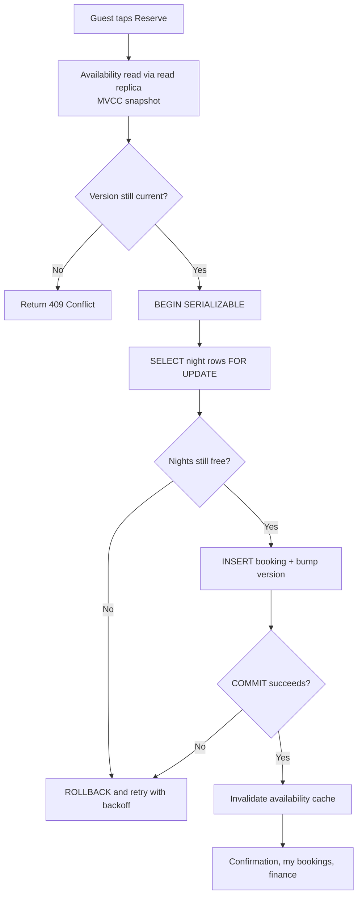

| Difficulty | Channel | Tags |
|---|---|---|
| intermediate | database | acid, isolation-levels, mvcc |

Ever wondered what happens when two guests click 'Confirm' on the same apartment at the same millisecond? Booking.com faced a version of this at a scale most teams never see: its Order Platform — the source of truth for every hotel, flight, and car reservation behind the 'Connected Trip' — began as siloed sharded MySQL, fought application complexity and master-failover downtime, then moved to Cassandra, which turned out to be the wrong primitive for transactional reservation data [1]. The rescue was a centralized distributed SQL store holding ~20TB across three regions with 99.999% availability [1]. That journey sets up the question every backend team eventually faces: how do you stop double bookings without melting the database?

---

> ### Real-World Case — Booking.com
>
> Booking.com's Order Platform is the source of truth for every reservation across hotels, flights, and cars, orchestrating checkout, payment, and fulfillment for the 'Connected Trip.' Built first on siloed sharded MySQL (which caused application complexity and master-failover downtime), it was consolidated into a centralized store on Cassandra — which turned out to be the wrong primitive for transactional reservation data.
>
> | | |
> |---|---|
> | **Challenge** | Reservation updates are multi-step read-modify-write operations spanning multiple rows and partitions. Cassandra offered only row-level isolation and no real ACID transactions, so the team built highly denormalized models plus a custom locking system using lightweight transactions (LWT/Paxos). The killer flaw: LWT timeouts were ambiguous — engineers could not tell whether a timeout meant a legitimate condition failure (e.g., a booking conflict) or an underlying infrastructure problem. Low write availability plus limited secondary indexes also forced them to mirror massive datasets into OpenSearch via Kafka and maintain extra cross-checks and sync services. |
> | **Solution** | After a three-database proof of concept, they migrated the Order Platform to CockroachDB, a distributed SQL database that provides ACID, SERIALizable transactions (optimistic, lockless concurrency with automatic transaction retries) across rows, tables, and regions, plus native CDC and secondary indexes. That let them delete the hand-rolled LWT locking layer, the extra consistency cross-checks, and the OpenSearch duplication path, consolidating reservation truth into one multi-region cluster (Frankfurt, London, Ireland). |
> | **Outcome** | The migrated platform holds ~20TB of reservation data in a single cluster spanning 3 regions with 99.999% availability and a 99.99998% write SLI; nodes can fail without visible disturbance, and capacity scales by adding nodes. Removing the redundant cross-check and search-sync services sharply reduced operational cost and cognitive load, and the platform now underpins confirmation pages, 'my bookings,' finance, ML, and analytics. |
> | **Lesson** | For inventory that must never be sold twice, do not bolt correctness onto an eventually consistent store with application-level locks: ambiguous lock timeouts turn a conflict into an unknown outcome. Choose a database whose transaction model matches the invariant — strong serializable ACID with retries — and accept the explicit availability tradeoff. As their RoachFest slides put it, 'Trading A(vailability) for C(onsistency)' — the database's consistency promise determines how much compensation logic you must maintain. |

---

## Hook — Two Clicks, One Room, Zero Good Outcomes

Here is the thing about that 'Confirm' button: the failure is invisible until it is extremely visible. It was 2am when the pager went off for a very ordinary reason — a popular beach house had one night left, and two travelers reserved it within 40 milliseconds of each other. Both saw 'available.' Both got a confirmation. Then the property owner called support, and a small race condition became refunds, apologies, and a very awkward email. 🔥 Hot Take: double bookings are not a quirky edge case; they are a trust incident with a database cause. Anyone who has debugged this knows the sinking feeling of reading two identical bookings side by side. Sound familiar?

## Problem — The Race Condition Hiding in Plain Sight

Building on that midnight scenario, the core challenge is deceptively simple: a check and a write are two separate operations, and nothing stops another request from squeezing between them. A naive flow reads availability, sees a free night, then inserts a booking — a classic read-modify-write race [6]. Under the ACID contract, atomicity promises the booking happens all at once, but only if the transaction is wired correctly [5]. The stakes are higher than a broken test: overbookings trigger refunds, support load, and reputational damage, while overly aggressive locking turns a busy Friday into a latency spike. Many developers think 'just add a cache' solves it; actually, a cache that lies about availability makes the race worse. ⚠️ Watch Out: read replicas are eventually consistent, so a replica-backed availability check is a hint, never a guarantee. So how does a team keep both correctness and uptime when demand spikes?

## Real-World Case — Booking.com

This leads directly to a company that lived the problem in production. Booking.com's Order Platform orchestrates checkout, payment, and fulfillment for the 'Connected Trip' across hotels, flights, and cars [1]. First came siloed sharded MySQL, which pushed complexity into the application and made master failover a downtime event. Then came a consolidation onto Cassandra — and a plot twist: a wide-column store built for scale was the wrong primitive for reservation rows that must agree with each other [1]. The earlier sharded-MySQL era resembles the routing problems that projects like Vitess were built to tame [10]. The platform was eventually rebuilt on a distributed SQL engine that keeps ACID transactions while spreading data across three regions [9]. Today the cluster holds about 20TB of reservation data, delivers 99.999% availability and a 99.99998% write SLI, and lets nodes fail without visible disturbance [1]. 💡 Insight: removing redundant cross-check and search-sync services cut operational cost and cognitive load, and the same store now feeds confirmation pages, 'my bookings,' finance, ML, and analytics. When the source of truth is trustworthy, everything downstream gets simpler.

## Deep Dive — Locks, Snapshots, and the Serializability Spectrum

Building on Booking.com's move away from an eventually consistent primitive, the real magic lives in isolation levels and the promises they make. SERIALIZABLE is the strictest level: it behaves as if transactions ran one after another, even when they run concurrently [2]. Under the hood, MVCC gives each transaction a snapshot, so readers do not block writers and writers do not block readers — until two writers touch the same rows [3]. That is where optimistic concurrency control enters: a version column is read, the work is done, and the commit succeeds only if nobody else bumped the version [4]. Pessimistic control takes the opposite bet with SELECT ... FOR UPDATE, locking the exact calendar rows up front [6][7]. 🎯 Key Point: neither pattern is 'better'; they answer different questions about how often conflicts happen. When would you actually use this? Choose pessimistic row locks when conflicts are common and retries are expensive; choose optimistic versions when conflicts are rare and holding locks feels wasteful. PostgreSQL implements FOR UPDATE with row-level locks, so a booking for Tuesday does not block a booking for Wednesday [7]. Because psycopg maps these semantics cleanly into Python, the retry loop stays readable [8].

| Option A vs Option B — the real tradeoff | Best for | Cost | Failure mode |
| --- | --- | --- | --- |
| Optimistic version column | Low-conflict listings | Cheap reads, retry on conflict | 409-style conflict at commit |
| Pessimistic SELECT FOR UPDATE | Hot properties, paid inventory | Locks held longer | Lock contention, possible timeouts |
| SERIALIZABLE alone | Complex multi-row invariants | Aborts under contention | Serialization failures to retry |

⚠️ Watch Out: SERIALIZABLE does not mean 'no retries' — it means the database will abort one of the conflicting transactions for you. Many developers discover this the hard way when a retry loop is missing and users see 500s.

## Workflow — From Click to Committed Reservation

This leads naturally to the request path, where theory becomes a sequence of small, boring, reliable steps. The diagram below tells the visual story — follow the branch where the version check fails and you will see why retries are a feature, not a bug.

1. Read availability from a replica for a fast first answer, using an MVCC snapshot [3].
2. Compare the cached version with the stored version; a mismatch returns 409 immediately.
3. Open a SERIALIZABLE transaction and lock only the requested night rows with FOR UPDATE [7].
4. Re-check the rows inside the lock, insert the booking, and bump the version column.
5. Commit; if the database raises a serialization failure, roll back and retry with exponential backoff.
6. Invalidate the availability cache only after a successful commit, then let confirmation pages and finance read the new truth.

💡 Insight: step 6 is where most teams leak stale data — cache invalidation after commit keeps the lie window tiny. ⚠️ Watch Out: never hold the row lock while calling an external payment API; that is how a slow third party becomes a database outage.

## Code Example — A Production-Shaped Booking Transaction

Building on that workflow, here is a production-shaped implementation in Python with psycopg [8]. The code below runs against any PostgreSQL-compatible store that supports SERIALIZABLE and row locks [7].

Here is what each section does, step by step:

- The retry loop wraps the whole transaction because SERIALIZABLE transactions can be aborted by the database; replaying them is safe and expected.
- SET TRANSACTION ISOLATION LEVEL SERIALIZABLE raises the guarantee before any row is touched, so multi-night invariants hold together.
- SELECT ... FOR UPDATE locks only the exact nights requested, which keeps contention local instead of freezing the whole property.
- The version and row-count checks are application-level validation: they catch stale cache reads and missing calendar rows before any money moves.
- INSERT plus the version bump happen in the same transaction, so the booking and its concurrency token commit atomically.
- Exponential backoff (25ms, 50ms, 100ms...) with jitter prevents a hot listing from stampeding the database on every retry.

Use this shape when a single reservation must cover multiple nights atomically; for a simple single-night hold, a conditional UPDATE with a WHERE booked = false predicate is often enough.

## Lessons Learned — Battle Scars and the So-What

Tying this back to the 20TB journey that opened the story, the lesson is not 'use SERIALIZABLE everywhere' — it is 'pick the right primitive for data that must agree.'

Battle scars worth avoiding:

- ⚠️ Watch Out: treating read replicas as authoritative. They are great for speed, terrible for final decisions.
- ⚠️ Watch Out: caching availability without invalidation on commit. Stale availability is a double booking with extra steps.
- ⚠️ Watch Out: no retry budget. Cap attempts, add jitter, and return a clear 409 instead of a mysterious 500.
- ⚠️ Watch Out: locking too broadly. Lock the night rows, not the property or the whole table.
- ⚠️ Watch Out: holding locks across network calls to payment or email services.

🎯 Key Point: correctness and availability are not enemies when conflicts are handled as a normal control flow. Teams that treat serialization failures as expected signals — like Booking.com's nodes failing without visible disturbance — end up with systems that scale by adding nodes instead of adding apologies [1]. When would you actually use this? Reach for this pattern whenever two users can claim the same finite resource: seats, inventory, meeting rooms, or appointment slots. The memorable insight to share at the next design review: a double booking is not a bug in the UI, it is a transaction that was never given a rule to lose gracefully.

---

## Booking Transaction Flow

<strong>Original Interview Question</strong>

**Q:** You're building a booking system for Airbnb where multiple users can reserve the same property simultaneously. How would you design the transaction handling to prevent double bookings while maintaining high availability?

**A:** Use SERIALIZABLE isolation with optimistic concurrency control. Implement row-level locks on property availability tables, use MVCC snapshot reads for checking availability, and apply application-level validation to ensure atomic booking operations.

## Conclusion

Two clicks, one room, one very awkward support call — that was the opening scene, and Booking.com's migration from sharded MySQL to Cassandra to a centralized transactional store shows the same tension at 20TB scale [1]. The journey went from a naive availability check to SERIALIZABLE transactions, MVCC snapshots, row locks, version columns, and retries that turn a race into a polite 409. Tomorrow, audit one path in your own system where a read is followed by a write: add a version, lock the narrowest row, and make retries boring. Do that, and the next time two guests hit Confirm at the same millisecond, the only thing that breaks is the myth that concurrency is someone else's problem.

---

## References

1. [Booking.com incident report](https://cockroachlabs.com/customers/booking-com/) — article
2. [Isolation (database systems) — Wikipedia](https://en.wikipedia.org/wiki/Isolation_(database_systems)) — documentation
3. [Multiversion concurrency control — Wikipedia](https://en.wikipedia.org/wiki/Multiversion_concurrency_control) — documentation
4. [Optimistic concurrency control — Wikipedia](https://en.wikipedia.org/wiki/Optimistic_concurrency_control) — documentation
5. [ACID — Wikipedia](https://en.wikipedia.org/wiki/ACID) — documentation
6. [Database lock — Wikipedia](https://en.wikipedia.org/wiki/Database_lock) — documentation
7. [PostgreSQL source repository — GitHub](https://github.com/postgres/postgres) — documentation
8. [Psycopg 3 — GitHub](https://github.com/psycopg/psycopg) — documentation
9. [CockroachDB — GitHub](https://github.com/cockroachdb/cockroach) — documentation
10. [Vitess — GitHub](https://github.com/vitessio/vitess) — documentation

---

**Author:** Satishkumar Dhule — [GitHub](https://github.com/satishkumar-dhule) · [LinkedIn](https://linkedin.com/in/satishkumar-dhule) · [Website](https://satishkumar-dhule.github.io)
