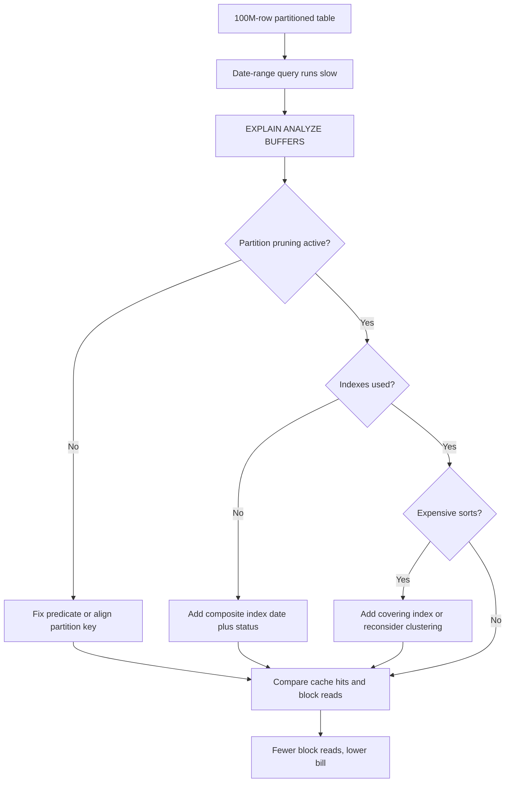

| Difficulty | Channel | Tags |
|---|---|---|
| intermediate | database | explain, query-plan, partitioning |

Picture a single orders table carrying 33 TB including indexes, more than 100 columns, and roughly 46 GB of fresh data every day [1]. It serves about 1,000 writes and 10,000 reads per second, which sounds like a normal Tuesday until date-range lookups start missing the buffer cache [1]. Every miss becomes a billed disk read, and the meter runs per I/O operation. Here is the uncomfortable question: what if the table is not the problem, and PostgreSQL is simply being forced to read too much of it?

---

> ### Real-World Case — Amazon (AWS)
>
> AWS database engineers built a production-scale simulation of an order-management system on Aurora PostgreSQL: a 33 TB orders table (including indexes) with over 100 columns, ingesting ~46 GB/day and serving ~1,000 writes plus ~10,000 reads per second. Date-range lookups against the monolithic table kept missing the buffer cache, so every query generated massive billed read I/O on an engine where you pay per I/O operation.
>
> | | |
> |---|---|
> | **Challenge** | Make date-filtered queries on a huge, fast-growing time-series table fast and economical when the working set dwarfed instance memory — without a long migration outage — and determine whether partition granularity (monthly vs. daily) actually mattered. |
> | **Solution** | They range-partitioned the orders table in place on created_at using native declarative partitioning plus pg_partman, attaching the existing 33 TB table as the first partition with only brief ~10-second application interruptions. The primary/unique key had to be changed to include the partition key (public_id, created_at), and every query and update had to carry created_at so the planner could prune. They then compared monthly and daily partition policies under the same synthetic load. |
> | **Outcome** | Disk block reads fell from ~600,000/second spikes to ~25,000/second with daily partitions, while buffer-cache hits rose from ~600,000/second to 1.5 million/second; writer ReadIOPS dropped from ~100,000/s to ~40,000/s with identical writes. Weekly storage-I/O charges fell from $17,676.81 to $5,608.33 — roughly $12,000/week saved — with up to 40% savings for monthly partitions and 60% for daily partitions. |
> | **Lesson** | Partition pruning's biggest payoff here wasn't raw query speed: by restricting the hot working set from 33 TB to ~46 GB, the relevant index and heap pages stayed in shared buffers, turning paid physical reads into free cache hits. When I/O is billed, partition granularity is a direct cost lever — but only if queries filter on the bare partition key and your keys/queries are redesigned to include it. |

---

## Hook — The 33 TB bill nobody saw coming

Picture a single orders table carrying 33 TB including indexes, more than 100 columns, and roughly 46 GB of fresh data every day [1]. It serves about 1,000 writes and 10,000 reads per second, which sounds like a normal Tuesday until date-range lookups start missing the buffer cache [1]. Every miss becomes a billed disk read, and the meter runs per I/O operation. At spike time, the engine was chewing through roughly 600,000 disk block reads per second. Sound familiar? Here is the uncomfortable question: what if the table is not the problem, and PostgreSQL is simply being forced to read too much of it?

## Problem — Partitioning is not a magic wand

Building on that tension, many developers discover that partitioning is not a magic wand. Splitting a 100M-row table by date only helps when the planner can prove that most partitions are irrelevant to the query. That proof lives in the EXPLAIN plan, and when it is missing, the database happily scans partitions that hold not a single matching row [3].

The pain shows up in three familiar ways. Queries filter on a date range, but the predicate does not line up with the partition key, so pruning never happens. Indexes exist on the parent table, but the planner prefers sequential scans because statistics are stale or the filter is not selective enough. Sort and hash aggregate nodes spill to disk, turning a simple lookup into a full-blown data-shuffling exercise [5].

Consequently, latency climbs, connection pools saturate, and on usage-based engines the invoice grows right alongside query time. The stakes are not academic: a single missed pruning opportunity can multiply billed I/O by an order of magnitude. So what separates a plan that merely works from a plan that is cheap?

## Real-World Case — Amazon (AWS)

This is where the story gets concrete. Amazon (AWS) database engineers built a production-scale simulation of an order-management system on Aurora PostgreSQL [8]: a 33 TB orders table with over 100 columns, ingesting about 46 GB per day and handling roughly 1,000 writes plus 10,000 reads per second [1]. Date-range lookups against the monolithic table kept missing the buffer cache, and every miss translated into billed read I/O [1].

Then came the plot twist. The team did not rewrite the application or shrink the data. They introduced daily date partitions, and the access path changed almost overnight. Disk block reads fell from roughly 600,000 per second at spike to about 25,000 per second, while buffer-cache hits climbed from roughly 600,000 per second to 1.5 million per second [1]. Writer ReadIOPS dropped from about 100,000/s to 40,000/s with identical write volume, which is the part that usually surprises people [1].

The money followed the I/O. Weekly storage-I/O charges fell from $17,676.81 to $5,608.33, roughly $12,000 saved every week, with up to 40% savings from monthly partitions and as much as 60% from daily partitions [1].

💡 Insight: the writes did not change at all; only the number of blocks touched per read changed. That is the whole game on metered storage.

## Deep Dive — What the plan is actually telling you

Building on the AWS result, the real skill is reading the plan rather than guessing at indexes. Run EXPLAIN (ANALYZE, BUFFERS) and treat it like a crime scene report: estimated versus actual rows, buffers hit versus read, and the exact nodes where time disappears [2].

**Partition pruning effectiveness.** First, confirm that only the expected partitions appear in the plan. If the query targets January 2024 and the plan still touches a dozen other partitions, pruning has failed. Common culprits include wrapping the partition key in a function, casting types inconsistently, or using a predicate the planner cannot prove against partition bounds [3]. PostgreSQL can prune at plan time or at execution time, and runtime pruning still shows up as extra partitions scanned in the node output [2].

**Index utilization patterns.** Next, look for Index Scan or Bitmap Heap Scan where a Seq Scan was expected, and check whether the index condition actually includes every filtered column. A plain index on event_date narrows the range, but a composite index on (event_date, status) lets the engine discard non-matching rows during the index scan itself [4]. Here is a nuance worth remembering: even with a range on the leading column, PostgreSQL can still apply the equality column as an index condition on the tuples it visits, which reduces heap fetches even though it cannot shrink the scan boundary.

**Expensive sorts and aggregates.** Moreover, a tidy-looking plan can hide a monstrous Sort or HashAggregate node. Watch for external merge sorts that spill to disk; these are the moments where work_mem and index ordering matter more than raw CPU [5]. An index that already matches the ORDER BY can remove the sort entirely.

**Is the partition key even right?** Here is the counterintuitive bit: partitioning by date only helps date-filtered queries. If most traffic filters on status or customer_id with a loose date predicate, the date key is solving yesterday's problem [3].

| Option | Best for | Real tradeoff |
|---|---|---|
| Monthly partitions | Moderate volume, simple maintenance | Up to 40% I/O savings, more rows scanned per query [1] |
| Daily partitions | Heavy date-range lookups | Up to 60% savings, more partitions to manage [1] |
| Composite (date, status) index | Queries filtering on both columns | Faster reads, extra index storage and write cost [4] |
| CLUSTER by index | Strong physical locality | One-time reorder, maintenance window, decays over time [6] |

⚠️ Watch Out: CLUSTER is not a background magic trick. It physically reorders rows, needs a maintenance window, and does not keep the table clustered as new rows arrive.

🎯 Key Point: Use daily partitions when date-range reads dominate and the storage bill is metered. Use monthly partitions when maintenance simplicity matters more than the last few percent. Use a composite index whenever the same secondary filter appears alongside the date range.

## Workflow — From slow plan to cheap plan

The diagnosis only pays off when it becomes a repeatable routine. The query optimization flow diagram below maps the route from a slow plan to a cheap one, and each step builds on the previous one.

1. Capture a baseline with EXPLAIN (ANALYZE, BUFFERS), recording shared hit blocks versus shared read blocks and total execution time [2].
2. Verify partition pruning by confirming that only the expected date partitions are scanned; if others appear, fix the predicate or type casting first [3].
3. Inspect index usage, comparing estimated versus actual rows and checking whether the Index Cond includes every filtered column [4].
4. Hunt expensive Sort and HashAggregate nodes, especially any that spill to disk [5].
5. Create the composite index with CREATE INDEX CONCURRENTLY so writes keep flowing while the index builds [6], [7].
6. Run ANALYZE to refresh statistics, then re-run the exact same EXPLAIN and compare buffers, not just timing.
7. Only then consider physical clustering, scheduled inside a maintenance window with a clear plan for decay.

🔥 Hot Take: comparing two plans by elapsed time alone is how teams fool themselves. Buffer hits and reads are the numbers that explain why the time changed. So which step tends to deliver the biggest surprise?

## Code Example — The psql playbook

Here is the psql playbook that turns the workflow into something runnable against a real database. Each command maps to one decision point from the diagram above.

**Step 1, the baseline.** The first command runs EXPLAIN with ANALYZE, BUFFERS, and VERBOSE. ANALYZE actually executes the query and reports real timings, BUFFERS reveals how many blocks came from cache versus disk, and VERBOSE exposes the exact index conditions [2]. Read the output for partitions that never ran and for large shared read counts.

**Step 2, the index build.** CREATE INDEX CONCURRENTLY adds the composite (event_date, status) index without taking an exclusive lock that would stall the 1,000 writes per second described in the opening story [1], [6], [7]. The tradeoff is a longer build and the need to drop an invalid index if the build fails.

**Step 3, fresh statistics.** ANALYZE updates the planner statistics so the next plan reflects the new index and current data distribution [6]. Skipping this step is a classic reason a perfectly good index appears unused.

**Step 4, the rematch.** Re-running the identical EXPLAIN makes the comparison honest. The win shows up as fewer shared read blocks and a narrower set of partitions touched.

**Step 5, optional clustering.** CLUSTER physically reorders rows to match index order, which can boost locality further, but it locks the table and must be scheduled carefully [6]. Treat it as a maintenance operation, not a daily habit.

⚠️ Watch Out: the trailing comments in the script are shell comments that document what to look for; they are not part of the SQL sent to PostgreSQL.

## Lessons Learned — Battle scars and the one insight

Bringing this back to the 33 TB orders table, the journey was Problem, Struggle, Discovery, Solution, Transformation: a metered I/O crisis, a monolithic access path, a plan-level diagnosis, date partitions plus a composite index, and finally a bill that shrank by roughly $12,000 per week [1].

**Battle scars worth avoiding:**
- Assuming partitions help automatically, when pruning must be verified in the plan [3].
- Filtering on a column other than the partition key and expecting magic [3].
- Building indexes during peak traffic with a plain CREATE INDEX instead of CONCURRENTLY [6].
- Celebrating lower elapsed time while ignoring buffer reads and disk spills [5].
- Treating CLUSTER as a permanent fix when locality decays as new rows land [6].

💡 Insight: on metered databases, the fastest query is the one that touches the fewest blocks, not the one with the cleverest SQL. Partitioning, composite indexes, and clustering are all just different ways to make PostgreSQL touch fewer blocks.

Many developers think the answer is always more hardware. The AWS numbers say otherwise: identical writes, a smarter access path, and up to 60% less I/O spend [1]. If this feels overwhelming, start with one query and one EXPLAIN; the plan tells a story once you know what to look for.

---

## Query Optimization Flow

<strong>Original Interview Question</strong>

**Q:** You have a PostgreSQL table with 100M rows partitioned by date. A query filtering on a specific date range is still slow. What would you check in the EXPLAIN plan and how would you optimize it?

**A:** Check partition pruning effectiveness, index utilization patterns, and expensive sort operations. Create composite indexes on (date, filtered_columns) and evaluate clustering strategies for optimal data access.

## Conclusion

The next time a date-range query crawls against a 100M-row table, resist the urge to add RAM first. Open the EXPLAIN plan, confirm pruning before anything else, chase the index conditions second, and only then reach for clustering. That is the habit that turned a 33 TB Aurora table from a $17,676.81 weekly I/O bill into a $5,608.33 one [1]. Here is the one-liner to take to your team: partitioning sets the stage, but the plan decides the bill. Run that check on your slowest query tomorrow, and let the invoice do the talking.

---

## References

1. [Amazon (AWS) incident report](https://aws.amazon.com/blogs/database/reduce-read-i-o-cost-of-your-amazon-aurora-postgresql-database-with-range-partitioning/) — article
2. [Amazon Aurora PostgreSQL User Guide](https://docs.aws.amazon.com/AmazonRDS/latest/AuroraUserGuide/AuroraPostgreSQL.html) — documentation
3. [Partition (database) - Wikipedia](https://en.wikipedia.org/wiki/Partition_(database)) — documentation
4. [Database index - Wikipedia](https://en.wikipedia.org/wiki/Database_index) — documentation
5. [Query plan - Wikipedia](https://en.wikipedia.org/wiki/Query_plan) — documentation
6. [PostgreSQL - Wikipedia](https://en.wikipedia.org/wiki/PostgreSQL) — documentation
7. [postgres/postgres GitHub repository](https://github.com/postgres/postgres) — documentation
8. [Amazon Aurora - Wikipedia](https://en.wikipedia.org/wiki/Amazon_Aurora) — documentation
9. [Database - Wikipedia](https://en.wikipedia.org/wiki/Database) — documentation

---

**Author:** Satishkumar Dhule — [GitHub](https://github.com/satishkumar-dhule) · [LinkedIn](https://linkedin.com/in/satishkumar-dhule) · [Website](https://satishkumar-dhule.github.io)
