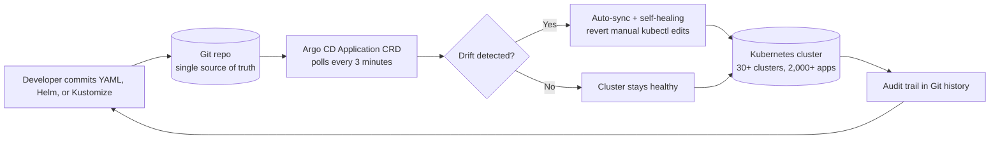

| Difficulty | Channel | Tags |
|---|---|---|
| beginner | devops | argocd, flux, declarative |

At Intuit, teams shipping TurboTax and QuickBooks found themselves fighting a quiet enemy: configuration drift across dozens of Kubernetes clusters. Imperative kubectl commands and one-off scripts had turned deployments into guesswork, with inconsistent environments and almost no audit trail [1]. Then the company flipped the script and scaled a Git-driven workflow across 2,000+ applications and 30+ clusters [1]. That shift is the story of declarative delivery, and it starts with a simple question: who owns the truth about your cluster?

---

> ### Real-World Case — Intuit
>
> As Intuit scaled microservices for products like TurboTax and QuickBooks across many Kubernetes clusters, teams relied on imperative kubectl commands and scripts that caused configuration drift, inconsistent environments, and limited auditability. They needed a standardized, automated way to deploy and operate thousands of services reliably.
>
> | | |
> |---|---|
> | **Challenge** | How to continuously deploy microservices from Git to Kubernetes at scale while eliminating manual, out-of-band cluster changes and ensuring the running state always matches the intended configuration. |
> | **Solution** | Intuit adopted Argo CD for declarative GitOps, defining each service as an Argo CD Application CRD that points to a Git repository containing Kubernetes manifests and Helm charts. They enabled automated sync with regular health checks and self-healing, so Argo CD continuously reconciles the cluster to the desired state in Git and automatically reverts any imperative changes made directly to the cluster. |
> | **Outcome** | Scaled GitOps-based delivery to 2,000+ applications across 30+ Kubernetes clusters, giving hundreds of developers an auditable Git-driven deployment workflow with consistent environments and automatic drift correction through self-healing. |
> | **Lesson** | Using Git as the single source of truth with Argo CD's declarative reconciliation, auto-sync, and self-healing removes configuration drift and makes microservice deployments repeatable, auditable, and safer than imperative kubectl-driven changes. |

---

## Hook — The Deploy Looked Fine. Then It Drifted.

The deploy looked fine. Then, somewhere between a Friday hotfix and a Monday morning, the cluster quietly changed. A developer ran a quick kubectl edit to 'just get the demo working,' nobody committed it, and by Tuesday the staging environment no longer matched production [3]. Sound familiar? Many developers have stared at a 500 error at 2am wondering which of the 47 manual tweaks broke things. The stakes are bigger than a bad afternoon: when truth lives in someone's terminal history, rollbacks become archaeology and audits become fiction. This is the moment GitOps walks onto the stage.

## Problem — When the Cluster Becomes a Mystery Box

That uneasy feeling points straight at the real problem. Kubernetes offers two ways to manage objects: imperative commands that tell the API server what to do right now, and declarative manifests that describe what should be true [3]. Teams under deadline pressure reach for the imperative path because it feels fast. kubectl scale, kubectl edit, kubectl apply from a laptop — each one is a tiny act of shadow configuration [5]. Multiply that by hundreds of developers and thousands of services, and suddenly nobody can answer a simple question: what is actually running? The result is configuration drift, where environments diverge one convenience at a time [6]. Moreover, incident reviews turn into guesswork because nothing was recorded in version control. Kubernetes already orchestrates containers across fleets of machines [8], and managed platforms add another layer of abstraction [9], but none of that fixes a missing source of truth. What happens when the cluster grows by another thousand services?

## Real-World Case — Intuit

To see this pain at scale, look no further than Intuit [1]. Picture the environment: TurboTax and QuickBooks microservices spreading across many Kubernetes clusters, with teams relying on imperative scripts to push changes [1]. Drift showed up as inconsistent environments and limited auditability — the exact failure mode described above, but at a scale that makes manual cleanup hopeless [1]. Here is the plot twist: the fix was not a fancier deployment script. Intuit standardized on a GitOps model where Git holds the declared desired state and controllers reconcile against it continuously [1]. The outcome speaks in numbers: 2,000+ applications across 30+ Kubernetes clusters, with hundreds of developers deploying through an auditable Git-driven workflow and self-healing that corrects drift automatically [1]. Sound like magic? It is really just discipline wrapped in a control loop.

## Deep Dive — Declarative Truth vs Imperative Impulses

Building on Intuit's turnaround, the core idea is simple: declare the desired state in Git and let a controller make reality match. An Argo CD Application custom resource points at a repository, a path, and a target cluster [2]. Kustomize overlays or Helm charts let teams express environment differences without forking entire manifests [4].

💡 Insight: the repository is not just storage; it is the audit log, the rollback mechanism, and the permission boundary rolled into one [6]. When someone runs a manual kubectl patch, Argo CD marks the app OutOfSync and, with self-healing enabled, reverts it [3]. That sounds strict because it is — and that strictness is the feature.

| Approach | What you do | What you get | Real tradeoff |
|---|---|---|---|
| Declarative (GitOps) | Commit YAML, Helm, or Kustomize to Git [2][4] | Audit trail, repeatable rollbacks, self-healing | Slower hotfixes; every change needs a commit |
| Imperative (kubectl) | Run commands directly against the cluster [5] | Instant feedback, great for debugging | Drift, no history, environments diverge [6] |

When would you actually use each? Declarative wins for anything that must be reproducible across clusters. Imperative earns its keep during live debugging, but the moment the fix works, commit it or watch self-healing erase it.

⚠️ Watch Out: teams often forget resource exclusions or sync windows, so a legitimate emergency tweak gets reverted mid-incident.

🔥 Hot Take: kubectl is not the enemy — treating your cluster like a pet instead of cattle is. And that mindset is exactly where the workflow comes in.

## Workflow — From Commit to Converged Cluster

This leads to the mechanics. The GitOps Sync Flow diagram below tells the whole visual story, from developer commit to a cluster that quietly fixes itself.

Step one: a developer commits manifests to the repo. Step two: the Argo CD Application CRD watches that path and polls on a health check interval — often three minutes, with one to five minutes being the practical range [2]. Step three: Argo CD compares live state against declared state. Step four: if drift exists, auto-sync applies the desired state and self-healing reverts manual edits [3]. Step five: Git history records everything, so a rollback is a git revert instead of a heroic shell session.

🎯 Key Point: the loop never sleeps, which is why configuration drift stops compounding. With the flow clear, the smallest production-worthy setup is surprisingly short.

## Code Example — Wiring an Argo CD Application

The snippet below creates the Application CRD that makes the magic happen: it points at Git, targets a namespace, and turns on both auto-sync and self-healing. Brace yourself — most of the interesting behavior lives in about six lines of YAML wrapped in a bash call.

The `syncPolicy.automated` block is the heart of it. `prune: true` removes resources deleted from Git, while `selfHeal: true` is the bouncer that escorts unauthorized kubectl changes out of the cluster [2]. `CreateNamespace=true` prevents the classic 'namespace does not exist' sync failure. The final command exposes sync status so a human can confirm the controller is watching. Once this is applied, try a manual `kubectl edit` and watch the drift disappear — which is where the lessons below come in.

## Lessons Learned — Battle Scars and Next Moves

Having seen the pattern from failure to fix, a few battle scars are worth writing down.

- Start with one service, not all 2,000. Intuit's scale was earned, not attempted on day one [1].
- Enable self-healing only after the manifests are trusted; otherwise the controller will faithfully undo a legitimate fix.
- Use sync windows around maintenance so automation does not fight the humans on call.
- Treat imperative commands as a debugging tool, never as a deployment strategy [5].
- If Argo CD is not the right fit, Flux implements the same reconciliation philosophy [7].

⚠️ Watch Out: skipping health checks means a broken rollout can be marked healthy. 💡 Insight: measure how often drift occurs — that number tells a team whether its process or its tooling needs fixing.

Remember the opening scene? Intuit's win was not a magic tool; it was making Git the only place where truth was allowed to live [1]. Here is the one line to take to your next standup: if it is not in Git, it is not real.

---

## GitOps Sync Flow

<strong>Original Interview Question</strong>

**Q:** You're setting up GitOps for a microservices deployment. How would you configure ArgoCD to automatically sync changes from your Git repository to Kubernetes, and what's the difference between declarative and imperative approaches in this context?

**A:** I'd configure ArgoCD by setting up a Git repository containing Kubernetes manifests or Helm charts, creating an Application CRD that points to the Git repository, enabling auto-sync with a health check interval of 3 minutes, and implementing self-healing to automatically revert any manual changes. The declarative approach involves defining the desired state in Git through YAML manifests, Helm charts, or Kustomize configurations, where ArgoCD continuously reconciles the actual state with the desired state. In contrast, the imperative approach uses kubectl commands to make direct changes to the cluster, bypassing the Git repository as the single source of truth.

## Conclusion

The journey from kubectl chaos to a self-healing GitOps loop is really a journey from oral tradition to written record. Intuit proved the pattern holds at 2,000+ apps and 30+ clusters [1]. Tomorrow, pick one service, place its manifests in Git, create an Application with automated sync and self-healing, then try a sneaky kubectl edit. The cluster will tell on them — and that is the whole point.

---

## References

1. [Intuit incident report](https://www.cncf.io/case-studies/intuit/) — article
2. [Argo CD — GitOps continuous delivery for Kubernetes (GitHub)](https://github.com/argoproj/argo-cd) — documentation
3. [Kubernetes: Declarative vs. Imperative Object Management](https://kubernetes.io/docs/concepts/overview/working-with-objects/object-management/) — documentation
4. [Kubernetes: Kustomize](https://kubernetes.io/docs/tasks/manage-kubernetes-objects/kustomization/) — documentation
5. [Kubernetes: kubectl Overview](https://kubernetes.io/docs/reference/kubectl/) — documentation
6. [GitOps (Wikipedia)](https://en.wikipedia.org/wiki/GitOps) — documentation
7. [Flux CD (GitHub)](https://github.com/fluxcd/flux2) — documentation
8. [Kubernetes (Wikipedia)](https://en.wikipedia.org/wiki/Kubernetes) — documentation
9. [Amazon EKS: What is Amazon EKS? (AWS Docs)](https://docs.aws.amazon.com/eks/latest/userguide/what-is-eks.html) — documentation

---

**Author:** Satishkumar Dhule — [GitHub](https://github.com/satishkumar-dhule) · [LinkedIn](https://linkedin.com/in/satishkumar-dhule) · [Website](https://satishkumar-dhule.github.io)
