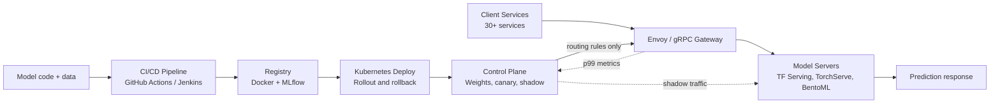

| Difficulty | Channel | Tags |
|---|---|---|
| beginner | devops | mlops, deployment |

Picture a single recommendation request landing at Netflix: behind it sits a routing layer that chooses among hundreds of model versions, serving over one million inference requests every second across 30-plus client services [1]. For years, that centralized router — called Switchboard — added a measurable 10–20 ms tax to every call, a number that looks trivial on a laptop and brutal at a million QPS [1]. The fix was not a faster router but a smarter architecture that moved routing off the direct request path entirely [1]. That story is the real difference between deploying a model and serving it — and it is exactly where most ML systems quietly bleed latency.

---

> ### Real-World Case — Netflix
>
> Netflix's centralized ML serving platform grew to hundreds of model types and versions serving over 1 million inference requests per second for recommendations, commerce, fraud detection, and other member experiences. Its Switchboard router gave 30+ client services one gRPC API and made A/B tests, canaries, shadow traffic, and instant rollbacks possible without client redeploys.
>
> | | |
> |---|---|
> | **Challenge** | Switchboard sat directly in the hot path: every request had to be deserialized, inspected for user/device/experiment context, rerouted to the right model shard VIP, and reserialized. That added 10–20 ms per request, amplified tail latency, created a shared single point of failure, and obscured which client and traffic type originated each request. |
> | **Solution** | Netflix kept the deployment/control-plane abstraction but redesigned the serving/data plane. Switchboard Rules were split into model-serving configuration and routing rules; a lightweight service named Lightbulb resolves only minimal request context into a routing key and model configuration, while Envoy—already Netflix's egress proxy—routes using the header-based key to the appropriate cluster VIP. This preserved model versioning, experimentation, shadow mode, and rollback while removing the heavyweight proxy and large-payload reserialization from the inference path. |
> | **Outcome** | The platform handles over 1M requests/sec across hundreds of model versions and 30+ client services. The old architecture's measurable tax was 10–20 ms of added latency per request; the Lightbulb/Envoy design removes the centralized router from the direct request path while retaining the same routing and rollout capabilities. |
> | **Lesson** | Model deployment and model serving fail in different ways: deployment tooling can safely own versioning and rollout policy, but putting that logic in the synchronous inference path can turn a useful abstraction into a latency and availability bottleneck. Decouple control-plane intelligence from data-plane forwarding. |

---

## Hook — One million requests, zero redeploys

Here is the uncomfortable truth: shipping a model to production and making it usable at scale are two completely different jobs. The deploy looked fine — the container was up, the health check was green, and the dashboard was calm. Then real traffic arrived, latency spiked, and suddenly nobody could tell which model version was actually answering requests. Sound familiar? That gap between 'it is running' and 'it is serving reliably' is where MLOps maturity is won or lost. Even mature teams learn this the hard way: the model is rarely the bottleneck; the plumbing around it is [1]. So what exactly is that plumbing made of?

## Problem — The deployment/serving identity crisis

Building on that tension, the core problem is a vocabulary mess: 'deployment' and 'serving' get used interchangeably, so teams design one when they actually need both. Deployment is the journey from code to a running, observable system — CI/CD pipelines, infrastructure provisioning, rollout and rollback strategies [2]. Serving is the moment of truth at runtime: an API receives a request, routes it to the right model version, loads weights, runs inference, and returns a response fast enough to matter [3]. Conflating them produces predictable pain — here is what you need to know:

- You get a flawless Kubernetes rollout [2] paired with a hand-rolled FastAPI endpoint [9] that melts at 500 QPS.
- Or a blazing-fast TorchServe backend [4] with no canary strategy, so a bad model version goes straight to 100% of users.
- Or excellent MLflow tracking [7] that nobody can act on because the serving layer cannot flip a weight without a full redeploy.

This leads to a simple question: if the two disciplines are so different, what does the split look like in production? Netflix makes that answer unusually clear.

## Real-World Case — Netflix

However, theory only goes so far — to see the stakes, look at Netflix's centralized ML serving platform, documented in the engineering team's write-up on model routing [1]. The platform grew to hundreds of model types and versions serving more than one million inference requests per second for recommendations, commerce, fraud detection, and other member experiences [1]. Its Switchboard router gave 30-plus client services a single gRPC API, which made A/B tests, canaries, shadow traffic, and instant rollbacks possible without any client redeploy [1]. But here is the plot twist: that convenience came with a tax. The centralized router sat directly in the request path, adding 10–20 ms of latency per call — trivial on a laptop, enormous at a million QPS [1]. The fix, known as Lightbulb, moved the router off the hot path using an Envoy-based design [5] while keeping the same routing and rollout capabilities [1].

⚠️ Watch Out: centralizing control is powerful, but putting the control plane in the data path is a classic latency trap. How, then, should the rest of us separate the two?

## Deep Dive — Serving vs deployment, side by side

Building on Netflix's architecture lesson, here is the clean split. 💡 Insight: deployment is about change over time — getting a new version safely into production — while serving is about requests in motion — handling each inference efficiently.

| Dimension | Deployment | Serving |
|---|---|---|
| Primary goal | Safe, repeatable releases | Low-latency, correct inference |
| Typical tools | Kubernetes [2], Terraform, GitHub Actions, MLflow [7], SageMaker [8] | TensorFlow Serving [3], TorchServe [4], BentoML [6], FastAPI [9] |
| Unit of work | Pipeline / release | Individual request |
| Key metric | Deploy frequency, rollback time | p99 latency, QPS, error rate |
| Failure mode | Bad rollout, config drift | Cold starts, OOM, version mix-ups |

Consequently, the trade-offs become concrete. Latency fights throughput: batch inference amortizes cost but misses sub-100 ms real-time targets [1]. Vertical scaling via bigger GPUs and more memory [8] helps one heavy model, while horizontal scaling with more pods [2] is what absorbs QPS spikes. 🔥 Hot Take: chasing sub-50 ms on a cold container is a losing game — warm pools and preloaded weights beat clever code every time [3].

🎯 Key Point — when would you actually use this?

- Real-time serving: recommendations and fraud checks where every millisecond counts [1].
- Batch inference: nightly scoring where seconds or minutes are perfectly fine.
- Dedicated model servers like TensorFlow Serving [3] and TorchServe [4] win on throughput; a thin FastAPI [9] wrapper wins on flexibility.

Many developers discover this only after an incident: general-purpose web frameworks are great glue and terrible inference engines. Knowing the trade-offs is one thing — running them is another.

## Workflow — From commit to canary

This leads directly to the workflow that ties deployment and serving together. The Model Deployment and Serving Flow diagram below maps the journey from a model commit to a canary release, with the routing plane kept deliberately off the hot path — the same lesson Netflix learned [1], [5].

- Train and register: log parameters, metrics, and artifacts with MLflow [7].
- Package: containerize with Docker and push to a registry.
- Deploy: roll out pods through Kubernetes [2] and allocate GPU/CPU via SageMaker [8].
- Serve: expose one gRPC [11] API through Envoy [5]; model servers handle inference [3], [4].
- Route and observe: split traffic for canaries, run shadow traffic, and watch p99 latency against the baseline [10].
- Roll back: flip a routing weight instead of redeploying anything.

⚠️ Watch Out: never let the router become a single point of failure — Netflix's entire redesign was about removing it from the direct path [1]. Theory is useful, but the next section turns this into something you can actually run.

## Code Example — A version-aware inference gateway

That workflow becomes concrete in a small gateway: one endpoint that hides every model version, splits canary traffic, and fires shadow requests off the critical path. The complete file is in the codeExample field.

```python
TARGETS = [
    ModelTarget('recommendations', 'v2', 0.90),
    ModelTarget('recommendations', 'v3-canary', 0.10),
    ModelTarget('recommendations', 'v4-shadow', 0.0, shadow=True),
]

def choose_target(model):
    live = [t for t in TARGETS if t.name == model and not t.shadow]
    roll, upto = random.random(), 0.0
    for t in live:
        upto += t.weight
        if roll < upto:
            return t
    return live[-1]
```

Line by line: `TARGETS` is the registry where every version is declared, so callers never name one. `choose_target` implements weighted random selection — 90% to v2, 10% to the canary — which is exactly the traffic-splitting pattern used at massive scale [1]. `shadow_targets` returns versions that receive traffic but never answer a client. The `predict` endpoint is the single API surface built with FastAPI [9], and `call_model` is the stub that stands in for an async gRPC [11] call to TorchServe [4] or TensorFlow Serving [3]. 🎯 Key Point: moving the shadow call off the response path is the whole trick — validation without user-visible latency. But what should teams carry into their next design review?

## Lessons Learned — Battle scars and the road ahead

Consequently, coming full circle to Netflix's million-QPS routing problem [1], the lesson is not 'build a smarter router' — it is 'keep the router out of the way.' 🎯 Key Point: deployment gets models to production; serving makes them trustworthy under load.

Here are the battle scars worth avoiding:

- Treating average latency as the metric — p99 is what users feel [10].
- Shipping a model server with no rollback path; weights should flip, not containers [7].
- Letting a control-plane component sit in the data path — the 10–20 ms tax nobody notices until scale [1], [5].
- Ignoring cold starts; prewarmed pools beat heroic optimization [3].
- Running shadow traffic in line with the response instead of off it.

💡 Insight: shadow traffic is cheaper than regret, and canaries are cheaper than incidents. If this feels overwhelming, start small — one registered model, one weight, one p99 graph [8]. The real question is not whether a model is deployed, but whether it is serving.

---

## Model Deployment and Serving Flow



<details>
<summary><strong>Original Interview Question</strong></summary>

**Q:** Explain the key differences between model serving and model deployment in ML systems, including specific technologies, scaling considerations, and real-world implementation patterns?

**A:** Deployment encompasses CI/CD pipelines, infrastructure setup, and monitoring using tools like Kubernetes, MLflow, and SageMaker. Serving focuses on runtime inference APIs with frameworks like TensorFlow Serving, TorchServe, or BentoML, handling request routing, model versioning, and autoscaling. Key trade-offs include latency vs throughput, batch vs real-time inference, and cold start optimization.

</details>

## Conclusion

The next time someone says 'the model is deployed,' ask the better question: is it serving? Netflix's million-QPS platform shows that the winning move was not a faster router but a router that stepped out of the way [1]. Your memorable insight for the team meeting: deployment is a one-time journey; serving is a per-request promise, and every millisecond you promise has to be kept. Start tomorrow by measuring p99, registering one versioned weight, and running one shadow test off the hot path. That is how a model becomes a reliable member of the system instead of a passenger in it.

---

## References

1. [Netflix incident report](https://netflixtechblog.com/state-of-routing-in-model-serving-16e22fe18741) — article
2. [Kubernetes Overview](https://kubernetes.io/docs/concepts/overview/) — documentation
3. [TensorFlow Serving](https://github.com/tensorflow/serving) — documentation
4. [TorchServe](https://github.com/pytorch/serve) — documentation
5. [Envoy Proxy](https://github.com/envoyproxy/envoy) — documentation
6. [BentoML](https://github.com/bentoml/BentoML) — documentation
7. [MLflow](https://github.com/mlflow/mlflow) — documentation
8. [Amazon SageMaker Documentation](https://docs.aws.amazon.com/sagemaker/) — documentation
9. [FastAPI](https://github.com/tiangolo/fastapi) — documentation
10. [Machine Learning](https://en.wikipedia.org/wiki/Machine_learning) — documentation
11. [gRPC](https://github.com/grpc/grpc) — documentation

---

**Author:** Satishkumar Dhule — [GitHub](https://github.com/satishkumar-dhule) · [LinkedIn](https://linkedin.com/in/satishkumar-dhule) · [Website](https://satishkumar-dhule.github.io)
