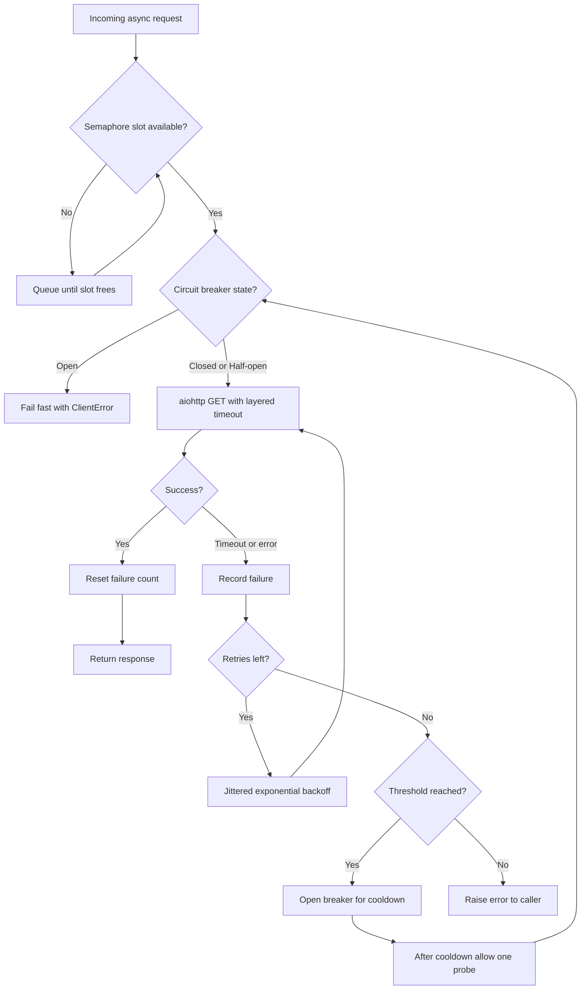

| Difficulty | Channel | Tags |
|---|---|---|
| advanced | backend | asyncio, aiohttp, concurrency |

At 3 a.m., a single slow downstream service can turn a healthy API into a sea of hung request threads. Netflix learned this the hard way: its API absorbed over a billion calls a day, fanned out at a 1:6 ratio into billions more, and peaked above 100,000 dependency requests per second, where even 99.99% uptime per dependency compounded into roughly 99.7% availability [1]. That gap is not a rounding error; it is two hours of darkness every month. The lesson that emerged from that pressure is the blueprint every async Python team eventually discovers: bound concurrency, fail fast, and give struggling services room to breathe.

---

> ### Real-World Case — Netflix
>
> Netflix's API handled over 1 billion incoming calls per day, fanning out at a 1:6 ratio to several billion calls across dozens of backend subsystems, peaking at over 100,000 dependency requests per second on thousands of EC2 instances. Even with every dependency at 99.99% uptime, the math gave 99.7% composite uptime (2+ hours of downtime per month), and a single latent dependency could saturate all Tomcat request threads in seconds and take down the whole API.
>
> | | |
> |---|---|
> | **Challenge** | Limit concurrent calls to failing or slow dependencies and degrade gracefully under high load and timeouts, so that one slow service could not cascade into a full-site outage or leave requests piling up until threads were exhausted. |
> | **Solution** | Netflix built DependencyCommand, open-sourced as Hystrix, combining aggressive network timeouts and retries, per-dependency thread-pool isolation, non-blocking 'tryable' semaphores (tryAcquire rather than a blocking acquire) for admission control, and circuit breakers that trip at thresholds like 50% errors in 10 seconds and reject calls until health checks pass. Every timeout, semaphore/thread-pool rejection, or short-circuit routes through a fallback: stale cache, queued eventual consistency, stubbed data, or an empty response, while request collapsing batches calls to reduce latency. |
> | **Outcome** | At 100,000+ dependency requests per second, Netflix reported a dramatic improvement in uptime and resilience; by 2012 Hystrix executed tens of billions of thread-isolated and hundreds of billions of semaphore-isolated calls every day at Netflix, and the circuit breakers acted as a release valve that let pressured downstream systems recover while keeping user request latency low. |
> | **Lesson** | The counterintuitive key was failing fast: use a non-blocking tryable semaphore instead of a blocking queue so callers are rejected immediately, and treat the circuit breaker as a deliberate 'release valve' that sheds load to let a failing dependency recover, with tiered fallbacks so users still get a useful response. |

---

## Hook — The night 100,000 dependencies knocked on the door

Picture this: dashboards are green, p50 latency is boring, and then one downstream service starts answering in 8 seconds instead of 80 milliseconds. Within seconds, every incoming coroutine is parked on that one dependency and your API is serving timeouts to everyone. Netflix operated at a scale where this scenario was not hypothetical: its API handled over a billion calls a day and fanned them out at a 1:6 ratio, peaking above 100,000 dependency requests per second [1].

🔥 Hot Take: The most dangerous dependency is rarely the one that is down. It is the one that is slow enough to keep every connection open and every caller waiting.

Many developers discover this only after the pager fires. The uncomfortable question is not whether a dependency will misbehave, but what your service does in the seconds before everyone else notices.

## Problem — When every dependency is up but your API is down

Building on that late-night scenario, the core challenge is not raw throughput; it is controlling what happens when throughput meets latency. A single latent dependency can saturate every available request slot in seconds, and because callers keep arriving, the queue grows faster than it drains. At Netflix scale, dozens of subsystems each offering 99.99% uptime composed to roughly 99.7% availability, about two hours of downtime per month, without any single service technically being down [1].

Here is what you need to know:
- Unbounded concurrency turns one slow call into a fleet-wide stall.
- Generous timeouts feel safe but convert slowness into resource exhaustion [5].
- Naive retries add load precisely when the downstream is weakest [7].
- Sessions that are never closed leak sockets until the next deploy.

⚠️ Watch Out: SSL context validation and missing cleanup on shutdown are the classic silent killers. A pool that works in staging can still fail in production because certificates were skipped 'just for now'.

When would you actually use this? Reach for it when your service fans out to more than a handful of network dependencies, when p99 matters more than the average, or when a dependency has no isolation of its own. Sound familiar?

## Real-World Case — Netflix

That theoretical failure became an engineering landmark at Netflix, and the numbers are almost comical. Its edge API absorbed more than one billion incoming calls per day, multiplied them through a 1:6 fan-out into several billion downstream calls, and hit peaks above 100,000 dependency requests per second across thousands of EC2 instances [1].

Even with every dependency at 99.99% uptime, the math delivered about 99.7% composite uptime, roughly two hours of downtime every month, and one latent dependency could saturate all Tomcat request threads in seconds. Consequently, the team introduced Hystrix, whose circuit breakers acted as a release valve: pressured downstream systems got room to recover while user-facing latency stayed low [1].

By 2012, Hystrix was executing tens of billions of thread-isolated and hundreds of billions of semaphore-isolated calls every day at Netflix [2]. The plot twist: isolation alone was not enough. Breakers had to open proactively, because waiting for a dependency to fail on its own meant waiting for a cascade.

💡 Insight: A breaker protects the caller from waiting and the downstream from being finished off by well-meaning retries. It is empathy implemented as code.

But how does that translate into Python primitives?

## Deep Dive — Semaphores, breakers, and the math of composite uptime

Having seen what isolation bought Netflix, the next question is which primitive belongs where. Many developers assume a semaphore is a connection pool; actually it is a concurrency gate. It decides how many callers may hold a slot, while aiohttp's connector decides how many sockets are kept alive [3]. The idea itself predates async Python by decades [8].

The circuit breaker is the second gate. It tracks failures per dependency and refuses new calls for a cooldown window once a threshold is crossed, then allows a single probe to test recovery. Python's asyncio.Semaphore provides the async-aware slot mechanism [4], while TimeoutError and ClientError give the failure signals worth counting [5].

| Approach | What it buys you | Real tradeoff |
|---|---|---|
| Semaphore only | Hard cap on concurrent calls | Queued callers still wait; no fast failure |
| Circuit breaker | Fails fast, protects downstream | Bad thresholds cause false trips |
| Backoff with jitter | Smooths retry storms | Adds latency to genuinely transient errors |
| Thread isolation | Strong bulkhead | Heavy in Python; context-switch and memory cost |

🎯 Key Point: Semaphores bound your side of the conversation; breakers bound the damage to the other side. You usually need both.

⚠️ Watch Out: Retrying non-idempotent writes is how a retry policy becomes a duplicate-order generator. Limit retries to safe methods or use idempotency keys.

Exponential backoff doubles the delay between attempts [7], and HTTP semantics already give you the vocabulary for 'try later' with 503 responses [9] [10]. But wait, it gets better: full jitter, randomizing the delay between zero and the capped backoff, prevents synchronized clients from retrying in lockstep [7].

So when would each one be used? Semaphores for protecting your own file descriptors and event loop, breakers for dependencies with a history of tail-end failures, and backoff for transient network blips. The next step is seeing the exact order in which these gates fire.

## Workflow — From semaphore slot to graceful degradation

With those mechanics clear, the request path becomes a short, predictable story. The diagram below, Request Flow Through Pool and Breaker, shows every branch a call can take.

1. A request arrives and tries to acquire a semaphore slot; excess callers queue instead of opening more sockets.
2. The breaker state is checked using a monotonic clock, so wall-clock jumps cannot confuse the cooldown [6].
3. If the breaker is open, the call fails fast with a ClientError instead of waiting for a timeout.
4. Otherwise aiohttp issues the GET with layered timeouts: connect, socket read, and total [3].
5. Success resets the failure count; a timeout or ClientError records a failure and triggers jittered backoff [5] [7].
6. Crossing the threshold opens the breaker for a cooldown, after which a single probe decides whether to close it again.

The event loop keeps all of this non-blocking, which is exactly why a semaphore rather than a thread lock is the right primitive [6].

💡 Insight: Failing fast is a feature, not a bug. A 10 ms error is cheaper for everyone than a 30 second timeout that ends in the same error.

Notice how each step has a single owner? That is what makes the behavior debuggable at 3 a.m. The next section turns that branch into code.

## Code Example — A pool manager that fails fast, backs off, and recovers

Now translate that flow into a manager you can drop into a service. The full implementation is below and in the code block that follows this section.

```python
import asyncio
import random
import time
from dataclasses import dataclass
from typing import Optional

import aiohttp

@dataclass
class BreakerState:
    failures: int = 0
    last_failure: float = 0.0
    opened_at: Optional[float] = None

    def is_open(self, now: float, threshold: int, cooldown: float) -> bool:
        if self.opened_at is None:
            return False
        if now - self.opened_at >= cooldown:  # Half-open after cooldown
            return False
        return self.failures >= threshold

    def record_success(self) -> None:
        self.failures = 0
        self.opened_at = None

    def record_failure(self, now: float, threshold: int) -> None:
        self.failures += 1
        self.last_failure = now
        if self.failures >= threshold:
            self.opened_at = now

class ConnectionPoolManager:
    def __init__(self, max_connections: int = 100, failure_threshold: int = 5,
                 cooldown: float = 30.0, max_retries: int = 3):
        self._slots = asyncio.Semaphore(max_connections)  # Bound concurrent calls
        self._session: Optional[aiohttp.ClientSession] = None
        self._timeout = aiohttp.ClientTimeout(total=30, connect=5, sock_read=10)
        self._breaker = BreakerState()
        self._threshold = failure_threshold
        self._cooldown = cooldown
        self._max_retries = max_retries

    async def start(self) -> None:
        connector = aiohttp.TCPConnector(limit=100, limit_per_host=20, keepalive_timeout=30)
        self._session = aiohttp.ClientSession(connector=connector, timeout=self._timeout)  # Reuse sockets

    async def close(self) -> None:
        if self._session is not None:
            await self._session.close()  # Prevent shutdown leaks
            self._session = None

    async def request(self, url: str) -> str:
        if self._session is None:
            raise RuntimeError("Call start() before issuing requests")
        for attempt in range(self._max_retries + 1):
            async with self._slots:  # Queue excess callers
                now = time.monotonic()
                if self._breaker.is_open(now, self._threshold, self._cooldown):
                    raise aiohttp.ClientError("Circuit breaker open: failing fast")  # No waiting
                try:
                    async with self._session.get(url) as response:
                        response.raise_for_status()
                        body = await response.text()
                        self._breaker.record_success()
                        return body
                except (asyncio.TimeoutError, aiohttp.ClientError):
                    self._breaker.record_failure(time.monotonic(), self._threshold)
                    if attempt == self._max_retries:
                        raise
            await asyncio.sleep(random.uniform(0, min(2 ** attempt, 8)))  # Full jitter
        raise aiohttp.ClientError("Unreachable")
```

Step by step, here is what is happening:
- `BreakerState` keeps failures, last failure, and an optional open timestamp; `is_open()` uses `time.monotonic()` so clock corrections cannot break the cooldown.
- `start()` builds a `TCPConnector` with a global limit and `limit_per_host`, so keep-alive reuses sockets without letting one host hoard them [3].
- `request()` acquires the semaphore first, which queues excess callers rather than multiplying sockets.
- The breaker check runs inside the slot, so open-breaker calls fail fast without occupying a connection.
- `response.raise_for_status()` turns 4xx/5xx into `ClientError`, which feeds the breaker; success resets it [5].
- Backoff uses `random.uniform(0, min(2 ** attempt, 8))`, full jitter capped at eight seconds, so retrying clients do not synchronize [7].
- `close()` awaits `session.close()`, plugging the leak that only shows up during shutdown.

Because `async with` releases the slot deterministically even when an exception is raised, no manual counter is required [11].

## Lessons Learned — Battle scars and the one metric to watch

After the code is deployed, the real work is resisting the urge to tune by gut feeling. Here are the battle scars worth memorizing:
- Sizing the pool by CPU count: network-bound work wants concurrency, not cores. Start with 100 connections and adjust from p99 latency, not from `os.cpu_count()`.
- Treating every error as retryable: retries belong on idempotent calls or behind idempotency keys.
- Skipping SSL verification in staging and forgetting to re-enable it in production.
- Watching only aggregate metrics: a healthy average hides one dependency tripping the breaker every minute.

🎯 Key Point: Monitor breaker trips per dependency, queue depth, and connect timeout rate. Those three numbers tell you whether the system is degrading gracefully or merely failing politely.

🔥 Hot Take: A circuit breaker with a 60 second cooldown and no half-open probe is just a scheduled outage with extra steps.

Consequently, the transformation is subtle but real: the same dependency slowdown that once took down the API now produces a burst of fast errors, a quiet downstream, and a clean recovery. If this feels overwhelming, start with one dependency, one semaphore, and one breaker. You do not need a platform team to begin.

---

## Request Flow Through Pool and Breaker



<details>
<summary><strong>Original Interview Question</strong></summary>

**Q:** How would you implement a connection pool manager for aiohttp that handles graceful degradation under high load and connection timeouts?

**A:** Implement a connection pool manager for aiohttp using a semaphore to limit concurrent connections, exponential backoff for retrying failed requests, and circuit breaker pattern to gracefully degrade under high load and connection timeouts.

</details>

## Conclusion

The 3 a.m. story from the introduction ends differently when these patterns are in place: Netflix's 100,000-per-second dependency storm still arrives, but the breaker opens, the semaphore holds the line, and the downstream gets room to breathe [1]. The one insight to carry into tomorrow's standup is simple: a circuit breaker is not something you add after an outage; it is the release valve you install before the pressure builds. Pick your riskiest dependency, wrap it in a bounded semaphore and a breaker with jittered retries, and measure how many calls fail fast instead of hanging. Your future on-call self will send a thank-you note.

---

## References

1. [Netflix incident report](https://netflixtechblog.com/fault-tolerance-in-a-high-volume-distributed-system-91ab4faae74a) — article
2. [Netflix Hystrix GitHub repository](https://github.com/Netflix/Hystrix) — documentation
3. [aiohttp GitHub repository](https://github.com/aio-libs/aiohttp) — documentation
4. [Python asyncio synchronization primitives](https://docs.python.org/3/library/asyncio-sync.html) — documentation
5. [Python asyncio exceptions](https://docs.python.org/3/library/asyncio-exceptions.html) — documentation
6. [Python asyncio event loop](https://docs.python.org/3/library/asyncio-eventloop.html) — documentation
7. [Exponential backoff](https://en.wikipedia.org/wiki/Exponential_backoff) — documentation
8. [Semaphore (programming)](https://en.wikipedia.org/wiki/Semaphore_(programming)) — documentation
9. [RFC 9110: HTTP Semantics](https://datatracker.ietf.org/doc/html/rfc9110) — documentation
10. [HTTP 503 Service Unavailable - MDN](https://developer.mozilla.org/en-US/docs/Web/HTTP/Status/503) — documentation
11. [Python asyncio tasks and coroutines](https://docs.python.org/3/library/asyncio-task.html) — documentation

---

**Author:** Satishkumar Dhule — [GitHub](https://github.com/satishkumar-dhule) · [LinkedIn](https://linkedin.com/in/satishkumar-dhule) · [Website](https://satishkumar-dhule.github.io)
