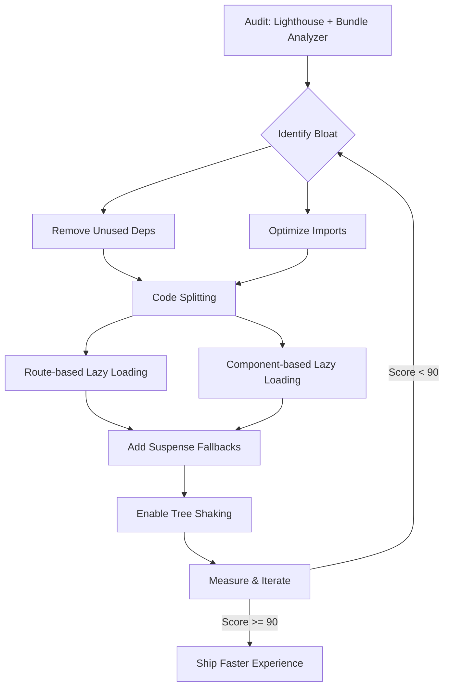

| Difficulty | Channel | Tags |
|---|---|---|
| intermediate | frontend | lighthouse, bundle, lazy-loading |

Picture a simple landing page that takes roughly 7 seconds to load on a shaky 3G connection. That was Netflix's reality for its logged-out sign-up page, weighed down by ~300kB of JavaScript for what should have been a lightweight experience [1]. If a 2.1MB bundle and a 4.2s Time to Interactive sound familiar, you are in the right place. This is the story of how teams diagnose bundle bloat, cut the fat, and turn sluggish React apps into fast, conversion-friendly experiences.

---

> ### Real-World Case — Netflix
>
> Netflix's logged-out sign-up homepage was taking ~7 seconds to load on a simulated 3G connection, shipping ~300kB of JavaScript (React, Lodash, utility libraries and hydration data) for what was essentially a simple landing page. With new users increasingly signing up on mobile and poor connections, this directly threatened sign-up conversion.
>
> | | |
> |---|---|
> | **Challenge** | Reduce Time-to-Interactive on the critical first page of the sign-up flow without sacrificing the shared React component logic used across the rest of the single-page sign-up app or breaking the server-rendered React architecture. |
> | **Solution** | They audited with Lighthouse/DevTools, disabled JavaScript to see which elements actually needed interactivity, then rewrote the page's interactions (tabs, language switcher, cookie banner, analytics logging) in vanilla JavaScript under 300 lines — removing React, Lodash and app code from the client while keeping React server-side. They then prefetched the heavy React/Redux SPA bundle for the next page using  plus XHR prefetching during idle time on the landing page, deferring that large code until it was actually needed. |
> | **Outcome** | Client JavaScript dropped by over 200kB, cutting Time-to-Interactive by over 50% (lab desktop TTI fell under 3.5s). Prefetching the subsequent pages reduced their TTI by another 30%, XHR prefetching hit a 95% cache success rate, First Input Delay was fast for 97% of desktop users, and users clicked the sign-up button at a higher rate. |
> | **Lesson** | The most effective bundle optimization is often shipping no JavaScript at all for non-interactive UI — then lazily prefetching the heavy framework code during idle time so the rest of the flow feels instant. Server-render the static shell, defer the expensive SPA. |

---

## Hook — When Every Kilobyte Costs a Customer

Performance is not just a technical scorecard; it is a business lever. On mobile networks and budget devices, every extra kilobyte competes with a user's patience. Developers often celebrate feature completeness while quietly shipping megabytes of code that delay the first meaningful interaction. Here is the thing, though: users do not wait for elegant abstractions to parse and execute. They leave.

Sound familiar? Many teams inherit apps where Lighthouse scores hover in the 60s and assume the fix requires a total rewrite. In reality, disciplined analysis and targeted changes—like code splitting and lazy loading—can unlock dramatic gains [2][3]. The question is not whether performance matters, but which changes deliver the biggest impact first.

## Problem — The Hidden Tax of a 2.1MB Bundle

A 2.1MB JavaScript bundle is more than a download problem. Browsers must download, parse, compile, and execute that code before the page becomes truly interactive. On slower connections, this compounds into long Time to Interactive (TTI), frustrated users, and lost conversions. When Lighthouse reports a 65, it is signaling cumulative issues: oversized chunks, unused dependencies, render-blocking work, and eager loading of non-critical features.

Consequently, the core challenge is prioritization. Not all bytes are equal. Some code is essential for the initial view; much of it is not. Without visibility into what fills the bundle, optimization becomes guesswork. Therefore, the path forward starts with measurement and a clear understanding of what users need right now versus what can wait [4].

## Real-World Case — Netflix's Sign-Up Page Diet

Netflix faced a version of this exact problem on its logged-out sign-up homepage. The page took about 7 seconds to load on a simulated 3G connection and shipped roughly 300kB of client-side JavaScript—including frameworks and utilities—for a largely static landing experience [1]. For a company growing sign-ups on mobile and variable networks, that delay directly threatened conversion.

Building on careful analysis, the team removed unnecessary client-side JavaScript, prefetched resources for subsequent pages, and focused on delivering only what the initial experience required. The payoff was concrete: client JavaScript dropped by over 200kB, Time-to-Interactive fell by more than 50%, and prefetched flows became significantly faster [1]. It is a powerful reminder that performance wins often come from subtraction, not addition.

## Deep Dive — Code Splitting, Lazy Loading, and Tree Shaking

To move from diagnosis to durable improvement, developers need a few core techniques working together. **Code splitting** breaks a monolithic bundle into smaller chunks that can be loaded on demand, reducing the amount of JavaScript required for the initial render [2]. **Lazy loading** defers non-critical resources—routes, components, or data—until they are actually needed, which shortens the critical path to interactivity [3][4].

Moreover, **dynamic imports** provide the mechanism to load modules at runtime, enabling both route-based and component-based splitting strategies [5]. **Tree shaking** complements these approaches by eliminating unused exports during bundling, but it depends on proper ES module syntax and configuration to be effective [8]. Finally, tools like webpack-bundle-analyzer turn opaque bundles into visual maps, revealing the largest offenders and guiding smart trade-offs [6].

💡 Insight: Treat bundle optimization as a product decision. Every dependency should justify its cost in bytes, parse time, and maintenance.

## Workflow — A Step-by-Step Path from 65 to 90+

However, knowing the techniques is only half the battle; sequencing them matters. A practical workflow keeps teams focused on measurable gains instead of random tweaks. The following diagram outlines a repeatable optimization loop:

1. **Audit first:** Run Lighthouse and inspect bundles to establish a baseline and find the heaviest chunks [6].
2. **Remove and replace:** Delete unused dependencies, swap heavy libraries for lighter alternatives, and prefer granular imports.
3. **Split strategically:** Apply route-based splitting for major views and component-based splitting for heavy widgets or charts [2][5].
4. **Lazy load with intent:** Defer non-critical UI behind user interaction or visibility, and provide clear loading states.
5. **Verify tree shaking:** Ensure ES module imports/exports are used consistently so dead code can be dropped [8].
6. **Measure and iterate:** Re-run audits after each change to confirm TTI, bundle size, and Lighthouse improvements.

⚠️ Watch Out: Lazy loading everything can backfire. Over-splitting creates request waterfalls and jarring user experiences. Prioritize high-impact, low-risk deferrals.

## Code Example — Route and Component Splitting in React

This leads to the implementation. In a React app, `React.lazy()` and `Suspense` make it straightforward to split routes and heavy components so the initial bundle stays lean [7]. The example below demonstrates a practical pattern: load core routes on demand, defer an expensive chart component, and provide resilient fallbacks while chunks are fetched [5].

Notice how the structure keeps critical navigation fast while isolating optional complexity. As a result, users get an interactive shell sooner, and secondary features arrive just in time.

## Lessons Learned — Performance Wins That Stick

Netflix's experience shows that meaningful performance gains often come from focusing on what users need first, not from shipping more code [1]. For teams staring at a 65 Lighthouse score, the path to 90+ is usually incremental: measure, cut, split, defer, and validate. Along the way, bundle analysis exposes hidden costs, and lazy loading ensures expensive features do not block the first interaction [2][4][6].

If this feels overwhelming, you are not alone. Start with the largest chunks, celebrate small wins, and bake performance checks into the development workflow. The real transformation is cultural as much as technical: when developers treat speed as a feature, users feel the difference—and metrics like TTI and conversion tend to follow.

---

## Performance Optimization Flow

<strong>Original Interview Question</strong>

**Q:** You're tasked with improving a React app's Lighthouse performance score from 65 to 90+. The bundle size is 2.1MB and Time to Interactive is 4.2s. What specific steps would you take to optimize the bundle and implement lazy loading?

**A:** Implement code splitting with React.lazy() and Suspense, analyze bundle composition with webpack-bundle-analyzer to identify largest chunks, remove unused dependencies and optimize imports, add dynamic imports for heavy components and third-party libraries, implement route-based splitting for better initial load times, and utilize tree shaking with proper ES module configuration.

## Conclusion

So what should you do tomorrow? Start with a bundle audit, identify the largest chunks, and remove or defer anything that is not essential to the first interaction. Then apply route-based and component-based splitting, verify tree shaking, and measure relentlessly. The memorable insight: performance is often a subtraction problem—ship less now so users can do more, faster.

---

## References

1. [Netflix incident report](https://medium.com/dev-channel/a-netflix-web-performance-case-study-c0bcde26a9d9) — article
2. [Code splitting](https://en.wikipedia.org/wiki/Code_splitting) — article
3. [Lazy loading](https://en.wikipedia.org/wiki/Lazy_loading) — article
4. [Lazy loading - Web Performance](https://developer.mozilla.org/en-US/docs/Web/Performance/Guides/Lazy_loading) — documentation
5. [import() - Dynamic module imports](https://developer.mozilla.org/en-US/docs/Web/JavaScript/Reference/Operators/import) — documentation
6. [webpack-bundle-analyzer](https://github.com/webpack-contrib/webpack-bundle-analyzer) — documentation
7. [React](https://github.com/facebook/react) — documentation
8. [Tree shaking](https://developer.mozilla.org/en-US/docs/Glossary/Tree_shaking) — documentation

---

**Author:** Satishkumar Dhule — [GitHub](https://github.com/satishkumar-dhule) · [LinkedIn](https://linkedin.com/in/satishkumar-dhule) · [Website](https://satishkumar-dhule.github.io)
