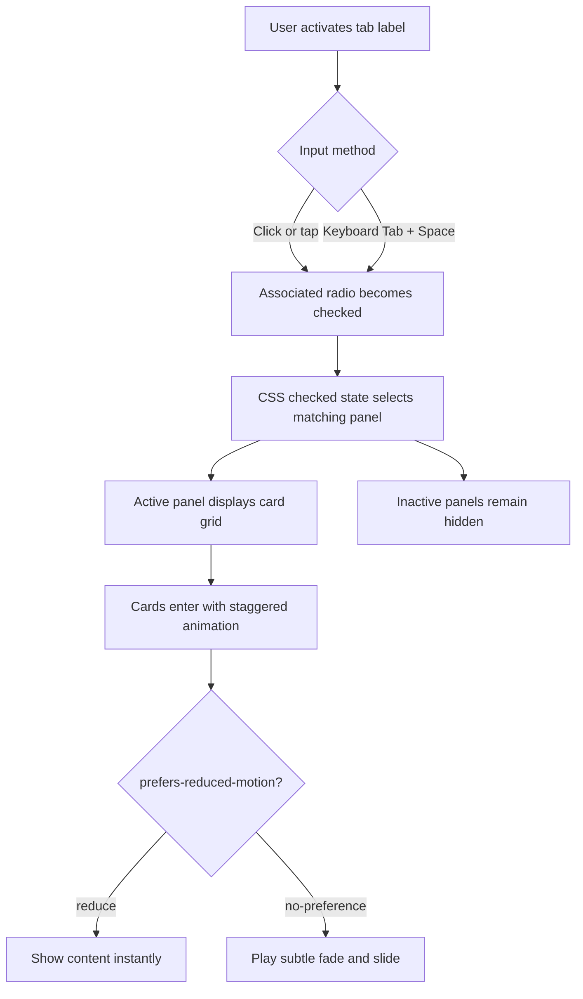

| Difficulty | Channel | Tags |
|---|---|---|
| beginner | frontend | css, flexbox, grid, animations |

When Microsoft's Office Engineering and Experiences team set out to rebuild its Fluent 2 design system, it needed documentation that could keep pace with a fast-moving Figma workflow [1]. After wrestling with rigid frameworks and CMSs that were hard to maintain, the team discovered that simpler, static architecture could unlock speed and resilience. That same lesson applies when you build interactive UI like tabbed panels: sometimes the most durable solution is the one that leans on the platform instead of piling on scripts.

---

> ### Real-World Case — Microsoft
>
> Microsoft's Office Engineering and Experiences team spent years rebuilding its Fluent 2 design system and needed a home for its design documentation. After several failed attempts with other frameworks and CMSs that were too rigid, hard to maintain, and out of sync with their Figma workflow, they reassessed what architecture they actually needed.
>
> | | |
> |---|---|
> | **Challenge** | They needed a lightweight, low-maintenance, static docs site that could support a React-based design system library, integrate with a Figma-to-Markdown workflow, host legacy Storybook iframes, and be secure and scalable against DDoS without relying on back-end services. |
> | **Solution** | They rebuilt the Fluent 2 website (fluent2.microsoft.design) on Astro, whose island architecture ships zero JavaScript by default and emits fully static files hosted on Azure. This kept designers and engineers working directly in HTML, CSS, and JavaScript while still allowing React components where needed. |
> | **Outcome** | The team delivered 200+ pages of new content over 10 months and reported building new pages in half the time versus their previous stack; a simple page can now be turned from a Figma design into a live page in 20-30 minutes. Static output also removed the back-end attack surface for DDoS resilience. |
> | **Lesson** | For design-system docs, a zero-JS-by-default, fully static architecture is a feature, not a limitation: it improves performance and security while keeping authoring close to raw HTML/CSS, so the same principles behind CSS-only UI patterns (radio-driven tabs, CSS Grid, focus-visible, reduced motion) stay maintainable at scale. The surprise is that Microsoft, the company synonymous with heavy JS tooling, deliberately chose the no-JS path. |

---

## Hook — A Design System Docs Page With No JavaScript Budget

Picture a design system site where every component demo, guideline, and example must load fast, stay accessible, and survive heavy traffic. Now imagine shipping an interactive tab panel without shipping a single line of JavaScript. Sound impossible? It is not. With a few well-chosen CSS features, you can create tabs that respond to clicks and keyboard input, adapt from desktop to mobile, and even animate gracefully for users who want motion [2][6]. The real question is not whether it can be done, but how to do it in a way that feels polished rather than hacked together.

## Problem — Interactive UI Without the Usual Safety Net

Tabs look simple, but they hide tricky requirements. You need a way to switch content, preserve keyboard focus, support small screens, and avoid overwhelming users with motion. Traditionally, teams reach for JavaScript to manage state and toggle panels. However, every script adds weight, complexity, and another failure point. Building on this tension, developers maintaining documentation sites often face a trade-off: add interactivity and risk fragility, or stay static and lose usability. The challenge, therefore, is to deliver a responsive 2×2 card grid on desktop, a single column on mobile, consistent 16:9 imagery, and accessible interactions using only HTML and CSS [3][5].

## Real-World Case — Microsoft

Microsoft's Fluent 2 documentation effort shows what happens when teams rethink architecture around real constraints. After several failed attempts with frameworks and CMSs that were too rigid, hard to maintain, and out of sync with their Figma workflow, the Office Engineering and Experiences team reassessed what they actually needed [1]. Consequently, they delivered 200+ pages of new content over 10 months and reported building new pages in half the time versus their previous stack. A simple page could go from Figma design to live in 20–30 minutes, and static output removed the back-end attack surface for DDoS resilience. This is the key takeaway for you: reducing complexity is not just a developer convenience—it can directly improve speed, maintainability, and security.

## Deep Dive — The CSS Primitives That Make Tabs Work

The core trick is surprisingly elegant. A group of radio inputs shares the same `name`, and each tab label is linked to an input with `for` and `id`. When a radio becomes `:checked`, adjacent or general sibling selectors can reveal the matching panel and hide the rest [2][8]. This gives you state without JavaScript.

Building on that foundation, layout becomes a matter of choosing the right tools. CSS Grid can define a `repeat(2, 1fr)` card layout on desktop and collapse to one column with a media query for mobile screens [5]. Each card can use `aspect-ratio: 16 / 9` to keep image areas consistent without padding hacks [3].

Moreover, accessibility details matter just as much as layout. Keyboard users need a clear `:focus-visible` outline so they can see where they are [6]. Motion-sensitive users benefit when entrance animations are wrapped in `@media (prefers-reduced-motion: no-preference)`, ensuring the experience remains calm when reduced motion is requested [4]. Staggered delays can add polish, but only as an enhancement layered on top of a solid, usable baseline [7].

## Workflow — From Markup to Motion, Step by Step

Start with semantic structure: a container for the tab controls, radio inputs, labels, and a panel for each tab. Next, wire up behavior by styling the `:checked` state so only the active panel is visible [2][8]. Then, define the panel's internal grid: two columns on larger screens and one column below your breakpoint [5].

After that, refine the card presentation. Give each card a fixed 16:9 image area, a title, and a short meta line so the layout stays predictable [3]. Finally, layer in progressive enhancements: visible focus styles for keyboard navigation and a subtle staggered entrance animation that only runs when users have not requested reduced motion [4][6][7]. The diagram below maps this flow from user interaction to rendered result.

## Code Example — A Runnable CSS-Only Tab Panel

The example below generates a complete HTML file with radio-based tabs, a responsive grid, fixed 16:9 image containers, focus outlines, and motion-aware staggered animations. Notice how the behavior comes from selectors and media queries rather than script-driven state [2][4][5]. You can save and open the output directly in a browser to see the pattern in action.

## Lessons Learned — Ship Less, Support More

The biggest lesson is that platform features often cover more ground than teams expect. Radio inputs and `:checked` selectors can replace small state machines, Grid can replace brittle layout hacks, and motion media queries can make polish inclusive by default [2][4][5]. Microsoft’s documentation rebuild reinforces the broader point: simpler architectures can move faster and break less [1].

However, CSS-only does not mean consequence-free. The markup must stay logical, labels must be correctly associated with inputs, and focus states must remain obvious [6]. If this feels overwhelming, you are not alone—many developers discover that accessibility and responsiveness are where the real craft lives. The practical next step is clear: take one interactive docs component, remove unnecessary JavaScript, and rebuild it with semantic HTML plus progressive CSS enhancements. Tomorrow, your pages can be faster, calmer, and easier to maintain.

---

## CSS Tab Interaction Flow

<strong>Original Interview Question</strong>

**Q:** Build a CSS-only tab panel for a design-system docs page. Use radio inputs to switch tabs (no JavaScript). Desktop: a 2x2 grid of cards under each tab; mobile: single column. Each card has a fixed 16:9 image area, a title, and a short meta line. Add a subtle entrance animation with a stagger and keep focus-visible outlines; ensure prefers-reduced-motion is respected?

**A:** Use a set of radio inputs with a shared `name` attribute and corresponding `` elements for each tab section. The `:checked` state of each radio controls visibility of its associated panel via adjacent sibling selectors. Each panel renders a 2×2 card grid on desktop and collapses to a single column on mobile. Cards use `aspect-ratio: 16/9` for fixed image containers, with a title and meta line below.

## Conclusion

The journey from rigid, script-heavy patterns to lean, CSS-driven interactions mirrors what Microsoft learned while rebuilding Fluent 2 docs: simpler systems can be faster to ship and easier to trust [1]. When you reach for radio inputs, Grid, aspect-ratio, focus-visible, and motion preferences, you are not just avoiding JavaScript—you are building interfaces that respect users and reduce maintenance. Tomorrow, pick one tabbed component in your docs or design system, rebuild it with these primitives, and see how much complexity you can remove without losing delight.

---

## References

1. [Microsoft incident report](https://astro.build/case-studies/microsoft) — article
2. [MDN: :checked](https://developer.mozilla.org/en-US/docs/Web/CSS/:checked) — documentation
3. [MDN: aspect-ratio](https://developer.mozilla.org/en-US/docs/Web/CSS/aspect-ratio) — documentation
4. [MDN: prefers-reduced-motion](https://developer.mozilla.org/en-US/docs/Web/CSS/@media/prefers-reduced-motion) — documentation
5. [MDN: CSS grid layout](https://developer.mozilla.org/en-US/docs/Web/CSS/CSS_grid_layout) — documentation
6. [MDN: :focus-visible](https://developer.mozilla.org/en-US/docs/Web/CSS/:focus-visible) — documentation
7. [MDN: Using CSS animations](https://developer.mozilla.org/en-US/docs/Web/CSS/CSS_animations/Using_CSS_animations) — documentation
8. [MDN: Next-sibling combinator](https://developer.mozilla.org/en-US/docs/Web/CSS/Next-sibling_combinator) — documentation

---

**Author:** Satishkumar Dhule — [GitHub](https://github.com/satishkumar-dhule) · [LinkedIn](https://linkedin.com/in/satishkumar-dhule) · [Website](https://satishkumar-dhule.github.io)
