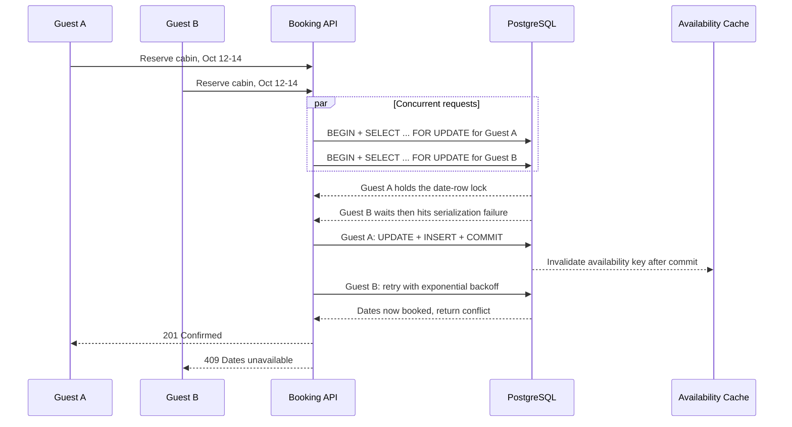

| Difficulty | Channel | Tags |
|---|---|---|
| intermediate | database | acid, isolation-levels, mvcc |

Ever wondered why a confirmed room sometimes turns into a very awkward front-desk conversation? Picture two travelers clicking Reserve on the same cabin at the exact same millisecond — both see success, and one of them gets a ruined vacation. Booking.com ran straight into this class of problem at a scale most teams never see: its Order Platform holds 20TB of reservation data across three regions while serving roughly 5M writes and 2B reads a day [1]. That story is a masterclass in what happens when atomicity stops being a database feature and becomes a product promise.

---

> ### Real-World Case — Booking.com
>
> Booking.com's Order Platform is the source of truth for every reservation across hotels, flights, and cars. Originally built on sharded MySQL, it was rebuilt on Cassandra to escape master-failover downtime — but reservation updates are multi-row, multi-partition read-modify-write operations that Cassandra's row-level isolation cannot make atomic.
>
> | | |
> |---|---|
> | **Challenge** | Guarantee that conflicting reservation/booking updates cannot both commit, while staying highly available globally — without relying on ambiguous application-level locking that fails silently under timeouts. |
> | **Solution** | Their first workaround was a lock manager built on Cassandra lightweight transactions (Paxos): slow, expensive, and worse, when an LWT timed out they could not tell whether the condition legitimately failed or the system was broken. They migrated ~20TB of reservation data to CockroachDB, which provides SERIALIZABLE isolation by default (MVCC versioned snapshot reads, Raft consensus, and transaction restarts on contention) plus native CDC and secondary indexes, letting them delete the custom locking logic, cross-store consistency-checker services, and OpenSearch replication pipelines. |
> | **Outcome** | 20TB of order data running across 3 regions (Frankfurt, London, Ireland) at 99.999% availability, with a 99.99998% write SLI; the platform handles ~5M writes and ~2B reads per day. They removed the extra cross-check systems and, counterintuitively, kept the denormalized Cassandra-style schema because normalizing into SQL joins across regions hurt latency. |
> | **Lesson** | The plot twist: a team that originally abandoned MySQL for Cassandra's write availability deliberately traded availability for consistency to get serializable ACID transactions — and the biggest SQL migration performance win came from *not* normalizing. A chaos-engineering wake-up call also showed a single slow disk on a liveness-range leaseholder could still degrade the whole cluster, proving high availability needs testing, not assumptions. |

---

## Hook — Two clicks, one cabin, zero good outcomes

Picture the scene: a lakeside cabin, one open weekend, and two travelers who both hit Reserve at the exact same millisecond. Both screens flash green. Both cards get charged. Only one person is sleeping there on Saturday.

That is not a hypothetical edge case tucked away in a textbook — it is the daily reality of any booking platform, and the moment it happens, a database has quietly turned a product promise into a customer service disaster.

🔥 Hot Take: A double booking is rarely a bug in the UI. It is a concurrency bug wearing a friendly confirmation email as a disguise.

The uncomfortable question is this: if two transactions cannot see each other's uncommitted work, what exactly stops both of them from believing they won? Sound familiar? Every developer who has shipped a reservation flow has stared at that question at 2am.

## Problem — When snapshot reads lie to you

Here is the thing though: modern databases are built to let readers and writers coexist, and that is precisely where the trouble starts. Under multiversion concurrency control (MVCC), a transaction reads a consistent snapshot of the data instead of blocking writers [4].

That is wonderful for throughput and terrible for anyone who assumes that 'check, then write' is safe. Two guests both read 'available' from their own snapshot, and because neither write has committed, neither sees a reason to stop. The database did exactly what it was told.

- **The stale check:** availability is read in one transaction, but the row changes before the write lands.
- **The write skew:** each transaction reads overlapping rows and writes a different one, so a simple row lock detects nothing [3].
- **The phantom:** a new booking row appears inside a date range that was previously empty [2].
- **The cache trap:** a read replica or cache still advertises an open date after the write committed.

⚠️ Watch Out: READ COMMITTED guarantees you never see dirty data. It does not guarantee that the row you read is still true by the time you commit. Many developers discover this the hard way, with a support ticket rather than a test failure.

So the real problem is not locking a row. It is deciding which guarantee is strong enough to keep a promise, and what that guarantee costs when traffic spikes.

## Real-World Case — Booking.com and the 20TB ordering machine

Now take that tiny race and multiply it by millions of reservations a day. Booking.com's Order Platform is the source of truth for every hotel, flight, and car reservation on the site, and it started life on sharded MySQL [1].

Master failover meant downtime, so the team moved the platform to Cassandra for availability. Then came the plot twist nobody enjoys: an order update is a multi-row, multi-partition read-modify-write, and Cassandra's row-level isolation cannot make that operation atomic [1].

- **The old safety net:** extra cross-check systems reconciled orders after the fact.
- **The cost:** every reconciliation layer is a place for two truths to disagree.
- **The surprising fix:** those cross-check systems were removed, and consistency was pushed into the order model itself.
- **The counterintuitive choice:** the denormalized Cassandra-style schema stayed. Normalizing into SQL joins across regions hurt latency too much [1].

Today the platform runs 20TB of order data across Frankfurt, London, and Ireland at 99.999% availability, with a 99.99998% write SLI, roughly 5M writes and 2B reads per day [1].

💡 Insight: The lesson is not that Cassandra is wrong. It is that isolation is a design decision, not a checkbox. At this scale, availability was chosen and correctness was paid for with careful data modeling instead of cross-region joins.

Which raises the next question: how does a normal team, without three regions of infrastructure, buy that same certainty?

## Deep Dive — Isolation levels, version columns, and the price of certainty

Building on that lesson, the booking problem becomes a tradeoff between how much correctness is needed and how much contention can be tolerated.

SERIALIZABLE is the strongest isolation level: it makes concurrent transactions behave as if they ran one after another, even though the database runs them in parallel [3]. Under the hood, PostgreSQL's implementation uses predicate locks and can abort one transaction with a serialization failure, which is the cue to retry [7].

Optimistic concurrency control takes a different tack. Instead of locking up front, each row carries a version column; a write includes the version it read, and the update only succeeds if that version still matches [5].

🔥 Hot Take: Optimistic locking is not 'no locking.' It is locking with the bill deferred to commit time, and somebody still has to pay it.

MVCC adds another layer: snapshot reads keep availability checks fast without blocking writers [4], while SELECT ... FOR UPDATE takes row-level locks on exactly the date rows being reserved [6].

| Option | What it buys | What it costs | When to reach for it |
|---|---|---|---|
| READ COMMITTED | Maximum concurrency | Stale checks, write skew | Feeds, analytics, non-critical reads |
| REPEATABLE READ | Stable snapshot | Write skew still possible | Reports over a fixed dataset |
| SERIALIZABLE + FOR UPDATE | No double bookings | Lock contention, retries | Checkout, payments, reservations |
| Optimistic version column | Few held locks | Retry storms on hot properties | High-read, low-confirm paths |
| Read replicas + cache | Cheap availability checks | Invalidation bugs | Browsing calendars, not confirming |

🎯 Key Point: ACID's isolation guarantee is a promise about transaction outcomes, not about hardware [10]. Layer caching and replicas on top, and the consistency of that layer belongs to the application team.

For example, write-through caching with invalidation on a successful booking keeps browsing fast, while cache semantics in distributed systems are a reminder that stale responses are normal, not an anomaly [9]. Teams also lean on managed PostgreSQL for backups and failover [8].

But knowing the tools is not the same as ordering them correctly. What does the sequence actually look like when two guests collide?

## Workflow — From race condition to confirmed reservation

This leads directly to a concrete sequence: one writer owns the dates, everyone else either waits or retries, and the cache gets told the truth. The reservation race sequence below shows exactly where the conflict is resolved.



Step by step, the flow works like this:

1. **Begin with intent.** Start a SERIALIZABLE transaction so the database tracks the read set and the write set together [3].
2. **Lock the narrowest thing possible.** SELECT ... FOR UPDATE on only the requested date rows avoids locking an entire property calendar [6].
3. **Validate honestly.** If any locked row is no longer available, commit nothing and return a clear conflict instead of a generic 500.
4. **Mutate atomically.** Update the availability rows, bump their versions, and insert the booking inside the same transaction [2].
5. **Invalidate after commit.** Only a successful write should evict the cached availability key; a failed attempt must not [9].
6. **Retry with backoff.** Serialization failures are expected, so retry with exponential backoff plus jitter, and cap the attempts.
7. **Protect the hot path.** When one property is being hammered, a circuit breaker stops retry traffic from becoming a self-inflicted outage.

⚠️ Watch Out: Caching an availability check on a replica is fine. Caching the result of a successful booking without invalidating it is how a sold-out cabin keeps selling.

The diagram makes the ordering visible; the code below makes it executable.

## Code Example — A booking transaction that refuses to lose

With that sequence in mind, here is the pattern in production-style Python, using a connection pool and PostgreSQL semantics. The snippet solves the exact race from the opening scene: two callers, one set of dates, one winner.

```python
import random
import time
from dataclasses import dataclass

@dataclass
class BookingResult:
    success: bool
    booking_id: int | None = None
    attempts: int = 0

class SerializationFailure(Exception):
    pass

class BookingService:
    def __init__(self, pool, max_retries=5):
        self.pool = pool
        self.max_retries = max_retries

    def reserve(self, property_id, check_in, check_out, guest_id):
        for attempt in range(1, self.max_retries + 1):
            try:
                with self.pool.connection() as conn:
                    # SERIALIZABLE tracks the whole read/write set, not one row.
                    conn.execute('BEGIN ISOLATION LEVEL SERIALIZABLE')
                    try:
                        # Lock only the date rows inside the requested range.
                        rows = conn.execute(
                            '''
                            SELECT stay_date, status, version
                            FROM property_availability
                            WHERE property_id = %s
                              AND stay_date BETWEEN %s AND %s
                            ORDER BY stay_date
                            FOR UPDATE
                            ''',
                            (property_id, check_in, check_out),
                        ).fetchall()

                        # A real conflict is a business outcome, not a retry case.
                        if any(row[1] != 'available' for row in rows):
                            conn.execute('ROLLBACK')
                            return BookingResult(False, attempts=attempt)

                        # Bump version so optimistic readers can spot staleness.
                        conn.execute(
                            '''
                            UPDATE property_availability
                            SET status = 'booked', version = version + 1
                            WHERE property_id = %s
                              AND stay_date BETWEEN %s AND %s
                            ''',
                            (property_id, check_in, check_out),
                        )

                        booking_id = conn.execute(
                            '''
                            INSERT INTO bookings
                                (property_id, guest_id, check_in, check_out)
                            VALUES (%s, %s, %s, %s)
                            RETURNING id
                            ''',
                            (property_id, guest_id, check_in, check_out),
                        ).fetchone()[0]

                        conn.execute('COMMIT')
                        return BookingResult(True, booking_id, attempt)
                    except Exception:
                        conn.execute('ROLLBACK')
                        raise
            except SerializationFailure:
                if attempt == self.max_retries:
                    raise
                # Jitter prevents a thundering herd of synchronized retries.
                time.sleep(min(0.01 * (2 ** attempt), 1.0) + random.random() * 0.01)
        raise RuntimeError('retry loop exited unexpectedly')
```

Walking through it:

- BEGIN ISOLATION LEVEL SERIALIZABLE asks the database to detect conflicts across the whole read/write set, not just one row [3].
- The SELECT ... FOR UPDATE query locks only the date rows in the requested range, so a booking for October 12 does not block one for December 2 [6].
- The availability branch treats genuine unavailability as a business outcome, not an error to retry.
- version = version + 1 gives optimistic readers a cheap way to notice they are stale [5].
- The nested try/except guarantees a ROLLBACK on every failure path, because a connection returned to a pool mid-transaction is a nasty surprise for the next caller.
- Backoff uses min(0.01 * (2 ** attempt), 1.0) plus jitter, so retries do not arrive in lockstep.

💡 Insight: The retry loop is not defensive filler — it is part of the correctness argument. SERIALIZABLE works by aborting one conflicting transaction, so a system without retries has deliberately chosen to fail under contention [7].

If this feels overwhelming, start with the lock and the rollback, then add retries. Sound familiar? It is the same shape as any idempotent payment flow.

## Lessons Learned — Battle scars and the thing to do tomorrow

Consequently, every team that ships a reservation flow collects a few scars. Here are the ones worth remembering before the pager does it for you.

- **Battle scar: locking the whole property.** One SELECT FOR UPDATE on the property row turns a busy weekend listing into a single-file queue. Lock the dates instead.
- **Battle scar: retrying a real conflict.** A sold-out date is not a transient failure. Retry only serialization errors; return 409 for genuine unavailability.
- **Battle scar: unbounded retries.** Five attempts with jitter is a strategy; infinite attempts are a denial-of-service attack against your own database.
- **Battle scar: normalizing across regions for purity.** Booking.com kept denormalized data because cross-region joins destroyed latency [1]. Correctness is not the same as textbook elegance.
- **Battle scar: forgetting observability.** Track lock wait time, serialization failure rate, and retry counts per property. Hot properties announce themselves in the metrics before they announce themselves in support tickets.

🎯 Key Point: Transactions protect data inside the database; ownership protects meaning outside it. Decide which component is allowed to say 'confirmed,' and make every other component a reader of that decision.

So what changes tomorrow? Draw the boundary of one atomic operation around the check and the write, pick the weakest isolation level that still makes that boundary honest, and add a retry budget with metrics. Then explain the tradeoff to your team in one sentence: a double booking is a concurrency bug with a customer-facing invoice.

That sentence is the memorable insight worth carrying into the next design review — and it ties straight back to the two travelers and the one cabin that started this journey.

---

## Reservation Race Sequence


<details>
<summary><strong>Original Interview Question</strong></summary>

**Q:** You're building a booking system for Airbnb where multiple users can reserve the same property simultaneously. How would you design the transaction handling to prevent double bookings while maintaining high availability?

**A:** Use SERIALIZABLE isolation with optimistic concurrency control. Implement row-level locks on property availability tables, use MVCC snapshot reads for checking availability, and apply application-level validation to ensure atomic booking operations.

</details>

## Conclusion

Two travelers clicked the same button, and only one of them got the cabin — because somewhere a transaction decided who won. Booking.com showed the world that at 5M writes and 2B reads a day, that decision is an architecture problem, not a SQL afterthought [1]. You do not need 20TB of orders to apply the lesson: lock the narrowest rows, keep the check and the write in one atomic boundary, retry the conflicts that are truly transient, and let the cache learn from committed truth. The next time a confirmation email goes out, it will be a promise the database can actually keep.

---

## References

1. [Booking.com incident report](https://www.cockroachlabs.com/customers/booking-com/) — article
2. [Database transaction - Wikipedia](https://en.wikipedia.org/wiki/Database_transaction) — documentation
3. [Isolation (database systems) - Wikipedia](https://en.wikipedia.org/wiki/Isolation_(database_systems)) — documentation
4. [Multiversion concurrency control - Wikipedia](https://en.wikipedia.org/wiki/Multiversion_concurrency_control) — documentation
5. [Optimistic concurrency control - Wikipedia](https://en.wikipedia.org/wiki/Optimistic_concurrency_control) — documentation
6. [Database lock - Wikipedia](https://en.wikipedia.org/wiki/Database_lock) — documentation
7. [PostgreSQL source repository](https://github.com/postgres/postgres) — documentation
8. [Amazon RDS for PostgreSQL - AWS Documentation](https://docs.aws.amazon.com/AmazonRDS/latest/UserGuide/CHAP_PostgreSQL.html) — documentation
9. [RFC 7234: HTTP/1.1 Caching](https://datatracker.ietf.org/doc/html/rfc7234) — documentation
10. [ACID - Wikipedia](https://en.wikipedia.org/wiki/ACID) — documentation

---

**Author:** Satishkumar Dhule — [GitHub](https://github.com/satishkumar-dhule) · [LinkedIn](https://linkedin.com/in/satishkumar-dhule) · [Website](https://satishkumar-dhule.github.io)
