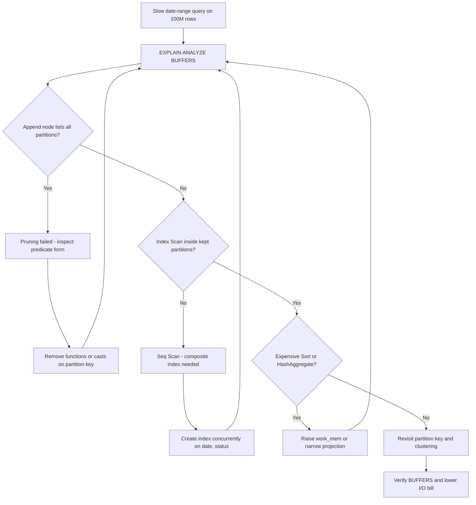

| Difficulty | Channel | Tags |
|---|---|---|
| intermediate | database | explain, query-plan, partitioning |

A 33 TB orders table can quietly turn into a $17,676.81 weekly I/O bill before anyone notices a single slow query [1]. AWS engineers ran exactly that production-scale time-series workload on Aurora PostgreSQL — roughly 46 GB ingested per day, 1,000 writes per second, and 10,000 reads per second — and watched the writer push about 100,000 read IOPS [1]. The fix was not a bigger instance; it was daily range partitioning that cut those reads to roughly 40,000 IOPS and the bill to $5,608.33 [1]. Your 100M-row partitioned table might be slow for the same reason, and the truth is already sitting inside the EXPLAIN plan.

---

> ### Real-World Case — Amazon (AWS)
>
> AWS engineers ran a production-scale time-series workload on Aurora PostgreSQL: a 33 TB orders table ingesting ~46 GB/day with 1,000 writes/sec and 10,000 reads/sec. Aurora charges separately for I/O, and the unpartitioned table produced ~100,000 read IOPS on the writer and a $17,676.81 weekly storage-I/O bill.
>
> | | |
> |---|---|
> | **Challenge** | Date-range queries on created_at were dragging the entire 33 TB table and its indexes into the buffer pool, wasting I/O and money; they needed range partitioning to actually prune partitions and shrink the working set. |
> | **Solution** | They range-partitioned orders by created_at using pg_partman, comparing monthly vs daily partitions, and attached the old table in place with only ~10-second application pauses. Critically, they had to add the partition key created_at to the primary key alongside public_id and to every application UPDATE/query that previously referenced only public_id, otherwise unique constraints could not be enforced and pruning/index access was defeated. |
> | **Outcome** | With daily partitions, blocks read dropped from ~600,000/sec spikes to ~25,000/sec, writer read IOPS fell from ~100,000/sec to ~40,000/sec, and weekly I/O charges fell from $17,676.81 to $5,608.33 (about 68% savings; up to 40% with monthly and 60% with daily partitioning). |
> | **Lesson** | Partitioning pays off only when the partition key appears directly in WHERE clauses and in the indexes/primary key; finer daily granularity beat monthly, and the real win is avoiding page reads rather than rewriting the query. |

---

## Hook — The deploy looked fine. Then the invoice arrived.

The deploy looked fine. Then finance forwarded a storage input/output invoice that read like a phone number. That was the reality of the Aurora PostgreSQL workload described in the AWS breakdown, where roughly 600,000 blocks-per-second spikes turned into a normal Tuesday [1].

Here is the uncomfortable part: nothing was 'broken' in the traditional sense. No 500 errors, no race condition, no rogue release — just a 33 TB orders table that the planner kept reading, block by block, because a date filter was not steering the scan the way developers assumed it would.

Many developers think partitioning is the finish line. Actually, partitioning is only a promise: it gives the planner the opportunity to skip data, and the database keeps that promise only when the query predicate and the indexes cooperate. If the predicate is disguised, the promise is void.

⚠️ Watch Out: the gap between 'the table is partitioned' and 'the planner skipped anything' is where the money leaks. So what does a skipped partition look like in a plan — and what does a scan of all 90 daily partitions look like?

## Problem — 100 million rows, one stubborn date filter

Building on that shock, the interview question sounds almost polite: a PostgreSQL table with 100M rows is partitioned by date, a query filters a specific date range, and it is still slow. What would anyone check in the EXPLAIN plan? The politeness is deceptive — this question separates developers who have read about partitioning from developers who have debugged it at 2am.

The core pain is that partitions are physical, but the planner's decision is logical. A date range only saves work if the planner can prove that entire partitions are irrelevant and then find a cheap way into the partitions that remain. Miss either half and a 100M-row table behaves like one big table wearing a very expensive costume.

Sound familiar? Teams usually notice the symptom as latency; specifically, as a dashboard query that used to return in seconds and now takes long enough to brew coffee. The invoice arrives as I/O. In cloud databases, storage reads are metered separately from compute, and containerized databases add another layer of durable storage through persistent volumes [9]. A careless scan is not just slow — it is a recurring charge.

Here is what you need to know before touching DDL:

- Partition pruning is a planner decision, not a runtime guarantee; it happens at plan time when the predicate is a constant, and at execution time for parameterized queries [2].
- An index on `status` alone rarely helps a query that starts with a date range; column order changes the whole access path [3].
- A partition key that looks optimal on paper can be the wrong key for the actual query pattern [4].
- The `BUFFERS` option turns a plan from an opinion into evidence by showing blocks touched [10].

When would this actually matter? Any event stream, order history, or multi-tenant analytics table where the newest slice is hot and the oldest is cold. If that describes your workload, the next section is not theory — it is someone else's production bill.

## Real-World Case — Amazon (AWS)

Now the abstraction gets a price tag. AWS engineers ran a production-scale time-series workload on Aurora PostgreSQL: an orders table of 33 TB ingesting about 46 GB per day, with 1,000 writes per second and 10,000 reads per second hammering the writer [1]. Aurora charges separately for input/output, so every unnecessary block read had a line item attached.

The struggle, however, was not a mysterious bug; it was the ordinary shape of a time-series query asking for a narrow slice of a very wide table. With the table unpartitioned, the workload produced roughly 100,000 read IOPS on the writer and a weekly storage I/O charge of $17,676.81 [1].

The discovery was refreshingly unglamorous: daily range partitions let the planner skip almost everything outside the requested dates. Blocks read dropped from roughly 600,000-per-second spikes to about 25,000 per second, writer read IOPS fell from roughly 100,000 to 40,000, and the weekly bill landed at $5,608.33 — around 68% less [1].

| Approach | Peak blocks read/sec | Writer read IOPS | Weekly I/O bill | Real tradeoff |
| --- | --- | --- | --- | --- |
| Unpartitioned | ~600,000 | ~100,000 | $17,676.81 | One table, maximum scan waste |
| Monthly partitions | Improved | Improved | Up to ~40% lower [1] | Fewer objects, coarser pruning |
| Daily partitions | ~25,000 | ~40,000 | $5,608.33 (~68% lower) [1] | More partitions to manage |

🔥 Hot Take: the partitioning scheme was not a clever new algorithm. It was the same query, the same data, and a planner finally allowed to ignore most of both.

But wait, it gets better. AWS also reported that monthly partitions delivered up to about 40% savings while daily partitions reached roughly 60% in related tests [1] — a reminder that granularity is a tradeoff, not a religion. Which raises the real question: how does anyone tell, before the invoice, whether pruning actually happened?

## Deep Dive — What the planner is actually doing

That question leads straight into the EXPLAIN plan. Running `EXPLAIN (ANALYZE, BUFFERS)` does two things a plain `EXPLAIN` cannot: `ANALYZE` actually executes the query and reports real row counts, while `BUFFERS` reports how many blocks were read [10]. PostgreSQL's planner is a cost-based optimizer, so those numbers reveal whether its estimate and reality agree [4].

💡 Insight: on a partitioned table, the plan should show an `Append` node whose children are only the partitions that survived pruning. If every partition appears, the filter never gave the planner a usable constant — a classic symptom of wrapping the partition key in a function or cast, such as `DATE(event_date)` or `event_date::date`.

The second clue is the access method. An `Index Scan` or `Bitmap Heap Scan` on the surviving partitions means an index is doing useful work; a `Seq Scan` on an 11-million-row daily slice means the index is missing, unusable, or not selective enough [3]. Composite indexes matter here, because a B-tree on `(event_date, status)` can narrow the date range first and then the status, while `(status, event_date)` starts from a value that matches nearly every row [5].

⚠️ Watch Out: an index that is technically 'used' can still be the wrong one. Check `Rows Removed by Filter` — if the index hands back millions of rows that get thrown away, the leading column is probably wrong.

Third, watch the expensive children: `Sort` and `HashAggregate` nodes, especially ones whose reports mention disk spills. Those are often the real villains behind a 'date filter is slow' complaint, because pruning fixed the scan but the aggregation still has to chew through the survivors [2]. Moreover, a narrow projection can remove a sort entirely when the query stops asking for `SELECT *`.

🎯 Key Point: when would you actually use a composite index like this? When the WHERE clause always pairs the partition key with a second, moderately selective column — status, tenant_id, or region. If the second column is nearly constant, the extra index column buys very little and only slows writes.

Here is the counterintuitive bit: more partitions are not automatically better. Thousands of tiny partitions add planning overhead and catalog churn, so the sweet spot balances pruning precision against object count [6]. The trick is to verify each assumption instead of trusting the DDL — which brings the discussion to a repeatable workflow.

## Workflow — A five-step triage, from EXPLAIN to fix

Building on those three clues, the debugging routine becomes a loop rather than a guess. The 'Partition Pruning Diagnostic Flow' diagram below maps the same path that the steps describe, and it is deliberately circular — every fix ends with another EXPLAIN.

1. Capture evidence with `EXPLAIN (ANALYZE, BUFFERS)` against the exact query, with literals matching production.
2. Find the `Append` node and count the partitions underneath it. All of them appearing means pruning failed; rewrite the predicate so the partition key stands alone.
3. Inspect the kept partitions for `Index Scan` versus `Seq Scan`, then compare `Rows Removed by Filter` against rows actually returned.
4. Hunt for `Sort` and `HashAggregate` nodes with disk spills; adjust `work_mem` or reduce rows early with a narrower projection.
5. Add the composite index on `(event_date, status)` without locking the table, then re-run step 1 and let the BUFFERS numbers decide whether the change earned its keep.
6. If scans remain broad, revisit the partition key itself: daily may beat monthly for tight windows, but the query pattern gets the final vote [7].

💡 Insight: teams often stop after step 5 because latency improves. The AWS numbers show why the loop matters — the same workload saved thousands of dollars only after the physical access pattern changed, not merely after a query got faster.

⚠️ Watch Out: never benchmark with `EXPLAIN` alone. Without `ANALYZE`, the plan reports estimates, and estimated selectivity is exactly what failed in the first place [10].

Sound familiar? The list looks simple, but step 5 is where production tables bite back — adding an index to a live 100M-row table has a locking trap that catches even careful developers.

## Code Example — From EXPLAIN output to a safer index build

Here is the thing though: the SQL in the original answer is correct in intent but dangerous in production. `CREATE INDEX CONCURRENTLY` cannot run inside a transaction block, and `CLUSTER` takes an `ACCESS EXCLUSIVE` lock that freezes reads and writes on the table [5]. The Python script below follows the standard DB-API cursor pattern [8] while keeping each statement in the right transaction context.

Step by step, the script does this:

- `explain_query()` executes `EXPLAIN (ANALYZE, BUFFERS)` through a normal transaction and returns each plan line, so the `Append` children and buffer counts can be inspected.
- The first `with psycopg.connect(...)` block prints the baseline plan — capture it before changing anything.
- The second connection sets `autocommit=True`, which is required for `CREATE INDEX CONCURRENTLY IF NOT EXISTS idx_events_date_status ON events (event_date, status)`; the leading date column lets the index serve the range first.
- `CLUSTER events USING idx_events_date_status` physically co-locates rows in index order, which reduces scattered reads but must be scheduled as maintenance because of the exclusive lock.

🎯 Key Point: when would you actually use this pattern? Any time an index must be added to a live, high-write table; the `CONCURRENTLY` keyword trades a longer build for zero write blocking. The `CLUSTER` step is optional and belongs in a maintenance window, not in a release.

⚠️ Watch Out: if a concurrent index build fails, it can leave an `INVALID` index behind. Drop it and retry rather than assuming the retry will reuse it.

With the plan verified and the index in place, only the takeaways remain — starting with the mistakes that quietly undo all of this.

## Lessons Learned — The five things worth remembering

Consequently, the journey from a 33 TB invoice to a 68% smaller bill comes down to habits, not heroics. The AWS story showed the stakes, the EXPLAIN walkthrough showed the evidence, and the code showed the safe way to act on it [1].

Here is what you need to know — the battle scars version:

- **Assuming pruning happened.** Verify the `Append` node lists only relevant partitions [2].
- **Function-wrapping the partition key.** `DATE(event_date)` can turn a precise range into a full scan; keep the raw column in the predicate.
- **Reversed composite index columns.** `(status, event_date)` may look equivalent, but B-tree prefix order decides which filter narrows first [3].
- **Trusting estimates.** Without `ANALYZE`, a plan can confidently recommend the wrong path [10].
- **Clustering at the wrong time.** Physical ordering helps reads, but the exclusive lock makes it a maintenance task [5].
- **Treating partition count as a virtue.** Too many partitions add planning cost; too few blur the pruning window [6].

🔥 Hot Take: the fastest query is the one whose data never gets read. A partition the planner skips costs nothing, and that is a much better optimization than making a scanner slightly faster.

💡 Insight: if this feels overwhelming, start with a single query — your slowest date-range one — and write down the partition count, scan type, and BUFFERS number before changing anything. Two numbers and a screenshot beat a week of guesswork.

Specifically, the next move is small: one plan, one check, one change. The only question left is what to do differently tomorrow. The conclusion turns this whole investigation into one small ritual.

---

## Partition Pruning Diagnostic Flow

<strong>Original Interview Question</strong>

**Q:** You have a PostgreSQL table with 100M rows partitioned by date. A query filtering on a specific date range is still slow. What would you check in the EXPLAIN plan and how would you optimize it?

**A:** Check partition pruning effectiveness, index utilization patterns, and expensive sort operations. Create composite indexes on (date, filtered_columns) and evaluate clustering strategies for optimal data access.

## Conclusion

The 33 TB orders table did not need a bigger instance or a heroic rewrite; it needed a planner allowed to skip work and an index aligned with the filter [1]. That is the whole story: a $17,676.81 weekly input/output bill fell to $5,608.33 when daily partitions, a composite `(event_date, status)` index, and honest `EXPLAIN (ANALYZE, BUFFERS)` evidence replaced assumption.

So what should change tomorrow? Pick one slow date-range query, run the plan with `BUFFERS`, count the partitions under `Append`, and check the B-tree column order before reaching for more hardware [4]. Then write the memorable version on the team whiteboard: a partition you skip is free, a partition you scan is an invoice, and the EXPLAIN plan is that invoice printed before you pay it.

Your database has already written the first draft of the answer. The question is whether anyone is reading it.

---

## References

1. [Amazon (AWS) incident report](https://aws.amazon.com/blogs/database/reduce-read-i-o-cost-of-your-amazon-aurora-postgresql-database-with-range-partitioning/) — article
2. [PostgreSQL - Wikipedia](https://en.wikipedia.org/wiki/PostgreSQL) — documentation
3. [Database index - Wikipedia](https://en.wikipedia.org/wiki/Database_index) — documentation
4. [Query optimization - Wikipedia](https://en.wikipedia.org/wiki/Query_optimization) — documentation
5. [postgres/postgres - official PostgreSQL source repository](https://github.com/postgres/postgres) — documentation
6. [Amazon RDS for PostgreSQL - AWS Documentation](https://docs.aws.amazon.com/AmazonRDS/latest/UserGuide/CHAP_PostgreSQL.html) — documentation
7. [What is Amazon Aurora? - AWS Documentation](https://docs.aws.amazon.com/AmazonRDS/latest/AuroraUserGuide/CHAP_AuroraOverview.html) — documentation
8. [sqlite3 - DB-API 2.0 interface - Python Documentation](https://docs.python.org/3/library/sqlite3.html) — documentation
9. [Persistent Volumes - Kubernetes Documentation](https://kubernetes.io/docs/concepts/storage/persistent-volumes/) — documentation
10. [How To Install and Use PostgreSQL on Ubuntu 20.04 - DigitalOcean](https://www.digitalocean.com/community/tutorials/how-to-install-and-use-postgresql-on-ubuntu-20-04) — blog

---

**Author:** Satishkumar Dhule — [GitHub](https://github.com/satishkumar-dhule) · [LinkedIn](https://linkedin.com/in/satishkumar-dhule) · [Website](https://satishkumar-dhule.github.io)
