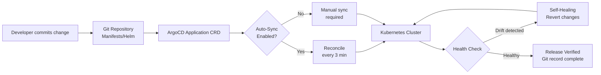

| Difficulty | Channel | Tags |
|---|---|---|
| beginner | devops | argocd, flux, declarative |

Picture this: a single-line Helm values change sitting in a queue for over four hours, blocked by config generation, internal builds, validation gates, and Terraform plans. That was the daily reality for Meta's Cloud Foundation team, supporting roughly 100 Kubernetes clusters across multiple clouds for AI research [1]. Then they discovered a different path—one where routine application deployments dropped from hours to verified, healthy releases within minutes. The secret wasn't faster machines or extra engineers; it was a fundamental shift in how Git and clusters relate to each other.

---

> ### Real-World Case — Meta
>
> Meta's Cloud Foundation team (15+ engineers) supports roughly 100 Kubernetes clusters across multiple clouds and accelerator types for AI research and inference. Terraform was doing double duty: provisioning infrastructure and deploying applications, so even a one-line Helm values change had to pass through config generation, internal builds, validation, Terraform plan, shared test rollouts, and promotion — taking over four hours.
>
> | | |
> |---|---|
> | **Challenge** | Application deploys were coupled to the slow infrastructure workflow, unrelated Helm releases shared a Terraform workspace like 'trains on a single track' (one stalled rollout delayed dozens), and a green Terraform apply only proved infrastructure succeeded — not that the application was actually healthy or that the intended change had landed. |
> | **Solution** | They built a GitOps platform with Argo CD as the reconciliation controller and Kargo for promotion. Application teams write a short declarative application definition; a config compiler generates Helm values and Argo CD/Kargo manifests stored in a dedicated Git repo on Mononoke, with Terraform still owning only the underlying infrastructure. Argo CD continuously reconciles cluster state against Git, with per-app health checks, rollout policies, and versioned release records — and they are consolidating per-cluster Argo CD instances into one centrally managed service. |
> | **Outcome** | Routine application deployment time dropped from more than 4 hours to a verified, healthy release within minutes across ~100 clusters; each app now gets independent promotion, health validation, and a complete Git release record, removing cross-release dependencies. |
> | **Lesson** | GitOps is only as declarative as your source of truth: during testing, Kargo wrote release settings directly into the live Argo CD config, so Git could not reconstruct a release and recovery depended on live state. They fixed it by making Kargo write the full desired release back to Git. The 'Oh wow' is that a tool being used for promotion silently reintroduced the imperative problem GitOps was meant to eliminate — a green apply is not the same as a healthy, reproducible release. |

---

## Hook — The Hidden Cost of a Four-Hour Deploy

Building on this story of transformation, consider what those four hours actually cost. When a deployment crawls along for hours, developers context-switch, releases batch up, and cross-release dependencies turn into a tangled mess. The stakes aren't just about speed—they're about trust in the system. Every manual intervention is a chance for drift. Every bypassed review is a potential incident waiting to happen. Many developers discover this the hard way: the real danger isn't the slow deploy, it's not knowing what's actually running in the cluster. So what does it take to flip the script?

## Problem — When Terraform Does Double Duty

This leads to the core challenge: how does a team keep 100 clusters in sync without losing sleep? The traditional approach treats infrastructure provisioning and application deployment as the same problem. But they're not the same. When Terraform does double duty—provisioning infrastructure and deploying applications—a one-line values change must pass through config generation, internal builds, validation, Terraform plan, shared test rollouts, and promotion [6]. Sound familiar? The pain runs deeper than slow pipelines. Configuration drift creeps in when kubectl commands bypass version control [7]. Rollbacks become archaeology projects. And with imperative commands, the Git repository stops being the single source of truth—it becomes a suggestion box. If this feels overwhelming, you are not alone; nearly every team hits this wall at scale.

## Real-World Case — Meta

However, the story doesn't end with the pain. Consider what Meta actually accomplished. Their Cloud Foundation team, 15+ engineers strong, faced exactly this challenge head-on. Supporting roughly 100 Kubernetes clusters across multiple clouds and accelerator types for AI research and inference, they needed a solution built for scale [1]. The impact was dramatic: deployment time dropped from over four hours to a verified, healthy release within minutes. Each app gained independent promotion, health validation, and a complete Git release record—removing cross-release dependencies entirely. Here is the thing though: the fix wasn't about writing more code or hiring more engineers. It was about changing the relationship between Git and the cluster. That shift is the plot twist hiding in plain sight.

## Deep Dive — Declarative vs Imperative, Explained

Building on this transformation, here is where the technical rubber meets the road. The declarative approach means defining the complete desired state in Git—through YAML manifests, Helm charts [6], or Kustomize overlays [9]—and letting a controller like ArgoCD continuously reconcile actual state with desired state [2]. Kubernetes itself supports declarative object management natively [3]. Think of it as a thermostat: you set the temperature, and the system works to maintain it. The imperative approach, by contrast, is like manually adjusting the heater every time the room changes temperature. You run kubectl commands directly against the cluster, bypassing Git entirely [7]. Here is a counterintuitive insight: many teams assume imperative is faster because kubectl apply feels immediate. But at scale, declarative wins because every change carries an audit trail, automated rollbacks stay one git revert away, and drift gets corrected automatically.

Moreover, the tradeoff deserves attention. Declarative requires discipline—you must resist the urge to kubectl edit during a crisis. Consequently, teams often need a cultural shift alongside the technical one. Specifically, the health check interval matters: 1-5 minutes is typical, with 3 minutes hitting a sweet spot between responsiveness and API load [5]. When would developers actually use imperative? For genuine emergencies—a broken node, a stuck pod at 2am. But those exceptions should stay exceptional, not become the default.

## Workflow — Configuring ArgoCD for Auto-Sync

This leads to the practical question: how does configuration actually happen? Here is the step-by-step flow, illustrated in the Mermaid diagram below:

1. Store Kubernetes manifests or Helm charts in a Git repository as the source of truth
2. Create an ArgoCD Application CRD pointing to that repository [4]
3. Enable auto-sync with a health check interval of 3 minutes (1-5 minutes is typical)
4. Implement self-healing to automatically revert unauthorized manual changes
5. Monitor health status and iterate on configurations

The diagram shows how changes flow from Git through ArgoCD to your clusters, with continuous reconciliation keeping everything aligned. Therefore, every commit becomes a traceable event, and every drift gets corrected without human intervention. Teams using Flux instead of ArgoCD follow a similar reconciliation model [8]. But how does this translate into actual, runnable configuration? That is where the code comes in.

## Code Example — An ArgoCD Application in Practice

Building on the workflow above, here is what this looks like in practice. The bash script below creates an ArgoCD Application with auto-sync and self-healing enabled, then verifies the configuration:

```bash
# ArgoCD Application manifest with auto-sync and self-healing
# Save as application.yaml and apply with: kubectl apply -f application.yaml

cat <<EOF | kubectl apply -f -
apiVersion: argoproj.io/v1alpha1  # ArgoCD Application CRD version
kind: Application
metadata:
  name: production-app
  namespace: argocd
spec:
  project: default
  source:
    repoURL: https://github.com/your-org/k8s-manifests.git  # Your Git source of truth
    targetRevision: HEAD  # Track the latest commit automatically
    path: overlays/production  # Kustomize overlay for production
  destination:
    server: https://kubernetes.default.svc  # Target cluster API
    namespace: production
  syncPolicy:
    automated:
      prune: true       # Delete resources removed from Git
      selfHeal: true    # Revert manual changes back to Git state
    syncOptions:
      - CreateNamespace=true  # Auto-create namespace if missing
    retry:
      limit: 5
      backoff:
        duration: 5s
        factor: 2
        maxDuration: 1m
EOF

# Verify the Application sync status
kubectl get application production-app -n argocd -o jsonpath='{.status.sync.status}'

# Refresh health status via ArgoCD CLI (runs every 3 min in production)
argocd app get production-app --refresh
```

Step by step, here is what happens:

- The `source` block points ArgoCD at the Git repository, making Git the single source of truth.
- `targetRevision: HEAD` ensures the controller tracks the latest commit automatically.
- `syncPolicy.automated.prune: true` removes resources deleted from Git, keeping the cluster clean.
- `selfHeal: true` is the magic ingredient—it reverts any manual kubectl changes back to the Git-defined state.
- The `retry` block with exponential backoff handles transient failures without human babysitting.
- The final commands verify sync status and force a health refresh, mimicking the 3-minute check interval.

This pattern works well because it turns a sprawling manual process into a single declarative object. Many developers think ArgoCD setup is complicated until they see how little configuration is actually required.

## Lessons Learned — Battle Scars and Next Steps

Building on everything covered, here are the battle scars and hard-won lessons from teams that walked this path.

**Battle Scars: Common Mistakes and How to Avoid Them**

- ⚠️ Watch Out: Forgetting to set `selfHeal: true` means drift never gets corrected. Auto-sync alone is not enough.
- ⚠️ Watch Out: Setting health check intervals under 1 minute can overwhelm the Kubernetes API server. Start at 3 minutes.
- ⚠️ Watch Out: Treating GitOps as purely technical ignores the cultural shift. Teams must trust the pipeline, not the kubectl shortcut.
- ⚠️ Watch Out: Letting imperative changes become routine defeats the entire audit trail. Reserve them for true emergencies.

**Key Insights**

💡 Insight: Declarative configuration transforms rollbacks into a single `git revert`—no frantic dashboard clicking required.

🔥 Hot Take: The biggest GitOps enemy isn't a broken pipeline; it's the developer who quietly runs `kubectl edit` at 4:45pm on a Friday.

🎯 Key Point: When would teams actually use imperative commands? Only when the cluster itself is broken and GitOps cannot reconcile—think node failures or API server outages at 2am.

Moreover, alternatives like Flux offer similar reconciliation capabilities [8], so the choice of tool matters less than the discipline of the approach. After debugging this pattern many times, here is what works: keep Git as the only writer, monitor health religiously, and celebrate every automated drift correction. Build tension into your process—make manual changes feel slightly inconvenient, and the right behavior becomes the default.

---

## GitOps Sync Flow



<details>
<summary><strong>Original Interview Question</strong></summary>

**Q:** You're setting up GitOps for a microservices deployment. How would you configure ArgoCD to automatically sync changes from your Git repository to Kubernetes, and what's the difference between declarative and imperative approaches in this context?

**A:** I'd configure ArgoCD by setting up a Git repository containing Kubernetes manifests or Helm charts, creating an Application CRD that points to the Git repository, enabling auto-sync with a health check interval of 3 minutes, and implementing self-healing to automatically revert any manual changes. The declarative approach involves defining the desired state in Git through YAML manifests, Helm charts, or Kustomize configurations, where ArgoCD continuously reconciles the actual state with the desired state. In contrast, the imperative approach uses kubectl commands to make direct changes to the cluster, bypassing the Git repository as the single source of truth.

</details>

## Conclusion

The journey from four-hour deploys to minutes isn't about magic—it's about discipline. Meta's story shows what happens when Git becomes the single source of truth and a controller like ArgoCD handles reconciliation [1]. Tomorrow, audit your deployment pipeline: count how many steps sit between a git commit and a running pod. Then ask yourself which ones could disappear. The one memorable insight to take back to your team: in GitOps, your Git repository isn't just storage—it's the control plane. Treat every kubectl edit like a debt you'll eventually repay, because drift always collects interest.

---

## References

1. [Meta incident report](https://www.cncf.io/case-studies/meta/) — article
2. [GitOps - Wikipedia](https://en.wikipedia.org/wiki/GitOps) — documentation
3. [Declarative Management of Kubernetes Objects - Kubernetes Docs](https://kubernetes.io/docs/concepts/overview/working-with-objects/) — documentation
4. [ArgoCD GitHub Repository](https://github.com/argoproj/argo-cd) — documentation
5. [How to Set Up Argo CD for Continuous Delivery to Kubernetes Clusters - DigitalOcean](https://www.digitalocean.com/community/tutorials/how-to-set-up-argo-cd-for-continuous-delivery-to-kubernetes-clusters) — documentation
6. [Helm GitHub Repository](https://github.com/helm/helm) — documentation
7. [kubectl Overview - Kubernetes Docs](https://kubernetes.io/docs/reference/kubectl/) — documentation
8. [Flux CD GitHub Repository](https://github.com/fluxcd/flux2) — documentation
9. [Kustomize GitHub Repository](https://github.com/kubernetes-sigs/kustomize) — documentation

---

**Author:** Satishkumar Dhule — [GitHub](https://github.com/satishkumar-dhule) · [LinkedIn](https://linkedin.com/in/satishkumar-dhule) · [Website](https://satishkumar-dhule.github.io)
