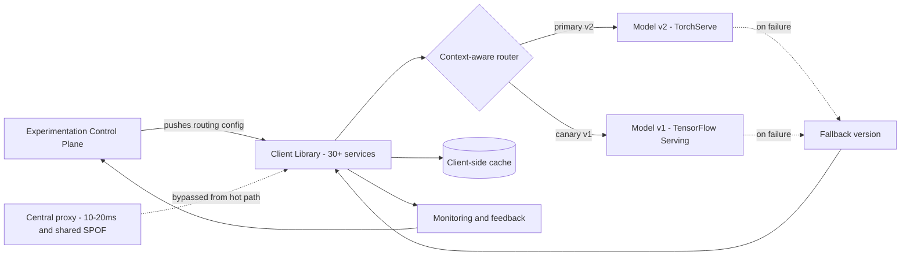

| Difficulty | Channel | Tags |
|---|---|---|
| beginner | devops | mlops, deployment |

Picture this: a viewer taps a title, and behind that tap a routing decision picks one model version out of hundreds — the kind of decision your own serving stack makes every single day. Netflix's centralized ML serving platform handles roughly 1 million requests per second for recommendations and commerce across 30+ client services [1]. To let researchers iterate freely, the team introduced 'Switchboard,' a mandatory central proxy that enabled A/B tests, canaries, and rollbacks without changing client apps. Then the plot twist arrived: that same proxy added a 10–20ms hop and sat in the critical path as a shared single point of failure [1].

---

> ### Real-World Case — Netflix
>
> Netflix's centralized ML serving platform powers hundreds of model versions behind title recommendations and commerce, handling ~1 million requests/second. To let researchers iterate on models without changing client apps—and to safely run A/B tests, canaries, and rollbacks—they built 'Switchboard,' a mandatory central proxy layer integrated with their experimentation platform, serving 30+ client services.
>
> | | |
> |---|---|
> | **Challenge** | As scale grew, Switchboard sat directly in the request path and became a single point of failure: a bug or a noisy-neighbor traffic spike could degrade every ML-powered experience at once. Its serialize-deserialize-reserialize cycle also added 10–20ms of latency per request (depending on payload size), causing timeouts for latency-sensitive clients, while obscuring request origins needed for tenant isolation and training-data logging. |
> | **Solution** | Netflix preserved the abstraction but re-architected it. They split Switchboard into 'Lightbulb'—a lightweight metadata resolver that maps request context to a routing key and model config out of band—and pushed actual routing into Envoy, the service mesh proxy already used for all egress traffic. Model-selection config and routing rules were separated; routing decisions ride in an HTTP header that Envoy acts on with minimal overhead, so inference requests flow directly to model clusters. |
> | **Outcome** | The platform kept its one-integration-point, context-aware routing for 30+ services while eliminating the 10–20ms proxy hop and the shared SPOF from the critical path, adding client-side caching and fallbacks for failures and faster experimentation-config propagation. |
> | **Lesson** | In ML serving, the centralized control plane that makes model versioning and A/B testing easy becomes a liability if it sits in the hot path. The winning pattern is separating control-plane decisions (model selection, rollout rules) from data-plane execution (routing, inference): resolve metadata once, out of band, and let a lightweight proxy like Envoy do the routing. This is the serving-vs-deployment distinction in practice. |

---

## Hook — The Routing Decision Hiding in Plain Sight

Ever wondered why a routing layer that behaves perfectly in staging turns into a latency villain in production? Here is the thing: many developers treat 'deploy the model' and 'serve the model' as one sentence, and that mental shortcut is where the trouble starts when real traffic finally shows up [2].

Sound familiar? A model gets trained, packaged, shipped through CI/CD, and everyone high-fives — until the p99 latency graph starts looking like a rollercoaster. ⚠️ Watch Out: the model weights are rarely the culprit. The path wrapping them usually is.

Netflix ran straight into this exact trap, and the resolution was counterintuitive enough to make any platform team redraw its architecture diagram [1]. So what actually breaks when deployment and serving blur into one?

## Problem — Two Words, One Confused Mental Model

Building on that tension, the first battle scar is conceptual: deployment and serving solve different problems, yet teams routinely budget for one and get ambushed by the other. Deployment owns the journey from commit to a running, observable artifact — CI/CD pipelines, infrastructure provisioning, monitoring, and rollback strategies [2]. Serving owns what happens afterward: the runtime inference API that receives a request, routes it, loads the right model version, and returns a prediction [3].

The stakes are concrete. Confuse the two and a team optimizes build pipelines while ignoring a 50ms cold start on every new pod. Or worse, a rollout succeeds while 30 downstream client services keep calling the old endpoint.

🔥 Hot Take: a green CI pipeline is not evidence that your model is serving anyone anything useful. Consequently, the real question becomes — how does a platform let researchers move fast without dragging every client app along for the ride?

## Real-World Case — Netflix

This leads directly to Netflix's centralized ML serving platform, which powers hundreds of model versions behind title recommendations and commerce at roughly 1 million requests per second [1]. Researchers needed to iterate on models without touching client apps, so the platform made 'Switchboard' a mandatory central proxy integrated with experimentation — one integration point for A/B tests, canaries, and safe rollbacks across 30+ client services [1].

For a while, the design worked exactly as intended. Then the hidden cost surfaced: the proxy hop added 10–20ms to every request and became a shared single point of failure sitting squarely in the critical path [1]. At a million requests per second, a 10ms tax adds up to roughly 10,000 seconds of aggregate waiting every second — a number that makes any 'small' hop feel suddenly less small.

💡 Insight: the very layer that made experimentation safe also made every request slower and every proxy outage a platform-wide event. That is the paradox — centralization bought control, then quietly charged rent.

How does a team keep the control and stop paying the tax?

## Deep Dive — Where Deployment Ends and Serving Begins

However, that paradox only makes sense once the two concepts are separated cleanly. The simplest split is by ownership: deployment owns the path to production, serving owns the path through production. Tooling, success metrics, and failure modes all differ [4][5].

| Concern | Deployment | Serving |
|---|---|---|
| Primary job | Build, provision, release, roll back | Route, load, infer, respond |
| Typical tools | Kubernetes, Docker, Terraform, MLflow, SageMaker [2][5] | TensorFlow Serving, TorchServe, BentoML, FastAPI [3][9][10] |
| Success metric | Clean release, fast rollback | p99 latency, throughput, availability [7] |
| Scaling lever | Pod replicas, cluster capacity [4] | Batching, model loading, GPU memory |

Specifically, request routing and load balancing decide which replica handles an inference call, and that decision directly shapes tail latency [6]. You might think horizontal scaling is a free win — add replicas, divide the load — but every replica carries model-loading cost, and GPU memory does not magically duplicate itself.

⚠️ Watch Out: 'more pods' often means more cold starts, not more speed. Therefore the real trade-off is latency versus throughput: batching improves吞吐 but adds queueing delay, while real-time paths chase sub-100ms responses and pay for it with lower batch efficiency.

When would you actually use this? Reach for dedicated model servers like TorchServe or TensorFlow Serving when prediction latency is your product surface [3][9]; keep CI/CD, monitoring, and rollback in the deployment layer where they belong [2].

## Workflow — Routing Without the Tax

Building on those trade-offs, the resolution keeps the single integration point but moves the routing decision to the caller side. The Mermaid diagram referenced below — 'Model Serving Request Flow' — shows the split between the control plane that publishes config and the data plane that serves predictions.

1. Config propagation: the experimentation platform pushes routing rules to each client library, so context-aware decisions travel with config instead of requiring a proxy call [1].
2. Direct inference: client services call the selected model endpoint straight away, eliminating the 10–20ms proxy hop [1].
3. Resilience: client-side caching and fallbacks absorb failures, so no shared proxy sits in the critical path anymore [1].
4. Feedback loop: latency and version metrics return to the control plane, feeding the next canary decision.

🎯 Key Point: the 'one integration point' survived — it simply moved from a runtime proxy to a client-side library. Consequently, teams got faster experimentation-config propagation without paying per-request proxy latency.

Here is the question that should bug you next: if the routing decision now lives in the client, what does that code actually look like in practice?

## Code Example — A Client-Side Router With Fallbacks

Here is the thing though: theory is cheap, so the snippet below shows the client-side router pattern in runnable Python. It deliberately avoids a central proxy and leans on config pushed from the control plane.

```python
import time
from concurrent.futures import ThreadPoolExecutor, as_completed
from functools import lru_cache

# Routing config pushed from the experimentation control plane;
# no central proxy sits in the request path.
ROUTING_CONFIG = {
    'recommend-v2': {'endpoint': 'http://models-v2.internal/predict', 'weight': 0.9},
    'recommend-v1': {'endpoint': 'http://models-v1.internal/predict', 'weight': 0.1},
}

@lru_cache(maxsize=1024)
def cached_prediction(model_key: str, user_context: str) -> str:
    # Client-side cache removes repeat hops for hot contexts.
    endpoint = ROUTING_CONFIG[model_key]['endpoint']
    return call_endpoint(endpoint, user_context)

def call_endpoint(endpoint: str, payload: str) -> str:
    # Stand-in for a real gRPC/HTTP inference call.
    time.sleep(0.04)  # simulate 40ms model inference
    return f'prediction from {endpoint} for {payload}'

def select_model(context: str) -> str:
    # Context-aware selection reads pushed config in production.
    return 'recommend-v2' if context else 'recommend-v1'

def infer_with_fallback(context: str) -> str:
    primary = select_model(context)
    try:
        return cached_prediction(primary, context)
    except Exception:
        # Fallback keeps the request alive when a version fails.
        fallback = 'recommend-v1' if primary != 'recommend-v1' else 'recommend-v2'
        return cached_prediction(fallback, context)

def infer_batch(contexts: list[str]) -> list[str]:
    # Bounded parallelism mirrors real serving concurrency limits.
    with ThreadPoolExecutor(max_workers=16) as pool:
        futures = {pool.submit(infer_with_fallback, c): c for c in contexts}
        return [f.result() for f in as_completed(futures)]
```

Step by step: `ROUTING_CONFIG` stands in for the experimentation config pushed to clients, which is how the one-integration-point idea survives without a runtime proxy [1]. `cached_prediction` uses `lru_cache` to absorb repeated calls for hot contexts, cutting redundant hops. `call_endpoint` simulates the 40ms inference; swap it for a real gRPC or HTTP call. `select_model` performs context-aware routing, and `infer_with_fallback` implements the resilience story — if the chosen version fails, traffic falls back instead of returning a 500. Finally, `infer_batch` uses `ThreadPoolExecutor` from Python's standard library to bound concurrency at 16 workers [8].

⚠️ Watch Out: `lru_cache` keys on arguments, so include every context field that changes the prediction or stale results creep in. 🔥 Hot Take: a fallback that silently serves last season's model can quietly corrupt your metrics — log it loudly.

## Lessons Learned — Battle Scars Worth Keeping

Consequently, the journey from Netflix's proxy problem to a client-side router yields a handful of lessons you can carry into your next design review.

- Deployment and serving are different jobs: own both explicitly, or one will sabotage the other [2][3].
- Centralization is not free — measure the hop, because 10–20ms per request at 1M requests/second is a lot of borrowed time [1].
- Latency versus throughput is a real choice, not a setting you flip once and forget [7].
- A/B tests and canaries need routing control; the interesting question is where that control lives [1].

Battle scars worth remembering: teams often ship model versioning in the deployment pipeline but forget that serving clients can pin an old version for weeks. Another classic mistake is autoscaling on CPU while the real bottleneck is GPU memory [4]. And yes, someone will eventually try to put a shared proxy back into the hot path — nostalgia is expensive.

💡 Insight: the best serving architecture centralizes decisions and keeps the data path as short as possible. That single sentence is the whole plot twist.

If this feels overwhelming, you are not alone — start by drawing your current request path and circling every hop that does not produce a prediction.

---

## Model Serving Request Flow



<details>
<summary><strong>Original Interview Question</strong></summary>

**Q:** Explain the key differences between model serving and model deployment in ML systems, including specific technologies, scaling considerations, and real-world implementation patterns?

**A:** Deployment encompasses CI/CD pipelines, infrastructure setup, and monitoring using tools like Kubernetes, MLflow, and SageMaker. Serving focuses on runtime inference APIs with frameworks like TensorFlow Serving, TorchServe, or BentoML, handling request routing, model versioning, and autoscaling. Key trade-offs include latency vs throughput, batch vs real-time inference, and cold start optimization.

</details>

## Conclusion

The moral of the story circles back to that viewer tapping a title. Netflix handled 1 million requests per second, kept one integration point for 30+ client services, and still found a way to strip the 10–20ms hop and the shared failure point out of the critical path [1]. The lesson is not 'proxies are bad' — it is 'know which side of the request path your control belongs on.'

So what should you do tomorrow? Map your deployment pipeline and your serving path on two separate whiteboards, then measure every hop between them. Leave your team with one memorable line: centralize decisions, decentralize execution. That is how you serve a million requests without paying a proxy tax on every single one.

---

## References

1. [Netflix incident report](https://netflixtechblog.com/state-of-routing-in-model-serving-16e22fe18741) — article
2. [MLflow GitHub repository](https://github.com/mlflow/mlflow) — documentation
3. [TensorFlow Serving GitHub repository](https://github.com/tensorflow/serving) — documentation
4. [Kubernetes Services documentation](https://kubernetes.io/docs/concepts/services-networking/service/) — documentation
5. [Amazon SageMaker deployment documentation](https://docs.aws.amazon.com/sagemaker/latest/dg/how-it-works-deployment.html) — documentation
6. [Load balancing (computing) - Wikipedia](https://en.wikipedia.org/wiki/Load_balancing_(computing)) — documentation
7. [Overview of HTTP - MDN Web Docs](https://developer.mozilla.org/en-US/docs/Web/HTTP/Overview) — documentation
8. [concurrent.futures - Python documentation](https://docs.python.org/3/library/concurrent.futures.html) — documentation
9. [TorchServe GitHub repository](https://github.com/pytorch/serve) — documentation
10. [BentoML GitHub repository](https://github.com/bentoml/BentoML) — documentation

---

**Author:** Satishkumar Dhule — [GitHub](https://github.com/satishkumar-dhule) · [LinkedIn](https://linkedin.com/in/satishkumar-dhule) · [Website](https://satishkumar-dhule.github.io)
