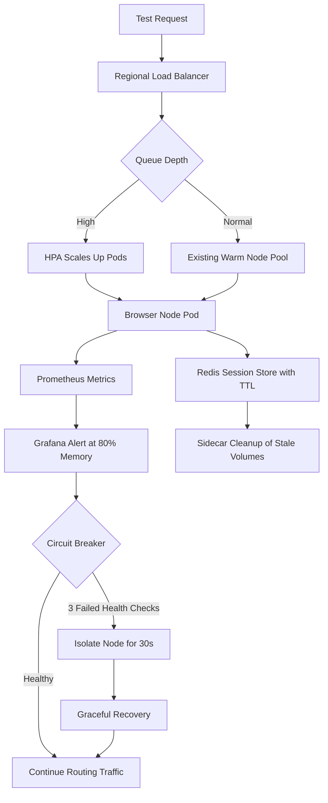

| Difficulty | Channel | Tags |
|---|---|---|
| advanced | system-design | selenium, webdriver, grid |

At 3am, a single CI job waits four minutes just to get a browser. Multiply that across 100+ hubs and 140,000 tests a day, and you have the exact bottleneck Expedia Group hit after five years on an EC2-based SeleniumGridScaler system [1]. The company's shift toward microservices and shift-left testing turned static hubs into a liability, and the answer, DA-Kube, promised per-branch grids on demand. Then came the plot twist: containerization alone did not make grid creation fast, because pod scheduling simply reintroduced the delay unless the underlying EC2 worker pool stayed warm [1].

---

> ### Real-World Case — Expedia Group
>
> Expedia's UI test automation had grown to 100+ Selenium hubs running 140,000+ tests per day on an EC2-based SeleniumGridScaler system that had run for five years. As the company shifted toward microservices and shift-left testing, the static EC2 hubs became a bottleneck: bringing a hub online took 2-4 minutes, hubs had to be manually stopped and restarted to save cost, and private IP ranges overlapped across multiple AWS accounts.
>
> | | |
> |---|---|
> | **Challenge** | Needed a dynamic, container-based Selenium Grid that could create per-branch grids on demand, scale browser capacity quickly without over-provisioning CPU/memory at the instance level, and route to hubs uniquely across AWS accounts with colliding private IPs. |
> | **Solution** | Built 'DA-Kube': Selenium Grid on AWS EKS using Kubernetes, Docker, Helm, and Traefik. Each grid runs in its own namespace with a unique domain name (e.g. da-xxx.hub.test.expedia.com), Chrome pods scale from 1 to 50+ via Helm upgrades, and Traefik ingress resolves cross-account IP overlap through per-hub DNS names. They also tuned the AWS VPC CNI with WARM_IP_TARGET to pre-allocate pod IPs. |
> | **Outcome** | The predecessor system sustained 100+ hubs and 140k+ tests/day (including 1,000 UI tests in ~5 minutes). DA-Kube enabled on-demand per-branch grids with dynamic pod scaling, but surfaced a counterintuitive constraint: containerization alone does not make grid creation fast unless the underlying EC2 worker node pool is kept warm, otherwise pod scheduling reintroduces the delay. |
> | **Lesson** | Scaling Selenium Grid on Kubernetes is not just about containers — you need warm worker nodes for fast startup, graceful node draining to avoid killing in-flight sessions during scale-down, and network-level isolation (per-hub DNS) when private IP spaces collide across accounts. |

---

## Hook — The four-minute browser

Picture this: a developer pushes a branch, the pipeline goes green on unit tests, and then everything stops. Not because the code is broken. Not because the tests failed. The pipeline is waiting for a browser to boot. Sound familiar?

That pause is where many teams quietly lose their shift-left strategy. The ambition is instant feedback, but the reality is a queue. At 10,000 concurrent sessions, a four-minute delay is not an inconvenience; it is a mathematical disaster that turns a five-minute test run into a multi-hour traffic jam.

> 💡 **Insight:** The scariest scaling problems rarely announce themselves as outages. They show up as a slow, accepted, normalized delay that everyone learns to live with.

The stakes are concrete. A grid targeting 99.9% uptime allows roughly 43 minutes of downtime per month [8]. A memory leak that slowly eats 520GB of cluster memory does not trigger a page until it is already too late. What if the real bottleneck was never the browser at all?

## Problem — Static hubs, dynamic expectations

Building on that tension, the core problem is an identity crisis. Traditional Selenium Grid follows a hub-node pattern where a central hub routes work to browser nodes [5]. That shape is simple to understand and painful to operate at scale.

Static EC2 hubs force teams into a bad bargain. Keep them running and pay for idle capacity; stop them to save money and accept a multi-minute cold start. Teams end up manually restarting hubs, which is about as modern as faxing a deploy request.

Then there is lifecycle management. Browser processes leak memory, sessions outlive their tests, and stale container volumes accumulate like digital dust. Without automatic cleanup, a node that looked healthy at 9am becomes a swamp by 4pm.

- **Who feels this:** QA platform teams, DevOps engineers, and any developer whose merge depends on UI tests.
- **What is at stake:** Release velocity, cloud spend, and trust in the test suite itself.
- **Why it compounds:** Overlapping private IP ranges across AWS accounts make multi-account grids hard to stitch together [1].

⚠️ **Watch Out:** A flaky grid trains developers to ignore red builds. Once trust is gone, no amount of dashboard polish brings it back.

## Real-World Case — Expedia Group

The numbers behind that struggle are not theoretical. Expedia Group's UI automation had grown to more than 100 Selenium hubs running over 140,000 tests per day on an EC2-based SeleniumGridScaler that had been in service for five years [1]. A batch of 1,000 UI tests could finish in about five minutes, but the infrastructure around it was anything but nimble.

As microservices multiplied, bringing a hub online took two to four minutes, hubs were manually stopped and restarted to control cost, and overlapping private IP ranges across AWS accounts created networking headaches [1]. The old model had reached the end of its useful life.

The team introduced DA-Kube, built on Kubernetes, Docker, Helm, and Traefik, to deliver on-demand grids per branch with dynamic pod scaling [1]. On paper, containerization was the obvious fix. In practice, developers discovered a counterintuitive constraint: Kubernetes can schedule a pod instantly only if there is a warm worker node to place it on. Cold EC2 pools reintroduce the exact latency containers were supposed to erase.

🔥 **Hot Take:** Kubernetes is not a time machine. It cannot make infrastructure appear faster than the compute underneath it.

## Deep Dive — Designing for 10,000 sessions

With the failure mode clear, the architecture choices become easier to judge. The target is 10,000 concurrent sessions at 99.9% uptime with zero memory leaks. That is a capacity problem, a lifecycle problem, and a failure-handling problem wearing the same costume.

**Capacity math first.** At 50 sessions per node, 10,000 sessions require 200 nodes [2]. With 2GB RAM and 1 CPU per node, that is 400GB baseline memory, plus a 30% buffer, landing at 520GB [3]. Horizontal pod autoscaling should react to queue depth, not just CPU, because a queue filling with browser work is the real signal of impending pain.

**Lifecycle second.** Redis-backed session leases with TTL expiration give every session a hard expiry [4]. Heartbeats renew active leases; explicit release removes them on teardown; a periodic scan catches what neither path handled. This is the difference between hoping cleanup runs and knowing it must.

| Option | What it buys you | Real tradeoff |
|---|---|---|
| Static EC2 hubs | Predictable capacity | 2–4 min boot, idle cost, manual restarts |
| Kubernetes + warm pool | On-demand per-branch grids | Reserved workers cost money; cold pools reintroduce latency |
| Redis TTL leases | Automatic session expiry | Too-short TTL kills live tests; too-long TTL leaks memory |
| Circuit breakers | Failing nodes isolated fast | Bad thresholds cause flapping between healthy and failed |

**Failure handling third.** Health checks hit a /status endpoint every 10 seconds, and three consecutive failures remove a node from rotation. Circuit breakers, a pattern for preventing repeated calls to a failing service [9], isolate that node for a 30-second recovery window. Pod Disruption Budgets preserve at least 85% capacity during voluntary disruptions [2].

🎯 **Key Point:** Use Redis TTL leases when grids are ephemeral and sessions must never outlive their pods. Use static hubs only when workload is truly constant and 4-minute cold starts are acceptable.

## Workflow — From request to recovery

Building on those trade-offs, here is how the pieces fit together as a single narrative rather than a pile of tools.

The flow below shows the full journey: a test request arrives, the regional load balancer routes it, queue depth triggers autoscaling, browser nodes create TTL-bound leases in Redis, Prometheus watches memory, and a circuit breaker isolates sick nodes before they poison the pool [6].



Step by step:

1. **Route regionally.** Weighted round-robin directs traffic using node capacity and response time, keeping P99 session initiation under 2 seconds [8].
2. **Scale on queue depth.** Horizontal pod autoscaling adds browser pods when the queue grows, backed by a warm EC2 pool so scheduling is instant [3].
3. **Lease the session.** Redis records the session with a TTL, so a dead pod cannot leave an immortal session behind [4].
4. **Watch memory.** Prometheus scrapes node metrics every few seconds and alerts at 80% memory, well before the 520GB ceiling [6].
5. **Isolate and recover.** Three failed health checks trip the circuit breaker; the node returns after 30 seconds if healthy [9].

But wait, it gets better: weekly rolling restarts and canary node versions mean leaks and zero-day failures are handled before they become headlines [2].

## Code Example — Enforcing session lifecycles

The workflow above only works if session leases are enforced in code rather than assumed. This Python snippet implements the heartbeat-and-sweep pattern that makes automatic cleanup boring, which is exactly what you want.

```python
import time
import uuid
from dataclasses import dataclass

import redis

@dataclass
class SessionLease:
    session_id: str
    node_id: str
    created_at: float

class SessionManager:
    """TTL-bound Selenium session leases with sweep-based cleanup."""

    def __init__(self, client: redis.Redis, ttl_seconds: int = 300):
        self.redis = client
        self.ttl = ttl_seconds
        self.prefix = "selenium:session:"

    def _key(self, session_id: str) -> str:
        return f"{self.prefix}{session_id}"

    def create_lease(self, node_id: str) -> SessionLease:
        session_id = str(uuid.uuid4())
        lease = SessionLease(session_id, node_id, time.time())
        # EX sets expiry, NX guarantees the key is new: one atomic operation
        self.redis.set(self._key(session_id), node_id, ex=self.ttl, nx=True)
        return lease

    def heartbeat(self, session_id: str) -> bool:
        # Renew the TTL while the test is genuinely alive
        return bool(self.redis.expire(self._key(session_id), self.ttl))

    def release(self, session_id: str) -> None:
        # Explicit teardown path for graceful test completion
        self.redis.delete(self._key(session_id))

    def sweep_stale(self) -> int:
        # SCAN avoids blocking Redis the way KEYS would
        removed = 0
        for key in self.redis.scan_iter(match=f"{self.prefix}*", count=500):
            if self.redis.ttl(key) <= 0:
                self.redis.delete(key)
                removed += 1
        return removed
```

**What happens here, line by line:**

- `create_lease` uses `EX` plus `NX`, so the expiry and the existence check happen atomically. No race, no orphan.
- `heartbeat` calls `EXPIRE` on every active session interval. If the client dies, no heartbeat arrives and the key self-destructs.
- `release` is the happy path: a finished test deletes its own lease immediately instead of waiting for TTL.
- `sweep_stale` runs every five minutes as a safety net, using `SCAN` with a cursor count of 500 so a large keyspace does not freeze Redis [4].

Many developers discover the hard way that `KEYS` is a production footgun at scale. The sweep is intentionally the backup, not the primary mechanism; TTL is the real hero.

## Lessons Learned — Battle scars and better defaults

After tracing the whole path, a few patterns stand out, along with the mistakes that make teams pay tuition twice.

**Battle scars to avoid:**

- Treating containers as a speed switch while leaving the worker pool cold. Fix: keep a warm node floor sized to your burst profile [1].
- Setting TTL equal to average test duration. Fix: use a comfortable multiple plus heartbeats, so slow tests are not murdered mid-run.
- Autoscaling on CPU alone. Fix: scale on queue depth, because browser saturation shows up in the queue before it shows up in CPU [3].
- Alerting at 95% memory. Fix: alert at 80% and restart on a weekly rolling schedule, because leaks do not respect your alert threshold.
- Letting one bad node take down a batch. Fix: health checks every 10 seconds, three strikes, 30-second isolation [9].

**What to do differently tomorrow:** start by measuring queue depth and cold-start time on your current grid. Then add TTL leases before adding more nodes, because scaling a leak just makes a bigger leak. If this feels overwhelming, begin with one branch grid and one dashboard; the pattern scales outward once it is trusted.

🔥 **Hot Take:** The best grid is not the one with the most nodes. It is the one where nobody thinks about the grid at all.

---

## Scalable Selenium Grid Session Flow


<details>
<summary><strong>Original Interview Question</strong></summary>

**Q:** Design a scalable Selenium Grid architecture to handle 10,000 concurrent test sessions with 99.9% uptime, ensuring zero memory leaks through automatic session lifecycle management, real-time monitoring, and graceful node failure recovery across multiple data centers?

**A:** Deploy Kubernetes cluster with auto-scaling node pools, Redis session store with TTL policies, Prometheus metrics for memory monitoring, circuit breakers for node isolation, and sidecar containers for session cleanup. Implement health checks, resource quotas, and rolling updates.

</details>

## Conclusion

The journey started with a four-minute browser wait and ended with a 10,000-session grid that heals itself. Expedia Group's story proves the hard part was never drawing the Kubernetes diagram; it was keeping the worker pool warm, bounding every session with a TTL, and isolating failures before they spread [1]. The memorable insight to share with the team is this: scale the cleanup, not just the cluster. Tomorrow, measure queue depth and cold-start time, add TTL leases before adding nodes, and keep one warm pool ready. A grid nobody has to think about is the real definition of 99.9% uptime.

---

## References

1. [Expedia Group incident report](https://medium.com/expedia-group-tech/da-kube-selenium-grid-using-kubernetes-docker-helm-and-traefik-856b802d1d08) — article
2. [Kubernetes Nodes documentation](https://kubernetes.io/docs/concepts/architecture/nodes/) — documentation
3. [Kubernetes Horizontal Pod Autoscaling](https://kubernetes.io/docs/tasks/run-application/horizontal-pod-autoscale/) — documentation
4. [Redis - Wikipedia](https://en.wikipedia.org/wiki/Redis) — documentation
5. [Selenium (software) - Wikipedia](https://en.wikipedia.org/wiki/Selenium_(software)) — documentation
6. [Prometheus GitHub repository](https://github.com/prometheus/prometheus) — documentation
7. [An Introduction to Kubernetes - DigitalOcean](https://www.digitalocean.com/community/tutorials/an-introduction-to-kubernetes) — blog
8. [Amazon EC2 Auto Scaling - AWS Documentation](https://docs.aws.amazon.com/autoscaling/ec2/userguide/what-is-amazon-ec2-auto-scaling.html) — documentation
9. [Circuit breaker design pattern - Wikipedia](https://en.wikipedia.org/wiki/Circuit_breaker_design_pattern) — documentation
10. [Docker (software) - Wikipedia](https://en.wikipedia.org/wiki/Docker_(software)) — documentation

---

**Author:** Satishkumar Dhule — [GitHub](https://github.com/satishkumar-dhule) · [LinkedIn](https://linkedin.com/in/satishkumar-dhule) · [Website](https://satishkumar-dhule.github.io)
