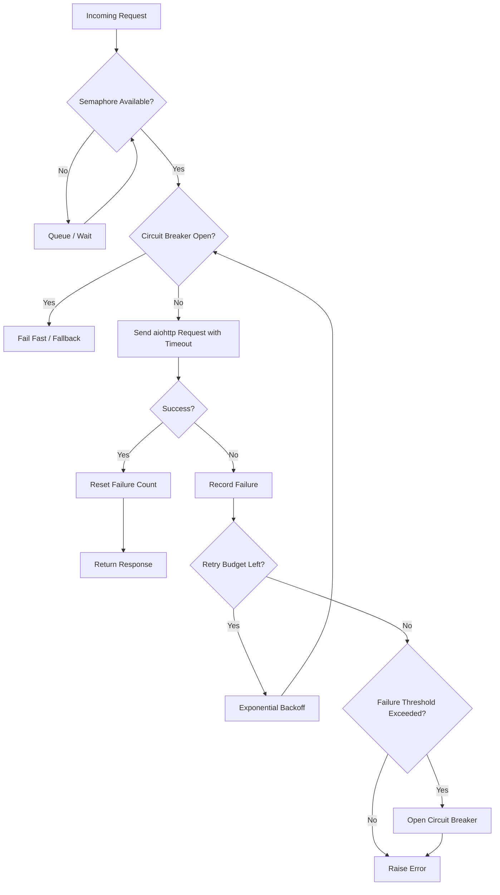

| Difficulty | Channel | Tags |
|---|---|---|
| advanced | backend | asyncio, aiohttp, concurrency |

When Netflix's API brokers were handling roughly 1 billion requests per day across hundreds of device types, a bad cache write triggered a cascade that could have taken down streaming for millions [1]. Engineers bypassed the cache, hit the database directly, and ran straight into their own throttling limits. The reason overall video views stayed nearly flat wasn't luck—it was deliberate connection management, circuit breakers, and graceful degradation built into the system [1][8]. If your service talks to downstream dependencies under load, the same resilience patterns can mean the difference between a blip and a blackout.

---

> ### Real-World Case — Netflix
>
> Netflix's API brokers catalog and subscriber metadata between internal services and hundreds of device types at ~1 billion requests/day (~20,000 rps peak), fanning out roughly 1:6 to dozens of backend dependencies. When a bug began writing partially populated Java objects into the shared cache, engineers bypassed the cache and sent requests straight to the database — and promptly got throttled by their own DB.
>
> | | |
> |---|---|
> | **Challenge** | A single latent or failing dependency had to be prevented from saturating the API's bounded connection pools, thread pools and task queues, blocking user requests and cascading into a total outage — while still returning a usable, if degraded, response instead of a 5xx. |
> | **Solution** | They built a service-dependency decorator layer (later open-sourced as Hystrix): every remote call is wrapped in a circuit breaker with bounded thread pools/queues and semaphore isolation, per-call timeouts, and explicit fallbacks. Requests are tracked over a 10-second rolling window; fallbacks trigger on timeout, pool/queue reaching 100% capacity, or client exceptions. Once the error rate crosses a threshold the circuit opens, serves fallbacks (custom local-cache/cookie fallback, fail-silent null, or fail-fast 5xx), and periodically probes for recovery. ~60 circuits fed a real-time dashboard. |
> | **Outcome** | During the incident the DB-select circuit tripped at an 80% error rate with 157 of 200 instances serving fallbacks and short-circuited requests never reaching the DB; the local fallback cache covered most of the active dataset, and overall video views stayed nearly flat versus the prior week — minimal member impact. At scale Hystrix executed tens of billions of thread-isolated and hundreds of billions of semaphore-isolated calls daily; a chaos test injecting ~1500ms latency into a ~15-20ms dependency produced ~5,000 fallbacks/second with only ~1 exception/second escaping to users. |
> | **Lesson** | Intentionally shed load: bounded pools/queues, timeouts and circuit breakers reject and short-circuit so an overloaded downstream can recover. Adding more connections/threads when a dependency is latent backfires — a 100-server × 10-connection budget (normally 200-300 in use) can balloon to 2,000 held-open connections and become a self-inflicted DDoS. Size timeouts near the healthy p99.5 and tune in production. |

---

## Hook — When the Safety Net Becomes the Bottleneck

Picture a service humming along at 20,000 requests per second, fanning out to dozens of backend dependencies. Everything looks healthy—until one dependency slows down, connections pile up, and the retry storm turns a minor hiccup into a system-wide outage [4]. Sound familiar? Many developers assume that adding more connections or more retries will solve the problem. In reality, uncontrolled concurrency often makes the failure worse. The real challenge isn't just making requests; it's knowing when to slow down, when to stop, and how to fail gracefully when the world on the other side of the wire is on fire [8].

## Problem — Too Many Connections, Too Little Time

Under high load, three forces collide: limited downstream capacity, unpredictable latency, and aggressive client retries. Without guardrails, an aiohttp client can open far more connections than a dependency can handle, exhausting sockets, memory, and event loop time [4]. Timeouts that are too generous let bad requests linger; timeouts that are too strict create false failures. Meanwhile, retries without backoff amplify traffic at the worst possible moment [3]. The result is a cascade failure: one slow service drags callers down, and callers drag their callers down. Teams need a connection pool manager that enforces concurrency limits, retries intelligently, and cuts off failing dependencies before they poison the entire system.

## Real-World Case — Netflix

Netflix's API brokers catalog and subscriber metadata between internal services and hundreds of device types at roughly 1 billion requests per day, peaking near 20,000 requests per second with a 1:6 fan-out to dozens of backend dependencies [1]. When a bug began writing partially populated Java objects into the shared cache, engineers bypassed the cache and sent requests straight to the database—and promptly got throttled by their own DB. The safeguards mattered: during the incident, the DB-select circuit tripped at an 80% error rate with 157 of 200 instances serving fallbacks, and short-circuited requests never reached the database [1]. A local fallback cache covered most of the active dataset, keeping overall video views nearly flat versus the prior week. At scale, Hystrix executed tens of billions of thread-isolated and hundreds of billions of semaphore-isolated calls daily; in a chaos test injecting ~1500ms latency into a ~15-20ms dependency, the system produced ~5,000 fallbacks per second with only ~1 exception per second escaping to users [1]. The lesson is clear: resilience is an architectural decision, not an afterthought.

## Deep Dive — The Building Blocks of Resilient Connection Pools

A production-grade aiohttp connection pool manager stands on four pillars. First, **semaphore-based limiting** caps concurrent in-flight requests so a surge cannot overwhelm downstream services or local resources [5][7]. A semaphore acts as a gatekeeper, allowing only N operations to proceed at once. Second, **exponential backoff** spaces out retries with increasing delays, often with jitter, so clients don't synchronize into another thundering herd [3]. Third, a **circuit breaker** tracks failure rates and response times; when errors cross a threshold, it opens and short-circuits requests for a cooldown period, giving the failing dependency room to recover [2]. Fourth, **health checks and cleanup** prune dead connections, validate SSL contexts, and ensure resources are released on shutdown. Each piece addresses a different failure mode: semaphores control volume, backoff controls retry pressure, circuit breakers contain blast radius, and cleanup prevents slow resource leaks [4][8].

## Workflow — How a Resilient Request Actually Flows

The request lifecycle should be explicit and predictable. A request enters the pool and waits for semaphore capacity. Once admitted, the circuit breaker checks whether the target dependency is healthy enough to receive traffic. If the circuit is open, the request fails fast or returns a fallback. If closed, the client issues the HTTP call with strict timeouts. On success, failure counters reset and the response flows back. On timeout or client error, the manager records the failure, applies backoff for retries, and may trip the breaker when thresholds are exceeded [2][3]. This flow keeps pressure bounded and makes failure behavior visible rather than chaotic.

💡 **Insight:** The fast-fail path is not a bug—it's a feature. Returning a controlled fallback quickly is often better for users than waiting 30 seconds for a timeout.

## Code Example — Building a Connection Pool Manager in Python

The following example shows a practical aiohttp connection pool manager using an asyncio semaphore, request timeouts, exponential backoff retries, and a simple circuit breaker [5][6]. It is intentionally compact, but it captures the core production patterns: bounded concurrency, controlled retries, and fail-fast behavior when a dependency is unhealthy.

**Walkthrough:**
1. **Initialization:** The manager creates a semaphore for concurrency limits, configures client timeouts, and initializes circuit breaker state.
2. **Session lifecycle:** `start()` and `close()` manage a shared `aiohttp.ClientSession`, preventing connection leaks.
3. **Circuit check:** Before making a request, `_circuit_open()` decides whether requests should be short-circuited based on recent failures and cooldown time [2].
4. **Bounded execution:** `async with self.semaphore` ensures only a fixed number of requests run concurrently [5][7].
5. **Retry with backoff:** On timeout or client error, the manager records failure and waits with exponential backoff before retrying [3].
6. **Recovery:** A successful response resets failure counters, allowing the circuit to close naturally.

⚠️ **Watch Out:** This example uses in-memory breaker state. In multi-process or distributed deployments, teams often need shared state, metrics, and per-dependency breakers to avoid blind spots.

## Lessons Learned — Designing for Failure Before It Happens

Building on Netflix's experience, the biggest takeaway is that resilience comes from combining simple mechanisms, not finding one magical fix [1]. Start by bounding concurrency with semaphores so your own clients don't become the attack vector [7]. Add exponential backoff and jitter to prevent retry storms [3]. Use circuit breakers to fail fast when dependencies degrade, and pair them with sensible fallbacks so users get a reduced experience instead of no experience [2][8]. Finally, treat timeouts, cleanup, and observability as first-class design concerns: measure failure rates, track fallback frequency, and tune thresholds based on real traffic. The goal isn't to eliminate failures—it's to make them boring, contained, and survivable.

---

## Resilient Request Flow

<strong>Original Interview Question</strong>

**Q:** How would you implement a connection pool manager for aiohttp that handles graceful degradation under high load and connection timeouts?

**A:** Implement a connection pool manager for aiohttp using a semaphore to limit concurrent connections, exponential backoff for retrying failed requests, and circuit breaker pattern to gracefully degrade under high load and connection timeouts.

## Conclusion

The moral of the story is simple: systems rarely fail because one request is slow—they fail because thousands of requests react badly at the same time. By combining semaphore-based limits, exponential backoff, circuit breakers, and disciplined cleanup, you can keep your aiohttp services responsive even when dependencies misbehave. Tomorrow, pick one critical downstream call, add explicit timeouts and concurrency limits, and measure what happens under failure. Resilience gets real the moment you test it before production does.

---

## References

1. [Netflix incident report](https://netflixtechblog.com/making-the-netflix-api-more-resilient-a8ec62159c2d) — article
2. [Circuit breaker design pattern](https://en.wikipedia.org/wiki/Circuit_breaker_design_pattern) — documentation
3. [Exponential backoff](https://en.wikipedia.org/wiki/Exponential_backoff) — documentation
4. [Connection pool](https://en.wikipedia.org/wiki/Connection_pool) — documentation
5. [asyncio synchronization primitives](https://docs.python.org/3/library/asyncio-sync.html) — documentation
6. [aio-libs/aiohttp](https://github.com/aio-libs/aiohttp) — documentation
7. [Semaphore (programming)](https://en.wikipedia.org/wiki/Semaphore_(programming)) — documentation
8. [Graceful degradation](https://en.wikipedia.org/wiki/Graceful_degradation) — documentation

---

**Author:** Satishkumar Dhule — [GitHub](https://github.com/satishkumar-dhule) · [LinkedIn](https://linkedin.com/in/satishkumar-dhule) · [Website](https://satishkumar-dhule.github.io)
