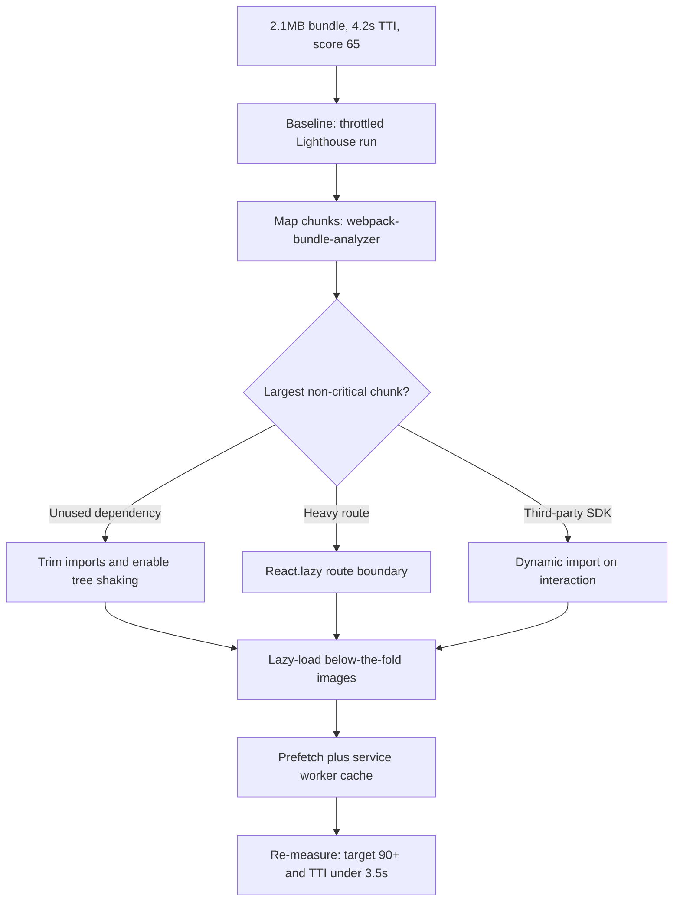

| Difficulty | Channel | Tags |
|---|---|---|
| intermediate | frontend | lighthouse, bundle, lazy-loading |

Ever wondered why a page that looks like a brochure can take seven seconds to become usable? After its 2016 global launch, Netflix watched new users arrive on mobile devices over poor connections, and its logged-out homepage — the registration gateway — shipped roughly 300KB of JavaScript, including React, Lodash, and hydration data [1]. On a simulated 3G connection in Lighthouse, that mostly static page took around seven seconds to load, an eternity when the competition is a thumb tap away [1]. That observation set off a performance effort that cut JavaScript by more than 200KB and halved Time to Interactive — a story worth stealing for any React app staring down a Lighthouse score of 65.

---

> ### Real-World Case — Netflix
>
> After its 2016 global launch, Netflix found many new users signing up on mobile devices over poor connections. Their logged-out homepage — the critical sign-up/sign-in landing page — shipped ~300KB of JavaScript (React, Lodash, and hydration data); simulating a 3G connection in Lighthouse showed a 7-second load time, far too slow for what was essentially a static marketing page.
>
> | | |
> |---|---|
> | **Challenge** | Reduce Time-to-Interactive on the sign-up landing page without abandoning React or breaking the consistent server-rendered React architecture and developer experience used across all Netflix web properties. |
> | **Solution** | Instead of adding more code-splitting, the team profiled which components actually needed React and found the page was mostly plain HTML with a few simple interactions (tabs, language switcher, cookie banner, analytics). They rewrote those in vanilla JavaScript (the language switcher alone saved ~300 lines), stripped client-side React and Lodash — cutting 200KB — while keeping React on the server to generate the initial HTML. They then prefetched React and the sign-up flow's HTML/CSS/JS in the background with the browser prefetch API and XHR prefetching while users read the landing page, so the subsequent SPA navigation loaded instantly. |
> | **Outcome** | Loading and Time-to-Interactive dropped 50% (desktop Lighthouse TTI fell below 3.5s, from ~7s), the JavaScript payload shrank by over 200KB, and prefetching cut TTI another 30% on the next page. The Chrome User Experience Report showed First Input Delay was fast for 97% of desktop users, and the faster page drove higher click-through on the register button. |
> | **Lesson** | The most powerful optimization is often deleting code, not splitting it: only ship a library to a page that genuinely needs it. Server-render static content with minimal JavaScript, lazy-load heavy code during idle time via prefetching, and remember there are no silver bullets — measure first with Lighthouse and bundle analysis before choosing a strategy. |

---

## Hook — The front door that took seven seconds to open

That Netflix front door is the perfect opening scene because it proves an uncomfortable truth: the heaviest code is often the code nobody asked for. Picture the register button sitting there, plain as day, while the browser chews through React internals and a Lodash copy that nobody plans to use on that screen. On 3G, seven seconds is enough time for a potential subscriber to open another tab and never come back [1]. The same dynamic plays out in a React app with a 2.1MB bundle and 4.2s TTI — a score of 65 is not a vanity metric, it is a leaky bucket. Every extra megabyte taxes the slowest device in the room first. So where does that weight actually come from, and why does deleting code feel scarier than shipping more of it?

## Problem — Two megabytes of everything, everywhere, all at once

Building on that leaky-bucket image, the core challenge is not that React is slow — it is that modern SPAs happily ship the entire application to someone who only needs the login screen [10]. A 2.1MB bundle means the browser downloads, parses, compiles, and executes roughly two megabytes before the first meaningful interaction, and on a mid-range phone that parsing tax alone can dominate the 4.2s TTI. Web performance is, at its core, a measurement discipline rather than a bag of tricks [5]. Three groups pay for the bloat: users on poor connections, teams watching conversion rates slide, and engineers handed a Lighthouse report with no roadmap attached.

Here is what tends to hide inside that number:

- One broad Lodash import that drags in the whole library instead of a single helper
- Route code for dashboards and analytics loaded on first paint
- Third-party charting, maps, or chat widgets initialized at startup
- Hydration payloads duplicated between server and client
- Above-the-fold images arriving at full resolution

The plot twist: adding more JavaScript to 'fix' perceived speed rarely helps. Dynamic imports let code load at the moment of need instead of the moment of arrival [2]. The real question becomes which boundaries to draw — and that decision determines whether the score climbs to 90 or just wobbles around 70.

## Real-World Case — Netflix

That boundary-drawing question is exactly what Netflix faced after its 2016 global launch. New subscribers were signing up on mobile over poor connections, yet the logged-out homepage — essentially a static marketing page — shipped about 300KB of JavaScript: React, Lodash, and hydration data [1]. Lighthouse on a simulated 3G connection showed roughly seven seconds to load, which is bizarre for a page whose main job is to show a title and a form [6].

Rather than rewrite the stack, the team treated the payload like a budget:

- Strip framework and utility weight the signup flow did not actually need
- Remove hydration data that was not driving visible UI
- Prefetch the next page so the following navigation felt instant

The outcome was not subtle:

| Metric | Before | After |
| --- | --- | --- |
| JavaScript payload | ~300KB | down by 200KB+ |
| Desktop TTI | ~7s | below 3.5s |
| TTI on next page | baseline | another ~30% faster via prefetch |
| First Input Delay | — | fast for 97% of desktop users |

Higher register-button click-through followed [1]. Notice what did not happen: no micro-frontend rewrite, no framework swap. The lesson lands hard when a team is staring at a 2.1MB bundle — measure first, then cut. But measuring is only half the story; the other half is understanding which cuts actually change the critical path.

## Deep Dive — Not all kilobytes are created equal

This leads to the technical heart of the matter: a kilobyte of JavaScript in the critical path costs parse, compile, and execution time, while a kilobyte fetched after interaction mostly costs bandwidth. That is why route-based splitting usually beats component-based splitting for a 2.1MB app — users rarely visit every route, so unused routes should not be downloaded at all.

Here is the tradeoff in plain terms:

| Option | Best for | Real tradeoff |
| --- | --- | --- |
| Route-based React.lazy() | Apps with distinct screens | Brief loading state on first navigation |
| Component-based lazy loading | Heavy charts, editors, maps | More Suspense boundaries to manage |
| Tree shaking | Libraries with ES modules | CommonJS imports can silently ruin it |
| Dynamic import() on interaction | Search, modals, third-party SDKs | Needs prefetch to feel instant |
| Image lazy loading | Below-the-fold media | Above-the-fold images must stay eager |

Tree shaking deserves its own warning. Bundlers can only drop unused exports when modules are ES modules; a stray CommonJS import can re-inflate a chunk after every careful cleanup [2]. Bundle analysis tools make the invisible visible by mapping which package owns which square of the chart [3].

Moreover, lazy loading images is a different mechanism from lazy loading code: native loading plus Intersection Observer handles media, while React.lazy() handles JavaScript [4][9]. Counterintuitive insight: prefetching a chunk during idle time can improve perceived speed more than shrinking that chunk further, because latency hides behind spare moments in the browser's schedule [7].

If that feels like a lot, take heart — the workflow below turns these principles into a repeatable sequence rather than a heroic one-off cleanup.

## Workflow — From 2.1MB to a cached shell in eight moves

Building on those tradeoffs, the optimization runbook works best as a loop rather than a checklist. Lighthouse supplies the score and the lab conditions, while the bundle analyzer explains the 'why' behind each warning [6][3].

1. Establish the baseline. Run Lighthouse in throttled mode and capture bundle size, TTI, and score before touching code.
2. Map the payload. Point webpack-bundle-analyzer at the production build and rank chunks by parsed size, not just gzip [3].
3. Cut dead weight first. Replace broad imports, drop unused dependencies, and verify ES module configuration so tree shaking can actually work [2].
4. Draw route boundaries. Wrap heavy screens in React.lazy() and keep a single Suspense fallback at the router level.
5. Defer the rest. Dynamically import charts, editors, and widgets; prefetch on hover or during idle time.
6. Lazy-load media. Native image lazy loading plus Intersection Observer keeps below-the-fold pixels out of the critical path [4][9].
7. Cache the shell. A service worker with a deliberate caching strategy keeps repeat visits fast [7].
8. Re-measure. Every step gets a before-and-after number, otherwise it is just optimism dressed as engineering.

The visual story of that loop is captured in the Bundle Optimization Flow diagram below: bloated bundle, measured diagnosis, targeted cuts, deferred chunks, cached shell, new score.

⚠️ Watch Out: splitting everything is a real failure mode. Too many tiny chunks create request waterfalls that can erase the gains on high-latency networks.

Once the boundaries are drawn, the code becomes surprisingly small — which is the perfect setup for the next section.

## Code Example — A router that ships the shell first

Here is the thing though: the theory only counts when it survives a production router. The snippet below implements route-based splitting, a graceful fallback, and an error boundary so a failed chunk does not leave a blank screen.

```javascript
import React, { Component, Suspense, lazy } from 'react';
import { Routes, Route } from 'react-router-dom';

// Route chunks are fetched only when the router matches the path
const Dashboard = lazy(() => import('./Dashboard'));
const Analytics = lazy(() => import('./Analytics'));

// Prefetch helper: call on nav hover to hide network latency
const preloadAnalytics = () => import('./Analytics');

// A failed chunk must not leave a blank screen
class SplitErrorBoundary extends Component {
  state = { failed: false };

  static getDerivedStateFromError() {
    return { failed: true };
  }

  render() {
    if (this.state.failed) {
      return <p>That section could not load. Please retry.</p>;
    }
    return this.props.children;
  }
}

function LoadingSpinner() {
  return <div role="status">Loading…</div>;
}

export default function App() {
  return (
    <SplitErrorBoundary>
      <Suspense fallback={<LoadingSpinner />}>
        <Routes>
          <Route path="/dashboard" element={<Dashboard />} />
          <Route path="/analytics" element={<Analytics />} />
        </Routes>
      </Suspense>
    </SplitErrorBoundary>
  );
}
```

Line by line, the logic is straightforward:

- `lazy(() => import('./Dashboard'))` creates a separate chunk fetched only when that route matches [2].
- The single `Suspense` fallback keeps the UI honest while a chunk arrives; no mystery blank page, no layout jump.
- `SplitErrorBoundary` catches chunk-load failures caused by offline moments or a stale deploy manifest.
- Calling `preloadAnalytics()` on hover removes the spinner for predictable interactions — the same trick behind Netflix's extra 30% on the next page [1].

🔥 Hot Take: a Suspense spinner that flashes for 80ms is usually worse than no spinner. Delay it slightly or prefetch instead. The final section turns this implementation into habits that survive the next six deploys.

## Lessons Learned — Make performance a budget, not a cleanup day

The Netflix journey and the React example converge on one idea: performance is a budgeting discipline, not an emergency sprint. Teams that win treat bundle size like a budget line, review chunk diffs in pull requests, and re-run Lighthouse on every release [6].

🎯 Key Point: measure, cut, defer, cache, re-measure — in that order, every time.

Battle scars worth memorizing:

- Cutting before measuring: hours spent minifying a dependency that was never in the critical path.
- Splitting every component: dozens of chunks, request waterfalls, and a slower app than before.
- Ignoring CommonJS: tree shaking quietly disabled while everyone admired the analyzer chart [2].
- Eager-loading above-the-fold images while lazily loading the wrong ones, stalling LCP for no reason [4].
- Forgetting cache semantics: a service worker without coherent freshness rules serves a stale shell to returning users [7][8].

Numbers to keep in the back pocket: Netflix's ~300KB payload cut by more than 200KB, TTI from ~7s to under 3.5s, another ~30% from prefetching, and fast First Input Delay for 97% of desktop users [1]. For the 2.1MB / 4.2s app at the start of this story, that sequence is a credible path to 90+.

The so-what for tomorrow: open the analyzer, find the single largest non-critical chunk, and remove it from the first load before lunch. Then give your team the one-line version — ship the shell, earn the rest.

---

## Bundle Optimization Flow



<details>
<summary><strong>Original Interview Question</strong></summary>

**Q:** You're tasked with improving a React app's Lighthouse performance score from 65 to 90+. The bundle size is 2.1MB and Time to Interactive is 4.2s. What specific steps would you take to optimize the bundle and implement lazy loading?

**A:** Implement code splitting with React.lazy() and Suspense, analyze bundle composition with webpack-bundle-analyzer to identify largest chunks, remove unused dependencies and optimize imports, add dynamic imports for heavy components and third-party libraries, implement route-based splitting for better initial load times, and utilize tree shaking with proper ES module configuration.

</details>

## Conclusion

A page that looks static can still be seven seconds of JavaScript, as Netflix's logged-out homepage proved before a careful payload audit changed the trajectory [1]. The journey from a 65 score and 4.2s TTI to 90+ does not require a rewrite; it requires analyzing the bundle, cutting dead weight, drawing route boundaries, deferring the heavy pieces, lazy-loading media, caching intelligently, and measuring again. Tomorrow, pick one non-critical chunk out of your own build and take it off the first load. Ship the shell, earn the rest — that is the line to take back to your team.

---

## References

1. [Netflix incident report](https://medium.com/dev-channel/a-netflix-web-performance-case-study-c0bcde26a9d9) — article
2. [MDN: import() dynamic import operator](https://developer.mozilla.org/en-US/docs/Web/JavaScript/Reference/Operators/import) — documentation
3. [webpack-bundle-analyzer GitHub repository](https://github.com/webpack-contrib/webpack-bundle-analyzer) — documentation
4. [MDN: Lazy loading guide](https://developer.mozilla.org/en-US/docs/Web/Performance/Guides/Lazy_loading) — documentation
5. [Wikipedia: Web performance](https://en.wikipedia.org/wiki/Web_performance) — documentation
6. [GoogleChrome Lighthouse GitHub repository](https://github.com/GoogleChrome/lighthouse) — documentation
7. [MDN: Service Worker API](https://developer.mozilla.org/en-US/docs/Web/API/Service_Worker_API) — documentation
8. [RFC 9111: HTTP Caching](https://datatracker.ietf.org/doc/html/rfc9111) — documentation
9. [MDN: Intersection Observer API](https://developer.mozilla.org/en-US/docs/Web/API/Intersection_Observer_API) — documentation
10. [Wikipedia: Single-page application](https://en.wikipedia.org/wiki/Single-page_application) — documentation

---

**Author:** Satishkumar Dhule — [GitHub](https://github.com/satishkumar-dhule) · [LinkedIn](https://linkedin.com/in/satishkumar-dhule) · [Website](https://satishkumar-dhule.github.io)
