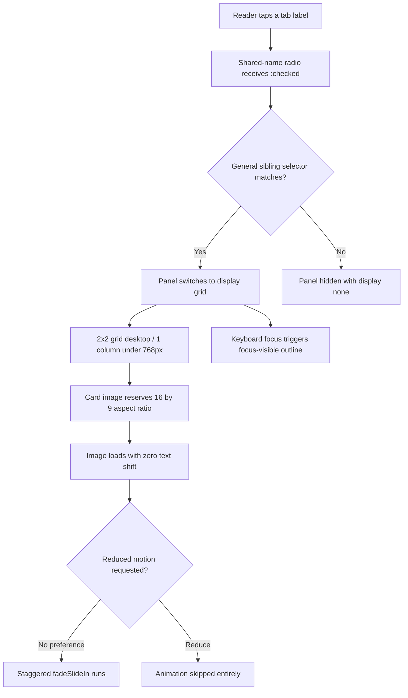

| Difficulty | Channel | Tags |
|---|---|---|
| beginner | frontend | css, flexbox, grid, animations |

Picture a reader tapping a headline just as the hero image arrives and shoves the article down a hundred pixels. That exact frustration played out across Yahoo! JAPAN News, where over 22 billion monthly page views met a Cumulative Layout Shift score near 0.2 [1]. Teams fixed it by reserving space before images loaded, and CLS fell to zero. The same tiny discipline—reserving the box and letting CSS decide what appears—powers the JavaScript-free tab panels below.

---

> ### Real-World Case — Yahoo! JAPAN
>
> Yahoo! JAPAN News, with over 22 billion monthly page views, found its article detail pages had a poor Cumulative Layout Shift score of about 0.2. The hero image at the top of each article loaded late with no space reserved for it, so when it arrived it shoved the headline and body text downward, causing accidental taps, disorientation, and reader frustration.
>
> | | |
> |---|---|
> | **Challenge** | Eliminate the layout shift caused by late-loading images without abandoning support for older browsers still in use (such as iOS 9), where the new CSS aspect-ratio property was not available. |
> | **Solution** | The team reserved the image's space before it loaded using the aspect-ratio box technique: the backend API supplied each image's ratio, and a container held that exact shape so the browser could allocate the box up front — the same principle behind setting aspect-ratio: 16/9 on a card's image area — with a padding-based fallback for legacy browsers. |
> | **Outcome** | CLS fell from about 0.2 to 0, URLs flagged as poor in Search Console dropped by 98%, and engagement rose sharply: page views per session +15.1%, session duration +13.3%, and bounce rate down 1.72 percentage points. The site also earned Chrome Android's 'Fast page' label. |
> | **Lesson** | Reserving fixed space for media with a CSS aspect ratio is not merely cosmetic — visual stability is a measurable UX signal that drives engagement, so a pure-CSS layout fix can move business KPIs at massive scale. |

---

## Hook — The deploy looked fine. Then the headline jumped

The deploy looked fine. Then the headline jumped. On Yahoo! JAPAN News, a publication serving more than 22 billion monthly page views, the hero image on article detail pages had no reserved space, so it arrived late and shoved the headline and body copy downward [1]. Readers tapped the wrong links, and a Cumulative Layout Shift score near 0.2 quietly became a trust problem. Picture that on your own docs page: a reader reaches for a tab, the layout twitches, and the click lands somewhere else. The stakes are bigger than aesthetics, because a jittery interface tells readers the page is not in control. But wait, it gets better: the same CSS habits that stop that jump can remove an entire JavaScript bundle from your tabbed UI. What if the fix was already in the browser?

## Problem — Tabs that twitch, bundle bloat, and the keyboard tax

Building on that tension, design-system docs pages are the classic place where tabs multiply fast. Each tab hides a 2x2 grid of cards, and every card wants an image, a title, and a meta line. Many developers reach for a component library, then discover the real cost is not 40KB of JavaScript but the hydration, the focus bugs, and the layout that shifts while images stream in. A CSS-only approach sounds like a clever party trick until someone asks about keyboard navigation. Here is the thing though: radio inputs already give you single-selection semantics for free, and the browser handles focus without any help.

⚠️ Watch Out: hiding panels with `display: none` removes them from the accessibility tree, so the panel you keep visible must be the one tied to the checked radio.

Use this pattern when the tab set is small, known up front, and speed matters—docs sites, settings pages, and marketing FAQs. For deep, stateful, URL-driven tabs, JavaScript is still the right tool. So how does a radio actually reach a panel three nodes away?

## Real-World Case — Yahoo! JAPAN

That last question is not academic; Yahoo! JAPAN News lived the consequences at scale. Article detail pages carried a CLS score around 0.2 because the top hero image loaded late with no space reserved for it [1]. Once the image painted, it pushed text down, causing accidental taps and disorientation for readers. The team reserved the image area before load, and CLS dropped from roughly 0.2 to 0. Consequently, URLs flagged as poor in Search Console fell by 98%.

The engagement numbers are the real plot twist: page views per session rose 15.1%, session duration climbed 13.3%, and bounce rate fell 1.72 percentage points, with the site earning Chrome Android's 'Fast page' label [1].

💡 Insight: reserving space is not merely a rendering optimization, it is a promise to the reader that the page will hold still. Interestingly, the fix was structural CSS, not a faster image CDN. That same promise is exactly what `aspect-ratio` makes trivial for the cards in the tabs below.

## Deep Dive — Radios, sibling selectors, and reserved space

Continuing from that promise, the CSS-only tab pattern rests on four small mechanisms that developers often underestimate. First, radios sharing one `name` enforce a single active choice; no JavaScript referee required [4]. Second, the general sibling combinator `~` lets a checked input reach every panel that follows it in the DOM [5]. Third, CSS Grid with `repeat(2, 1fr)` produces the desktop 2x2 layout, and a `max-width: 768px` media query collapses it to one column [2]. Fourth, `aspect-ratio: 16 / 9` reserves the image box before any pixels arrive, so card text never gets shoved around [3].

Here is what you need to know:
- `:checked` is the only state you need; labels are just the clickable face of the radio [4].
- `backwards` fill mode makes staggered cards start invisible instead of flashing at full opacity [8].
- `prefers-reduced-motion: no-preference` opts animation in, which is the safer default for motion-sensitive readers [7].
- `:focus-visible` draws the outline for keyboard users while keeping mouse clicks visually quiet [6].

🔥 Hot Take: the biggest accessibility win here is not the outline, it is that native radios already announce their selected state to screen readers. Specifically, the stagger runs only when the reader has not asked for less motion, so it stays a delight rather than a trap. But here is the subtle tradeoff: `display: none` is instant and cheap, yet it cannot animate, so teams that need cross-fades must move to opacity and `` patterns. Which tradeoff is right for a docs page that must feel instant?

## Workflow — From tap to stable card in six steps

Following that tradeoff, the workflow is deliberately boring, which is the point. The 'Tab Panel Rendering Flow' diagram below maps the whole path from a tap to a stable card.

1. Reserve the image box with `aspect-ratio` before anything loads [3].
2. Emit one radio, one label, and one panel per tab, all sharing a single `name`.
3. Mark the first radio `checked` so the page has a valid initial state.
4. Switch panels with `input:not(:checked) ~ .panel { display: none; }` [5].
5. Lay out the visible panel with `repeat(2, 1fr)` and collapse it below 768px using a media query [9].
6. Gate the stagger behind `prefers-reduced-motion: no-preference` [7] and keep `:focus-visible` outlines [6].

Notice where the branches land in the Mermaid flow: motion and focus are side paths, not afterthoughts. Therefore, a reader who tabs through the controls gets an outline, while a reader who prefers less motion simply skips the animation. How many components in your current design system can claim the same?

## Code Example — Generating the CSS-only panel

Putting the workflow into practice, the JavaScript below does not implement the interaction; it only generates the markup and inlines the critical CSS that makes the CSS-only pattern work. That distinction matters because the runtime is a convenience, while tab switching itself stays in the browser's CSS engine.

Step by step: the `TABS` array describes each section and its cards; `buildTabs` creates a radio, a label, and a panel per entry; the shared `name: 'tabs'` guarantees one active choice; `index === 0` sets the initial tab; each card's image box is a plain `div` whose size comes from CSS; and the `CSS` array is joined and injected early so the 16:9 reservation applies before images paint. Consequently, the entrance animation is scoped to `prefers-reduced-motion: no-preference`, and `:focus-visible` stays global.

⚠️ Watch Out: DOM order is part of the API here. Panels must follow their radios, or the `~` combinator silently stops matching. After debugging this pattern many times, here is what works: keep the generated order rigid, keep the CSS inline and early, and let the browser do the switching.

## Lessons Learned — Battle scars and the next docs page

Bringing the journey full circle, Yahoo! JAPAN News proved that a fraction of a point of layout shift can cost real engagement at 22 billion page views [1]. The CSS-only tab panel applies the same discipline at component scale.

Battle scars to avoid:
- Placing panels before their radios breaks the `~` selector; sibling order is part of the contract [5].
- Forgetting `backwards` fill causes a flash of fully visible cards before the stagger starts [8].
- Using `prefers-reduced-motion: reduce` as the animation gate inverts the intent; gate on `no-preference` instead [7].
- Stubbing image boxes without `aspect-ratio` recreates the exact CLS bug from the opening story [3].
- Skipping `:focus-visible` leaves keyboard users guessing where they are [6].

🎯 Key Point: every interactive component should answer three questions before shipping—does it keep still, does it work with a keyboard, and does it respect motion preferences? Many developers think `display: none` is the whole accessibility story until they learn that native form controls carry semantics for free. Sound familiar? The next time a teammate suggests a 40KB tabs library for a docs page, you now have a quieter answer.

---

## Tab Panel Rendering Flow

<strong>Original Interview Question</strong>

**Q:** Build a CSS-only tab panel for a design-system docs page. Use radio inputs to switch tabs (no JavaScript). Desktop: a 2x2 grid of cards under each tab; mobile: single column. Each card has a fixed 16:9 image area, a title, and a short meta line. Add a subtle entrance animation with a stagger and keep focus-visible outlines; ensure prefers-reduced-motion is respected?

**A:** Use a set of radio inputs with a shared `name` attribute and corresponding `` elements for each tab section. The `:checked` state of each radio controls visibility of its associated panel via adjacent sibling selectors. Each panel renders a 2×2 card grid on desktop and collapses to a single column on mobile. Cards use `aspect-ratio: 16/9` for fixed image containers, with a title and meta line below.

## Conclusion

So what should change tomorrow? Start treating layout stability as a design constraint, not a performance afterthought—Yahoo! JAPAN News moved CLS from about 0.2 to zero and watched poor URLs drop 98% [1]. Then reach for radios, labels, Grid, and `aspect-ratio` before reaching for a dependency. The memorable insight to share with your team: a tab panel that never shifts, never needs JavaScript, and never ignores a keyboard is not a compromise; it is the browser doing its job. Build the space before the pixels arrive, and the rest of the interface will follow.

---

## References

1. [Yahoo! JAPAN incident report](https://web.dev/case-studies/yahoo-japan-news) — article
2. [MDN: CSS Grid Layout](https://developer.mozilla.org/en-US/docs/Web/CSS/CSS_grid_layout) — documentation
3. [MDN: aspect-ratio](https://developer.mozilla.org/en-US/docs/Web/CSS/aspect-ratio) — documentation
4. [MDN: :checked](https://developer.mozilla.org/en-US/docs/Web/CSS/:checked) — documentation
5. [MDN: General sibling combinator](https://developer.mozilla.org/en-US/docs/Web/CSS/General_sibling_combinator) — documentation
6. [MDN: :focus-visible](https://developer.mozilla.org/en-US/docs/Web/CSS/:focus-visible) — documentation
7. [MDN: prefers-reduced-motion](https://developer.mozilla.org/en-US/docs/Web/CSS/@media/prefers-reduced-motion) — documentation
8. [MDN: Using CSS animations](https://developer.mozilla.org/en-US/docs/Web/CSS/CSS_animations/Using_CSS_animations) — documentation
9. [MDN: Using media queries](https://developer.mozilla.org/en-US/docs/Web/CSS/CSS_media_queries/Using_media_queries) — documentation

---

**Author:** Satishkumar Dhule — [GitHub](https://github.com/satishkumar-dhule) · [LinkedIn](https://linkedin.com/in/satishkumar-dhule) · [Website](https://satishkumar-dhule.github.io)
