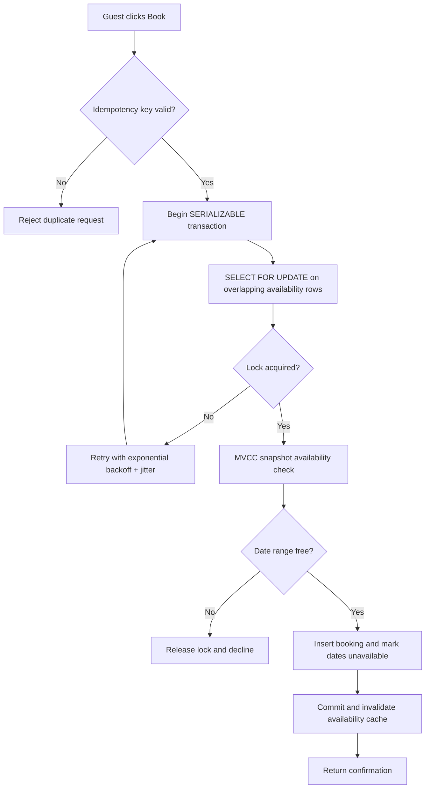

| Difficulty | Channel | Tags |
|---|---|---|
| intermediate | database | acid, isolation-levels, mvcc |

When a guest clicks "Book" twice in a split second, a well-meaning system can turn one reservation into two charges — and Airbnb learned this the hard way. As Airbnb's Payments services moved toward a microservices architecture, lost responses, client timeouts, and double clicks meant the same payment request could execute more than once, charging guests twice or paying hosts twice [1]. The fix was not a bigger database or a slower queue; it was a rethink of how transactions, isolation, and idempotency fit together. Since Orpheus launched, Airbnb hit five nines (99.999%) consistency in payments while annual payment volume simultaneously doubled [1].

---

> ### Real-World Case — Airbnb
>
> As Airbnb's Payments services moved to a microservices (SOA) architecture, lost responses, client timeouts, and users clicking "Book" twice could cause the same payment request to be executed more than once — charging a guest multiple times or paying a host twice. The team needed retry-safe, exactly-once behavior without sacrificing low latency or data integrity.
>
> | | |
> |---|---|
> | **Challenge** | Guarantee idempotency and ACID correctness across distributed payment services, including race conditions from duplicate requests, without relying on potentially stale read replicas or a slow standalone idempotency service. |
> | **Solution** | Airbnb built Orpheus, an embedded idempotency library: each request carries an idempotency key, acquires a database row-level lock (an expiring lease), and runs in ACID transactions against a sharded MySQL master only — never replicas or caches. They split API calls into Pre-RPC, RPC, and Post-RPC phases with strict rules: no network calls inside DB transactions and no DB access during RPC, combining commits via Java lambdas, classifying errors as retryable/non-retryable, recording responses, and using exponential backoff with jitter. |
> | **Outcome** | Since Orpheus launched, Airbnb achieved five nines (99.999%) consistency in payments while annual payment volume simultaneously doubled; the row-level lease design also eliminated duplicate charges caused by a few seconds of replica lag. |
> | **Lesson** | The counterintuitive fix for high availability wasn't more replication — it was deliberately reading idempotency state from a strongly consistent sharded master, because a stale replica few seconds behind can turn a correct retry into a duplicate charge. Treat concurrency control as a write-boundary invariant enforced by the database, not by optimistic UI checks. |

---

## Hook — The Book Button That Charged Three Times

It was 3am when the alerts started firing. A guest in Lisbon had clicked "Book" on a seaside apartment, the network blipped, and the client retried. Twice. What should have been one €180 reservation became three charges, two confirmed bookings, and one very awake on-call engineer staring at a 500 error. Picture the fallout: a host blaming the platform, a guest disputing a chargeback, and a support queue that suddenly smells like burnt coffee. Sound familiar? This is the exact class of bug that keeps distributed systems engineers up at night, and it is why transaction design is not academic trivia. 💡 Insight: the database cannot tell the difference between "user clicked twice" and "network retried once." To your system, those events look identical.

## Problem — Two Guests, One Weekend, One Race Condition

Building on that 3am chaos, the root cause is a race condition wearing a deceptively friendly mask. Two guests want the same property for the same weekend, and both requests race toward the database at nearly the same instant [2]. Without careful coordination, both read "available," both write "booked," and the property is now double-booked. The stakes are higher than an awkward apology email. Overbooking means refunds, rebooking costs, and trust erosion that no discount coupon fully repairs. Moreover, the pressure to stay available makes the trap worse: adding locks to fix correctness can tank throughput, so teams face a brutal tradeoff between being right and being fast. Specifically, every extra millisecond of lock wait shows up in checkout latency. This is where isolation levels enter the story.

## Real-World Case — Airbnb

Building on that tension, Airbnb's Orpheus payments system faced the same demon in a different costume. As Airbnb's Payments services moved to a service-oriented architecture, lost responses, client timeouts, and users clicking "Book" twice caused the same payment request to execute more than once [1]. The result was double charges for guests and duplicate payouts to hosts — the failure mode described above, but with real money attached. The team could not simply add a global lock; that would have destroyed the low latency a global marketplace demands. Instead, a row-level lease design delivered retry-safe, effectively exactly-once behavior. Since Orpheus launched, Airbnb achieved five nines (99.999%) consistency while annual payment volume doubled [1]. 🔥 Hot Take: the lesson is not "use a lock." It is "make the operation safe to retry." The row-level lease also eliminated duplicate charges caused by just a few seconds of replica lag [1]. But how does one actually build that safety net? That question leads straight into the engine room.

## Deep Dive — Isolation, Locks, and the Retry Safety Net

This leads directly into the concepts that make retry-safety possible. Database transactions bundle multiple operations into a single all-or-nothing unit, and the ACID properties guarantee atomicity, consistency, isolation, and durability [2]. Isolation is the tricky sibling: it decides how much one transaction can see of another's unfinished work, and the SQL standard defines levels from READ UNCOMMITTED up to SERIALIZABLE [3]. You might think SERIALIZABLE is the obvious choice for everything, but actually it is the most restrictive and the most expensive in terms of lock contention. Here is the thing though — correctness-critical paths like booking and payment deserve that cost. 💡 Insight: SERIALIZABLE prevents write skew, the subtle anomaly where two transactions read overlapping data and both commit conflicting writes [6].

Under the hood, multiversion concurrency control (MVCC) keeps old versions of rows so readers never block writers and writers never block readers [5]. This is why a read-only availability check can stay blazing fast on a replica while the write path does the heavy lifting. Optimistic concurrency control takes a different bet: rather than locking eagerly, it lets transactions proceed and validates with a version column at commit time, retrying on conflict [4]. ⚠️ Watch Out: optimistic control is wonderful until contention is high, at which point retries pile up and latency spikes — many teams learn this the hard way during a flash sale.

Therefore, here is the real tradeoff laid bare:

| Approach | Best For | Cost | Failure Mode |
|---|---|---|---|
| Pessimistic lock (SELECT FOR UPDATE) | Hot properties, high contention | Blocks competing writers | Lock contention, deadlocks |
| Optimistic locking (version column) | Low contention, mostly reads | Cheap until conflicts rise | Retry storms |
| SERIALIZABLE isolation | Money and booking paths | Highest overhead | Aborts under contention |
| Idempotency keys | Retry-heavy APIs | Storage for keys | Key cleanup complexity |

🎯 Key Point: there is no single winner. The art lies in matching the mechanism to the access pattern.

## Workflow — From Click to Confirmed Reservation

Building on those tradeoffs, a production booking flow stitches several mechanisms into one coherent path. The Booking Transaction Flow diagram below maps the journey from a guest's click to a confirmed reservation, including the retry loop that makes the whole thing resilient. Here is what you need to know:

1. The client sends an idempotency key with the request, so a double click is recognizable as the same intent.
2. The system checks that key first; a replay returns the stored result and skips all the expensive work.
3. A SERIALIZABLE transaction begins for the critical section [3].
4. SELECT FOR UPDATE locks only the availability rows whose dates overlap the request [7].
5. An MVCC snapshot confirms the date range is still free before any write happens [5].
6. The booking is inserted, dates are marked unavailable, and the transaction commits.
7. The availability cache is invalidated and a confirmation returns.

⚠️ Watch Out: lock only the rows that overlap the requested dates. Locking an entire property calendar turns a weekend reservation into a traffic jam, and competitors will happily exploit that latency. How does that translate into code you can actually ship? Read on.

## Code Example — Building the Retry-Safe Booking Path

Consequently, the following Python snippet turns that workflow into something you can reason about line by line. It uses an idempotency guard, a SERIALIZABLE transaction, row-level locking, and exponential backoff — the same ingredients Airbnb leaned on, minus the production infrastructure [9]. The full implementation lives in the code block below.

Step by step: the idempotency lookup runs first, so a replayed request returns the original booking id instead of creating a duplicate. Next, the transaction is explicitly set to SERIALIZABLE, which is what closes the write-skew gap between two simultaneous bookings. The SELECT ... FOR UPDATE statement locks just the overlapping date rows, a pattern documented in the PostgreSQL source and its SQL handling [7][9]. The INSERT then relies on a unique constraint on the idempotency key to enforce exactly-once semantics at the storage layer. Finally, the except branch rolls back and sleeps with exponential backoff plus jitter, so a thundering herd of retries does not make contention worse. Sound familiar if you have ever debugged a retry storm? The jitter is the part most teams forget.

## Lessons Learned — Design for Retries, Not Perfection

When the dust settles, a handful of hard-won lessons rise above the noise. First, retries are not an edge case — they are a normal part of distributed life, so design every money-moving operation to be idempotent [8]. Second, reach for SERIALIZABLE on the narrow paths where correctness is non-negotiable, and let MVCC keep reads cheap everywhere else [3][5]. Third, make locks surgical: SELECT FOR UPDATE on overlapping date rows beats a coarse property-wide lock every time [7].

Battle scars worth remembering:
- Forgetting idempotency keys: the classic "Book clicked twice" bug. Add a unique constraint on the key.
- Locking too broadly: whole-table locks that turn a weekend booking into a queue at the coffee machine.
- Ignoring replica lag: a few seconds of stale reads can resurrect duplicate charges [1].
- Skipping backoff jitter: synchronized retries create a thundering herd that makes contention worse.

💡 Insight: monitor lock wait time and add circuit breakers for hot properties. A listing that goes viral is a load event, not a reason to melt the database. 🎯 Key Point: if this feels overwhelming, you are not alone — start with idempotency keys and add isolation only where the money moves.

---

## Booking Transaction Flow

<strong>Original Interview Question</strong>

**Q:** You're building a booking system for Airbnb where multiple users can reserve the same property simultaneously. How would you design the transaction handling to prevent double bookings while maintaining high availability?

**A:** Use SERIALIZABLE isolation with optimistic concurrency control. Implement row-level locks on property availability tables, use MVCC snapshot reads for checking availability, and apply application-level validation to ensure atomic booking operations.

## Conclusion

Coming full circle, the guest who clicked "Book" three times at 3am did not need a faster database — the system needed to recognize that those three requests were one intent. Airbnb's Orpheus proved that retry-safe, exactly-once behavior can coexist with five nines consistency and doubled payment volume [1]. The next time a race condition lands in your inbox, remember: the fix is rarely "add a lock." It is "make the operation safe to repeat." That is the one memorable insight worth sharing with your team tomorrow: design for retries first, and correctness will follow.

---

## References

1. [Airbnb incident report](https://medium.com/airbnb-engineering/avoiding-double-payments-in-a-distributed-payments-system-2981f6b070bb) — article
2. [Database transaction](https://en.wikipedia.org/wiki/Database_transaction) — documentation
3. [Isolation (database systems)](https://en.wikipedia.org/wiki/Isolation_(database_systems)) — documentation
4. [Optimistic concurrency control](https://en.wikipedia.org/wiki/Optimistic_concurrency_control) — documentation
5. [Multiversion concurrency control](https://en.wikipedia.org/wiki/Multiversion_concurrency_control) — documentation
6. [Serializability](https://en.wikipedia.org/wiki/Serializability) — documentation
7. [Database lock](https://en.wikipedia.org/wiki/Database_lock) — documentation
8. [Idempotency](https://en.wikipedia.org/wiki/Idempotency) — documentation
9. [PostgreSQL official source repository](https://github.com/postgres/postgres) — documentation

---

**Author:** Satishkumar Dhule — [GitHub](https://github.com/satishkumar-dhule) · [LinkedIn](https://linkedin.com/in/satishkumar-dhule) · [Website](https://satishkumar-dhule.github.io)
