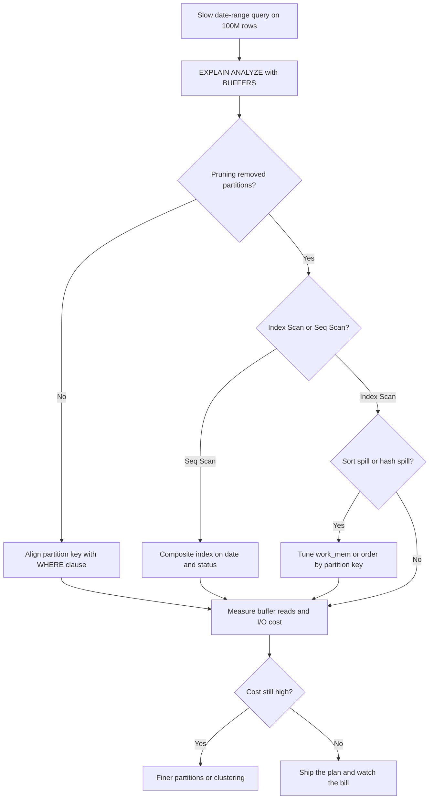

| Difficulty | Channel | Tags |
|---|---|---|
| intermediate | database | explain, query-plan, partitioning |

Picture a 33 TB orders table swallowing 46 GB of new data every day, with roughly 1,000 writes and 10,000 reads per second. For Amazon (AWS)'s Aurora PostgreSQL team, that table was also pulling 600,000 physical buffer reads per second, and on Aurora's pay-per-I/O model [2] the storage meter reached $17,676.81 in a single week [1]. The tempting fix — throw more memory at it — was not the fix. The real lever was hiding in the EXPLAIN plan, waiting for someone to read it [1].

---

> ### Real-World Case — Amazon (AWS)
>
> AWS database engineers built a production-scale Aurora PostgreSQL ordering workload with 33 TB of data ingesting 46 GB/day, driving roughly 1,000 writes/sec and 10,000 reads/sec. Date-ranged reads against the huge unpartitioned orders table caused massive physical I/O — 600,000 buffer reads/sec — which on Aurora's pay-per-I/O model translated into a $17,676/week storage bill.
>
> | | |
> |---|---|
> | **Challenge** | Make date-range queries touch only the relevant slice of a multi-terabyte time-series table so that the working set fits in cache, without a long migration outage. They also had to work around PostgreSQL's rule that a partitioned table's primary key must include the partition key (created_at). |
> | **Solution** | They converted the table in place to native RANGE partitioning on created_at, attached the original table as the first partition via a NOT VALID then validated CHECK constraint, and used pg_partman to roll monthly/daily partitions. Queries and updates were rewritten to carry created_at so the planner could prune partitions, and buffer reads/IOPS were measured with EXPLAIN-style stats, pg_stat_io and CloudWatch before and after. |
> | **Outcome** | Writer ReadIOPS fell from ~100,000/sec to ~40,000/sec; physical block reads dropped from ~600,000/sec to ~25,000/sec while cache hits rose to ~1.5M/sec. Weekly Aurora I/O charges fell from $17,676.81 to $5,608.33 (about 68% saved); the post reports up to 40% savings with monthly and 60% with daily partitions, with only ~10-second application interruptions during migration. |
> | **Lesson** | Partitioning only pays off when the dominant queries filter on the partition key with a bare-column predicate — then pruning shrinks the working set, raises cache hit rates and, on I/O-billed databases, turns a query-plan problem directly into a cost problem. |

---

## Hook — The bill that kept climbing while the cache looked healthy

$17,676.81 for one week of I/O [1]. That is not a typo, and it is not a ransom note — it was a storage bill attached to date-ranged reads against a huge orders table.

Here is the uncomfortable part: from the outside, everything looked healthy. Caches were warm, reads per second were impressive, and the application was doing exactly what it was designed to do. Then the physical I/O meter kept climbing like a smoke alarm with a low battery, and every date-range query was feeding it.

Sound familiar? Many developers discover the hard way that 'the query uses an index' and 'the query is cheap' are two completely different statements [3].

So what exactly turns a perfectly reasonable date filter into a five-figure weekly expense?

## Problem — When 'partitioned' quietly means 'still scanning everything'

Fast-forward to a more familiar scene: a PostgreSQL table with 100 million rows, partitioned by date, and a query that filters a single week. The partition key looks perfect on paper. Yet the plan still shows scans across far more data than the date range should require [4].

This leads to the central frustration of large-scale query tuning. Partitioning is often sold as an automatic speed button, but a partition boundary only helps when the planner can prove that whole partitions are irrelevant. If the predicate is written in a way that blocks that proof — a function wrapped around the date column, an implicit cast, or a range that spans every partition — pruning quietly does nothing.

Consequently, the database reads pages, builds sorts, and hashes aggregates for data nobody asked for. On a self-managed cluster that shows up as latency and CPU. On Aurora's pay-per-I/O model [2], it shows up as a line item that makes budget reviews awkward.

Who feels this? Teams running event streams, order histories, billing records, telemetry tables — anywhere dates are the natural access path. With 100 million rows, an avoidable full scan is not a rounding error; it is a recurring incident.

The plot twist is that adding indexes blindly can make the bill worse. Before reaching for DDL, the plan has to be interrogated.

## Real-World Case — Amazon (AWS)

The AWS engineers did not meet this problem in a lab. They built a production-scale Aurora PostgreSQL ordering workload with 33 TB of data, ingesting 46 GB per day, driving roughly 1,000 writes per second and 10,000 reads per second [1].

Date-ranged reads hit a huge unpartitioned orders table. Physical I/O peaked at about 600,000 buffer reads per second, and the weekly Aurora storage charge landed at $17,676.81 [1]. When I/O is metered, a scan is not merely slow — it is invoiced.

Building on that pressure, the team introduced range partitioning and realigned how the workload touched the table. Writer ReadIOPS fell from roughly 100,000 per second to about 40,000 per second. Physical block reads dropped from ~600,000 per second to ~25,000 per second, while cache hits rose to roughly 1.5 million per second [1].

Here is the payoff that made the report worth writing: weekly Aurora I/O charges fell from $17,676.81 to $5,608.33 — about 68% saved. The gains reached up to 40% with monthly partitions and 60% with daily partitions, with only about 10 seconds of application interruption during migration [1].

Counterintuitively, the win came from reading less, not computing faster. Which detail in the plan would have told you that before the bill arrived?

## Deep Dive — Reading the plan like a detective, not a dashboard

Building on the AWS outcome, here is the detective work. EXPLAIN (ANALYZE, BUFFERS) is the microscope: ANALYZE shows what actually happened, and BUFFERS shows how many pages were touched [3]. Timings alone hide the crime.

Here is what you need to know:

- Pruning evidence: look for only the relevant partitions appearing in the plan, and for removed subplans. If every partition shows up for a one-day filter, the predicate and the partition key are not speaking the same language [4].
- Scan choice: an Index Scan or Bitmap Heap Scan is not automatically good, and a Seq Scan is not automatically evil. Compare estimated rows to actual rows; bad estimates are usually the real villain [5].
- Composite indexes: a single index on (event_date, status) serves filters on both columns and on date alone, because the leading column still drives the range. An index on status alone forces the planner to juggle unrelated row locations.
- Sort and hash spills: Sort Method: external merge disk and hash batches greater than 1 are flashing warnings. They mean work is spilling instead of fitting in memory.
- Physical layout: even a perfect index can scatter reads across the heap. CLUSTER aligns rows with the index, but it is a one-time, lock-heavy rewrite — pg_repack-style online tools are the gentler cousin.

Here is the thing though: SELECT * sabotages covering strategies. Returning every column drags heap fetches back into the picture even when the index found the right rows.

| Decision | Option A | Option B | Real tradeoff |
|---|---|---|---|
| Partition granularity | Monthly | Daily | Daily prunes harder and can save more I/O, but planning overhead and partition count grow [1] |
| Index shape | (status) | (event_date, status) | Composite follows the date range first; single-column indexes multiply heap visits |
| Physical order | Normal heap | CLUSTER by index | CLUSTER improves locality but needs a maintenance window |

Many developers think the hero is a bigger cache. In a metered-I/O world, the hero is a predicate that lets the planner skip work entirely [4]. If the plan still looks fuzzy, what should the first measured step be?

## Workflow — From slow query to measurable fix in five moves

This leads to a repeatable routine rather than a ritual of random index creation. The diagnostic path below turns a vague 'query is slow' report into a decision you can defend in a review.

1. Capture the truth: run EXPLAIN (ANALYZE, BUFFERS) with the exact production predicate and literal date range.
2. Confirm pruning: count how many partitions survive. If the answer is 'all of them', fix the predicate before touching anything else.
3. Compare estimates with reality: large actual-versus-estimated gaps point to stale statistics, so ANALYZE the parent and partitions.
4. Inspect access paths: identify Seq Scans, Index Scans, and Bitmap Heap Scans, then check for disk sorts or hash spills.
5. Add the composite index with CREATE INDEX CONCURRENTLY so writers keep working, then re-run the same plan.
6. Re-measure the business metric: buffer reads per second and I/O cost, not just milliseconds [9].
7. Escalate only if needed: finer partitions or clustering, as the AWS team found, can unlock the next tier of savings [1].

The diagram maps this journey from symptom to measurable outcome:

[Mermaid diagram will be rendered below.]

Pro tip: automate the repetitive parts. Tools built around hypertables and continuous aggregation show how much of this pruning machinery can be productized [7]. But before automation, the manual plan read builds the intuition.

## Code Example — A bash playbook you can run against a real database

Building on the workflow, the playbook below is deliberately boring — which is exactly what production wants. The SQL inside the heredocs is the same investigation developers run by hand; bash just makes it repeatable.

- The first EXPLAIN includes BUFFERS, so shared read counts become part of the evidence instead of an afterthought.
- CREATE INDEX CONCURRENTLY avoids taking an AccessExclusiveLock on a busy table; the price is a longer build and no transaction wrapper.
- ANALYZE refreshes planner statistics so the next plan is not guessing from stale numbers.
- The final query selects only three columns and uses a half-open date range, which avoids BETWEEN's inclusive-end edge cases with timestamps.

Notice the shift between the first and last query: same intent, narrower payload, measurable difference. The fully runnable version follows in the code block.

## Lessons Learned — Battle scars from the partition wars

However, the story does not end at a green checkmark. Battle scars usually come from the steps people skip when the first number improves.

- Mistake: assuming monthly partitions match a dashboard that filters one day. Fix: align granularity with the dominant predicate, and remember the report's larger gains with daily partitions [1].
- Mistake: indexing status alone because 'status is the filter'. Fix: lead with the date column when the range is the primary selector [5].
- Mistake: running CLUSTER at peak traffic. Fix: schedule it or use an online rewriter, because locality is not worth an outage.
- Mistake: celebrating latency while ignoring buffer reads. Fix: watch I/O metrics alongside query time [9].
- Mistake: wrapping the partition column in a function. Fix: keep predicates sargable so pruning can reason about boundaries [4].

When would you actually use each move? Use a composite (date, status) index when both columns appear together in WHERE. Use daily partitions when reads target hours or days and every avoided partition saves metered I/O. Use clustering only when index correlation is poor and a maintenance window exists.

If this feels overwhelming, start with one query and one plan. That is how the 33 TB problem became a $5,608.33 week.

---

## Query Optimization Decision Flow

<strong>Original Interview Question</strong>

**Q:** You have a PostgreSQL table with 100M rows partitioned by date. A query filtering on a specific date range is still slow. What would you check in the EXPLAIN plan and how would you optimize it?

**A:** Check partition pruning effectiveness, index utilization patterns, and expensive sort operations. Create composite indexes on (date, filtered_columns) and evaluate clustering strategies for optimal data access.

## Conclusion

The journey began with a five-figure weekly I/O bill and ended with a 68% smaller one [1]. Nothing magical happened: the team stopped asking the database to read data the query did not need, and the EXPLAIN plan showed exactly where the waste lived.

The one insight worth sharing with your team tomorrow: on a metered database, every unnecessary buffer read is an invoice line, so treat partition pruning as a cost control, not just a performance trick.

Your move — pull one slow date-range query, run EXPLAIN (ANALYZE, BUFFERS), and count the partitions it actually touches. The answer might pay for your next coffee run.

---

## References

1. [Amazon (AWS) incident report](https://aws.amazon.com/blogs/database/reduce-read-i-o-cost-of-your-amazon-aurora-postgresql-database-with-range-partitioning/) — article
2. [Amazon Aurora overview — Amazon RDS documentation](https://docs.aws.amazon.com/AmazonRDS/latest/AuroraUserGuide/CHAP_AuroraOverview.html) — documentation
3. [Query plan — Wikipedia](https://en.wikipedia.org/wiki/Query_plan) — documentation
4. [Partition (database) — Wikipedia](https://en.wikipedia.org/wiki/Partition_(database)) — documentation
5. [Database index — Wikipedia](https://en.wikipedia.org/wiki/Database_index) — documentation
6. [PostgreSQL source repository — GitHub](https://github.com/postgres/postgres) — documentation
7. [TimescaleDB hypertables for time-series partitioning — GitHub](https://github.com/timescale/timescaledb) — documentation
8. [How To Install and Use PostgreSQL on Ubuntu 22.04 — DigitalOcean](https://www.digitalocean.com/community/tutorials/how-to-install-and-use-postgresql-on-ubuntu-22-04) — documentation
9. [Monitoring Amazon RDS — Amazon RDS documentation](https://docs.aws.amazon.com/AmazonRDS/latest/UserGuide/Monitoring.html) — documentation

---

**Author:** Satishkumar Dhule — [GitHub](https://github.com/satishkumar-dhule) · [LinkedIn](https://linkedin.com/in/satishkumar-dhule) · [Website](https://satishkumar-dhule.github.io)
