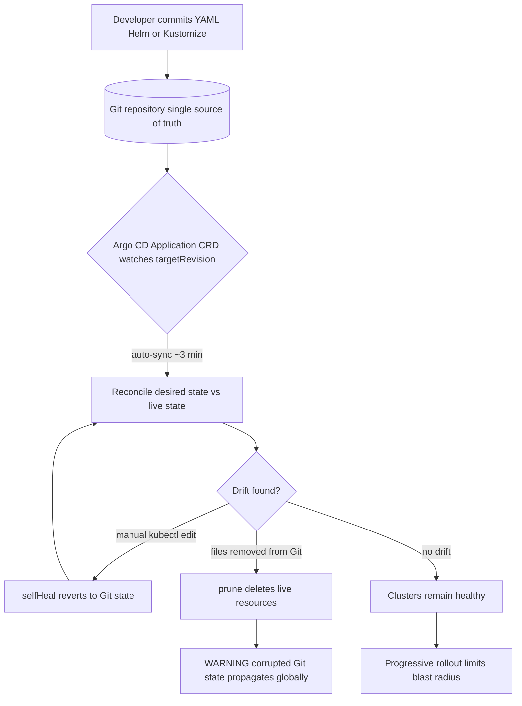

| Difficulty | Channel | Tags |
|---|---|---|
| beginner | devops | argocd, flux, declarative |

On August 25, 2021, a routine peer-reviewed edit removed two tiny characters — the `{{ }}` delimiters — from a root-level templating file in Skyscanner's GitOps repository, and within minutes Argo CD faithfully reconciled that corrupted state across every cluster on earth, deleting all 478 of the company's microservices [1]. No hacker, no failing server, no malicious insider — just Git doing exactly what Git was told. That four-and-a-half-hour global outage, which cut off roughly 75 million monthly users, is the most brutal reminder imaginable that in GitOps your repository is not documentation; it is production itself. So how does a team harness that kind of automation without handing a single commit the keys to the entire kingdom?

---

> ### Real-World Case — Skyscanner
>
> On August 25, 2021, an engineer made what was intended to be a harmless no-op edit to a root-level templating file in Skyscanner's GitOps infrastructure repo — removing the `{{ }}` delimiters. The change was peer-reviewed, merged, and because that file drove regional configuration, it propagated globally within minutes. At 16:00 GMT, Argo CD reconciled every cluster against this corrupted Git state, found no valid namespaces, and pruned all 478 microservices worldwide.
>
> | | |
> |---|---|
> | **Challenge** | Skyscanner's cell-based architecture (multiple K8s clusters per region, n+2 redundancy on AWS spot instances) was designed so no single failure could take down the site. The problem was that Argo CD was given authority to reconcile namespaces — the very containers holding workloads that were NOT Git-managed — creating a hybrid state where declarative reconciliation could delete everything it didn't see declared in Git, including deployments, services, and HPAs deployed by a separate imperative toolchain. |
> | **Solution** | Skyscanner relied on the same GitOps mechanism that caused the outage to fix it: they reverted/restore the correct configuration in Git, and each cluster's Argo CD controller self-reconciled back to the declared state automatically — no central push needed. They prioritized restoring a single region with critical services first (serving all traffic from four clusters in one region by ~20:30 GMT), shed non-critical load like price alerts, and manually restored the remaining regions over the following two days. Long-term fixes: channel-based staged rollouts (dev → alpha → beta → main) so no config change can go global, unit-testing templated config as code, and re-wargamed runbooks. |
> | **Outcome** | A 4.5-hour full global outage — skyscanner.net and mobile apps unavailable to ~75 million monthly users; all 478 services deleted across every AZ and region. Cluster-level self-healing was fast (namespaces back within an hour for some clusters), but full traffic recovery took hours due to manual restoration and stale runbooks. Post-incident, any config change now rolls out to only a small subset of clusters at once, limiting theoretical blast radius to a single cluster. |
> | **Lesson** | Declarative GitOps with auto-sync and self-heal/prune is a double-edged sword: it faithfully enforces Git as the single source of truth, so a bad commit becomes a globally amplified, self-executing deletion in seconds — the automation doesn't know the difference between a fix and a mistake. The same reconciliation property is also the fastest recovery path, and the real danger lies in the in-between state where Git controls a wrapper (namespaces) around resources it doesn't own. Guardrails matter more than the tooling: stage rollouts, test templated config as code, and ensure self-heal cannot turn one bad line into a planet-wide outage. |

---

## Hook — The Deploy Looked Fine. Then Everything Vanished.

The deploy looked fine. A two-character edit to a root-level template, a clean peer review, a green merge — and then, at 16:00 GMT, every Argo CD controller did exactly what it was built to do. No alarm fired because nothing malfunctioned; the automation was working perfectly, and that is the unsettling part. When the repository is the source of truth, a bad commit is not a documentation error — it is a production change delivered at machine speed to every region at once. Sound familiar? Many developers discover this only when the pager starts screaming. If the tooling behaved flawlessly, where did the safety actually go?

## Problem — When Your Source of Truth Becomes a Single Point of Failure

Building on that unease, the core challenge is not whether to automate Kubernetes deployments, but what happens when automation inherits a flawed definition of "correct." Under the declarative model, teams describe the desired state in Git using YAML manifests, Helm charts, or Kustomize overlays, and a controller continuously reconciles live state toward it [2]. The imperative model — direct `kubectl apply`, `kubectl scale`, or `kubectl delete` commands — changes the cluster first and asks questions later [7]. Many developers assume imperative is risky only because it skips code review; actually, the deeper risk is invisible drift, where no one can say which environment matches which commit. For a 30-person platform team running hundreds of services, that ambiguity turns every incident into archaeology. Consequently, GitOps promises auditability, repeatable rollbacks, and a single source of truth — yet the very mechanism that guarantees those benefits also guarantees that a poisoned source of truth propagates everywhere. The plot twist: the safest cluster is not the one with the most automation, but the one where the blast radius of a wrong commit is deliberately capped. Where, then, does that cap live?

## Real-World Case — Skyscanner

Nothing illustrates that trade-off more vividly than Skyscanner's August 25, 2021 outage [1]. An engineer removed the `{{ }}` delimiters from a root-level templating file — a change intended to be a harmless no-op. It passed peer review and merged. Because that file drove regional configuration, the corrupted definition spread across every environment in minutes; at 16:00 GMT Argo CD reconciled each cluster, found no valid namespaces, and pruned all 478 microservices worldwide. ⚠️ Watch Out: `prune` does not ask whether a deletion makes sense; it simply enforces absence. The impact was a 4.5-hour full global outage for roughly 75 million monthly users, with skyscanner.net and mobile apps unavailable. Cluster-level self-healing was fast — namespaces returned within an hour on some clusters — but full traffic recovery dragged on because manual restoration was required and runbooks were stale. Afterward, the team changed the rollout model so any config change reaches only a small subset of clusters at a time, reducing the theoretical blast radius to a single cluster. That is the real fix: not less GitOps, but narrower GitOps. Which settings make that possible?

## Deep Dive — Declarative Reconciliation vs Imperative Commands

Building on the Skyscanner timeline, the mechanics reduce to a few Argo CD primitives [3]. An Application CRD is the contract: `spec.source` points at the repo, path, chart, or overlay; `spec.destination` names the target cluster and namespace; and `spec.syncPolicy` decides how aggressively reconciliation behaves. With `syncPolicy.automated.prune: true`, resources that disappear from Git are deleted from the cluster — a feature until it is not. With `selfHeal: true`, a developer's emergency `kubectl edit` is quietly reverted, which is exactly what teams want for drift but exactly what they do not want during an incident when Git is wrong. Argo CD's reconciliation interval defaults to roughly three minutes (controlled by `timeout.reconciliation`), so a bad commit has a very short fuse. 💡 Insight: those three settings — prune, selfHeal, interval — are the entire philosophical difference between "Git is a suggestion" and "Git is law."

Now for the comparison that interviewers love and production actually punishes:

| Option | How change happens | Strength | Real tradeoff |
| --- | --- | --- | --- |
| Declarative (GitOps) | Commit YAML, Helm [4], or Kustomize [5]; controller reconciles | Auditable, repeatable, easy rollbacks | Bad commits propagate fast; prune amplifies mistakes |
| Imperative (kubectl) | Direct `kubectl` commands against the API [7] | Instant, excellent for debugging | No history, drift across environments, manual rollbacks |

When would you actually use each? Declarative wins for anything that must survive a quarter — services, namespaces, network policy. Imperative earns its keep in short-lived debugging, a one-off `kubectl port-forward`, or a break-glass fix while the pipeline is down. 🔥 Hot Take: teams that ban `kubectl` entirely are not more mature; they are simply hiding imperative changes in shell scripts nobody reviews. The mature team allows imperative work but measures it, then commits the fix so the declarative loop can reclaim the truth. Knowing the knobs is only half the battle; the other half is the order in which changes travel.

## Workflow — From Commit to Cluster Without the Global Delete Button

This leads directly to the deployment path that either contains a blast radius or amplifies it. The `GitOps Reconciliation Flow` diagram below shows the whole journey from commit to cluster.

1. A developer commits manifests or a Helm/Kustomize change to a reviewed branch.
2. The Argo CD Application CRD notices a new `targetRevision` and fetches the rendered manifests.
3. Every ~3 minutes, reconciliation compares desired state against live state.
4. If drift came from a manual `kubectl` edit, `selfHeal` reverts it to Git.
5. If files vanished from Git, `prune` deletes the corresponding live resources — the Skyscanner failure mode.
6. Healthy clusters stay green while progressive sync waves push changes to a canary subset before every region.
7. Teams running Flux instead get a similar reconciliation loop with a different control-plane shape [6].

🎯 Key Point: the sync loop is deliberately dumb — it cannot tell a brilliant refactor from a corrupted template. Safety therefore has to be designed around it: branch protection, dry-run diffs, staged rollouts, and a rollback that is one `git revert` away. Theory is cheap, so here is a manifest you can actually apply.

## Code Example — An Application CRD That Refuses the Dangerous Default

Consider a production-style Application manifest that keeps the useful parts of automation while dropping the risky default. Run it as a bash script against a cluster where Argo CD is installed.

```bash
#!/usr/bin/env bash
# Production-style Argo CD Application with guardrails enabled.
set -euo pipefail

# Namespace where the Argo CD control plane runs.
ARGO_NS=argocd

# Apply a declarative Application CRD; Git stays the single source of truth.
cat <<'YAML' | kubectl apply -n $ARGO_NS -f -
apiVersion: argoproj.io/v1alpha1
kind: Application
metadata:
  name: payments-service
  finalizers:
    - resources-finalizer.argocd.argoproj.io
spec:
  source:
    repoURL: https://github.com/example/platform-manifests.git
    targetRevision: main          # pin to a reviewed branch, not a moving tag
    path: overlays/production/payments
  destination:
    server: https://kubernetes.default.svc
    namespace: payments
  syncPolicy:
    automated:
      prune: false                # global prune starts with a corrupted Git state
      selfHeal: true              # revert out-of-band kubectl edits automatically
    syncOptions:
      - CreateNamespace=true
    retry:
      limit: 3
      backoff:
        duration: 10s
        factor: 2
        maxDuration: 2m
YAML

# Nudge the first sync; the controller's ~3-minute interval takes over after that.
argocd app sync payments-service --async
```

Step by step: the shebang and `set -euo pipefail` make the script fail loudly instead of half-applying. `ARGO_NS` targets the namespace holding the control plane. The heredoc feeds a declarative Application CRD into `kubectl apply`, keeping Git as the source of truth while the manifest itself is reviewed. `targetRevision: main` pins the source to a reviewed branch rather than a tag that can be rewritten. `prune: false` is the deliberate guardrail: it stops a corrupted Git state from deleting live resources, which is the exact Skyscanner lesson. `selfHeal: true` still reverts out-of-band edits, so drift control survives. `CreateNamespace=true` avoids the namespace-pruning trap, and the retry backoff prevents a flaky API server from becoming a sync storm. Finally, `argocd app sync --async` nudges the first reconciliation without blocking the terminal; the controller's own ~3-minute interval takes over from there. Once the loop is running, the remaining work is learning to live with it — which is where battle scars come in.

## Lessons Learned — Battle Scars Worth Keeping

After the code is applied, the hard-won lessons are what keep it safe at 3am. The mistakes that show up again and again:

- ⚠️ Never enable global `prune` on day one. Start with `prune: false`, prove the manifests in staging, then scope pruning to namespaces that tolerate deletion.
- 75 million users do not care that the rollback was technically instant if the runbook is stale. Keep a tested one-command rollback — `git revert` plus a forced sync — and rehearse it quarterly.
- A peer review of a two-character change is still a review; require CI that renders manifests and diffs them against live state before merge.
- Staged rollout is not optional at scale. Skyscanner's post-incident fix capped the theoretical blast radius at one cluster; do the equivalent with progressive sync waves [1].
- Measure drift instead of assuming zero. Alert on `kubectl` writes in production namespaces so imperative break-glass work stays visible [7].
- Treat Git as production: branch protection, signed commits, and audit logs are deployment controls, not bureaucracy [2].

Many developers think GitOps removes human error; actually, it removes the delay between human error and its consequences. That is a fair trade only when the consequences are small. If this feels overwhelming, start with one non-critical namespace and one guarded Application — the confidence compounds. The final question is simple: what changes tomorrow?

---

## GitOps Reconciliation Flow



<details>
<summary><strong>Original Interview Question</strong></summary>

**Q:** You're setting up GitOps for a microservices deployment. How would you configure ArgoCD to automatically sync changes from your Git repository to Kubernetes, and what's the difference between declarative and imperative approaches in this context?

**A:** I'd configure ArgoCD by setting up a Git repository containing Kubernetes manifests or Helm charts, creating an Application CRD that points to the Git repository, enabling auto-sync with a health check interval of 3 minutes, and implementing self-healing to automatically revert any manual changes. The declarative approach involves defining the desired state in Git through YAML manifests, Helm charts, or Kustomize configurations, where ArgoCD continuously reconciles the actual state with the desired state. In contrast, the imperative approach uses kubectl commands to make direct changes to the cluster, bypassing the Git repository as the single source of truth.

</details>

## Conclusion

The journey began with two characters and 478 deleted microservices [1], moved through the uncomfortable truth that perfect automation amplifies perfect mistakes, and ended with concrete guardrails — prune discipline, self-heal awareness, short reconciliation intervals, staged rollouts, and rehearsed rollbacks. The one memorable insight to share with your team: in GitOps, a commit is a deployment, so your repository deserves production-grade respect. Tomorrow, audit every Application for `prune: true`, pin every `targetRevision`, and add one canary cluster before the next release. Do that, and the next two-character edit becomes a boring diff instead of a headline.

---

## References

1. [Skyscanner incident report](https://medium.com/@SkyscannerEng/how-a-couple-of-characters-brought-down-our-site-356ccaf1fbc3) — article
2. [Kubernetes: Declarative Management of Kubernetes Objects](https://kubernetes.io/docs/concepts/overview/working-with-objects/) — documentation
3. [Argo CD GitHub repository](https://github.com/argoproj/argo-cd) — documentation
4. [Helm GitHub repository](https://github.com/helm/helm) — documentation
5. [Kustomize GitHub repository](https://github.com/kubernetes-sigs/kustomize) — documentation
6. [Flux CD GitHub repository](https://github.com/fluxcd/flux2) — documentation
7. [Kubernetes kubectl reference](https://kubernetes.io/docs/reference/kubectl/) — documentation
8. [DigitalOcean: An Introduction to Kubernetes](https://www.digitalocean.com/community/tutorials/an-introduction-to-kubernetes) — blog

---

**Author:** Satishkumar Dhule — [GitHub](https://github.com/satishkumar-dhule) · [LinkedIn](https://linkedin.com/in/satishkumar-dhule) · [Website](https://satishkumar-dhule.github.io)
