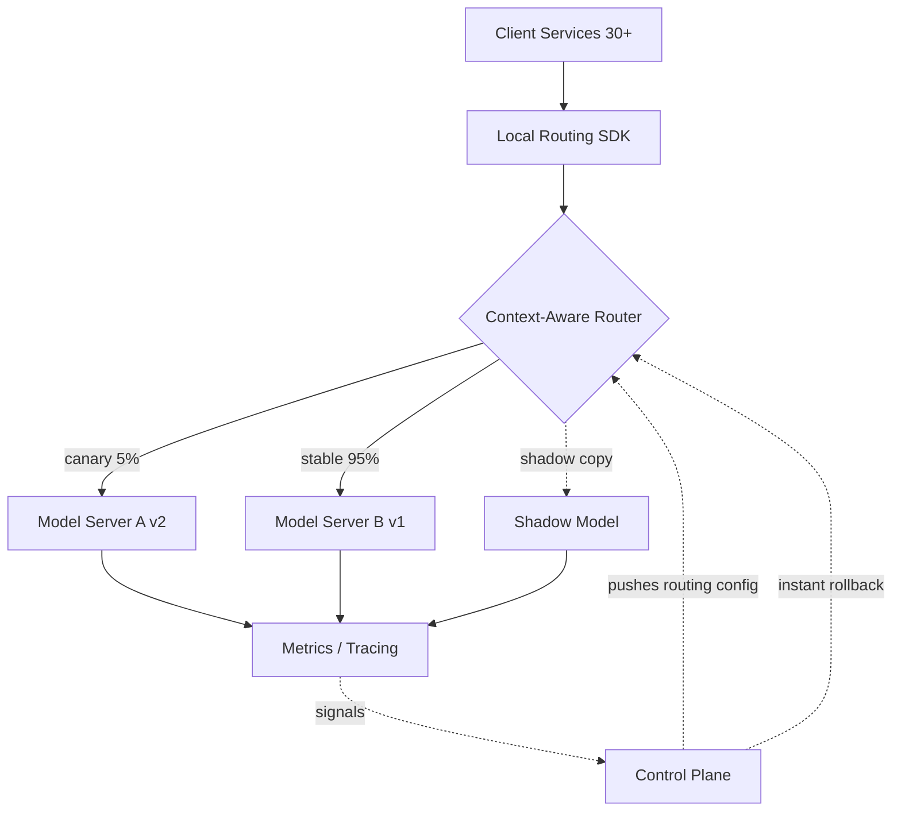

| Difficulty | Channel | Tags |
|---|---|---|
| beginner | devops | mlops, deployment |

At one million requests per second, a 10-millisecond tax is not a rounding error — it is a traffic jam at full speed. Netflix built Switchboard, a custom API gateway that fronted inference for hundreds of model types across recommendations, artwork selection, fraud detection, and search, serving 30+ client services at over 1 million RPS [1]. It was the single integration point that made fast ML iteration possible — until that very abstraction became the bottleneck. The uncomfortable truth: 'deploying' a model and 'serving' it are two different engineering disciplines, and blurring them is how a clean architecture becomes a 3am pager incident.

---

> ### Real-World Case — Netflix
>
> Netflix built a centralized ML serving platform that routes inference for hundreds of model types across recommendations, artwork selection, fraud detection, and search — all fronted by a custom API gateway called Switchboard handling over 1 million requests per second for 30+ client services. The gateway gave teams one integration point, A/B traffic splitting, shadow mode, and instant rollback. But as traffic scaled, the very abstraction that enabled rapid ML iteration became the bottleneck.
>
> | | |
> |---|---|
> | **Challenge** | Switchboard sat directly in the critical request path, forcing a full deserialize/re-serialize of large payloads on every call — adding 10–20ms of latency per request (far worse at p99), creating a single point of failure where one bug or noisy tenant could degrade every ML-powered experience, and hiding request origins from serving clusters which broke test-vs-real traffic separation needed for model training. |
> | **Solution** | Netflix split routing metadata from the actual request payload. They introduced Lightbulb, a lightweight out-of-band metadata service that resolves use-case context (an 'Objective') into a routingKey header plus model config — but never touches the payload. The actual routing is delegated to Envoy, the service-mesh proxy already handling all inter-app traffic at Netflix, which reads only the routingKey header to send the request to the right cluster VIP. Requests flow client → Envoy → model cluster directly, with routing config pushed dynamically from the control plane. |
> | **Outcome** | Eliminated the 10–20ms per-request serialization tax and removed the central gateway from the request path, removing a single point of failure at 1M+ RPS. Preserved single-integration-point abstraction, context-aware routing, canaries, shadow testing, and instant rollback while gaining per-tenant isolation and client-side caching fallbacks. |
> | **Lesson** | Centralized serving gateways are excellent for velocity at moderate scale but become a latency and availability liability at high QPS. The fix isn't to abandon the abstraction — it's to separate 'where should this go?' (cheap, cacheable metadata resolved out-of-path) from 'what are we sending?' (the payload, routed directly by a mesh sidecar reading only a header). Rules that change infrequently should never force every request through a shared choke point. |

---

## Hook — When the Abstraction Becomes the Anchor

Picture this: your recommendation model is finally in production, the offline metrics look great, and the deployment pipeline is green across the board. Then the traffic graph climbs, and latency creeps from 40ms to 70ms to 90ms. Sound familiar?

Many developers discover that the hard part was never training the model — it was everything that happens after the model file leaves the notebook. That 'everything' splits into two worlds that sound interchangeable in standups but behave very differently under load: model deployment and model serving. Confuse the two, and your system quietly accumulates a per-request tax on every single call.

But here is where the story gets interesting. What happens when the thing that made iteration fast is the very thing slowing every request down? ⚠️ Watch Out: the bottleneck often hides inside the abstraction teams trust most.

## Problem — Two Words, One Big Misunderstanding

Building on that tension, the distinction stops sounding academic fast. In production, it decides whether a team ships a new model in twenty minutes or burns a week babysitting GPU utilization.

Think of deployment as building and stocking a restaurant, and serving as taking orders during dinner rush. You can have a beautiful kitchen and still fail because the waiters are slow. Here is what you need to know:

- Deployment owns the path to production: CI/CD pipelines, infrastructure provisioning, container builds, model registry, monitoring hooks, and rollback strategy [2][6][7].
- Serving owns the runtime: request routing, model loading, batching, version routing, and response optimization [3][4][5].
- The failure modes differ. Deployment bugs surface as failed rollouts or drift. Serving bugs surface as tail latency, timeouts, and cold starts.

Many developers think 'putting the model in a container solves serving.' Actually, the container is the easy part. The moment hundreds of client services with different latency budgets share one gateway, you have a routing problem dressed up as a deployment problem.

🔥 Hot Take: treating serving as an afterthought is how a 10–20ms serialization tax sneaks into every request. And once that tax is baked into a central gateway, removing it means rewriting the integration layer. Netflix knows that plot twist firsthand.

## Real-World Case — Netflix

However, Netflix's problem was the good kind: too much success. Switchboard, the company's custom API gateway, became the front door for inference across recommendations, artwork selection, fraud detection, and search, handling over 1 million requests per second for 30+ client services [1]. It gave teams one integration point, A/B traffic splitting, shadow mode, and instant rollback — the dream of centralized control.

As traffic scaled, that dream developed a cost. Every request paid a 10–20ms serialization tax just to pass through the gateway [1]. At a million RPS, that is not a nuisance; it is a systemic ceiling. Worse, the gateway sat squarely in the request path, making it a single point of failure for every model-backed feature.

💡 Insight: the abstraction that accelerated ML iteration had become the constraint on it.

The fix was counterintuitive. Instead of scaling the gateway, the team removed it from the hot path. They preserved the single-integration-point experience through client-side libraries, context-aware routing, per-tenant isolation, canaries, shadow testing, and instant rollback — while eliminating the serialization tax and the central failure domain [1]. Same developer experience, no 10–20ms toll booth. Teams have all been there — staring at a latency graph wondering where the time went.

## Deep Dive — Deployment vs. Serving, Side by Side

This leads to a sharper mental model: deployment is about getting a model into production safely; serving is about making every prediction fast, correct, and isolated.

Here is the real tradeoff, side by side:

| Dimension | Deployment | Serving |
|---|---|---|
| Primary goal | Safe, repeatable release | Fast, reliable inference |
| Typical tools | Kubernetes, Docker, Terraform, MLflow, SageMaker [2][6][7] | TensorFlow Serving, TorchServe, BentoML, FastAPI, gRPC [3][4][5] |
| Key concern | Rollback, drift, reproducibility | Latency, throughput, version routing |
| Scaling lever | Pod replicas, cluster capacity | Batching, GPU memory, connection pooling |
| Failure mode | Bad rollout, config drift | Cold starts, tail latency, timeouts |

🎯 Key Point: deployment tools answer 'can we ship this safely?' Serving tools answer 'can we answer this request in 50ms?'

Scaling is where theory meets a wall. Horizontal scaling adds pod replicas behind a load balancer — Kubernetes handles this with Deployments and Horizontal Pod Autoscalers [2][9]. Vertical scaling means more GPU memory or CPU per instance, which helps when a single model will not fit otherwise. But neither fixes a bad serving path. If every request pays a serialization tax, adding replicas just delivers more expensive slow requests.

The trade-offs are real:

- Latency vs. throughput: batching requests boosts throughput but adds waiting time. Real-time inference targets sub-100ms, while batch jobs tolerate about a second or more.
- Versioning: model servers such as TensorFlow Serving and TorchServe support named model versions, which is what makes A/B testing and canaries possible [3][4].
- Cold starts: loading a multi-gigabyte model on first request can add seconds. Pre-warming and keeping warm pools are the standard defenses.

💡 Insight: the paper 'Hidden Technical Debt in Machine Learning Systems' argues that the model is a small fraction of a real ML system — the glue (serving, monitoring, config) is where complexity and cost live [8]. Netflix's gateway tax is that glue made visible. So when would teams actually use each side? Reach for deployment tooling when shipping, monitoring, and rolling back; reach for serving tooling when optimizing the per-request path. Confusing them is like tuning the engine while ignoring the flat tire.

## Workflow — Routing Inference Without the Toll Booth

However, understanding the difference is only half the battle — the architecture has to reflect it. The Model Serving Routing Flow diagram below shows how a modern serving layer keeps the developer-friendly abstraction without keeping the gateway in the request path.

Step 1 — Package the model with an explicit serving contract. Define the input schema, expected latency budget, and version label before CI/CD ever runs.

Step 2 — Deploy through the pipeline. Kubernetes orchestrates container replicas, while MLflow or SageMaker tracks the model artifact and experiment lineage [2][6][7].

Step 3 — Move routing to the client. A thin local SDK makes context-aware decisions (tenant, region, canary flag) without a network hop, which is exactly how the 10–20ms tax disappears [1].

Step 4 — Keep a control plane, not a data plane. The central service pushes routing config — canary percentages, shadow rules, rollback switches — asynchronously. It never touches inference traffic.

Step 5 — Observe and roll back instantly. Shadow mode and traffic splitting let teams validate a new version against real traffic before promotion, with HTTP semantics governing the request/response contract [11].

⚠️ Watch Out: a control plane that needs synchronous approval on every request is just a gateway wearing a disguise. Keep it out of the hot path.

## Code Example — A Production-Style Serving Router

Building on that workflow, here is a compact Python illustration of the client-side routing idea. It centralizes the policy (canary selection, shadow testing, rollback) but executes decisions locally — no gateway hop on the critical path.

The snippet uses a deterministic per-tenant hash so a given tenant always lands in the same bucket, a short local cache as a fallback, and a fire-and-forget shadow call that never blocks the response.

Discussion of the key lines follows in the codeExample field.

## Lessons Learned — The Toll Booth Principle

So what changed after the dust settled? The journey from confusion to clarity follows a familiar arc: problem (a model ships), struggle (latency climbs), discovery (the gateway is the tax), solution (move routing to the edge), and transformation (teams iterate fast again without paying per-request interest).

Battle scars worth avoiding:

- Mistake 1 — Treating deployment success as serving success. Green pipelines do not guarantee 50ms inference.
- Mistake 2 — Centralizing the request path for convenience. One integration point is great; one synchronous hop in every request is not.
- Mistake 3 — Ignoring tail latency. Averages look fine while p99 quietly erodes user experience.
- Mistake 4 — Forgetting rollback design until an incident. Instant rollback has to be a first-class control-plane feature, not a panic-time script.

🔥 Hot Take: the best serving infrastructure is often the infrastructure you remove from the request path. Netflix preserved the abstraction and deleted the toll booth [1]. That is the whole trick.

If this feels overwhelming, you are not alone — MLOps maturity is a spectrum, and even large platforms evolve into this shape over years [8][10]. Start by naming which layer a problem belongs to before reaching for another tool.

---

## Model Serving Routing Flow

<strong>Original Interview Question</strong>

**Q:** Explain the key differences between model serving and model deployment in ML systems, including specific technologies, scaling considerations, and real-world implementation patterns?

**A:** Deployment encompasses CI/CD pipelines, infrastructure setup, and monitoring using tools like Kubernetes, MLflow, and SageMaker. Serving focuses on runtime inference APIs with frameworks like TensorFlow Serving, TorchServe, or BentoML, handling request routing, model versioning, and autoscaling. Key trade-offs include latency vs throughput, batch vs real-time inference, and cold start optimization.

## Conclusion

The journey started with a 10-millisecond tax at one million requests per second and ends with a simple principle: know which layer you are fixing. Deployment gets your model out safely; serving decides whether every prediction is fast and isolated. Netflix kept the single integration point teams loved and deleted the gateway from the hot path — the abstraction survived, the toll booth did not [1]. Tomorrow, audit one serving path in your own system and ask a single question: does traffic pass through a component that adds latency without adding intelligence? If the answer is yes, that is your bottleneck wearing a friendly face. Remember one line to share with your team: centralize the policy, decentralize the path.

---

## References

1. [Netflix incident report](https://netflixtechblog.com/state-of-routing-in-model-serving-16e22fe18741) — article
2. [Kubernetes Documentation — Concepts](https://kubernetes.io/docs/concepts/overview/) — documentation
3. [TensorFlow Serving — GitHub Repository](https://github.com/tensorflow/serving) — documentation
4. [TorchServe — GitHub Repository](https://github.com/pytorch/serve) — documentation
5. [BentoML — GitHub Repository](https://github.com/bentoml/BentoML) — documentation
6. [MLflow — GitHub Repository](https://github.com/mlflow/mlflow) — documentation
7. [Amazon SageMaker Developer Guide](https://docs.aws.amazon.com/sagemaker/latest/dg/whatis.html) — documentation
8. [Hidden Technical Debt in Machine Learning Systems](https://arxiv.org/abs/1504.08227) — paper
9. [An Introduction to Kubernetes — DigitalOcean](https://www.digitalocean.com/community/tutorials/an-introduction-to-kubernetes) — blog
10. [Machine learning — Wikipedia](https://en.wikipedia.org/wiki/Machine_learning) — documentation
11. [RFC 9110: HTTP Semantics](https://datatracker.ietf.org/doc/html/rfc9110) — documentation

---

**Author:** Satishkumar Dhule — [GitHub](https://github.com/satishkumar-dhule) · [LinkedIn](https://linkedin.com/in/satishkumar-dhule) · [Website](https://satishkumar-dhule.github.io)
