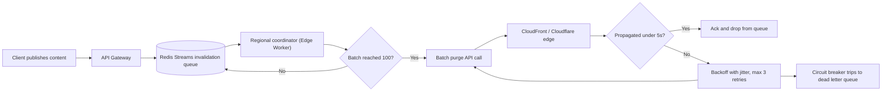

| Difficulty | Channel | Tags |
|---|---|---|
| intermediate | system-design | edge, caching, purging |

Picture a publisher in Sydney hitting 'publish' on a breaking-news story, then watching stale content sit in a local cache while the invalidation request takes a scenic detour across the Pacific. That was the daily reality for Cloudflare customers, whose original purge system leaned on a hub-and-spoke config replicator plus lazy purge timestamps until the whole thing hit a write-throughput wall [1]. Millions of purge calls per day were filling disks with history, and geography quietly became the enemy. What happened next is a masterclass in designing for the same five-second promise your own multi-region system has to keep.

---

> ### Real-World Case — Cloudflare
>
> Cloudflare's original flexible purge (by cache-tag, hostname, prefix) leaned on Quicksilver, its hub-and-spoke config replicator, plus 'lazy purge' timestamps. After a decade, thousands of customers issuing millions of purge calls per day were filling every machine's disk with purge history, hitting Quicksilver's write-throughput ceiling, and forcing customers in places like Australia to round-trip across the Pacific just to invalidate local content.
>
> | | |
> |---|---|
> | **Challenge** | Deliver global cache invalidation far faster than a 5-second SLA at massive throughput, without storage cost scaling linearly with purge volume — and do it for one-to-many purges where cache keys can't be precomputed because tags are response headers, not request attributes. |
> | **Solution** | Rebuilt as 'Coreless Purge': API Gateway Workers authenticate at the edge, Purge Ingest Workers discard the >50% of requested URLs that aren't even cacheable and precompute cache keys once, regional Durable Object queues with an autoscaler hold/replay purges, and regional Purge Fanout Workers fan out to hundreds of data centers. Each machine runs CacheDB (Rust + RocksDB) as a sidecar indexing every cached file by host/tag/URL over Unix domain sockets; the cache proxy checks its pending-purge queue on every HIT, so a purge takes effect the instant it lands even while disk deletion is still in progress. |
> | **Outcome** | P50 global purge latency dropped from 1,570ms to 149ms — a 90.5% improvement — across 330 cities in 120+ countries; storage use fell 10x; the fanout worker alone cut end-to-end latency 50% and tripled throughput; tag/hostname/prefix purges became viable for all plan tiers. |
> | **Lesson** | The counterintuitive win was removing the coordinator entirely: Kafka buffers and extra batching around the central hub only added latency, while going coreless with per-machine indexes was simultaneously faster, cheaper, and more scalable. Second lesson — over half of purge requests targeted uncached content, so the cheapest optimization was refusing to broadcast them at all. |

---

## Hook — The tweet, the stale image, and 1,570 milliseconds

Picture this: a product lead fires off a launch tweet, traffic floods the site, and every cache from Frankfurt to Sydney is still serving last week's hero image. Somewhere a console shows a purge request that has not come back yet. Sound familiar? The uncomfortable truth is that invalidation — not computation — is often the slowest part of a modern delivery pipeline. When one publish event has to erase copies of content across hundreds of cities, the network and the control plane, not the application code, set the clock. This is the story of how that clock was dragged from seconds into milliseconds, and what your design must copy to survive the same pressure.

## Problem — Ten thousand invalidations a second, five seconds to live

Building on that tension, the requirements sound almost unreasonable on paper. Purge globally in under five seconds, absorb 10,000 invalidations per second, stay up 99.99% of the time, and keep every region consistent — all at once.

💡 Insight: purging is a write-heavy distributed problem disguised as a cache problem.

Here is what makes it hurt:

- **Fan-out explosion:** one wildcard like `/products/*` can touch thousands of edge locations, so a single logical purge becomes thousands of physical ones.
- **API limits and cost:** every provider call carries quota and price, so naive per-path purging melts both.
- **Ordering hazards:** a late stale purge can resurrect old content, which is the kind of bug that ruins weekends.
- **Geography:** a coordinator in the wrong region makes an editor wait for a round trip across an ocean.

Many developers discover the hard way that a short TTL is not a substitute for correctness; it is a seatbelt, not a steering wheel. The Cache-Control semantics you already depend on [6] and the rules formalized in RFC 9111 [7] can shrink the stale window, but they cannot guarantee a five-second SLA once an explicit purge is required.

⚠️ Watch Out: treating a 2-second TTL as the purge mechanism multiplies origin traffic and still leaves correctness to chance.

So the real question becomes: how does a design avoid turning every purge into a global synchronization accident?

## Real-World Case — Cloudflare

This leads directly to the best-documented version of that struggle. Cloudflare's original 'flexible purge' — by cache tag, hostname, or prefix — depended on Quicksilver, its hub-and-spoke configuration replicator, plus lazy purge timestamps compared at read time [1]. After a decade, thousands of customers were issuing millions of purge calls per day.

The breaking points were almost physical:

- Purge history piled up on every machine's disk until storage became a genuine constraint.
- Quicksilver's write throughput hit its ceiling, so the control plane — not the edge network — became the bottleneck.
- Customers in places like Australia still crossed the Pacific to invalidate content that lived locally.

🔥 Hot Take: the bottleneck was not the cache. It was the machinery responsible for telling the cache what to forget.

Then came the twist. Instead of pushing more purge metadata through Quicksilver, the team rebuilt around a fanout worker and local decision-making. The result: P50 global purge latency fell from 1,570ms to 149ms — a 90.5% improvement — across 330 cities in 120+ countries, storage use dropped 10x, and the fanout worker alone cut end-to-end latency by 50% while tripling throughput [1]. Tag, hostname, and prefix purges finally became viable for every plan tier.

If a system with Cloudflare's resources had to rethink purging, which assumption in your design is quietly borrowed from a simpler era?

## Deep Dive — Why fanout, batching, and locality win

However, copying Cloudflare's outcome without copying its reasoning is a classic way to build something impressive and wrong. The core idea is to stop treating invalidation as one global transaction and start treating it as a coordinated local operation with a global deadline.

**Fanout over broadcast.** A dedicated fanout worker fans one logical purge out to regional coordinators in parallel instead of serializing through one replicator. That single change explains how latency was halved and throughput tripled [1]. 🎯 Key Point: parallel fanout turns a linear dependency chain into a tree, and trees are fast.

**Batch the API calls.** Providers charge and throttle per request, so grouping up to 100 invalidations into one call can cut API costs by roughly 90% while staying under rate limits. CloudFront's invalidation model, with its per-path behavior and explicit quota logic, makes this especially relevant [2].

**Regional coordinators and edge compute.** Let a regional worker decide what to purge locally using regional cache headers, so a Sydney purge never needs a Pacific round trip. CDN fundamentals show why locality dominates here [5], while an API gateway keeps the control plane clean and observable [3].

| Option | What it buys you | The real tradeoff |
|---|---|---|
| Per-path invalidation | Surgical precision | Rate limits, high cost, slow fan-out |
| Pattern or wildcard purge | Few calls, broad reach | Over-invalidation and possible origin spikes |
| Short TTL only | Simple, no control plane | Stale windows and no enforceable SLA |
| Fanout + batching + regional coordinator | 5-second SLA, low cost | More moving parts, needs reconciliation |

**Battle scars to avoid:**

- **Retry storms:** naive retries amplify load; use exponential backoff with jitter and a hard cap of three attempts.
- **No circuit breaker:** after five consecutive failures, fail fast instead of hammering a dying provider.
- **Ignoring partitions:** during a network partition, accept eventual consistency and reconcile later rather than blocking everything.
- **Treating 2 seconds as magic:** `Cache-Control: max-age=2, must-revalidate` [6] with RFC 9111 semantics [7] is a fallback, not a purge guarantee.

One more counterintuitive detail: Redis Streams with consumer groups give durable ordering and acknowledgments, so a purge is either processed or visibly pending — never silently lost [4][8]. That is the sort of boring infrastructure that makes five-second promises possible. With the principles settled, how does the request actually move end to end?

## Workflow — From publish to purge in five seconds

Building on the fanout model above, the workflow is a relay race with a strict clock. The Purge Propagation Flow diagram below traces the same path the story has been circling.



1. **Publish event** lands at the API Gateway [3], which validates it and assigns a purge ID.
2. **Queue write:** an ordered entry goes into a Redis Stream backed by managed cache infrastructure, with a consumer group for acknowledgments [4][8].
3. **Batch window:** a coordinator drains up to 100 paths, keeping the window short so the five-second budget survives.
4. **Regional fanout:** edge workers in each region issue purge calls to CloudFront or Cloudflare in parallel [2].
5. **Ack and reconcile:** successes are acknowledged; failures pass through backoff and then into a dead-letter queue.
6. **Verify:** regional health checks confirm propagation, and partial failures trigger rollback for that region only.

When would this actually be used? Reach for it when freshness is a product feature — breaking news, financial tickers, flash sales — and a stale page costs more than the infrastructure. If content tolerates a 30-second window, a simple TTL is cheaper and developers should stop here.

⚠️ Watch Out: the batch window is where SLAs go to die. Keep it under 100–200ms or the arithmetic stops working. And what does the code enforcing all this look like?

## Code Example — A batching worker with a circuit breaker

Building on the workflow, this snippet implements the part that decides how fast and how safely purges leave the building. It is intentionally production-shaped: bounded batches, capped retries with jitter, and a circuit breaker.

```javascript
// Bounded batching worker with backoff + circuit breaker
const BATCH_SIZE = 100;
const MAX_RETRIES = 3;
const BASE_DELAY_MS = 200;

class CircuitBreaker {
  constructor(threshold = 5) {
    this.threshold = threshold; // fail fast after N consecutive failures
    this.failures = 0;
    this.open = false;
  }
  record(success) {
    this.failures = success ? 0 : this.failures + 1;
    if (this.failures >= this.threshold) this.open = true;
  }
}

async function purgeBatch(files, token, zoneId, breaker) {
  if (breaker.open) throw new Error('Circuit breaker open');
  const response = await fetch(
    `https://api.cloudflare.com/client/v4/zones/${zoneId}/purge_cache`,
    {
      method: 'POST',
      headers: {
        Authorization: `Bearer ${token}`,
        'Content-Type': 'application/json'
      },
      body: JSON.stringify({ files }) // wildcard patterns allowed
    }
  );
  breaker.record(response.ok);
  if (!response.ok) throw new Error(`Purge failed: ${response.status}`);
  return response.json();
}

async function withRetry(task, attempt = 0) {
  try {
    return await task();
  } catch (err) {
    if (attempt >= MAX_RETRIES) throw err; // route to dead-letter queue
    const jitter = Math.random() * 100;
    const delay = BASE_DELAY_MS * 2 ** attempt + jitter;
    await new Promise(resolve => setTimeout(resolve, delay));
    return withRetry(task, attempt + 1);
  }
}

export async function processQueue(paths, token, zoneId) {
  const breaker = new CircuitBreaker();
  const batches = [];
  for (let i = 0; i < paths.length; i += BATCH_SIZE) {
    batches.push(paths.slice(i, i + BATCH_SIZE));
  }
  return Promise.allSettled(
    batches.map(batch => withRetry(() => purgeBatch(batch, token, zoneId, breaker)))
  );
}
```

Step by step:

1. **`CircuitBreaker`** counts consecutive failures and opens after five, so a sick provider is not hammered.
2. **`purgeBatch`** posts a wildcard file list to the purge endpoint [1] using the standard fetch API [9]; the token and zone are injected rather than hardcoded.
3. **`withRetry`** applies exponential backoff plus jitter, capped at three attempts, then throws so the caller can route the work to a dead-letter queue.
4. **`processQueue`** slices paths into batches of 100 and uses `Promise.allSettled` so one bad batch never hides ten good ones.

💡 Insight: `allSettled` is the quiet hero here. It preserves per-batch outcomes, which is exactly what regional reconciliation needs.

If this feels overwhelming, start with batching and retries alone; add the breaker and dead-letter queue once real traffic shows where it hurts.

## Lessons Learned — The insights worth stealing

After tracing the whole path, a few truths stand out.

- **Treat invalidation as a write path, not a config change.** Cloudflare's 10x storage reduction came from taking purge history off the hot path [1].
- **Parallelism beats raw speed.** Fanout cut latency by 50% and tripled throughput without making any single machine faster [1].
- **TTL is a safety net.** Pair a 2-second TTL with correct cache headers [6] and RFC 9111 semantics [7], but never confuse it with a purge guarantee.
- **Plan for failure from day one.** Circuit breakers, dead-letter queues, and regional rollback are the reason a 99.99% uptime target is believable.
- **Measure the tail.** A P50 of 149ms [1] makes the headline, but users remember P99.

🎯 Key Point: the one line to take to the team — **a purge is not a broadcast, it is a deadline with a fanout.**

So what changes tomorrow? Audit the purge path for a single serial bottleneck, unbounded retries, and geography treated as an afterthought. Add batching first, then fanout, then keep decisions local, and give every failure a place to land. Do that, and the next launch tweet that goes viral will find caches that already have the memo.

---

## Purge Propagation Flow


<details>
<summary><strong>Original Interview Question</strong></summary>

**Q:** How would you design a multi-region CDN cache purging system that guarantees content propagation within 5 seconds while handling 10,000 concurrent invalidations per second?

**A:** Implement Cloudflare API + AWS CloudFront with distributed invalidation queue, edge compute coordination, and 2-second TTL. Use batch invalidation, exponential backoff, and regional cache headers for 5-second SLA.

</details>

## Conclusion

Cloudflare's journey from 1,570ms to 149ms began with a blunt realization: the system telling the edge what to forget had become slower than the edge itself [1]. You probably will not rebuild a global replicator this quarter, but you can audit your own purge path for the same disease — one serial bottleneck, unbounded retries, and geography treated as an afterthought. Start by batching, add fanout, keep decisions local, and give every failure a place to land. Do that, and the next time a launch tweet goes viral, your caches will already have the memo.

---

## References

1. [Cloudflare incident report](https://blog.cloudflare.com/instant-purge/) — article
2. [Amazon CloudFront invalidation documentation](https://docs.aws.amazon.com/AmazonCloudFront/latest/DeveloperGuide/Invalidation.html) — documentation
3. [Amazon API Gateway developer guide](https://docs.aws.amazon.com/apigateway/latest/developerguide/welcome.html) — documentation
4. [Amazon ElastiCache developer guide](https://docs.aws.amazon.com/AmazonElastiCache/latest/dg/index.html) — documentation
5. [Content delivery network — Wikipedia](https://en.wikipedia.org/wiki/Content_delivery_network) — documentation
6. [HTTP caching — MDN Web Docs](https://developer.mozilla.org/en-US/docs/Web/HTTP/Caching) — documentation
7. [RFC 9111: HTTP Caching](https://datatracker.ietf.org/doc/html/rfc9111) — documentation
8. [Redis source repository](https://github.com/redis/redis) — documentation
9. [Fetch API — MDN Web Docs](https://developer.mozilla.org/en-US/docs/Web/API/Fetch_API) — documentation

---

**Author:** Satishkumar Dhule — [GitHub](https://github.com/satishkumar-dhule) · [LinkedIn](https://linkedin.com/in/satishkumar-dhule) · [Website](https://satishkumar-dhule.github.io)
