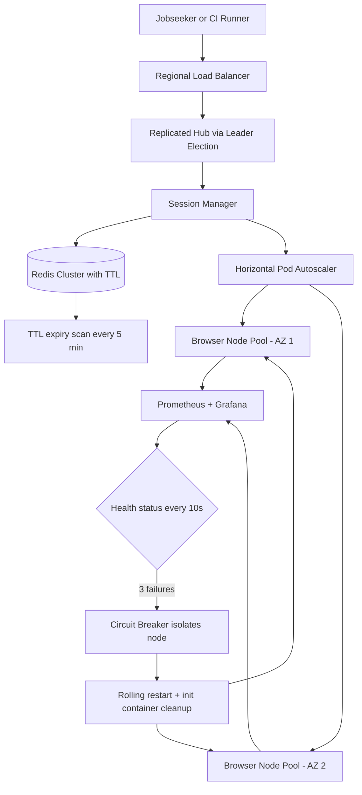

| Difficulty | Channel | Tags |
|---|---|---|
| advanced | system-design | selenium, webdriver, grid |

Picture a jobseeker clicking 'submit' on an application, only to watch it disappear because a browser node ran out of memory. That was the operational reality Indeed confronted when it repurposed Selenium WebDriver into production infrastructure for submitting millions of job applications across 650+ employer career sites [1]. The stock Selenium Grid, built for test suites that can afford a retry, began failing in exactly the ways a test-only tool gets away with: a single hub, no auto-scaling, node exhaustion, memory leaks, and sessions that never returned cleanly [1]. Each failure was not a red build, but a real person's application lost in transit.

---

> ### Real-World Case — Indeed
>
> Indeed wanted jobseekers to be able to apply to jobs on 650+ employer career sites, most of which exposed no application API, so it repurposed Selenium WebDriver as production infrastructure that drove real browsers to fill out and submit real applications. As volume grew past millions of applications, the stock Selenium Grid broke down in exactly the ways a test-only grid can get away with: hub as a single point of failure, no auto-scaling, node capacity exhaustion, memory leaks on long-running nodes, and sessions not being returned cleanly — each failure meant a real person's application was lost.
>
> | | |
> |---|---|
> | **Challenge** | Build a large-scale Selenium Grid-like system that eliminates the hub SPOF, auto-scales browser nodes, handles capacity exhaustion, detects and replaces unhealthy nodes, mitigates memory leaks on grid nodes, and guarantees session return/cleanup — while steadily driving down failure rates for user-facing transactions. |
> | **Solution** | Instead of running SeleniumHQ's out-of-the-box Grid, Indeed's engineers (Seshumadhav Chaturvedula and Sasi Kumar) designed and incrementally hardened their own grid architecture on the RemoteWebDriver protocol, adding no-single-point-of-failure hub design, auto-scaling, node capacity management, unhealthy-node monitoring, a memory-leak strategy for grid nodes, and session-return logic over roughly 1.5 years of iteration. |
> | **Outcome** | The platform created 5M+ browser sessions and enabled jobseekers to send millions of job applications to 650+ employers, with ongoing, measured reductions in session failure rates. |
> | **Lesson** | Selenium Grid is optimized for ephemeral CI test runs, not production traffic. The moment each browser session is a real customer transaction, you must own the control plane: HA schedulers, queue-driven autoscaling, aggressive node recycling for leaks, health-based isolation, and guaranteed session reclamation. |

---

## Hook — The 3am pager that test grids never have to answer

It was 3am when the pager went off. Not because a CI pipeline turned red, but because thousands of real submissions were quietly timing out while a hub somewhere kept confidently handing out sessions to nodes that were already dead. Many developers think a Selenium Grid is 'just infrastructure for tests,' so a little flakiness is harmless. Here is the thing though: the moment a grid carries user-facing traffic, that harmless flakiness becomes a trust-destroying outage. The stakes are no longer 'rerun the suite,' they are 'explain to a jobseeker why their application vanished.'

## Problem — When a test tool meets production traffic

A conventional grid assumes forgiving conditions. Tests are ephemeral, retries are cheap, and a leaked browser process is someone else's problem after the run ends. Production traffic flips every one of those assumptions. You now need tens of thousands of long-lived sessions, each holding a real browser with a real memory footprint, and 99.9% availability is no longer a nice-to-have but a contractual promise. Selenium itself was never the villain; it is a browser automation framework that became the standard for driving real browsers [7].

⚠️ Watch Out: The hub is the first thing to break. In a standard hub-node pattern, every session request funnels through one coordinator. Lose it, and the entire grid goes dark even though hundreds of perfectly healthy nodes are still running. Sound familiar? That is a single point of failure wearing a friendly name.

Consequently, the problem is not one bug but a constellation of them: session state that lives only in process memory, nodes that accumulate zombie browser processes until they suffocate, and no graceful way to drain a failing node without killing the sessions it already owns. Moreover, without clear resource boundaries, one greedy session can starve its neighbors. The question becomes: how do you turn a fragile test cluster into a resilient platform?

## Real-World Case — Indeed

Indeed's journey is the clearest illustration of this trap. The company wanted jobseekers to apply to jobs on 650+ employer career sites, most of which exposed no application API, so it repurposed Selenium WebDriver to drive real browsers through real application forms [1]. At a scale of millions of applications, the stock grid broke down precisely along the fault lines described above: the hub became a single point of failure, nodes could not auto-scale, capacity exhausted under load, long-running nodes leaked memory, and sessions were not returned cleanly [1].

🔥 Hot Take: The biggest mistake was not choosing Selenium. It was treating a test tool like production infrastructure without giving it production-grade guardrails. Each grid failure translated directly into a lost human application, so the team had to re-architect session lifecycle management, monitoring, and recovery.

The result is telling: the platform created 5M+ browser sessions and enabled millions of applications, with ongoing, measured reductions in session failure rates [1]. That is the transformation from 'flaky test grid' to 'dependable production system.' But how exactly does one engineer that kind of resilience? That leads us to the deeper design.

## Deep Dive — The anatomy of a 10,000-session grid

Building on the failure modes above, the architecture has to answer three questions at once: where does session state live, how do nodes stay healthy, and how does the whole thing survive partial failure?

**State belongs outside the process.** Redis, with TTL-based expiration and connection pooling, becomes the source of truth for session state, so no single browser node owns a session's fate [2]. TTL keys self-expire after a fixed window, which means even a crashed cleanup sidecar cannot leak a session forever.

**Capacity is math, not guesswork.** Here is the arithmetic behind a 10,000-session target:

| Concern | Calculation | Result |
|---|---|---|
| Minimum nodes | 10,000 sessions / 50 per node | 200 nodes |
| Baseline memory | 200 nodes × 2GB | 400GB |
| With 30% buffer | 400GB × 1.3 | 520GB cluster memory |
| Session start latency | Regional load balancing | P99 < 2s |
| Availability | Multi-AZ + auto failover | 99.9% uptime |

💡 Insight: That 30% memory buffer is not waste; it is the difference between a graceful autoscaling event and an out-of-memory cascade at 3am. Per-pod CPU and memory requests and limits keep one greedy session from starving its neighbors [9].

**Health is observable, not assumed.** A weighted round-robin balancer routes traffic based on node capacity and response time, while an HTTP /status endpoint polled every 10s removes a node after three consecutive failures, and Kubernetes liveness and readiness probes enforce the same discipline at the pod level [3]. Circuit breakers isolate a failing node for a 30-second recovery window instead of hammering it [4]. Horizontal Pod Autoscaling ties replica counts to queue depth, scaling before capacity runs dry [6].

**Failure is a design input.** Network partitions invite split-brain, so leader election keeps one coordinator authoritative. Pod Disruption Budgets preserve at least 85% capacity during voluntary disruptions [5]. Canary deployments split traffic to new node versions so a zero-day regression touches only a fraction of sessions. Weekly rolling restarts and GC tuning complete the memory-hygiene story, with Prometheus and Grafana exposing trends before they become incidents.

Here is a pro tip: treat Prometheus alerts at 80% memory as a rehearsal, not a notification. By the time 90% hits, you are already negotiating with the OOM killer.

## Workflow — From session request to graceful recovery

This leads to the concrete request lifecycle. The diagram below tells the visual story of how a session moves through the grid, and how failure is handled without losing a user's work.



Step by step:
1. A request arrives at the regional load balancer and is routed to a healthy hub replica using weighted round-robin based on capacity and response time.
2. The session manager writes a session record to Redis with a TTL, so state is externalized from any single pod [2].
3. The Horizontal Pod Autoscaler watches queue depth and scales browser-node pools before capacity runs dry [6].
4. Browser nodes, commonly packaged from maintained container images, execute the automation across multiple availability zones [8].
5. Every 10 seconds the /status endpoint is polled; three consecutive failures remove the node, and the circuit breaker gives it a 30-second cooldown [4].
6. Cleanup init containers remove stale volumes, Redis key scans run every 5 minutes, and rolling restarts keep memory fresh.
7. If a disruption occurs, Pod Disruption Budgets hold at least 85% capacity while leader election prevents split-brain [5].

⚠️ Watch Out: Skipping step 2 is the classic mistake. Session state that lives only in a node's memory evaporates the instant that node is recycled, and no amount of autoscaling will bring it back.

## Code Example — A session lifecycle guard with TTL and circuit breaking

Building on that workflow, the snippet below implements the two highest-leverage pieces: TTL-backed session registration in Redis and a circuit breaker that isolates misbehaving nodes. It is illustrative, but it uses production-shaped patterns rather than toy logic.

```python
import time
import uuid
import redis

# Connection pooling avoids a new TCP handshake per session lookup
pool = redis.ConnectionPool(host='redis-cluster', port=6379, db=0, max_connections=500)
store = redis.Redis(connection_pool=pool)

SESSION_TTL = 900  # seconds; stale sessions self-destruct via Redis TTL

class CircuitBreaker:
    '''Isolates a node after repeated failures for a cooldown window.'''
    def __init__(self, failure_threshold=3, cooldown_seconds=30):
        self.failure_threshold = failure_threshold
        self.cooldown_seconds = cooldown_seconds
        self.state = {}  # node_id -> (failures, tripped_at)

    def allows(self, node_id):
        failures, tripped_at = self.state.get(node_id, (0, 0))
        if tripped_at and time.time() - tripped_at < self.cooldown_seconds:
            return False  # circuit still open, give the node breathing room
        if failures >= self.failure_threshold:
            self.state[node_id] = (0, time.time())
            return False
        return True

    def record_failure(self, node_id):
        failures, _ = self.state.get(node_id, (0, 0))
        self.state[node_id] = (failures + 1, 0)

    def record_success(self, node_id):
        self.state[node_id] = (0, 0)

breaker = CircuitBreaker()

def acquire_session(node_id, browser_type):
    if not breaker.allows(node_id):
        raise RuntimeError(f'Node {node_id} isolated by circuit breaker')
    session_id = str(uuid.uuid4())
    # setex writes the session AND its expiry atomically; no orphan keys
    store.setex(f'session:{session_id}', SESSION_TTL, f'{node_id}:{browser_type}')
    return session_id

def release_session(session_id):
    # Explicit cleanup on success; the TTL covers the crash path
    store.delete(f'session:{session_id}')
```

The mechanics are straightforward. The pooled Redis client avoids reconnecting on every session lookup, which matters at 10,000 concurrent sessions. The `CircuitBreaker` tracks failures per node; after three failures it opens for 30 seconds, exactly the isolation window described earlier. `acquire_session` uses `setex` to write the session and its expiry atomically, so a crash cannot leave an orphan key behind. Finally, `release_session` performs explicit cleanup on the happy path, while the TTL remains the safety net for the unhappy one.

## Lessons Learned — Battle scars and the road ahead

Every team that scales a grid this far collects a few scars. Here are the ones worth memorizing.

**Battle scars:**
- Treating the hub as disposable: replicate it and use leader election, or accept that it is your single point of failure.
- Letting sessions live in node memory: externalize to Redis with TTL, always.
- Ignoring memory until it is too late: alert at 80%, restart weekly, and tune GC. The OOM killer is a terrible on-call partner.
- Autoscaling on CPU instead of queue depth: browser sessions are I/O-bound, so CPU is a lagging indicator.
- Rolling everything at once: canary new node versions and keep Pod Disruption Budgets in place [5].

🎯 Key Point: Resilience is not a feature you add at the end; it is a property of where you put state and how you retire failure.

It is also worth borrowing a page from the chaos-engineering playbook popularized by Netflix, where injecting failure deliberately reveals weak spots before customers do [10]. Teams that kill browser nodes in staging sleep better than teams that discover the same bug during a real application rush. If this feels overwhelming, you are not alone; every production grid starts as a humble test cluster.

So what changes tomorrow? Start by auditing where your sessions actually live. If the answer is 'in a browser process on a node,' you already know the next refactor.

---

## Grid Session Lifecycle


<details>
<summary><strong>Original Interview Question</strong></summary>

**Q:** Design a scalable Selenium Grid architecture to handle 10,000 concurrent test sessions with 99.9% uptime, ensuring zero memory leaks through automatic session lifecycle management, real-time monitoring, and graceful node failure recovery across multiple data centers?

**A:** Deploy Kubernetes cluster with auto-scaling node pools, Redis session store with TTL policies, Prometheus metrics for memory monitoring, circuit breakers for node isolation, and sidecar containers for session cleanup. Implement health checks, resource quotas, and rolling updates.

</details>

## Conclusion

Remember the jobseeker whose submission vanished at the start? The lesson from Indeed's 5M+ browser sessions is that the grid is not a supporting character; it is the product [1]. When you externalize session state, scale on real demand, and design for graceful failure, a test tool becomes a production platform that people can trust. Build your 10,000-session grid like every session is someone's livelihood, because in the case that started this story, it literally was.

---

## References

1. [Indeed incident report](https://confengine.com/conferences/selenium-conf-2016/proposal/2527/how-indeed-used-selenium-to-submit-job-applications) — article
2. [Redis](https://en.wikipedia.org/wiki/Redis) — documentation
3. [Kubernetes: Configure Liveness, Readiness and Startup Probes](https://kubernetes.io/docs/tasks/configure-pod-container/configure-liveness-readiness-startup-probes/) — documentation
4. [Circuit breaker design pattern](https://en.wikipedia.org/wiki/Circuit_breaker_design_pattern) — documentation
5. [Kubernetes: Configuring Pod Disruption Budgets](https://kubernetes.io/docs/tasks/run-application/configure-pdb/) — documentation
6. [Kubernetes: Horizontal Pod Autoscaling](https://kubernetes.io/docs/tasks/run-application/horizontal-pod-autoscale/) — documentation
7. [Selenium (software)](https://en.wikipedia.org/wiki/Selenium_(software)) — documentation
8. [SeleniumHQ/docker-selenium](https://github.com/SeleniumHQ/docker-selenium) — documentation
9. [Kubernetes: Resource Management for Pods and Containers](https://kubernetes.io/docs/concepts/configuration/manage-resources-containers/) — documentation
10. [Chaos engineering](https://en.wikipedia.org/wiki/Chaos_engineering) — documentation

---

**Author:** Satishkumar Dhule — [GitHub](https://github.com/satishkumar-dhule) · [LinkedIn](https://linkedin.com/in/satishkumar-dhule) · [Website](https://satishkumar-dhule.github.io)
