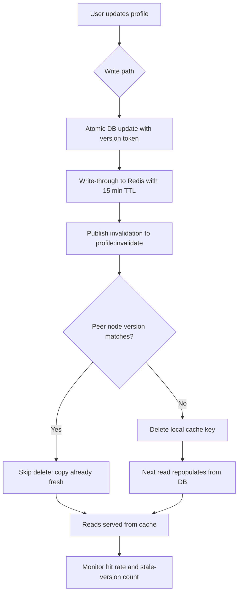

| Difficulty | Channel | Tags |
|---|---|---|
| beginner | backend | redis, memcached, cache-invalidation |

Picture a quiet Tuesday where Bob's message to Alice lands in a different region than Mary's — and neither store holds the full thread. That is not a hypothetical; it happened at Meta, where a stale cache pointer made near-total data loss look like a UI bug [1]. TAO serves over a quadrillion queries a day, and still needed a new consistency system to catch a rare interleaving in under 30 minutes [1]. This is the journey of how a profile cache goes wrong, and how write-through invalidation, TTLs, and a bit of versioning keep the truth intact.

---

> ### Real-World Case — Meta
>
> Meta's TAO cache serves over a quadrillion queries a day, and the company runs one of the world's largest Memcache deployments. A messaging service used TAO to map users to their primary message store; when a user's store was reshuffled between regions, stale TAO replicas sometimes sent messages to different regions — Bob's and Mary's messages to Alice landed in separate stores, neither with the full history, which to users was indistinguishable from data loss.
>
> | | |
> |---|---|
> | **Challenge** | Cache invalidation is hard because data mutates on both the read path (cache fill) and the write path (invalidation): an in-flight 'x=42' fill can arrive after the 'x=43' invalidation and leave stale data cached indefinitely. Version fields help but fail if the newer version is evicted, and logging every cache state change at quadrillion-query scale would turn a read-heavy workload into a write-heavy logging nightmare, making these races nearly impossible to diagnose. |
> | **Solution** | Meta built Polaris, a client-side consistency observability service that treats the cache as a black box, receives invalidation events, then queries all cache replicas for violations of client-observable invariants at 1/5/10-minute timescales — using retries to eliminate false positives and avoid expensive DB-bypass queries. They added a stateful 'consistency tracing' library that logs only cache mutations inside the narrow race window around invalidations (including evictions and missing log entries as a signal). This exposed a real bug: an error handler called drop_cache(key, version), which only evicts entries with older versions — but the stale item carried the latest version, so the handler silently did nothing and the bad value persisted forever. |
> | **Outcome** | TAO's cache consistency improved from 99.9999% (six nines) to 99.99999999% (ten nines) within five minutes — fewer than 1 in 10 billion cache writes remain inconsistent. The interleaving bug (requiring a rare two-table transactional update, a tiny race window, and a transient cache-host error in exact sequence) would previously have taken weeks for an expert to find; Polaris and consistency tracing pinpointed it in under 30 minutes. |
> | **Lesson** | Designing a consistent cache is very different from operating one: you must measure consistency as a false-positive-free, client-observable invariant before you can improve it, and focus tracing narrowly on the invalidation race window rather than logging everything. TTL alone is not invalidation, delete-then-refill races need leases or versioned keys, and error-handling code is a prime hiding place for silent staleness bugs — lessons that apply directly whether caching Postgres data in Redis or running Memcache at scale. |

---

## Hook — When a stale pointer eats your messages

Bob sends Alice a message. Mary sends one too. Two regions, two stores, and neither copy holds the full thread. To Alice, that is indistinguishable from data loss — and no amount of 'it is only the cache' will convince her otherwise.

Now scale that feeling to TAO, the cache layer serving more than a quadrillion queries a day at Meta [1]. A stale replica in a social graph is annoying. A stale replica that decides where a message lives is a different animal entirely.

Here is the uncomfortable part: nothing crashed. No error budget alarm screamed. The system did exactly what an eventually consistent cache is supposed to do — just at the wrong moment, in the wrong order, on the wrong host. That is the kind of bug that turns a quiet afternoon into a war room.

So how does a team keep a cache honest when the database is the truth and a dozen service nodes each hold their own copy? That question is the whole journey.

## Problem — Two sources of truth, one ugly race

Building on that last question, consider the humble profile service. Reads outnumber writes by a mile, so cache-aside is the default: check the cache, fall back to the database, repopulate on a miss [2]. HTTP has been doing the same dance for years with validators and freshness lifetimes [5][6].

However, the trouble starts on the write path. A profile update touches the database and the cache — two systems that cannot commit together. Delete the key before the database write? A concurrent reader can repopulate the old value and leave it there for the full TTL. Delete after the write? A reader who fetched the old value just before the commit can write it back afterward. Both orders have a losing interval [2].

⚠️ Watch Out: the naive 'delete the key' step is where most cache bugs are born. It is not atomic with the database update, and every microsecond between the two is a window for a stale read to sneak in.

- Stale reads are not random; they are order-dependent, which makes them look like flukes in logs
- TTLs are a safety net, not a consistency strategy — a 30 minute TTL means up to 30 minutes of wrong answers
- Multiple app servers multiply the problem: each one has its own idea of 'fresh'

When would this actually bite? Any time a cached field changes routing, permissions, or money. An avatar can be stale for a minute; a 'this user is admin' flag cannot. The stakes decide the strategy, not the cache's feature list.

Many developers discover this only after a support ticket that reads, essentially, 'the site forgot my last change.' Sound familiar?

## Real-World Case — Meta

This is exactly the failure mode that showed up at Meta, only with higher stakes and a much larger blast radius. TAO is the cache layer behind the social graph, and it serves over a quadrillion queries a day on one of the world's largest Memcache deployments [1].

Specifically, the messaging service used TAO to map users to their primary message store. When a user's store was reshuffled between regions, two tables needed a transactional update: the user-to-store mapping and the store metadata. A rare interleaving opened a tiny race window, and a transient cache-host error had to land in exactly the right sequence. When it did, stale TAO replicas kept pointing different senders at different stores. Bob's and Mary's messages to Alice ended up in separate regions, neither holding the full history [1].

🔥 Hot Take: from the outside, that looked like data loss. The data was safe; the cache had simply lied about where it lived. Consistency bugs wear the costume of every other bug.

The fix was not 'lower the TTL.' Engineers built Polaris, a consistency tracing system, and instrumented the cache path end to end. The previously invisible bug — something an expert might have needed weeks to find — was pinpointed in under 30 minutes. Consistency jumped from 99.9999% (six nines) to 99.99999999% (ten nines) in five minutes, leaving fewer than one in ten billion cache writes inconsistent [1].

That is the plot twist: the win came from observability and precise invalidation, not from swapping one cache for another. Which raises the obvious next question — what does each cache actually give you to work with?

## Deep Dive — Write-through, TTLs, and the Redis vs Memcached reality

Building on Meta's lesson, the practical pattern for profile data is write-through with a bounded TTL. On update, write the database, write the new value to the cache with a fresh expiry, and publish an invalidation event so peer nodes can drop their copies. Reads stay cache-aside. Consequently, a five to thirty minute TTL keeps a missed invalidation from becoming permanent damage [2].

💡 Insight: deleting the key and writing the new value both have a job. The write keeps the hot reader fast; the broadcast tells every other node that its copy is now folklore. Skipping either one is how 'eventually consistent' becomes 'eventually wrong.'

Now the comparison everyone wants: Redis or Memcached?

| Option | What it buys you | The real tradeoff |
| --- | --- | --- |
| Redis | Pub/sub invalidation, persistence, rich data structures [3][7] | More moving parts, more memory per key, ops complexity |
| Memcached | Lean architecture, very fast pure get/set, easy horizontal scale [4][8][9] | No persistence, no native pub/sub — coordination is your problem |
| Redis + pub/sub | Automatic fan-out to every app node [3] | At-least-once delivery means handlers must be idempotent |
| Memcached + external bus | Keeps the cache dumb and fast | You own the failure modes when the bus is down |

🎯 Key Point: choose on invalidation requirements, not on benchmark bragging rights. Redis shines when invalidation patterns are complex or durability matters. Memcached wins when the cache is a pure, disposable speed layer and some staleness is acceptable.

When would each one actually be used? Pick Redis for profile services with distributed writers, feature flags, or rate-limit counters sharing the same cluster. Pick Memcached for high-volume session or rendered-fragment caching where a cold miss is cheap and a separate coordination channel already exists.

But wait, it gets better: even with pub/sub, ordering is not guaranteed. A fast reader can still race a slow publish. That is where version tokens and fences earn their keep — the topic of the workflow next.

## Workflow — A five-step write path that survives races

That ordering problem leads directly to a concrete workflow. The Mermaid diagram labeled 'Profile Update Invalidation Flow' maps every hop below — follow it like a map while reading the steps.

1. Generate a version token before touching anything. A UUID is enough to answer 'is this copy newer than mine?'
2. Commit the profile change to the database. The database remains the source of truth; the cache is a derived index.
3. Write the new value through to the cache with a 15 minute TTL. This is the write-through half of the pattern.
4. Publish an invalidation event carrying the user ID and version token. Redis pub/sub does the fan-out [3].
5. On each peer, compare the token with the local version. A match means skip; a mismatch means delete the local key so the next read repopulates from the database.

- Idempotence is mandatory: pub/sub can redeliver, so a repeated delete must be harmless [7]
- Observability is part of the design: track hit rate, eviction rate, and stale-version counts, because Meta's ten-nines jump came from seeing the bug, not guessing [1]
- Moreover, the TTL remains the backstop: if the publish dies, the key expires on its own schedule [6]

⚠️ Watch Out: never let the invalidation worker write the new value itself. Deleting is safe; writing from a delayed event can resurrect an older profile over a newer one.

When would this be overkill? For a single-node service with one writer and a forgiving UI, a plain delete plus a short TTL is fine. The versioned dance pays off the moment there are multiple writers, multiple app nodes, or a field that routes traffic.

## Code Example — A versioned write-through profile cache

Consequently, here is the pattern turned into code. The snippet in the code example below uses Python with redis-py, and it deliberately solves the race described earlier instead of assuming it away.

- `read_profile` is the cache-aside fast path: `GET`, return on hit, otherwise load and `SETEX` with a bounded TTL
- `update_profile` writes the database first, then writes the fresh value through, then publishes a versioned event
- `local_versions` lives per process, so each node can decide whether its own copy is already current
- `invalidation_worker` ignores its own writes and evicts only stale peers; a repeat event is harmless

Notice the ordering: database, cache, publish. Swap the last two and a reader can repopulate stale data after the eviction. This is the same class of interleaving that cost Meta weeks of detective work, except now the token makes it visible [1].

The `Callable` parameters keep the snippet honest — real teams plug in their ORM or repository layer, and the cache logic stays independent. Tests should simulate a delayed subscriber and assert that an older event cannot delete a newer value.

If this feels overwhelming, start with the two-line version: `setex` on write and `delete` on update. Then add the token when the second app server shows up. Nobody starts at ten nines.

## Lessons Learned — What changes tomorrow morning

The journey started with Bob and Mary losing their conversation to a stale pointer; it ends with a pattern that makes that story impossible. Here is what carries forward.

- **Treat TTL as a seatbelt, not a pilot.** It limits damage but does not create correctness [2][6].
- **Write-through plus versioned invalidation beats delete-and-hope.** The database commits; the cache follows; peers get told [3].
- **Redis buys coordination, Memcached buys simplicity.** Neither buys correctness by itself [4][8].
- **Instrument the cache path.** Meta moved from six nines to ten nines in five minutes because Polaris could see the interleaving [1].

Battle scars worth avoiding: invalidation handlers that write instead of delete; TTLs measured in hours for data that routes users; caches without a hit-rate dashboard; and pub/sub consumers that assume exactly-once delivery. Each one is a quiet outage waiting for a busy Tuesday.

💡 Insight: the most dangerous cache bug is not the one that returns an error. It is the one that returns a perfectly plausible, slightly old answer — so plausible that nobody questions it until a user does.

So what changes tomorrow? Pick one cached field that affects routing or permissions, trace its write path, and add a version token to its invalidation event. Put a stale-rate metric on the dashboard before the next deploy.

The line to share with your team: a cache is a derived opinion about the database, and every opinion needs an expiry date and a way to be corrected.

---

## Profile Update Invalidation Flow

<strong>Original Interview Question</strong>

**Q:** You're building a user profile service that caches frequently accessed profiles. How would you implement cache invalidation when a user updates their profile, and what trade-offs would you consider between Redis and Memcached?

**A:** Implement write-through caching with TTL-based expiration. On profile update, invalidate the cache by deleting the key and writing new data to both the database and cache. Redis offers pub/sub for automatic distributed invalidation, while Memcached requires manual coordination across nodes.

## Conclusion

A quadrillion daily queries did not save Meta from a stale pointer; visibility and precise invalidation did. Write the database, write the cache, publish a versioned invalidation, and measure the stale rate — the journey from six nines to ten nines starts with that one ordering decision. Tomorrow, trace a single profile write in your own service and ask where a slightly old answer could hide.

---

## References

1. [Meta incident report](https://engineering.fb.com/2022/06/08/core-infra/cache-made-consistent/) — article
2. [Cache (computing) - Wikipedia](https://en.wikipedia.org/wiki/Cache_(computing)) — documentation
3. [Redis - Wikipedia](https://en.wikipedia.org/wiki/Redis) — documentation
4. [Memcached - Wikipedia](https://en.wikipedia.org/wiki/Memcached) — documentation
5. [HTTP caching - MDN Web Docs](https://developer.mozilla.org/en-US/docs/Web/HTTP/Caching) — documentation
6. [RFC 7234: Hypertext Transfer Protocol (HTTP/1.1): Caching](https://datatracker.ietf.org/doc/html/rfc7234) — documentation
7. [redis/redis - GitHub](https://github.com/redis/redis) — documentation
8. [memcached/memcached - GitHub](https://github.com/memcached/memcached) — documentation
9. [An Introduction to Memcached - DigitalOcean](https://www.digitalocean.com/community/tutorials/an-introduction-to-memcached) — documentation

---

**Author:** Satishkumar Dhule — [GitHub](https://github.com/satishkumar-dhule) · [LinkedIn](https://linkedin.com/in/satishkumar-dhule) · [Website](https://satishkumar-dhule.github.io)
