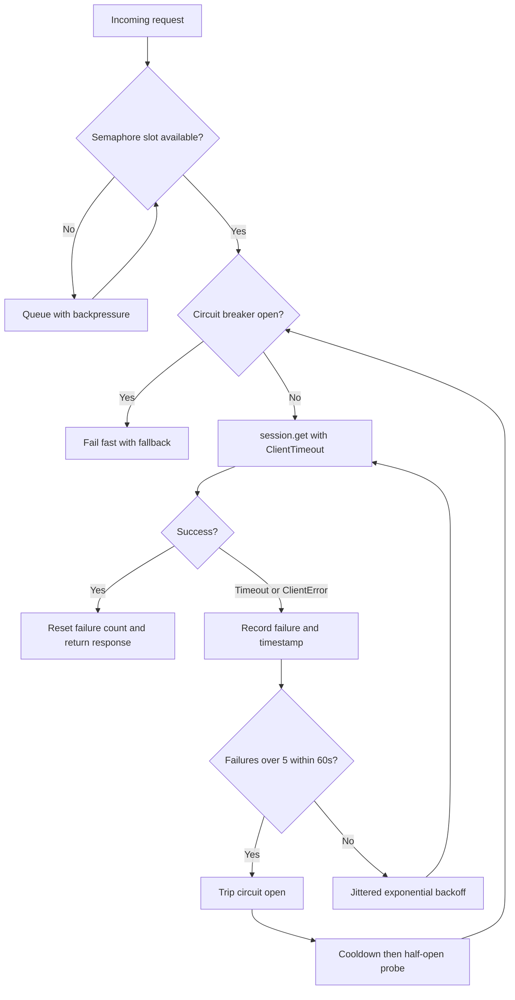

| Difficulty | Channel | Tags |
|---|---|---|
| advanced | backend | asyncio, aiohttp, concurrency |

At its peak, Netflix's API was fielding more than a billion incoming calls a day, fanning out at a 1:6 ratio into several billion outgoing calls across dozens of backend subsystems, with bursts topping 100,000 dependency requests per second on thousands of EC2 instances [1]. Then a single downstream service got slow. Its client library quietly exhausted the API's own request threads, and failure cascaded to every user on every screen. The fix was not more servers — it was a pattern that deliberately stopped making requests. That same pattern is what your aiohttp connection pool needs when the network starts misbehaving.

---

> ### Real-World Case — Netflix
>
> Netflix's API handled more than 1 billion incoming calls per day, fanning out at a 1:6 ratio to several billion outgoing calls across dozens of backend subsystems, with peaks over 100,000 dependency requests per second on thousands of EC2 instances. When any single downstream service became slow (latent), its client library could exhaust the API's own request threads and cascade failure to every user.
>
> | | |
> |---|---|
> | **Challenge** | Prevent one slow or failing dependency from consuming all available connection/thread resources and taking down the whole API, while still returning a usable (degraded) response to members instead of errors. |
> | **Solution** | Netflix built Hystrix: per-dependency bulkheads implemented as small bounded thread pools or semaphores (acquired via non-blocking tryAcquire), aggressive timeouts tuned near the 99.5th percentile, and circuit breakers that short-circuit a dependency once its rolling error rate crosses a threshold and periodically probe it for recovery. The counterintuitive core: when a dependency went latent, engineers resisted the instinct to enlarge pools/timeouts and instead let the circuit breaker shed load and serve fallbacks, deliberately releasing pressure on the sick backend. |
> | **Outcome** | Hystrix executed 10+ billion thread-isolated and 200+ billion semaphore-isolated command executions per day at Netflix, across 100+ command types and 40+ thread pools per API instance, with a documented dramatic improvement in uptime. Incident dashboards show circuits tripping on roughly one-third of a cluster while users still received degraded-but-functional fallback responses with no increase in HTTP 500s; the thread-isolation overhead was measured at only ~3ms at p90 and ~9ms at p99. |
> | **Lesson** | Under high load or latency, the instinct to raise semaphore/pool limits, queues, and timeouts is exactly wrong. Netflix's own example: 100 servers × 10 connections = 1,000 (normally 200–300 in use); under latency all 1,000 are held, and bumping to 20 each creates 2,000 held connections that further crush the backend — you DDOS yourself. Cap concurrency, fail fast, back off with jitter, and open the circuit to let the dependency recover. This is the exact tradeoff behind an aiohttp pool manager's semaphore, timeout, backoff, and circuit breaker. |

---

## Hook — The Deploy Looked Fine. Then Everything Went Red

The deploy looked fine. Latency was flat, error rates were boring, and then a single downstream service started taking 800ms instead of 80ms. Within minutes, the API's own worker threads were all parked waiting on that one dependency, and healthy requests — requests that never needed that service — began timing out too. Sound familiar?

This is the failure mode that quietly turns a minor blip into a full-blown incident. One latent dependency, one saturated pool, and suddenly every user sees a spinner. At Netflix scale, the numbers get almost comical: Hystrix executed more than 10 billion thread-isolated and 200 billion semaphore-isolated commands per day, spread across 100+ command types and 40+ thread pools per API instance [1]. That is not over-engineering. That is arithmetic.

💡 Insight: The dangerous part of a cascade is not the slow service. It is the resources your own service burns while waiting for it.

Here is the thing though — adding more connections rarely fixes this. Throw more concurrency at a saturated downstream and you simply deliver the outage faster. The real question is not 'how many connections can you open?' but 'when should you stop opening them?' That question is where the rest of this story lives.

## Problem — The Pool That Became the Bottleneck

Building on that tension, the core problem is deceptively simple: an aiohttp client with no limits will happily create unbounded connections, and unbounded connection pools [6] are an outage waiting for a traffic spike. Under high load, three things tend to break at once, and they reinforce each other like a bad horror sequel.

- Connection exhaustion: every pending request grabs a socket and waits, so new requests queue behind work that can never finish
- Timeout storms: a 30-second total timeout that is reasonable in isolation becomes a 30-second traffic jam when thousands of requests hit it together
- Cascade failure: the caller holds its own resources while waiting, so slowness propagates upstream one service at a time

⚠️ Watch Out: A semaphore that only caps concurrency is not a pool manager. It stops you from opening too many connections, but it does nothing about what happens when the service behind them is down.

Many developers discover this the hard way: the semaphore fills up, the queue grows, and the application keeps accepting work it can never complete. Without backpressure, the queue itself becomes an unbounded memory leak with a polite name.

This leads to a counterintuitive idea. When the downstream is failing, the fastest way to protect your service is to voluntarily send it less traffic. That is the heartbeat of graceful degradation.

## Real-World Case — Netflix

To see that idea in the wild, look at what Netflix publicly documented in the Hystrix project. The API handled more than 1 billion incoming calls per day, fanning out at a 1:6 ratio into several billion outgoing calls across dozens of backend subsystems, with peaks above 100,000 dependency requests per second on thousands of EC2 instances [1]. When any single downstream service became latent, its client library could exhaust the API's own request threads and cascade failure to every user [1].

The fix was isolation plus a circuit breaker. Hystrix's own repository describes thread and semaphore isolation as distinct strategies [2], and the project wrapped dependency calls so a failing service could not consume all calling threads while tripping circuits to stop repeated attempts against unhealthy dependencies [1]. The documented scale is staggering: 10+ billion thread-isolated and 200+ billion semaphore-isolated command executions per day, across 100+ command types and 40+ thread pools per API instance, with a dramatic improvement in uptime [1].

🔥 Hot Take: The most impressive number is not the billions. It is that during incidents, circuits tripped on roughly one-third of a cluster while users received degraded-but-functional fallback responses and no increase in HTTP 500s [1].

Critically, the isolation overhead was measured at only about 3ms at p90 and 9ms at p99 [1]. Resilience was cheap; the alternative was expensive. The lesson for your aiohttp service is direct: isolation boundaries and a way to say "not right now" turn a cascade into a shrug.

## Deep Dive — Semaphores, Backoff, and the Circuit Breaker

Building on Netflix's playbook, an aiohttp pool manager really rests on four mechanisms, each answering a different question. Confusing them is the most common design mistake, so treat them as distinct tools with distinct jobs.

| Mechanism | Question it answers | Failure it prevents | Real tradeoff |
|---|---|---|---|
| Semaphore | How many at once? | Connection exhaustion | Queued requests still wait |
| Timeout | How long before giving up? | Hung sockets | Too tight fails healthy calls |
| Exponential backoff | When to retry? | Retry storms | Adds latency, needs jitter |
| Circuit breaker | Should we retry at all? | Cascading failure | Can trip on partial failures |

Specifically, the semaphore is the simplest layer: `asyncio.Semaphore(max_connections)` limits how many coroutines can hold a connection slot at once [3]. Python's synchronization primitives make this straightforward, but the semaphore only manages local concurrency — it has no idea whether the remote service is healthy [3]. And because the network is not reliable, one of the classic fallacies of distributed computing [9], that distinction matters enormously.

Exponential backoff answers the retry question by doubling the delay between attempts, which stops a swarm of clients from hammering a recovering service [5]. The pattern is widely recommended for transient errors, yet it carries a warning: retries must be idempotent, or partial updates corrupt state [8]. This is precisely why production implementations add jitter — randomized delays that desynchronize thousands of retrying clients.

Moreover, the circuit breaker is the plot twist. Unlike a timeout, which waits patiently and then fails, a breaker proactively refuses requests once failures cross a threshold, moving through closed, open, and half-open states [4]. Wikipedia's overview notes the counterintuitive risk: breakers can mistake a partial failure for a total outage and take down healthy shards, especially in sharded or cell-based architectures [4]. So the breaker needs a sensible threshold, a cooldown window, and a limited half-open probe.

💡 Insight: Timeouts protect your callers. Backoff protects the downstream. Circuit breakers protect both — by making your service politely unavailable instead of catastrophically slow.

When would you actually reach for each? Use a semaphore whenever a downstream has a hard connection cap, backoff for transient 429s and network blips, and a breaker whenever one dependency's bad mood has already ruined someone else's day.

## Workflow — From Request to Response (or Graceful Refusal)

With the pieces separated, the request lifecycle becomes a clear sequence rather than a tangle of callbacks. The Mermaid diagram labeled 'Request Flow Through a Resilient aiohttp Pool' below shows how a call flows through the pool manager, where the circuit breaker short-circuits, and how failures feed back into the breaker state.

Step by step, here is what happens:

1. Acquire a slot — the coroutine enters the semaphore; if all slots are busy, it waits, which provides natural backpressure [3]
2. Check the breaker — if the circuit is open, fail immediately with a fallback instead of spending a connection on doomed work
3. Send with a timeout — `session.get()` runs under a `ClientTimeout`; slow responses raise `TimeoutError` rather than hanging forever
4. Record the outcome — success resets the failure counter; timeouts and `ClientError`s increment it and timestamp the last failure
5. Trip or recover — once failures pass the threshold inside the cooldown window, the circuit opens; after the window elapses, a limited probe can close it again [4]

⚠️ Watch Out: Always release the semaphore slot, even on exceptions. Using `async with self.semaphore` handles this automatically, which is precisely why the code example uses it.

Consequently, the manager behaves like a small state machine wrapped around your HTTP client — borrowing the same isolation idea that made Hystrix famous [1][2].

## Code Example — A Pool Manager That Knows When to Say No

Now that the workflow is mapped, the implementation can stay compact while still covering the essentials. The snippet below combines semaphore limiting, a total timeout, jittered retries, and a time-based circuit breaker, and it is deliberately close to production shape rather than a toy.

Walking through it piece by piece:

- The constructor creates the semaphore from `max_connections`, keeps a 30-second total timeout, and stores the failure threshold and cooldown window.
- `start()` builds a `TCPConnector` with keepalive, reusing TCP connections instead of paying the handshake tax on every call [7].
- `make_request()` acquires the semaphore first, so no more than the configured number of requests are in flight; queued callers wait their turn instead of opening fresh sockets [3].
- The breaker check runs inside the slot. If the circuit is open, the code raises `ClientError("Circuit breaker open")` immediately — no network call, no wasted timeout.
- The retry loop uses jittered exponential backoff and re-raises on the final attempt, so callers still see real errors rather than silent corruption [5][8].
- `_circuit_open()` uses the event loop clock via `asyncio.get_event_loop().time()` and resets the counter once the cooldown expires, acting as the half-open probe [3][10].
- `close()` guarantees session cleanup on shutdown, preventing the leaked-session failure mode that plagues long-running services.

But wait, it gets better — two details are worth adding before copying this into production. First, back the breaker with active health checks that prune dead keepalive connections. Second, make the breaker per-dependency rather than global, so one unhealthy service cannot block calls to healthy ones — the same lesson behind Hystrix's 40+ thread pools per instance [1].

🔥 Hot Take: A circuit breaker without a half-open probe is just a polite way of staying down forever. The moment the cooldown ends, a small controlled probe needs to test the water [4].

## Lessons Learned — What Survives the Next Spike

Tracing the path from that billion-call API down to a single aiohttp coroutine, a few truths survive every rewrite. Here are the battle scars worth keeping.

**Battle scars — mistakes that bite teams repeatedly:**

- Treating a semaphore as a complete solution — it caps concurrency but does not handle downstream failure
- Forgetting jitter — synchronized retries turn a recovery into a second outage [5]
- Ignoring SSL context validation and sloppy timeout configurations — both create failures that look like network flakiness
- Skipping connection cleanup on shutdown — leaked sessions and sockets accumulate quietly
- Losing error context across the async stack — re-raise with meaning so callers can react

🎯 Key Point: The goal is not to prevent failure. It is to fail small, fail fast, and keep serving something useful while the dependency recovers.

So what should change tomorrow? Start by measuring your current fan-out ratio and p99 dependency latency; you cannot protect what you have not measured. Then add one isolation boundary around your most fragile downstream, wrap it with a breaker, and verify that a forced failure produces a degraded response rather than a 500 — exactly the behavior Netflix documented on those incident dashboards [1].

If this feels overwhelming, begin with the smallest step: put a semaphore and a real timeout around your riskiest `session.get()`. Everything else builds on that.

---

## Request Flow Through a Resilient aiohttp Pool

<strong>Original Interview Question</strong>

**Q:** How would you implement a connection pool manager for aiohttp that handles graceful degradation under high load and connection timeouts?

**A:** Implement a connection pool manager for aiohttp using a semaphore to limit concurrent connections, exponential backoff for retrying failed requests, and circuit breaker pattern to gracefully degrade under high load and connection timeouts.

## Conclusion

The cascade that once took down entire fleets did not need more hardware — it needed a way to stop. From Netflix's billion-call API with circuits tripping on a third of the cluster while users kept getting usable responses [1], to a handful of lines of aiohttp code, the principle is identical: limit concurrency, bound your waits, back off with jitter, and refuse to keep hitting something that is already down. The next time one service gets slow at 3 a.m., your pool will not be the reason the pager fires — it will be the reason the incident ends quietly. Share this one insight with your team: a healthy service is not one that never fails, it is one that knows when to stop trying.

---

## References

1. [Netflix incident report](https://github.com/Netflix/Hystrix/wiki/Operations) — article
2. [Netflix Hystrix GitHub Repository](https://github.com/Netflix/Hystrix) — documentation
3. [Python asyncio Synchronization Primitives](https://docs.python.org/3/library/asyncio-sync.html) — documentation
4. [Circuit breaker design pattern](https://en.wikipedia.org/wiki/Circuit_breaker_design_pattern) — blog
5. [Exponential backoff](https://en.wikipedia.org/wiki/Exponential_backoff) — blog
6. [Connection pool](https://en.wikipedia.org/wiki/Connection_pool) — blog
7. [aiohttp GitHub Repository](https://github.com/aio-libs/aiohttp) — documentation
8. [Retry with backoff pattern](https://docs.aws.amazon.com/prescriptive-guidance/latest/cloud-design-patterns/retry-backoff.html) — documentation
9. [Fallacies of Distributed Computing](https://en.wikipedia.org/wiki/Fallacies_of_distributed_computing) — blog
10. [Python asyncio Task API](https://docs.python.org/3/library/asyncio-task.html) — documentation

---

**Author:** Satishkumar Dhule — [GitHub](https://github.com/satishkumar-dhule) · [LinkedIn](https://linkedin.com/in/satishkumar-dhule) · [Website](https://satishkumar-dhule.github.io)
