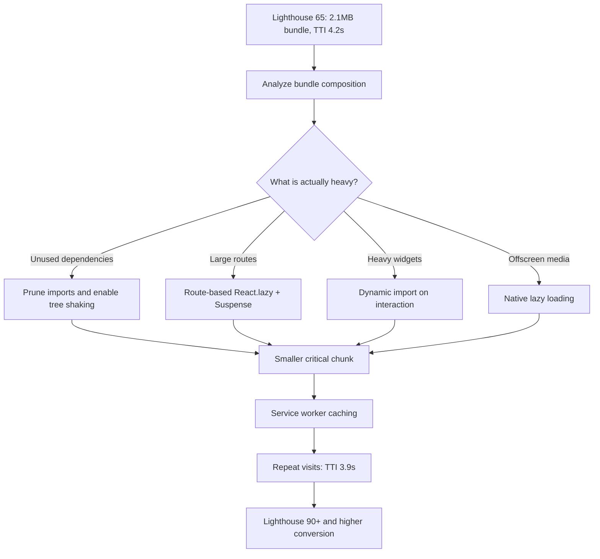

| Difficulty | Channel | Tags |
|---|---|---|
| intermediate | frontend | lighthouse, bundle, lazy-loading |

In 2017, Pinterest's mobile web app was a 2.5MB JavaScript monolith that kept users waiting 23 seconds for the UI to become interactive on average Android hardware over 3G [1]. The old experience converted just 1% of unauthenticated mobile visitors into signups, logins, or app installs [1]. Then the team did something counterintuitive: instead of shipping more features, they started deleting bytes. What followed reads less like a performance ticket and more like a heist story, with 843% more signups as the prize.

---

> ### Real-World Case — Pinterest
>
> In 2017 Pinterest's mobile web app was a monolith shipping over 2.5MB of JavaScript (~1.5MB main bundle + 1MB lazy-loaded). On average Android hardware over 3G, users waited 23 seconds for the UI to become interactive, and the old experience converted just 1% of unauthenticated mobile visitors into signups, logins, or app installs.
>
> | | |
> |---|---|
> | **Challenge** | Cut the multi-megabyte JS payload and parse/compile cost enough to make the site interactive in seconds rather than tens of seconds, while preserving feature parity and improving conversion and SEO traffic. |
> | **Solution** | Rebuilt the mobile web in React, Redux and webpack, splitting the monolith into a ~73KB vendor chunk (React/Redux/router), a ~72KB entry chunk (app shell, store), and 13–18KB async route chunks via React Router code splitting and CommonsChunkPlugin, with chunk-hash caching and babel-preset-env to transpile only what target browsers need. They lazy-loaded non-critical assets, deferred offscreen images, used a normalized Redux store for instant route changes, added a service worker caching JS/CSS/app shell (with app-version-based invalidation), and used Lighthouse to validate Time to Consistently Interactive. |
> | **Outcome** | Core bundle fell from 650KB to 150KB (homepage JS ~490KB to ~190KB); First Meaningful Paint dropped 4.2s → 1.8s and Time to Interactive 23s → 5.6s, falling to 3.9s on repeat visits with service worker caching. Business results: time spent +40%, user-generated ad revenue +44%, core engagements +60%; a year later mobile web weekly active users were up 103%, logins up 370%, and new signups up 843% year-over-year — the team's biggest user acquisition win of 2016. |
> | **Lesson** | Code splitting and lazy loading only pay off when paired with measurement and guardrails: Pinterest used Lighthouse plus real-user metrics, and a year later — with ~600 JS files — one ill-chosen import could re-bloat the bundle, so they added bundle-size alert graphs and a custom ESLint rule blocking heavy imports to defend the gain. |

---

## Hook — The Day 23 Felt Like an Eternity

Picture this: a user taps a pin, the screen paints, and then nothing happens. Twenty-three seconds later the interface finally responds [1]. On fiber that delay is a punchline; on 3G with a mid-range Android it is an abandonment event. Research on web performance has long shown that roughly 80% of the time to view a page is controlled by the front end, and faster pages improve visitor retention [2].

💡 Insight: the bottleneck is rarely the API. It is the JavaScript the browser must fetch, parse, compile, and execute before a single tap feels real. So here is the question that starts the whole journey: how much of that 2.5MB bundle was actually needed for the first screen?

## Problem — When the Bundle Becomes the Product

Building on that 23-second reality, the core challenge is not 'make Lighthouse happy.' It is buying back attention before the user's thumb gives up. A 2.1MB bundle with a 4.2s Time to Interactive is a symptom: every route, widget, and third-party script has been invited to the initial party. Many developers discover the hard way that shipping one big chunk means the browser pays for code nobody will ever run on this visit. Consequently, teams face three connected problems.

Here is what you need to know:

- Parse and compile cost scales with JavaScript size, not just network speed; a slower CPU turns 2.1MB into seconds of blocked main thread.
- Time to Interactive measures when the UI can actually respond, so beautiful pixels that cannot be tapped still score badly.
- Unused dependencies are the sneakiest culprit: one default import from a barrel file can drag an entire library onto the critical path [3].

⚠️ Watch Out: minification is not a strategy. It trims maybe 20-30% and leaves the architectural problem untouched.

| Approach | What it fixes | Real tradeoff |
|---|---|---|
| Minify and gzip | Transfer size only | Parsing cost mostly remains |
| Route-based splitting | Initial load | Needs a loading state and prefetch plan |
| Component splitting | Heavy widgets | More chunks to manage and cache |
| Tree shaking | Dead exports | Requires ESM-friendly imports [5] |

🔥 Hot Take: a Lighthouse score of 65 is not a vanity metric problem. It is a product problem wearing a developer costume. But knowing the diagnosis is not the same as having a cure, so what would a team even look at first?

## Real-World Case — Pinterest

However, the stakes become impossible to ignore once the numbers have names attached. In 2017 Pinterest's mobile web app was a monolith shipping over 2.5MB of JavaScript: roughly 1.5MB main bundle plus 1MB lazy-loaded [1]. On average Android hardware over 3G, users waited 23 seconds for the UI to become interactive, and the old experience converted just 1% of unauthenticated mobile visitors into a signup, login, or app install [1].

The struggle was not a lack of features. It was too many of them arriving at once. The team treated the bundle like a budget, not a dumping ground, and rebuilt the mobile web as a progressive web app, an approach that relies on service workers and an app shell to keep the interface immediately available [9].

Then came the transformation. The core bundle fell from 650KB to 150KB, homepage JavaScript dropped from about 490KB to 190KB, and First Meaningful Paint moved from 4.2s to 1.8s [1]. Time to Interactive collapsed from 23s to 5.6s, then to 3.9s on repeat visits once service worker caching entered the picture [1][8].

💡 Insight: the business numbers were louder than the lab numbers. Time spent rose 40%, user-generated ad revenue 44%, and core engagements 60% [1]. A year later, mobile web weekly active users were up 103%, logins 370%, and new signups 843% year-over-year [1].

🎯 Key Point: speed was not a polish pass. It was the acquisition channel. The next question is mechanical: which levers produced that kind of change, and in what order?

## Deep Dive — The Four Levers That Actually Move the Needle

This leads to the discovery phase, where intuition gets replaced by evidence. Before touching a single import, teams need a map of the bundle. A tool such as webpack-bundle-analyzer renders modules as an interactive treemap, exposing the exact libraries eating the critical path [6]. Pro tip: read parsed and gzip sizes, not just stat sizes, because what ships is what matters.

Four levers do most of the heavy lifting:

- Code splitting divides the app into independently loaded chunks, so only what the current view needs is fetched [3]. Use route-based splits when whole pages differ, and component-based splits when one widget is disproportionately large.
- Dynamic imports turn import() into an on-demand promise [4]. When would a team actually use this? Any time a feature is interaction-gated: charts, editors, maps, PDF viewers.
- Tree shaking removes dead exports, but only when modules stay in ESM form and imports are specific [5][10]. A default import from a CommonJS-style barrel can quietly disable the optimization.
- Lazy loading defers non-critical resources until they are near the viewport, which shortens the critical rendering path for images and media [7].

⚠️ Watch Out: splitting everything is its own performance bug. Too many tiny chunks create request waterfalls and cache fragmentation. Group by route first, then by genuinely expensive component.

| Option A | Option B | Here is the real tradeoff |
|---|---|---|
| One 2.1MB bundle | Route-based lazy chunks | Fewer requests vs. much faster first paint |
| Eager chart library | Dynamic import on click | Instant widget vs. 200-400KB removed from startup |
| HTTP cache only | Service worker cache | Simple invalidation vs. 3.9s repeat-visit TTI [8] |

🔥 Hot Take: most 'we need a faster CDN' conversations are really 'nobody has opened the treemap' conversations. Once the map exists, the workflow can finally become repeatable. But wait, it gets better: the order of operations matters more than any single trick.

## Workflow — From 65 to 90+ as a Repeatable Pipeline

Consequently, once the levers are clear, the work needs a sequence that a team can rerun every sprint. The Mermaid diagram below, **Bundle Slim-Down Flow**, shows the path visually; the steps spell it out in words.

1. Measure first. Run Lighthouse under simulated 3G and a mid-tier CPU. Record bundle size, TTI, and the largest chunks.
2. Visualize. Generate stats and open the treemap from webpack-bundle-analyzer [6]. Write down the top five contributors by parsed size.
3. Prune. Remove unused dependencies, replace broad imports with named ESM imports, and confirm tree shaking is active [5][10].
4. Split by route. Wrap page components in React.lazy and one Suspense boundary at the router level [11][3].
5. Split by component. Lazy-load heavy charts and editors behind an ErrorBoundary so a failed chunk never blanks the page.
6. Prefetch on intent. Warm the next route on hover or focus so the split feels instant [4].
7. Defer media. Add native lazy loading to offscreen images and iframes [7].
8. Cache the shell. Register a service worker that precaches the app shell and the critical chunks [8][9].
9. Re-measure. Compare against the baseline, then set a budget so 2.1MB never sneaks back in.

🎯 Key Point: steps 2 and 9 are the ones teams skip, and they are the ones that make the difference stick. If this feels overwhelming, start with step 2 alone; one treemap usually produces enough insight to justify the rest. With the sequence in hand, the implementation almost writes itself.

## Code Example — Turning the Plan Into a Production Entry Point

Building on that workflow, the snippet below turns the plan into a production-shaped React entry point. The complete version lives in the `codeExample` field, but the logic is worth unpacking here.

- React.lazy with dynamic import creates separate chunks for Dashboard and Analytics [4][11].
- A single Suspense boundary at the router keeps loading states consistent instead of sprinkling spinners everywhere.
- The chart is split again at the component level, keeping a visualization library out of the initial download [3].
- ErrorBoundary catches a failed chunk, so one bad deploy degrades gracefully instead of showing a white screen.
- prefetch on hover hides the network delay before navigation, and the named ESM import keeps tree shaking intact [5].

When would a team actually use this pattern? Any app with more than one route and at least one expensive widget. Small apps should not pay the complexity tax until the treemap says otherwise. Sound familiar? The 2.1MB baseline from the problem section is exactly what this structure dismantles.

## Lessons Learned — Battle Scars and the One Insight to Steal

With the code shipped, the final chapter is about the things that still go wrong. Battle scars are usually more educational than the happy path.

⚠️ Watch Out: common mistakes and how to dodge them.

- Lazy-loading the above-the-fold component. That converts one fast render into two slow ones. Keep the shell eager.
- Splitting without prefetch. Users then stare at spinners on every click. Warm routes on hover.
- Forgetting an ErrorBoundary. A chunk 404 becomes a blank app and a very confused support queue.
- Letting barrel files re-import everything. Specific ESM imports are the difference between 150KB and 650KB [5][10].
- Measuring only lab data. Synthetic scores and real-user field data can diverge sharply [2].

💡 Insight: Pinterest did not win by writing clever React. It won by treating bytes as a budget and caching as a product feature [1][8].

The journey started with 23 seconds of silence on a 3G screen, moved through a treemap and a stack of lazy chunks, and ended with 843% more signups. That is the whole story: performance work is rarely about doing more. It is about deciding what deserves to arrive first. The so-what for tomorrow is simple: open the bundle analyzer before the next feature ships, and set a size budget your future self will thank you for.

---

## Bundle Slim-Down Flow

<strong>Original Interview Question</strong>

**Q:** You're tasked with improving a React app's Lighthouse performance score from 65 to 90+. The bundle size is 2.1MB and Time to Interactive is 4.2s. What specific steps would you take to optimize the bundle and implement lazy loading?

**A:** Implement code splitting with React.lazy() and Suspense, analyze bundle composition with webpack-bundle-analyzer to identify largest chunks, remove unused dependencies and optimize imports, add dynamic imports for heavy components and third-party libraries, implement route-based splitting for better initial load times, and utilize tree shaking with proper ES module configuration.

## Conclusion

Twenty-three seconds was never a technology limitation; it was a pile of unexamined defaults. Pinterest's rebuild showed that shrinking the core bundle to 150KB, splitting routes, deferring heavy widgets, and caching the shell can turn a sluggish mobile site into a team's biggest acquisition win [1][8][9]. You do not need a rewrite to start. Run the analyzer, split one route, add one prefetch, and watch the treemap shrink. The one insight worth sharing with your team: every kilobyte on the critical path is a tiny tax on every single visitor, and those taxes compound. Stop paying them by default.

---

## References

1. [Pinterest incident report](https://medium.com/dev-channel/a-pinterest-progressive-web-app-performance-case-study-3bd6ed2e6154) — article
2. [Web performance - Wikipedia](https://en.wikipedia.org/wiki/Web_performance) — documentation
3. [Code splitting - Glossary | MDN](https://developer.mozilla.org/en-US/docs/Glossary/Code_splitting) — documentation
4. [import() - JavaScript | MDN](https://developer.mozilla.org/en-US/docs/Web/JavaScript/Reference/Operators/import) — documentation
5. [Tree shaking - Glossary | MDN](https://developer.mozilla.org/en-US/docs/Glossary/Tree_shaking) — documentation
6. [webpack-bundle-analyzer - GitHub](https://github.com/webpack/webpack-bundle-analyzer) — documentation
7. [Lazy loading - Performance | MDN](https://developer.mozilla.org/en-US/docs/Web/Performance/Guides/Lazy_loading) — documentation
8. [Service Worker API - Web APIs | MDN](https://developer.mozilla.org/en-US/docs/Web/API/Service_Worker_API) — documentation
9. [Progressive web app - Wikipedia](https://en.wikipedia.org/wiki/Progressive_web_app) — documentation
10. [JavaScript modules - JavaScript | MDN](https://developer.mozilla.org/en-US/docs/Web/JavaScript/Guide/Modules) — documentation
11. [React - GitHub](https://github.com/facebook/react) — documentation

---

**Author:** Satishkumar Dhule — [GitHub](https://github.com/satishkumar-dhule) · [LinkedIn](https://linkedin.com/in/satishkumar-dhule) · [Website](https://satishkumar-dhule.github.io)
