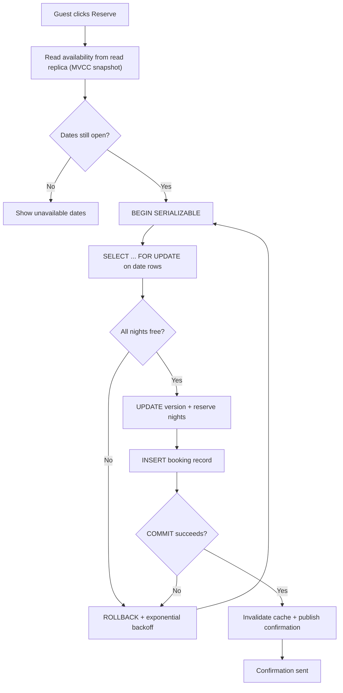

| Difficulty | Channel | Tags |
|---|---|---|
| intermediate | database | acid, isolation-levels, mvcc |

When Booking.com rebuilt its Order Platform to centralize reservation and checkout data for flights, hotels, and cars, the team made a trade that would make most engineers wince: they accepted a write SLI of 99.99998% — slightly below the raw write availability of Cassandra — because correctness mattered more than another few nines of uptime [1]. That cluster now spans Frankfurt, London, and Ireland, guards roughly 20TB of data, and reports 99.999% availability, with plans to retire the old Cassandra components entirely [1]. Picture three travelers clicking Reserve on the same beachfront apartment at the exact same millisecond. Somewhere between payment authorization and the confirmation email, a transaction either holds the line or quietly hands out three keys to one door.

---

> ### Real-World Case — Booking.com
>
> Booking.com's 'Order Platform' centralizes all reservation and checkout data for flights, hotels, and cars. Originally built on sharded MySQL and then Cassandra to scale, it handled multi-step reservation writes (payment authorization, fulfillment, confirmation) that must be atomic across many rows and partitions.
>
> | | |
> |---|---|
> | **Challenge** | Reservation data is transactional by nature, but Cassandra offered only row-level isolation and no proper ACID transactions. The team's hand-rolled locking system based on lightweight transactions would sometimes time out, and they could not tell whether a timeout meant a genuine failed condition or an infrastructure problem, while replicated OpenSearch indexes added costly cross-checks to keep data in sync. |
> | **Solution** | They migrated roughly 20TB of reservation data to CockroachDB, a distributed SQL database that provides SERIALIZABLE isolation by default using MVCC versioned snapshot reads, timestamp-ordered optimistic concurrency control, and Raft consensus for writes. Native ACID transactions, CDC, and secondary indexes let them delete the custom locking layer, extra cross-checks, and separate replication services while running a single multi-region cluster. |
> | **Outcome** | The cluster spans 3 regions (Frankfurt, London, with Ireland as a third) and reports 99.999% availability over 20TB of data. CockroachDB's write SLI is 99.99998%, deliberately lower than Cassandra's raw write availability but accepted for correctness, and the team plans to fully retire Cassandra for these workloads, including 'components that are actually causing havoc.' |
> | **Lesson** | For contended, transactional inventory like reservations, the database should own the correctness contract: weak row-level isolation plus application-built locks produce ambiguous timeouts, whereas SERIALIZABLE transactions with MVCC decide conflicts atomically. High availability and strong consistency are not mutually exclusive, accepting a tiny write-unavailability budget can eliminate entire classes of race-condition bugs and operational complexity. |

---

## Hook — The 300-Millisecond Race That Decides Who Sleeps Outside

The deploy looked fine. Then the support tickets arrived: two guests, one confirmation code, and a property owner politely asking whether the apartment had developed a second bedroom overnight. Sound familiar? Somewhere in checkout, a read said 'available,' a write assumed it still was, and the database happily recorded both reservations. A booking is nothing more than a transaction — a unit of work that must finish entirely or not at all [2] — but treating it like a casual form submission is how weekends get ruined. Picture the stakes: a non-refundable flight, a wedding venue, a very loud review. The race lasts maybe 300 milliseconds; the fallout lasts months. Here is the thing though: the database is not broken. The assumption is. So what actually happens when two transactions sprint for the same row?

## Problem — Race Conditions, Phantom Rows, and the Illusion of 'Just Check Availability'

Building on that 300-millisecond race, the core mistake is deceptively simple: check availability, then insert a booking, with no guarantee that nothing changed between those two steps. Many developers think a SELECT followed by an INSERT is 'good enough' until the first overbooking incident lands in the inbox. Underread committed, each statement sees whatever was committed at its own moment, so two guests can both observe an open calendar and both proceed [3]. MVCC makes this subtle in a different way — it hands every transaction a snapshot of the data, which is brilliant for readers, but a stale snapshot can look perfectly truthful [5].

⚠️ Watch Out: the classic write skew — two transactions read overlapping state, each makes a different change, and neither sees the other's update — slips right past row-level checks unless the isolation level is raised [6]. This matters anywhere a scarce resource can be claimed twice: hotel nights, concert seats, ride slots, limited inventory. When would this actually bite? Any time 'check then act' crosses a network boundary. The uncomfortable question is how a system keeps truthful snapshots without grinding to a halt.

## Real-World Case — Booking.com

That question is exactly what Booking.com answered when its Order Platform had to centralize reservation and checkout data for flights, hotels, and cars [1]. Originally the platform leaned on sharded MySQL, then Cassandra, to absorb enormous write volume across many rows and partitions. But a reservation is not one write — it is payment authorization, fulfillment, and confirmation, all of which must land together or not at all. The team moved these multi-step writes to CockroachDB, whose distributed transaction machinery is visible in the open-source codebase [9].

Here is the plot twist: the cluster spans Frankfurt, London, and Ireland, holds about 20TB of data, and reports 99.999% availability, yet its write SLI sits at 99.99998% — deliberately lower than Cassandra's raw write availability [1]. 💡 Insight: that tiny dip is a feature, not a bug. The team traded a fraction of raw availability for atomicity, with plans to retire the old Cassandra components entirely, including pieces described as 'actually causing havoc' [1]. However, correctness at three-region scale is not free — so what does SERIALIZABLE actually buy, and what does it cost?

## Deep Dive — SERIALIZABLE, MVCC, and Why Optimistic Locking Wins the Long Game

Building on Booking.com's trade, SERIALIZABLE isolation is the strictest promise a database makes: concurrent transactions behave as if they executed one after another [6]. Under the hood, engines often lean on two-phase locking or conflict detection that aborts transactions whose reads and writes overlap in dangerous ways [7]. Optimistic concurrency control takes a different bet — it lets transactions run without holding locks, then validates a version column at commit time and retries the losers [4]. For example, an HTTP ETag lets a client say 'only write if nothing changed since this token' [8]. Here is the real tradeoff:

| Option | What it buys | What it costs | Use it when |
|---|---|---|---|
| Pessimistic row lock (SELECT ... FOR UPDATE) | Blocks competitors before they read stale state | Holds locks across round trips; hot rows serialize | Short, high-contention critical sections |
| Optimistic version column | No locks during reads; high throughput on cold rows | Retries when conflicts are frequent | Mostly non-conflicting bookings |
| Full SERIALIZABLE | Strongest correctness; catches phantoms and write skew | Abort rate rises with contention | Money-moving operations where correctness is non-negotiable |

🔥 Hot Take: the fastest booking system in the world is worthless if it sells the same night twice; the second-fastest one that never double-books wins every time. Battle scars worth memorizing:

- Retry storms: naive immediate retries thrash hot properties. Add exponential backoff with jitter.
- Cache drift: an availability cache not invalidated on commit will happily serve stale 'open' dates.
- Lock creep: locking an entire calendar instead of the exact nights turns a 20ms transaction into a queue.
- Monitoring blind spots: track lock wait time and abort rate, or contention sneaks up on you.

PostgreSQL's row-locking primitives live in the engine that powers much of this pattern [10]. Therefore the practical recipe combines all three: SERIALIZABLE for the critical section, row locks on the exact date rows, and a version column for the metadata. When would this be overkill? Reading availability for a browse page — that belongs on a replica, not inside a serializable transaction [11]. So how does this theory become a checkout flow that survives Black Friday?

## Workflow — From Click to Confirmation Without the Double-Book

Building on the recipe above, the journey from click to confirmation happens in seven deliberate steps:

1. Read availability from a read replica using an MVCC snapshot; treat it as advisory only [11].
2. Open a SERIALIZABLE transaction on the primary.
3. Lock only the overlapping date rows with SELECT ... FOR UPDATE.
4. Re-check availability inside the transaction — this is the authoritative check.
5. Bump the property version, flip the nights to reserved, and insert the booking row.
6. Commit; on serialization failure, roll back and retry with exponential backoff plus jitter. A deterministic 'dates taken' conflict returns immediately — retrying a settled fact is just expensive optimism.
7. Invalidate the availability cache and publish the confirmation event.

The diagram below maps the whole path, including the two places a transaction can loop back and try again:



Notice the loop: conflict is not an error condition here, it is expected traffic. ⚠️ Watch Out: a hot property with hundreds of simultaneous attempts creates a thundering herd of retries; a circuit breaker that briefly serves 'try again shortly' is kinder than a database-wide lock queue. 🎯 Key Point: cache invalidation happens after commit, never before — otherwise a rolled-back booking erases a perfectly good cache entry. Diagrams do not commit transactions, though. Code does.

## Code Example — A Transaction That Refuses to Double-Book

Building on that flow, the implementation below turns the seven steps into one Python function that either claims every requested night or claims nothing. The snippet uses a DB-API style connection with PostgreSQL-like SQL; the same commit/rollback discipline applies across Python database drivers [12].

```python
import random
import time
from datetime import date, timedelta

MAX_RETRIES = 5
BASE_DELAY_MS = 20

class BookingConflict(Exception):
    '''Raised when the calendar changed underneath this transaction.'''

def each_night(start: date, end: date):
    day = start
    while day < end:
        yield day
        day += timedelta(days=1)

def reserve_stay(conn, property_id: int, check_in: date, check_out: date,
                 guest_id: int, expected_version: int) -> int:
    '''Claim every night in [check_in, check_out) atomically.'''
    nights = list(each_night(check_in, check_out))

    for attempt in range(1, MAX_RETRIES + 1):
        try:
            # SERIALIZABLE makes the read-check-write sequence behave like one instant.
            conn.set_session(isolation_level='SERIALIZABLE', autocommit=False)
            with conn.cursor() as cur:
                # Lock only the contested calendar rows, not the whole property.
                cur.execute(
                    '''
                    SELECT booked_date, reserved, version
                    FROM property_availability
                    WHERE property_id = %s AND booked_date = ANY(%s)
                    ORDER BY booked_date
                    FOR UPDATE
                    ''',
                    (property_id, nights),
                )
                rows = cur.fetchall()

                # Application-level validation still decides what is legal.
                if any(reserved for _, reserved, _ in rows):
                    raise BookingConflict('one or more nights are already reserved')

                # Optimistic guard: a stale property version aborts the write.
                cur.execute(
                    '''
                    UPDATE properties
                    SET version = version + 1
                    WHERE id = %s AND version = %s
                    RETURNING version
                    ''',
                    (property_id, expected_version),
                )
                if cur.fetchone() is None:
                    raise BookingConflict('property metadata changed during checkout')

                # Flip each locked night using the version just read.
                for night, _, version in rows:
                    cur.execute(
                        '''
                        UPDATE property_availability
                        SET reserved = TRUE, guest_id = %s, version = version + 1
                        WHERE property_id = %s AND booked_date = %s AND version = %s
                        ''',
                        (guest_id, property_id, night, version),
                    )

                # The reservation record lands in the same transaction.
                cur.execute(
                    '''
                    INSERT INTO bookings (property_id, guest_id, check_in, check_out)
                    VALUES (%s, %s, %s, %s)
                    RETURNING id
                    ''',
                    (property_id, guest_id, check_in, check_out),
                )
                booking_id = cur.fetchone()[0]

            conn.commit()  # Atomic: every row changes, or none do.
            return booking_id

        except BookingConflict:
            conn.rollback()
            raise

        except Exception:
            conn.rollback()
            if attempt == MAX_RETRIES:
                raise
            # Exponential backoff plus jitter prevents synchronized retry storms.
            delay = (BASE_DELAY_MS * (2 ** (attempt - 1))) / 1000
            time.sleep(delay + random.uniform(0, delay))

    raise RuntimeError('unreachable')
```

Here is what each part does:

- `each_night` expands the stay into individual dates, mapping cleanly to one locked row per night.
- `conn.set_session(...)` raises the transaction to SERIALIZABLE, so overlapping read-check-write sequences cannot both succeed [6].
- `SELECT ... FOR UPDATE` grabs the exact date rows, blocking competitors before they can read stale availability [10].
- The `reserved` check is the application-level validation that locks alone cannot provide.
- The conditional `UPDATE ... WHERE version = %s` is optimistic concurrency control in its purest form: a metadata change updates zero rows and aborts the booking [4].
- Each locked night is flipped using the version read moments earlier, so a stale write cannot slip through.
- The booking insert shares the transaction; `conn.commit()` makes the whole thing atomic [2].
- Backoff with jitter spreads retries across time. Deterministic conflicts are re-raised immediately because retrying a settled fact is pointless.

🔥 Hot Take: if the retry block is the most interesting code in the file, the design is probably right. When would this be too much? Single-user scheduling tools with no contention — a unique constraint may be enough there. At marketplace scale, this is the price of sleeping soundly.

## Lessons Learned — Key Takeaways and Actionable Next Steps

Building on the code, the journey from 'two clicks, one room' to 'correct at 99.999% availability' comes down to a handful of habits worth keeping. First, treat correctness as a product feature: Booking.com accepted a marginally lower write SLI rather than risk inconsistent orders [1]. Second, choose the narrowest lock that works — exact nights instead of whole calendars keep latency low. Third, always re-check inside the transaction; a snapshot from a read replica is a hint, never a promise. Fourth, make retries boring: bounded attempts, exponential backoff, jitter, and a circuit breaker for hot properties. Fifth, invalidate caches only after commit.

Many developers discover the hard way that a cache invalidated before a rollback serves data that never existed. 💡 Insight: the real enemy is not concurrency itself — it is the assumption that the world stood still between two statements. The one thing to tell your team tomorrow: draw the check-then-act boundary on every critical path, and make it atomic. That single habit prevents more incidents than any framework. And the next time a support ticket says 'two confirmations, one apartment,' you will know exactly which transaction stopped blinking.

---

## Booking Transaction Flow


<details>
<summary><strong>Original Interview Question</strong></summary>

**Q:** You're building a booking system for Airbnb where multiple users can reserve the same property simultaneously. How would you design the transaction handling to prevent double bookings while maintaining high availability?

**A:** Use SERIALIZABLE isolation with optimistic concurrency control. Implement row-level locks on property availability tables, use MVCC snapshot reads for checking availability, and apply application-level validation to ensure atomic booking operations.

</details>

## Conclusion

Back at the beginning, three travelers clicked Reserve on the same apartment at the same millisecond. The difference between a headline and a non-event was a transaction that refused to trust its own snapshot. Booking.com showed that even at 20TB across three regions, trading a sliver of raw write availability for atomicity is a rational bargain [1]. Your version of that bargain is smaller — a SERIALIZABLE boundary, a row lock on the right date, a version check, and a retry that knows when to back off. Start by auditing one check-then-act path this week and adding the missing guard. The next double-booking incident will be the one that never happens.

---

## References

1. [Booking.com incident report](https://cockroachlabs.com/customers/booking-com/) — article
2. [Database transaction - Wikipedia](https://en.wikipedia.org/wiki/Database_transaction) — documentation
3. [Isolation (database systems) - Wikipedia](https://en.wikipedia.org/wiki/Isolation_(database_systems)) — documentation
4. [Optimistic concurrency control - Wikipedia](https://en.wikipedia.org/wiki/Optimistic_concurrency_control) — documentation
5. [Multiversion concurrency control - Wikipedia](https://en.wikipedia.org/wiki/Multiversion_concurrency_control) — documentation
6. [Serializability - Wikipedia](https://en.wikipedia.org/wiki/Serializability) — documentation
7. [Two-phase locking - Wikipedia](https://en.wikipedia.org/wiki/Two-phase_locking) — documentation
8. [RFC 7232: HTTP/1.1 Conditional Requests](https://datatracker.ietf.org/doc/html/rfc7232) — documentation
9. [cockroachdb/cockroach GitHub repository](https://github.com/cockroachdb/cockroach) — documentation
10. [postgres/postgres GitHub repository](https://github.com/postgres/postgres) — documentation
11. [Amazon RDS PostgreSQL User Guide](https://docs.aws.amazon.com/AmazonRDS/latest/UserGuide/CHAP_PostgreSQL.html) — documentation
12. [Python sqlite3 documentation](https://docs.python.org/3/library/sqlite3.html) — documentation

---

**Author:** Satishkumar Dhule — [GitHub](https://github.com/satishkumar-dhule) · [LinkedIn](https://linkedin.com/in/satishkumar-dhule) · [Website](https://satishkumar-dhule.github.io)
