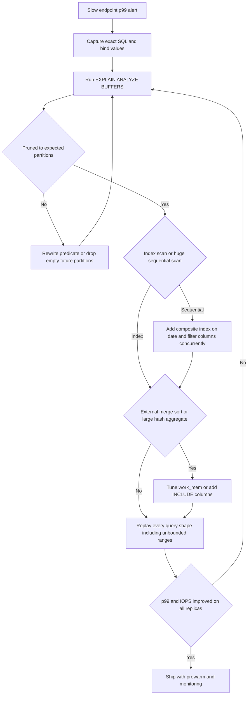

| Difficulty | Channel | Tags |
|---|---|---|
| intermediate | database | explain, query-plan, partitioning |

Picture this: a single PostgreSQL table holding eight years of hourly crypto prices, now past 1TB, with average queries taking more than 30 seconds. That was CoinGecko's reality, where spiking IOPS, growing request queues, and a falling Apdex pushed their API SLO toward the danger zone [1]. The fix was monthly range partitioning plus a ruthless reading of the EXPLAIN plan, and the payoff was an 86% drop in p99 latency. But here is the twist that makes this story worth your time: after the migration, two queries actually got slower.

---

> ### Real-World Case — CoinGecko
>
> After 8 years of data, CoinGecko's PostgreSQL RDS 'prices' table storing hourly crypto prices grew past 1TB and took over 30 seconds on average to query. Spiking IOPS on price endpoints (breaching 24K daily), growing request queues, falling Apdex, and emerging replica lag put their API SLO/SLA at risk.
>
> | | |
> |---|---|
> | **Challenge** | Queries filtering on a timestamp range were scanning years of irrelevant data. Adding indexes failed because the table uses a JSONB column with currency-specific keys, so a single added index would only benefit one application. |
> | **Solution** | They analyzed query patterns, found almost every query had a timestamp range in WHERE and needed at most 4 months of data, then migrated to monthly RANGE partitioning (table_YYYYMM). The partition key had to be added to the primary key (composite keys), Rails schema changed from schema.rb to schema.sql, and they used pg_prewarm, a Go copy app, CloudWatch monitoring, and a Foreign Data Wrapper to copy 1.2TB live without downtime. |
> | **Outcome** | p99 response time dropped from 4.13s to 578ms (~86% reduction), IOPS fell 20% (with savings multiplied across replicas), 6-8x faster queries, replica lag disappeared, and prewarm time fell from 10h to 3h. Notably, two queries regressed after partitioning: one without a lower date bound scanned all partitions, and a 'created_at > ?' query with no upper bound scanned empty future partitions — both fixed by rewriting the queries and removing future partitions. |
> | **Lesson** | Partition pruning only works when queries constrain the partition key with proper bounds; partitioning can actively hurt queries that lack them (a query fine on an unpartitioned table can scan every partition). The wins came from choosing a partition key matching the dominant query pattern, not just from splitting the table. |

---

## Hook — Thirty seconds to answer one price question

The graphs started climbing before anyone finished celebrating the last deploy. CoinGecko's `prices` table, storing hourly crypto prices across more than eight years, had crossed 1TB and the average query was taking over 30 seconds [1]. Price endpoints were hammering IOPS hard enough to breach a 24,000 cap again and again, with alerts firing daily. Request queues grew, Apdex slid, and replica lag showed up exactly where the API could least afford it. Here is the uncomfortable question: when a table gets that big, is the database broken, or is the query simply demanding too much data? That distinction is the whole game, and the EXPLAIN plan is where the argument gets settled.

## Problem — Partitioned, and somehow still slow

Building on that unease, imagine 100 million rows in a date-partitioned `events` table and a query for January 2024 where `status = 'completed'`. Partitioning was chosen precisely for this shape of question, so surely PostgreSQL touches only January. Not necessarily. Partitioning splits one logical table into physically separate pieces, but the planner still has to prove which pieces are irrelevant before it can skip them [2]. If the date predicate is wrapped in a function, or the range has no lower bound, that proof evaporates and the Append node lights up like a Christmas tree. Cost-based optimizers compare candidate plans using estimates, and when those estimates are stale or wrong, the chosen plan can be spectacularly bad [4].

Here is what you need to know before reaching for a bigger instance:

- **Pruning effectiveness:** count the child scans under the Append node. Touching four monthly partitions is the goal; touching forty is a predicate bug, not a hardware bug.
- **Access path:** an index scan on a narrow slice is healthy, while a sequential scan across a cold partition is a warning. That said, a sequential scan on a tiny partition can be the correct, cheaper choice.
- **Expensive sorts and hash aggregates:** `Sort Method: external merge Disk` means work ran out of memory and spilled. You can partition perfectly and still lose seconds there.

⚠️ Watch Out: a missing lower date bound is not a cosmetic oversight. It converts a targeted lookup into an all-partition scan, and the same query may have looked perfectly fast on the old unpartitioned table.

## Real-World Case — CoinGecko

That diagnostic mindset is exactly what CoinGecko applied, and the story reads like a masterclass in doing the unglamorous things right. Adding indexes was tried first and abandoned, partly because the table leaned on a JSONB column whose keys varied by application, making one index per key a poor trade [1]. Monthly range partitioning won because nearly every query carried a timestamp range and users rarely asked for more than four months of history. The team ran a dry run on a production-sized RDS database, measured 6-8x faster queries, and discovered that warming the old table's cache alone consumed 10 hours before any migration work could even begin [7].

Go-live brought two plot twists. Copying a single day of data stalled beyond 15 minutes on production, so the team provisioned another database, prewarmed it, and used a foreign data wrapper to read remotely while writing locally. Replicas also needed prewarming, not just the primary, because IOPS saturation on RDS read replicas feeds directly into replication lag [8]. Then the numbers landed: p99 fell from 4.13s to 578ms, an 86% reduction; IOPS dropped 20%, with savings multiplied across every replica; replica lag disappeared; and prewarm time fell from 10 hours to 3 hours [1].

But the most instructive part came after the victory lap. Two queries regressed: one lacked a lower date bound and scanned every partition, while a `created_at > ?` query with no upper bound scanned empty future partitions that had been pre-created for convenience. Both were fixed by rewriting the queries and removing those future partitions [1]. Partitioning had done exactly what it was told. The queries had not.

## Deep Dive — Reading a plan like a detective

With the case in mind, here is what those three suspects actually look like when the plan is opened up. `EXPLAIN (ANALYZE, BUFFERS)` is the truth serum: `ANALYZE` executes the statement and reports actual row counts, while `BUFFERS` exposes how much data was read from disk versus cache. Comparing estimated rows against actual rows tells you whether the optimizer's map matches the territory [4].

**First, pruning.** PostgreSQL's declarative partitioning keeps the parent logical and the leaf tables physical, and the planner removes partitions whose constraints make a match impossible [2]. Look for a small number of scanned children, ideally with others marked as never executed. Use range partitioning when predicates are ranges, list partitioning for fixed categories, and hash partitioning when reads are keyed by equality rather than time [2]. The partition key is a contract with the query shape; break the contract and the pruning disappears.

**Second, index choice.** A composite index on `(event_date, status)` works because the leading column serves the range and the second column serves the equality filter. Column order is not decoration: indexes are ordered structures, and a filter on the second column alone cannot efficiently drive the first [3]. Many developers discover this the hard way after adding two single-column indexes and wondering why the planner shrugs. Use this when a narrow date window plus a selective status is the dominant access pattern; if the query returns half the table, a sequential scan is likely cheaper. An `INCLUDE (event_id)` clause can even turn the lookup into an index-only scan when the projection is tiny [3].

**Third, sorting and physical layout.** A large hash aggregate or an external merge sort can dominate runtime after pruning has already succeeded. Physical clustering co-locates rows in index order, which reduces scattered reads for range-heavy, mostly-read workloads, but it is a one-time rewrite that decays as new rows arrive; on a partitioned parent, cluster the leaf partitions individually. PostgreSQL's own source and documentation are the final word on which node does what [6].

| Option | Use it when | The real tradeoff |
|---|---|---|
| Composite index `(event_date, status)` | Narrow date window plus selective filter | Write amplification and a costly concurrent build on a huge table |
| Cluster leaf partitions by date | Range scans dominate and writes are moderate | One-time rewrite, no lasting guarantee, ops coordination |
| More, smaller monthly partitions | Queries touch only a few months | More planning overhead and a migration project nobody volunteered for |
| More IOPS or memory | Buying time during a migration | Cost multiplies across replicas and masks the real bug |

🔥 Hot Take: partitioning is not an index strategy. It is a query-shape contract, and only a well-formed predicate cashes the check.

💡 Insight: PostgreSQL itself is a mature object-relational system with a cost-based planner, so the plan is not an opinion — it is a measurable claim about disk and CPU [5].

## Workflow — From pager to proof in six steps

Translating those signals into a repeatable routine prevents the classic mistake of changing five things at once and learning nothing. The loop below keeps the investigation disciplined: every change is followed by another measurement, and unbounded query shapes are replayed before anyone declares victory.



Step one captures the exact statement with its parameters, because a prepared statement's generic plan can differ from the one produced with literal values. Step two runs the plan with buffers on production-shaped data; a dry run on a toy dataset is how teams end up surprised on go-live day [7]. Step three counts touched partitions, step four compares estimated and actual rows, and step five changes exactly one thing before re-measuring. Step six is the one most often skipped: replay queries with missing bounds, `>` without `<`, and timestamps beyond the newest partition. That is precisely where CoinGecko's two regressions were hiding [1].

## Code Example — Let the plan prove the fix

The workflow becomes concrete once the plan is captured before and after a change. The SQL below does the minimum useful work: it reveals the real access path, then adds the composite index without blocking writes on a live table.

```sql
-- Capture the truth: actual rows, timing, and disk reads for both filters
EXPLAIN (ANALYZE, BUFFERS)
SELECT event_id, event_date, status
FROM events
WHERE event_date BETWEEN '2024-01-01' AND '2024-01-31'
  AND status = 'completed';

-- CONCURRENTLY avoids locking out writers during a large index build
CREATE INDEX CONCURRENTLY IF NOT EXISTS idx_events_date_status
  ON events (event_date, status);

-- Re-run the EXPLAIN and compare Rows Removed by Filter and buffer counts
```

Line by line: the `BETWEEN` predicate gives the planner a closed range, so pruning can eliminate every partition outside January. The equality on `status` becomes the second key of the composite index, which lets a single index walk satisfy both conditions. `CONCURRENTLY` trades a longer build for zero write downtime, which matters when the table measures in terabytes. Re-running the same plan afterward is the only honest way to know whether the index was used rather than merely created.

That manual loop is fine for one query and terrible for twenty, so the Python harness in the `codeExample` field automates it with psycopg, a production-grade PostgreSQL driver [9]. It prints the number of partitions touched, rows discarded by the filter, and cache versus disk reads before and after the index build.

## Lessons Learned — Battle scars worth keeping

Every earlier step exists because someone, somewhere, learned it under pressure. The good news is that these scars are cheap to acquire secondhand.

- **Never pre-create distant empty partitions.** A query with only `created_at > ?` will happily scan every future partition, empty or not, and burn IOPS for the privilege [1].
- **Treat missing bounds as a bug class.** An unbounded range against a partitioned table is a full scan wearing a clever costume. The fix belongs in the query text, not in more hardware.
- **Match the partition key to real predicates.** Range partitioning pays off when timestamp ranges dominate reads; otherwise the pruning machinery is expensive decoration [2].
- **Warm every replica, not just the primary.** A cold cache after a switch can erase hours of preparation and reintroduce the lag the whole project was meant to kill [8].
- **Measure on production-shaped data.** Dry runs revealed the 6-8x win before go-live, and also revealed that copying one day of production data could take more than 15 minutes [1].
- **Freeze unrelated deployments on switch day.** CoinGecko's team traced post-switch CPU and IOPS noise to a different deploy, and untangling it consumed a rollback and a long argument [1].

🎯 Key Point: an index helps after pruning, pruning helps before sorting, and neither helps when the predicate is malformed. Order matters.

So what changes tomorrow? Pick the slowest endpoint, capture its exact SQL, run `EXPLAIN (ANALYZE, BUFFERS)`, and count the partitions. If the count is wrong, nothing else deserves attention yet.

---

## EXPLAIN Debugging Flow


<details>
<summary><strong>Original Interview Question</strong></summary>

**Q:** You have a PostgreSQL table with 100M rows partitioned by date. A query filtering on a specific date range is still slow. What would you check in the EXPLAIN plan and how would you optimize it?

**A:** Check partition pruning effectiveness, index utilization patterns, and expensive sort operations. Create composite indexes on (date, filtered_columns) and evaluate clustering strategies for optimal data access.

</details>

## Conclusion

CoinGecko started with a 1TB table, 30-second queries, and an SLO in jeopardy, and ended with p99 at 578ms and replica lag gone [1]. The journey was not a bigger instance; it was a partition key that matched real predicates, a composite index that matched the filters, and a team willing to read the plan before and after every change. The two regressions prove the moral: partitioning removes wasted work only when the query lets it. Tomorrow morning, take one slow query, run EXPLAIN with ANALYZE and BUFFERS, and count the partitions it touches. If that number surprises you, the rest of the optimization conversation has not started yet.

---

## References

1. [CoinGecko incident report](https://dev.to/coingecko/scaling-postgresql-performance-with-table-partitioning-136o) — article
2. [Partition (database) - Wikipedia](https://en.wikipedia.org/wiki/Partition_(database)) — documentation
3. [Database index - Wikipedia](https://en.wikipedia.org/wiki/Database_index) — documentation
4. [Query optimization - Wikipedia](https://en.wikipedia.org/wiki/Query_optimization) — documentation
5. [PostgreSQL - Wikipedia](https://en.wikipedia.org/wiki/PostgreSQL) — documentation
6. [postgres/postgres: official PostgreSQL source mirror](https://github.com/postgres/postgres) — documentation
7. [Amazon RDS for PostgreSQL User Guide](https://docs.aws.amazon.com/AmazonRDS/latest/UserGuide/CHAP_PostgreSQL.html) — documentation
8. [Working with read replicas for Amazon RDS for PostgreSQL](https://docs.aws.amazon.com/AmazonRDS/latest/UserGuide/USER_PostgreSQL.Replication.ReadReplicas.html) — documentation
9. [psycopg/psycopg: PostgreSQL adapter for Python](https://github.com/psycopg/psycopg) — documentation

---

**Author:** Satishkumar Dhule — [GitHub](https://github.com/satishkumar-dhule) · [LinkedIn](https://linkedin.com/in/satishkumar-dhule) · [Website](https://satishkumar-dhule.github.io)
