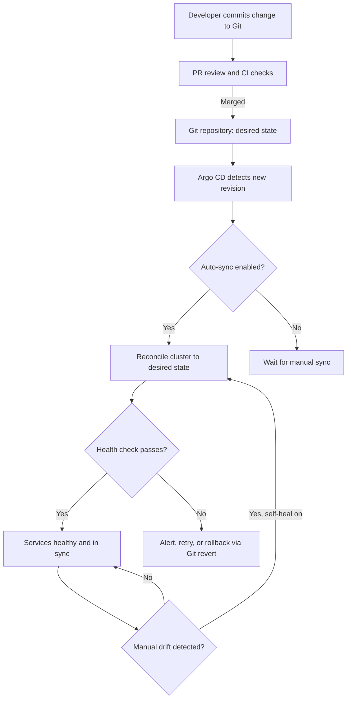

| Difficulty | Channel | Tags |
|---|---|---|
| beginner | devops | argocd, flux, declarative |

On 25 August 2021, an engineer at Skyscanner made what looked like a harmless no-op edit to a root-level templating file, accidentally dropping a pair of `{{ }}` delimiters. The change was peer-reviewed, merged, and auto-rolled out by Argo CD to every region within minutes, triggering a full global outage that lasted 4.5 hours and deleted 478 services worldwide [1]. It is a vivid reminder that GitOps is incredibly powerful, but only when teams understand the mechanics, guardrails, and trade-offs behind declarative delivery.

---

> ### Real-World Case — Skyscanner
>
> Skyscanner ran its travel platform in fault-tolerant 'cells': each region had multiple Kubernetes clusters per availability zone in an n+2 configuration designed to survive losing a whole cluster, all kept in sync by Argo CD reconciling against Git. On 25 August 2021 an engineer made what was intended as a harmless no-op edit to a root-level templating file, accidentally dropping the `{{ }}` delimiters; it was peer-reviewed, merged, and auto-rolled out to every region within minutes.
>
> | | |
> |---|---|
> | **Challenge** | The declarative desired state in Git was now corrupted — every namespace generated from that root file no longer rendered valid definitions. Because Argo CD treats Git as the single source of truth and continuously reconciles actual state toward desired state, the controller had no way to tell that this commit was a mistake rather than intent: it simply converged the clusters to the broken declaration. |
> | **Solution** | Skyscanner used Argo CD with automated sync and pruning (self-healing) — the exact pattern of continuous reconciliation described in the GitOps model. At 16:00 GMT Argo CD faithfully pruned what Git no longer declared and deleted all 478 services across every namespace, availability zone, and region simultaneously. Recovery used the same declarative loop in reverse: once the correct configuration was restored in Git, clusters reconciled themselves back to it, with the team deliberately bringing up one region and prioritizing critical services first. |
> | **Outcome** | A full global outage lasting 4.5 hours — skyscanner.net and the mobile apps were unavailable to all travellers and partners, with all 478 services deleted worldwide. By ~20:30 GMT the site served all traffic from a single restored region; the remaining regions and non-critical services were recovered over the following two days. Postmortem actions included banning global config deploys, treating templated config as code with tests and linting, verifying backups/restore access, and reconsidering how much config is shared across regions. |
> | **Lesson** | In declarative GitOps the reconciler is literal and has no concept of human intent — the same auto-sync plus self-heal/prune that makes drift self-correcting will amplify a single bad commit at machine speed across your entire fleet. 'Git is the source of truth' means Git is also your largest blast radius: declarative config with templating logic needs linting, tests, staged rollouts, and tested backups, while imperative `kubectl` edits are drifted away by self-healing within minutes. The tool that caused the outage was also the only thing that could fix it. |

---

## Hook — The Deploy That Looked Perfectly Safe

Picture a routine pull request: small diff, clean review, green checks, merge. Nothing about it screams danger. Yet in a GitOps world, that merge is not just a code change — it is a production command waiting to be executed automatically [1].

When Skyscanner's platform, organized into fault-tolerant cells across regions, reconciled against the broken template, Argo CD did exactly what it was designed to do: it made the cluster match Git. The result was fast, consistent, and catastrophic. By roughly 20:30 GMT, traffic was serving from a single restored region, while full recovery took two more days [1]. The scary part? The tooling worked as intended. The process around it did not.

## Problem — Why Microservices Make GitOps Both Essential and Risky

Managing dozens or hundreds of microservices with manual `kubectl` commands does not scale. Teams drift out of sync, environments diverge, and nobody can answer the simple question: what is actually running in production? [2]

GitOps addresses this by making Git the single source of truth for desired state. A controller continuously compares what Git declares with what the cluster runs, then reconciles differences automatically [3]. That solves configuration drift and improves auditability, but it also raises the stakes. A bad commit can propagate everywhere quickly. The challenge is not just enabling automation — it is designing automation with blast-radius controls, validation, and clear operational boundaries.

## Real-World Case — Skyscanner

Skyscanner ran its travel platform in fault-tolerant cells, with multiple Kubernetes clusters per availability zone in an n+2 configuration designed to survive losing an entire cluster. Argo CD kept every cluster in sync by reconciling against Git [1].

The incident began with a seemingly harmless edit to a root-level templating file. Missing `{{ }}` delimiters turned the change into a destructive rollout. Because auto-sync was in place, the faulty state spread to every region within minutes. The impact was severe: skyscanner.net and mobile apps were unavailable globally for 4.5 hours, and 478 services were deleted worldwide [1].

Recovery was staged: one region restored first, then remaining regions and non-critical services over two days. The postmortem drove practical changes — banning global config deploys, treating templated config as code with tests and linting, verifying backup and restore access, and reconsidering how much configuration should be shared across regions [1].

## Deep Dive — Declarative vs Imperative in GitOps

The core distinction is simple: **declarative** means describing the desired end state; **imperative** means issuing step-by-step commands to change state [4].

**Declarative approach:**
- Desired state lives in Git as YAML manifests, Helm charts, or Kustomize overlays [5].
- Argo CD continuously reconciles actual cluster state against declared state [6].
- Changes flow through commits, pull requests, reviews, and audit trails.
- Rollbacks are often as simple as reverting a Git commit.

**Imperative approach:**
- Teams run commands like `kubectl apply`, `kubectl edit`, or `kubectl scale` directly against the cluster.
- Changes can bypass Git, creating configuration drift and mystery state [4].
- Emergency fixes are fast, but long-term traceability suffers.

| Dimension | Declarative (GitOps) | Imperative (kubectl) |
|---|---|---|
| Source of truth | Git repository | Cluster/live commands |
| Auditability | High — commit history | Low — scattered command history |
| Drift handling | Continuous reconciliation | Manual detection/fix |
| Rollback | Git revert | Manual reapply or restore |
| Risk profile | Bad commit can auto-propagate | Ad hoc changes cause drift |

💡 **Insight:** Declarative does not mean safe by default. It means consistent by default. Safety comes from guardrails around that consistency [7].

## Workflow — Setting Up ArgoCD for Auto-Sync Microservices

Building on the declarative model, a practical ArgoCD setup for microservices follows a clear workflow. Each step reduces ambiguity about what should run and where [6].

1. **Structure the Git repo:** Store Kubernetes manifests, Helm charts, or Kustomize overlays per service or environment. Keep ownership clear.
2. **Create an Application CRD:** Define an ArgoCD `Application` that points to the repo URL, path, target revision, and destination cluster/namespace [8].
3. **Enable automated sync:** Configure `automated` sync so ArgoCD applies Git changes without manual intervention.
4. **Set health checks and prune:** Let ArgoCD evaluate resource health and prune resources removed from Git.
5. **Enable self-heal:** If someone makes a manual cluster change, ArgoCD reverts it to match Git.
6. **Add guardrails:** Use policy checks, linting, template tests, progressive rollouts, and environment scoping to limit blast radius.

⚠️ **Watch Out:** Auto-sync plus self-heal is powerful, but a globally scoped bad config can become a global outage in minutes — exactly what Skyscanner experienced [1]. Scope applications carefully and validate before merge.

## Code Example — ArgoCD Application with Auto-Sync and Self-Heal

This example shows a minimal but production-minded ArgoCD `Application` manifest for a microservice. It uses Git as the source of truth, enables automated sync, prunes deleted resources, and self-heals drift [6][8].

The key design decision is explicitness: repo, path, revision, destination, and sync policy are all declared in version-controlled configuration. That makes behavior predictable and reviewable. In practice, teams should also add CI validation for manifests and templates before merge, because ArgoCD will faithfully apply whatever Git declares [1][7].

## Lessons Learned — Make GitOps Fast, But Also Safe

Skyscanner's postmortem lessons map directly to everyday GitOps practice: ban risky global config deploys, treat templated config as code with tests and linting, verify backup and restore access, and reduce unnecessary shared configuration [1].

Here is what to do differently tomorrow:
- **Validate before merge:** Lint templates, render Helm/Kustomize output, and run policy checks in CI.
- **Limit blast radius:** Separate apps by environment, region, or cell; avoid one global config controlling everything.
- **Use progressive delivery:** Roll out changes gradually instead of everywhere at once.
- **Keep rollback easy:** Practice Git reverts and verify restore procedures regularly.
- **Treat Git as production control:** Every merge to the watched branch is an operational action, not just a code change [2][3].

🎯 **Key Point:** GitOps gives teams speed, consistency, and auditability. The winning move is pairing that automation with guardrails so one small diff never becomes a global incident.

---

## GitOps Sync Flow

<strong>Original Interview Question</strong>

**Q:** You're setting up GitOps for a microservices deployment. How would you configure ArgoCD to automatically sync changes from your Git repository to Kubernetes, and what's the difference between declarative and imperative approaches in this context?

**A:** I'd configure ArgoCD by setting up a Git repository containing Kubernetes manifests or Helm charts, creating an Application CRD that points to the Git repository, enabling auto-sync with a health check interval of 3 minutes, and implementing self-healing to automatically revert any manual changes. The declarative approach involves defining the desired state in Git through YAML manifests, Helm charts, or Kustomize configurations, where ArgoCD continuously reconciles the actual state with the desired state. In contrast, the imperative approach uses kubectl commands to make direct changes to the cluster, bypassing the Git repository as the single source of truth.

## Conclusion

GitOps with ArgoCD turns Git into the control plane for Kubernetes, giving teams auditability, consistency, and fast delivery. The Skyscanner outage proves the flip side: automation amplifies both good and bad changes. Start by making your desired state declarative, then earn the right to auto-sync with tests, scoped rollouts, and practiced recovery. The next merge to main should be boring — by design.

---

## References

1. [Skyscanner incident report](https://medium.com/@SkyscannerEng/how-a-couple-of-characters-brought-down-our-site-356ccaf1fbc3) — article
2. [GitOps - Wikipedia](https://en.wikipedia.org/wiki/GitOps) — documentation
3. [Kubernetes Controllers](https://kubernetes.io/docs/concepts/architecture/controller/) — documentation
4. [Declarative Management of Kubernetes Objects Using Configuration Files](https://kubernetes.io/docs/tasks/manage-kubernetes-objects/declarative-config/) — documentation
5. [Kubernetes Objects](https://kubernetes.io/docs/concepts/overview/working-with-objects/) — documentation
6. [Argo CD - Declarative GitOps CD for Kubernetes](https://github.com/argoproj/argo-cd) — documentation
7. [How To Deploy to Kubernetes Using Argo CD and GitOps](https://www.digitalocean.com/community/tutorials/how-to-deploy-to-kubernetes-using-argo-cd-and-gitops) — blog
8. [Argo CD Declarative Setup Documentation](https://github.com/argoproj/argo-cd/blob/master/docs/operator-manual/declarative-setup.md) — documentation

---

**Author:** Satishkumar Dhule — [GitHub](https://github.com/satishkumar-dhule) · [LinkedIn](https://linkedin.com/in/satishkumar-dhule) · [Website](https://satishkumar-dhule.github.io)
