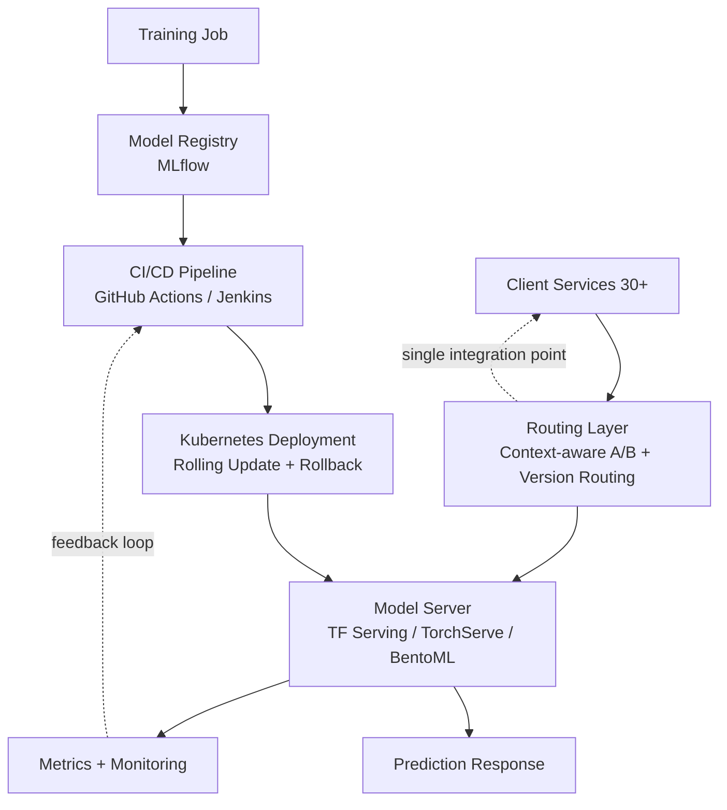

| Difficulty | Channel | Tags |
|---|---|---|
| beginner | devops | mlops, deployment |

Picture a single proxy sitting in the hot path of one million inference requests per second, quietly taxing every recommendation users see with 10–20 milliseconds of delay. That was the reality at Netflix, where the 'Switchboard' routing layer became the mandatory entry point for over 30 member-facing services [1]. Teams needed version-agnostic routing and safe A/B rollouts, but the price was a shared bottleneck nobody could afford to lose. So where does 'deployment' end and 'serving' begin — and why does that boundary decide whether an ML system scales or collapses?

---

> ### Real-World Case — Netflix
>
> By 2025 Netflix's centralized ML serving platform handled hundreds of model types and versions at roughly 1 million inference requests per second across recommendations, commerce, and other member-facing experiences. To let client microservices stay agnostic to model versions, A/B allocations, and shifting compute shards, the team built 'Switchboard,' a proxy that sat directly in the request path and became a mandatory entry point for over 30 services.
>
> | | |
> |---|---|
> | **Challenge** | Switchboard owned request routing, model selection, context enrichment, canaries, and rollbacks — but as a single centralized hop it added 10–20ms of serialization/deserialization latency per request, amplified tail latency, created a single point of failure for many ML experiences, and blurred the line between real and synthetic traffic needed for training. The proxy's generic API-gateway design also couldn't natively integrate Netflix's experimentation platform or model-specific lifecycle stages like shadow mode and rollback. |
> | **Solution** | Netflix kept the control-plane ideas but refactored the data plane: they split responsibilities into 'Lightbulb,' a lightweight service that only resolves minimal request context into routing metadata and model config, and Envoy, which already handled all inter-app egress, to perform the actual cluster/VIP routing via a header-based routingKey. The routing service was removed from the hot path entirely, model inputs were separated from routing metadata to avoid re-serializing large payloads, and client-side caching/fallbacks were added for resilience. |
> | **Outcome** | The redesign preserved the single integration point, context-aware A/B routing, and decoupled model sharding for 30+ client services while serving 1M+ RPS — eliminating the 10–20ms proxy hop, removing a shared single point of failure, and giving per-tenant isolation for diverse latency SLAs (from tens of ms to 300ms+) without losing safe rollout and rollback capabilities. |
> | **Lesson** | In ML serving, keep control-plane intelligence (versioning, experiments, routing rules) out of the synchronous inference path. Push routing to infrastructure that already owns the network hop, and separate metadata from payloads — otherwise the serving layer you built to accelerate iteration becomes the latency and reliability bottleneck. |

---

## Hook — The Hidden Cost Hiding in Your Request Path

A routing layer looks harmless on an architecture diagram — just a box between clients and models. But when that box sits in the synchronous request path of 30+ services, every millisecond it burns is multiplied by a million requests per second. Many developers assume the model itself is the bottleneck, yet the real culprit is often the glue around it: proxies, version shims, and A/B splitters that turn a clean inference call into an obstacle course. Here is the uncomfortable truth — the more 'robust' a deployment pipeline looks on paper, the more likely serving has quietly become the limiting factor. What happens when the thing meant to make rollouts safe becomes the thing that breaks at scale? That tension sits at the heart of this whole topic.

## Problem — Deployment and Serving Are Not the Same Job

That tension explains the confusion heard in countless standups: deployment and serving sound interchangeable, but they solve different problems at different phases of a model's life. Deployment is the journey from code to a running, observable system — CI/CD pipelines, infrastructure provisioning, container images, rollback strategies, and monitoring. Serving is what happens on every single request afterward: loading the model, routing it, batching inputs, and returning a prediction before the user's patience runs out.

Mix them up, and teams end up optimizing Docker image build times while p99 latency quietly doubles.

Here is what you need to know:
- **Deployment answers 'can we ship it safely?'** — versioning, gradual rollout, rollback, and observability [6].
- **Serving answers 'can we answer fast enough?'** — request routing, model loading, autoscaling, and warmup [3].
- **The boundary is where the pain lives.** A change that is trivial in deployment, like swapping a model version, becomes a routing problem in serving when clients must stay agnostic.

This leads to an awkward question: if deployment already handles versions, why does serving need its own version logic? The broader ML engineering literature frames this as a pipeline problem [10], and the Netflix story shows the practical answer — clients rarely care which version they get, but the system absolutely must.

## Real-World Case — Netflix

To see this boundary in the wild, consider Netflix. Its centralized ML serving platform grew into a beast: hundreds of model types and versions pushing roughly one million inference requests per second across recommendations, commerce, and other member-facing experiences [1]. To keep client microservices from caring about model versions, A/B allocations, or which compute shard held the weights, the team built 'Switchboard' — a proxy that sat directly in the request path and became mandatory for over 30 services [1]. It worked, but every request paid a 10–20ms tax, and the whole estate shared one single point of failure.

⚠️ Watch Out: A single integration point is a blessing until it is the only path. The redesign preserved that integration point, the context-aware A/B routing, and the decoupled model sharding — yet stripped out the proxy hop, removed the shared failure domain, and gave each tenant isolation for latency SLAs ranging from tens of milliseconds to 300ms+ [1].

The plot twist? The fix was not 'scale the proxy harder.' It was rethinking where routing belongs — which is exactly the deployment-versus-serving distinction in practice.

## Deep Dive — Where Deployment Ends and Serving Begins

Building on the Netflix case, the distinction becomes surgical. Deployment is a control-plane concern; serving is a data-plane concern. Deployment decides what should run, while serving decides how each request is answered right now.

| Dimension | Deployment (control plane) | Serving (data plane) |
|---|---|---|
| Primary goal | Ship, observe, roll back safely | Answer each request fast and correctly |
| Typical tools | Kubernetes, Terraform, MLflow, SageMaker [2][6][7] | TensorFlow Serving, TorchServe, BentoML, FastAPI, gRPC [3][4][5] |
| Time scale | Minutes to hours per release | Milliseconds per request |
| Failure mode | Bad rollout, missing rollback | Cold starts, p99 spikes, GPU OOM |
| Version concern | Artifact/registry versioning | Request-time version routing |

💡 Insight: A model registry version and a serving route version are different things. Confusing them is how teams ship 'v2' while still serving v1.

**When would you actually use each?**
- Reach for dedicated model servers like TensorFlow Serving or TorchServe when you need battle-tested batching, model warmup, and gRPC performance out of the box [3][4].
- Use BentoML or a FastAPI wrapper when inference logic is custom Python and HTTP flexibility matters more than raw protocol speed [5].
- Choose a managed platform like SageMaker when the team wants infrastructure offloaded and accepts less control [7].

🔥 Hot Take: Kubernetes horizontal pod autoscaling is not a latency strategy — it is a capacity strategy. Reacting to CPU after a traffic spike guarantees the spike gets eaten, because GPU-backed model loads are slow to warm [2][9].

This leads to the trade-off nobody puts on a slide: latency versus throughput. Real-time paths target sub-100ms, often sub-50ms, while batch pipelines happily tolerate under one second. Batching improves GPU utilization but adds queueing delay — the classic 'fast for one, slow for many' paradox. Many developers discover this only after a dashboard shows beautiful GPU utilization and terrible tail latency.

## Workflow — From Commit to Prediction

Consequently, the cleanest mental model is a two-lane highway. The deployment lane moves artifacts; the serving lane moves requests. The 'Model Serving Request Flow' diagram below shows how those lanes meet at the model server.

1. **Train and register.** A training job produces an artifact logged to a registry such as MLflow, which records parameters, metrics, and lineage [6].
2. **Package.** The artifact and its runtime dependencies get baked into a container, so the environment stays reproducible.
3. **Deploy through CI/CD.** A GitHub Actions or Jenkins pipeline pushes the image to Kubernetes, which rolls pods gradually and supports instant rollback [2].
4. **Route at serving time.** A client call hits an API gateway or Envoy-style proxy, which applies context-aware A/B rules and version routing [1].
5. **Infer and observe.** The model server batches the request, returns a prediction, and emits latency and error metrics that feed monitoring and close the loop [3][9].

⚠️ Watch Out: Step 4 is where the Netflix team found their trap — a proxy in the hot path is convenient until it is mandatory. Keep routing decisions close to the data plane, not inside a shared bottleneck.

But wait, it gets better: once routing is context-aware, the same infrastructure can serve a 30ms recommendation call and a 300ms commerce call from one platform without either tenant stepping on the other.

## Code Example — A Production-Shaped Serving Shim

To make this concrete, here is a version-aware inference shim that mirrors the routing shape described above. It keeps the serving concern (routing, warmup, latency budgets) separate from the deployment concern (building and shipping the container).

```python
# serving/app.py - a version-aware inference shim
import time
from dataclasses import dataclass

from fastapi import FastAPI, HTTPException

app = FastAPI()

@dataclass
class ModelHandle:
    name: str
    version: str
    latency_budget_ms: int
    loaded_at: float

# Registry of loaded models keyed by (name, version)
MODELS: dict = {}

def load_model(name: str, version: str, budget: int) -> ModelHandle:
    # Simulate the expensive weights load / warmup step
    time.sleep(0.05)
    return ModelHandle(name, version, budget, time.time())

@app.on_event("startup")
async def warmup() -> None:
    # Warm the default model so first requests avoid a cold start
    MODELS[("recommender", "v2")] = load_model("recommender", "v2", 45)

@app.post("/predict/{model_name}")
async def predict(model_name: str, payload: dict) -> dict:
    version = payload.get("version", "v2")
    key = (model_name, version)
    if key not in MODELS:
        # Lazy-load unknown versions on first use, then cache the handle
        MODELS[key] = load_model(model_name, version, 45)
    handle = MODELS[key]
    started = time.perf_counter()
    features = payload.get("features", [1])
    # Real servers batch here; this stub keeps the routing shape visible
    score = sum(features) / max(len(features), 1)
    elapsed_ms = (time.perf_counter() - started) * 1000
    if elapsed_ms > handle.latency_budget_ms:
        # Surface budget breaches instead of silently eating the SLA
        raise HTTPException(status_code=503, detail="latency budget exceeded")
    return {"model": handle.name, "version": handle.version, "score": score}
```

**What is happening, line by line:**
- `ModelHandle` stores the version and its own latency budget, so different tenants can carry different SLAs — the per-tenant isolation Netflix leaned on [1].
- `MODELS` is an in-process cache keyed by `(name, version)`, representing the request-time version routing that deployment artifacts alone do not provide.
- `load_model` simulates the expensive weight load; the `warmup` startup hook pays that cost once so the first real request avoids a cold start.
- `predict` applies a client-agnostic default version, lazy-loads unknown versions, and measures elapsed time with `time.perf_counter()`.
- The `HTTPException` on budget breach is the crucial production pattern: surface SLA violations loudly instead of silently absorbing them.

## Lessons Learned — Battle Scars and Better Defaults

From that shim to a million requests per second, every team scaling ML serving collects a few scars. Here are the ones worth skipping.

**Battle scars:**
- **Treating the router as free.** Netflix proved a proxy in the hot path costs 10–20ms per request [1]. Measure the plumbing, not just the model.
- **Confusing registry version with route version.** A team can deploy v2 and still serve v1 if the routing layer ignores the registry [6].
- **Autoscaling after the spike.** GPU warmup is slow; scale on leading indicators rather than lagging CPU [2][9].
- **One SLA to rule them all.** A 30ms recommender and a 300ms commerce path have nothing in common; isolate tenants [1].
- **Ignoring the protocol.** gRPC and HTTP each have a place, and dedicated servers make that choice for you [4][5].

🎯 Key Point: Deployment earns trust through safe rollouts; serving earns trust through predictable latency. Both matter, but they fail in completely different ways.

If this feels overwhelming, start small — instrument one route, measure one p99, and let the data argue for the redesign. Sound familiar? It should; this is the same journey every mature ML platform eventually takes.

---

## Model Serving Request Flow



<details>
<summary><strong>Original Interview Question</strong></summary>

**Q:** Explain the key differences between model serving and model deployment in ML systems, including specific technologies, scaling considerations, and real-world implementation patterns?

**A:** Deployment encompasses CI/CD pipelines, infrastructure setup, and monitoring using tools like Kubernetes, MLflow, and SageMaker. Serving focuses on runtime inference APIs with frameworks like TensorFlow Serving, TorchServe, or BentoML, handling request routing, model versioning, and autoscaling. Key trade-offs include latency vs throughput, batch vs real-time inference, and cold start optimization.

</details>

## Conclusion

Netflix's million-RPS reckoning teaches a lesson that fits any team: the safest integration point and the fastest request path are not enemies — but only if routing lives where the data flows [1]. Tomorrow, map your own request path and find the box that every caller must traverse; time it, then ask whether it is earning its milliseconds. The one insight worth sharing with your team: deployment decides what ships, while serving decides what survives contact with production. Get that boundary right, and 1M RPS stops being a fire drill and becomes just another Tuesday.

---

## References

1. [Netflix incident report](https://netflixtechblog.com/state-of-routing-in-model-serving-16e22fe18741) — article
2. [Kubernetes Concepts Overview](https://kubernetes.io/docs/concepts/overview/) — documentation
3. [TensorFlow Serving — GitHub Repository](https://github.com/tensorflow/serving) — documentation
4. [TorchServe — GitHub Repository](https://github.com/pytorch/serve) — documentation
5. [BentoML — GitHub Repository](https://github.com/bentoml/BentoML) — documentation
6. [MLflow — GitHub Repository](https://github.com/mlflow/mlflow) — documentation
7. [Amazon SageMaker Developer Guide](https://docs.aws.amazon.com/sagemaker/latest/dg/whatis.html) — documentation
8. [Machine Learning — Wikipedia](https://en.wikipedia.org/wiki/Machine_learning) — documentation
9. [Horizontal Pod Autoscaling — Kubernetes Documentation](https://kubernetes.io/docs/tasks/run-application/horizontal-pod-autoscale/) — documentation
10. [Towards ML Engineering: A Brief History of TensorFlow Extended (TFX)](https://arxiv.org/abs/2010.02013) — paper

---

**Author:** Satishkumar Dhule — [GitHub](https://github.com/satishkumar-dhule) · [LinkedIn](https://linkedin.com/in/satishkumar-dhule) · [Website](https://satishkumar-dhule.github.io)
