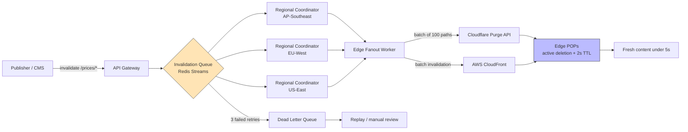

| Difficulty | Channel | Tags |
|---|---|---|
| intermediate | system-design | edge, caching, purging |

A purge issued in Sydney once had to cross the Pacific before it could reach Sydney. That was the awkward reality of Cloudflare's original 'flexible purge' system: a request born in Australia traveled to a core data center in the United States before it propagated anywhere else [1]. As purge volume grew to millions of API calls per day, Quicksilver write limits, Kafka buffers, and purge-history storage on every machine turned a simple cache clear into a global waiting game [1]. The fix did not add more servers — it moved the decision-making to the edge and cut median purge latency from 1,570ms to 149ms [1].

---

> ### Real-World Case — Cloudflare
>
> Cloudflare's original 'flexible purge' system (by tag, hostname, prefix) used its Quicksilver config database in a hub-and-spoke model: a purge issued in Australia had to cross the Pacific to a core data center before propagating anywhere. As customers grew to millions of purge API calls per day, purge-history storage ate into cache disk space on every machine, Quicksilver hit write-throughput limits, and Kafka buffers added latency — while users in far-flung regions still saw stale prices and news.
>
> | | |
> |---|---|
> | **Challenge** | Propagate invalidations to hundreds of data centers across 330 cities in 120+ countries in well under a 5-second SLA, without a centralized write bottleneck, without purge-history storage that scales with throughput, and without exposing stale content during propagation. |
> | **Solution** | They eliminated the core entirely ('Coreless Purge'): requests are ingested at the nearest PoP by Workers, purged locally to derive the cache key, queued in regional Durable Objects that track per-datacenter pointers for replay and catch-up, then broadcast via regional Fanout Workers. Last-mile fan-out runs in CacheDB, a per-machine Rust/RocksDB sidecar that indexes files by tag/hostname/URL and actively deletes them; the cache proxy checks CacheDB's pending-purge queue on every HIT, so stale files are never served even while physical deletion is in progress. |
> | **Outcome** | Global P50 purge latency dropped from 1,570ms (May 2022) to 149ms (August 2024) — a 90.5% improvement — with regional gains of 79–89%; the Fanout Worker alone cut end-to-end latency 50% and tripled throughput. Active deletion saved 10x storage versus lazy purge and unlocked purge-by-tag/hostname/prefix for Free, Pro, and Business plans; Enterprise limits now allow 5,000 keys/sec. |
> | **Lesson** | The fastest way to scale a centralized purger was to delete the center: push state to regional replicated queues and indexes to individual machines, and make the correctness check cheap at read time. Counterintuitively, their long-held assumption that proactive disk purging was too expensive was wrong — per-machine RocksDB indexes made active deletion cheaper than maintaining lazy-purge history. |

---

## Hook — The purge that crossed an ocean

⚡ **A purge issued in Sydney once crossed the Pacific before it could reach Sydney.** That is the story behind Cloudflare's instant-purge rewrite: median purge latency sat at 1,570ms in May 2022, and most of that time was spent on travel rather than actual work [1]. Picture a price correction that has already been published, a news fix that needs to land now, and a cache that politely keeps serving yesterday's bytes. The stakes are not academic — every extra second of staleness is a wrong checkout total, a broken layout, or a headline nobody should still be seeing. Sound familiar? Then hold on, because the fix was not 'add more servers.' It was a rethink of where the brain of the system lives, and the plot twist involves storing *less* data, not more.

## Problem — Five seconds, ten thousand requests, zero staleness

Building on that latency gap, the core challenge is simple to state and miserable to implement: invalidate cached copies spread across hundreds of points of presence within five seconds while absorbing 10,000 invalidation requests per second. An edge node caches by design, and HTTP caching rules explicitly allow stale responses until freshness or validation says otherwise [2][3]. When a publisher calls a purge endpoint, that call is not a database `UPDATE`; it is a distributed recall notice with no global clock and no atomic commit [4]. Strong consistency across regions sounds wonderful until the network partitions, and then the choice becomes 'serve stale content' or 'serve nothing.' Many developers discover this the hard way at 2am, staring at a dashboard reporting 99.99% availability while the support queue tells a different story. ⚠️ **Watch Out:** treating a purge API as a synchronous RPC is the fastest way to turn a cache platform into a queueing simulator. The real question is not whether to purge, but how much staleness to tolerate while the purge is in flight — and that question gets a surprisingly practical answer in the next section.

## Real-World Case — Cloudflare

However, theory only gets interesting when a real system hits its ceiling. Cloudflare's original 'flexible purge' — by tag, hostname, and prefix — relied on the Quicksilver configuration database in a hub-and-spoke layout [1]. A purge issued in Australia crossed the Pacific to a core data center before it propagated anywhere, and with millions of purge API calls per day, three pressures stacked up at once: purge-history storage consumed cache disk on every machine, Quicksilver hit write-throughput limits, and Kafka buffers injected extra latency [1]. The response was architectural rather than cosmetic. Active deletion replaced lazy purge, a Fanout Worker pushed coordination out to the edge, and regional purge reduced cross-region chatter [1]. 🔥 **Hot Take:** the most counterintuitive result was storage. Active deletion used 10x less space than lazy purge, which is the opposite of what most caching intuition suggests. By August 2024, global P50 purge latency had fallen from 1,570ms to 149ms — a 90.5% improvement — with regional gains of 79–89%; the Fanout Worker alone cut end-to-end latency by 50% and tripled throughput [1]. Purge by tag, hostname, and prefix became available on Free, Pro, and Business plans, and Enterprise limits climbed to 5,000 keys per second [1]. The lesson is not that one vendor is fast. It is that the network hop is often the real bottleneck — a CDN, after all, is a distributed system built precisely to fight distance [5]. So how does that insight become a design you can actually ship?

## Deep Dive — Consistency, queues, and the 2-second safety net

Building on that discovery, the design space comes down to three trade-offs that must be made explicitly. First: freshness versus availability. A 2-second TTL with `Cache-Control: max-age=2, must-revalidate` provides a bounded staleness window even when the purge infrastructure is having a bad day [2][3]. That is not strong consistency; it is a safety net that makes eventual consistency feel acceptable to humans. Second: where coordination happens. A central coordinator simplifies reasoning but exports latency to every region, while edge workers invert that arrangement and keep decisions close to the cache [7]. Third: how work is queued. A managed queue such as Amazon SQS provides durable buffering and redrive, while Redis Streams with consumer groups provide ordering and explicit acknowledgement [6][8].

| Decision | Option A | Option B | Real tradeoff |
|---|---|---|---|
| Expiry | Lazy purge with 2s TTL only | Active purge plus 2s TTL | Lazy is cheap but stale; active costs writes but meets the 5s SLA |
| Queue | Redis Streams | Managed SQS | Streams give ordering control; SQS gives durability with less operational work |
| Fanout | Central coordinator | Edge Fanout Worker | Central is simpler; edge cut Cloudflare latency by 50% [1] |
| Scope | Purge every region | Purge affected regions only | Global purge is safe but costly; regional purge saves cross-region traffic |

Here is what you need to know before committing:

- **Batch ruthlessly.** Groups of 100 paths per API call cut request overhead dramatically and keep provider rate limits quiet [4].
- **Back off with jitter.** Exponential retries without jitter turn one partial failure into a synchronized stampede; cap at three attempts and randomize.
- **Fail fast.** A circuit breaker after five consecutive failures protects both origin and queue.
- **Dead-letter everything.** Failed invalidations need a replay path, not a silent log line [8].
- **Reconcile during partitions.** Eventual consistency with a reconciliation pass beats blocking publishers indefinitely.

🎯 **Key Point:** use this architecture when freshness is a product promise — pricing, news, inventory. If assets are immutable and fingerprinted in their filenames, a long TTL and no purge is the better hero. Still wondering whether TTL or purge does the heavy lifting? The next section turns these trade-offs into an ordered plan.

## Workflow — From API call to edge fanout

This leads to the execution path, where the abstract trade-offs become an ordered sequence of moves. The Mermaid flowchart labelled 'Invalidation Flow' below tells the visual story from publisher to edge POP:

1. A publisher submits `invalidate /prices/*` through an API Gateway with authentication and rate limiting [9].
2. The gateway writes the invalidation into a durable stream, assigning a region scope and correlation ID [6].
3. Regional coordinators consume via consumer groups, deduplicate paths, and form batches of 100.
4. Edge Fanout Workers fan the batch out to Cloudflare's purge API and CloudFront invalidations in parallel [4][7].
5. Successful batches are acknowledged; retries use exponential backoff with jitter, and exhausted messages land in a dead-letter queue [8].
6. Edge POPs apply active deletion while the 2-second TTL acts as the final freshness backstop [1][2].
7. Coordinators run as resilient workloads with health checks and rolling restarts, the kind of placement Kubernetes handles well [10].

⚠️ **Watch Out:** acknowledging a queue entry *before* the purge succeeds is the classic bug — it quietly loses invalidations during a partial failure. Regional rollback and a reconciliation loop cover the case where one provider accepts the purge and another does not. With the flow mapped, the remaining question is what the code actually looks like when it has to survive all of this.

## Code Example — Batch purge consumer with backoff

Consequently, the implementation in the code block focuses on one narrow but critical job: draining a stream, batching paths, and purging with retries that do not amplify an outage. The example mirrors the production pattern of batch invalidation plus bounded retry [4][6]. First, `backoffMs` doubles the wait on each attempt but caps it at eight seconds and multiplies by a random jitter factor, so thousands of consumers do not retry in lockstep. Second, `purgeWithRetry` sends a single POST containing up to 100 wildcard paths — exactly the kind of batch Cloudflare's purge API accepts — and treats any non-2xx status as a failure. Third, the loop retries at most three times before rethrowing, which is the signal to move the message to a dead-letter queue instead of retrying forever [8]. Fourth, `drainBatch` deduplicates paths with a `Set`, calls the provider, and only then acknowledges the stream entries — the acknowledgement ordering that prevents silent invalidation loss. Finally, the returned metadata gives the caller a quick view of region and batch size for tracing and SLA dashboards. 💡 **Insight:** the code is deliberately boring. In invalidation systems, boring code with explicit failure paths is a feature; clever code that hides partial failures is how stale prices reach production. Adapt the provider call for CloudFront invalidations in the same loop, and pipe failures into your replay queue rather than logging and moving on.

## Lessons Learned — Battle scars and better defaults

Building on the journey from a Pacific-crossing purge to edge fanout, a few lessons are worth pinning above the desk. **Battle scar #1:** assuming purge history is free. Cloudflare found it eating cache disk on every machine, and active deletion stored 10x less [1]. **Battle scar #2:** treating every region identically. Millions of daily purge calls make global fanout expensive; purge only the affected regions and let the 2-second TTL cover the rest [1][3]. **Battle scar #3:** trusting unbounded retries. Three attempts plus jitter, a five-failure circuit breaker, and a dead-letter queue are the unglamorous trio that keeps a 10,000/sec stream from becoming a self-inflicted DDoS. **Battle scar #4:** forgetting that CDN semantics are HTTP semantics; RFC 9111 exists for a reason and is worth reading before designing a freshness SLA [2]. Teams have all been there — a green dashboard and a cache serving last week's content.

For tomorrow, the practical checklist is short: measure purge P50 and P99 by region, put a TTL under every dynamic object, batch purges at the gateway, and rehearse replay from the dead-letter queue. 🔥 **Hot Take:** the 5-second SLA is less about raw speed and more about removing unnecessary hops — Cloudflare's own 90.5% gain came from moving coordination, not from buying faster disks [1]. The one insight to share with your team: **a purge is a distributed recall notice, not a database write — so design the delivery path, not just the API call.** But before closing, it is worth revisiting where this whole story began.

---

## Invalidation Flow

<strong>Original Interview Question</strong>

**Q:** How would you design a multi-region CDN cache purging system that guarantees content propagation within 5 seconds while handling 10,000 concurrent invalidations per second?

**A:** Implement Cloudflare API + AWS CloudFront with distributed invalidation queue, edge compute coordination, and 2-second TTL. Use batch invalidation, exponential backoff, and regional cache headers for 5-second SLA.

## Conclusion

The story started with an invalidation in Sydney that had to visit the United States before coming home. It ends with a different mental model: purges are distributed recall notices, and the winning move is to shorten the delivery path rather than brute-force the compute. Cloudflare's 1,570ms-to-149ms journey proves the payoff — 90.5% lower median latency, 50% less end-to-end time from the Fanout Worker, and 10x less storage [1]. Tomorrow, put a 2-second TTL under dynamic content, batch your purges, acknowledge only after success, and rehearse the dead-letter replay. One idea to take into the next design review: if the network hop is the bottleneck, no amount of CPU will save you — move the decision to the edge and let the TTL catch the leftovers.

---

## References

1. [Cloudflare incident report](https://blog.cloudflare.com/instant-purge/) — article
2. [RFC 9111: HTTP Caching](https://datatracker.ietf.org/doc/html/rfc9111) — documentation
3. [MDN Web Docs: HTTP caching](https://developer.mozilla.org/en-US/docs/Web/HTTP/Caching) — documentation
4. [AWS CloudFront: Invalidating Files](https://docs.aws.amazon.com/AmazonCloudFront/latest/DeveloperGuide/Invalidation.html) — documentation
5. [Wikipedia: Content delivery network](https://en.wikipedia.org/wiki/Content_delivery_network) — documentation
6. [DigitalOcean: How To Install and Secure Redis on Ubuntu 22.04](https://www.digitalocean.com/community/tutorials/how-to-install-and-secure-redis-on-ubuntu-22-04) — documentation
7. [GitHub: cloudflare/workers-sdk](https://github.com/cloudflare/workers-sdk) — documentation
8. [AWS SQS Developer Guide](https://docs.aws.amazon.com/AWSSimpleQueueService/latest/SQSDeveloperGuide/welcome.html) — documentation
9. [AWS API Gateway Developer Guide](https://docs.aws.amazon.com/apigateway/latest/developerguide/welcome.html) — documentation
10. [Kubernetes: Overview](https://kubernetes.io/docs/concepts/overview/) — documentation

---

**Author:** Satishkumar Dhule — [GitHub](https://github.com/satishkumar-dhule) · [LinkedIn](https://linkedin.com/in/satishkumar-dhule) · [Website](https://satishkumar-dhule.github.io)
