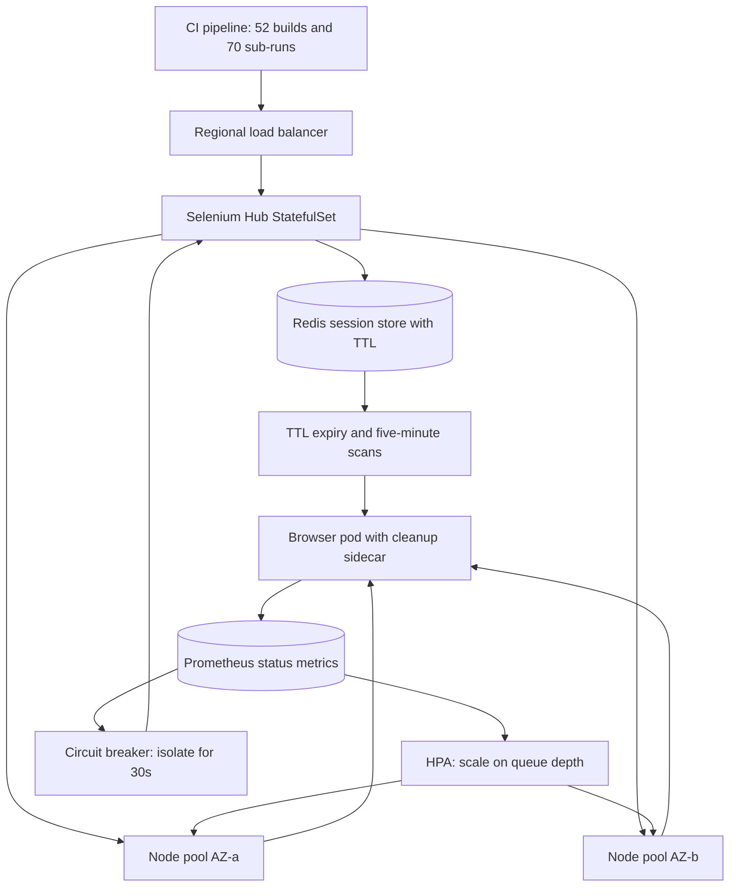

| Difficulty | Channel | Tags |
|---|---|---|
| advanced | system-design | selenium, webdriver, grid |

13.6 million test executions in a single day, about one million of them Selenium runs, and a static pool of 1,200 browser VMs sitting roughly half idle while builds stalled. That was the daily reality at Salesforce, where 75,000 tests fanned out across 52 auto-builds and up to 70 parallel sub-runs [1]. The painful part was not the scale; it was the mismatch. Capacity existed, but stale testbeds and burst demand meant the wrong tests grabbed the wrong machines at the wrong moment. Sound familiar?

---

> ### Real-World Case — Salesforce
>
> Salesforce was running ~13.6 million test executions daily, including ~1 million Selenium runs, across 75,000 distinct tests and 52 auto-builds that could fan out to 70 parallel sub-runs. Their static pool of ~1,200 browser VMs sat at only ~50% utilization while flaky 'stale' testbeds and burst demand caused failures and wasted spend.
>
> | | |
> |---|---|
> | **Challenge** | The classic Selenium Grid hub-and-node model with a fixed VM pool could not deliver deterministic, isolated testbeds at this scale: machines leaked state between runs, utilization was poor, and there was no way to absorb sudden 1,000s-of-tests bursts or shift capacity when a cloud region struggled. |
> | **Solution** | Salesforce built the 'Dynamic Grid' — instead of maintaining long-lived Grid nodes, they used Selenium with JClouds to provision identical, disposable testbeds on demand across both EC2 and OpenStack, triggered by Perforce code changes. Failed/flaky tests ('flappers') were auto-rerun on fresh environments with bugs filed automatically, and capacity was shifted across clouds for burst scalability. |
> | **Outcome** | ~13.6M daily test executions with ~1M Selenium runs sustained; 75,000 tests across 52 builds with up to 70 parallel sub-runs; ~1,200 static VMs at ~50% utilization replaced by on-demand provisioning that improved utilization, determinism, and burst handling. |
> | **Lesson** | At extreme scale the answer was to question Selenium Grid itself — the talk literally includes a chapter titled 'Why NOT Selenium Grid?'. Treating browser nodes as ephemeral, disposable cattle (fresh VM per test, auto-rerun, auto-file bugs) beat trying to keep a persistent Grid healthy, prefiguring today's per-session Kubernetes/Dynamic Grid patterns. |

---

## Hook — The day the browser pool stopped behaving like a pool

That Salesforce snapshot is not a typo, and it is the perfect opening scene for anyone designing a grid at this scale. Picture 10,000 concurrent test sessions knocking on the door at once, each demanding a fresh browser, a clean profile, and a predictable slice of memory. Now add a promise of 99.9% uptime, which works out to roughly 43 minutes of downtime per month — a budget that evaporates fast when nodes leak memory or vanish mid-run.

The stakes are not abstract. A flaky grid means delayed releases, wasted cloud spend, and developers blaming 'the tests' when the real culprit is infrastructure. Here is the twist that catches many teams off guard: adding more VMs often makes the problem worse. Why would throwing hardware at the issue backfire?

## Problem — Why static grids buckle under bursty load

Building on that paradox, the core challenge is not raw throughput; it is lifecycle control under uneven demand. A static pool of 1,200 browsers looks generous until 52 builds each spawn 70 sub-runs and every sub-run wants a session in the same minute. Queues explode, stale sessions linger, and memory creeps upward until a node dies mid-test.

The arithmetic is deceptively simple: 10,000 sessions divided by 50 sessions per node gives a minimum of 200 nodes, and at 2 GB per pod that is 400 GB of baseline RAM, or about 520 GB with a 30% buffer [2]. Yet those numbers are the easy part. The hard part is guaranteeing that every session releases its browser, its socket, and its temp files even when the test crashes, the node disappears, or the network partitions.

Many developers discover the hard way that a grid without automatic session expiry is just a very expensive memory leak with a dashboard. So what does a system that never leaks actually look like?

## Real-World Case — Salesforce

That mismatch is exactly what Salesforce confronted, and the documented numbers make the lesson concrete [1]. Roughly 13.6 million executions per day flowed through the pipeline, with Selenium accounting for around one million of them across 75,000 distinct tests. The static fleet of about 1,200 browser VMs ran at only ~50% utilization, which sounds inefficient until the bursts arrive: then 'stale' testbeds and sudden demand caused failures precisely when capacity was needed most.

The fix was not 'buy more VMs.' Teams moved toward on-demand provisioning, which improved utilization, determinism, and burst handling at the same time. Notice the counterintuitive insight hiding in that story: utilization went up while failures went down, because capacity became elastic rather than fixed. That raises the obvious follow-up question — which pieces of the architecture have to change to make elasticity safe?

## Deep Dive — From 200 nodes to self-healing sessions

Building on Salesforce's pivot, the architecture has to treat sessions as ephemeral by design, not as objects somebody remembers to clean up. The hub-node pattern puts a central Selenium Hub in front of browser nodes managed by Kubernetes StatefulSets spread across availability zones [4][6][7]. Redis holds session metadata with TTL-based expiration, so a session that stops renewing simply disappears instead of haunting a node forever. Resource limits — 2 GB RAM and 1 CPU per pod — make noisy neighbors predictable, while horizontal pod autoscaling reacts to queue depth rather than guesswork [2][3]. Regional load balancing across zones follows the same multi-AZ auto scaling logic cloud providers recommend [8].

Here is the plot twist: the hub is intentionally not the source of truth; Redis is. That separation is what lets a hub restart without losing a single session.

However, memory hygiene needs more than TTLs. Weekly rolling restarts, memory alerts at 80%, and garbage collection tuning handle slow leaks, while init containers sweep stale Docker volumes and Redis key scans run every five minutes. Prometheus scrapes /status metrics every 10 seconds and Grafana surfaces memory trends; three consecutive failures pull a node out of rotation, and a circuit breaker isolates it for a 30-second recovery window [5][9]. Netflix famously popularized this breaker pattern with Hystrix after navigating its own cloud turbulence, proving that failing fast beats failing slowly [10].

When would teams actually use all of this? Whenever tests outnumber any single machine, whenever release trains cannot afford 43 minutes of downtime, or whenever browser profiles accumulate like unread email. Consider the real tradeoffs:

| Decision | Static VM pool | Kubernetes + Redis grid |
| --- | --- | --- |
| Burst handling | Pre-provisioned, often idle | Autoscales on queue depth [3] |
| Session cleanup | Manual, leak-prone | TTL expiry plus periodic sweeps |
| Node failure | Restart and hope | Circuit breaker plus automatic failover [9] |
| Cost profile | Pay for peak always | Pay closer to actual demand |

💡 Insight: elasticity is only safe when teardown is automatic. An elastic grid with manual cleanup is just a faster way to create messes.

Moreover, multi-AZ deployment with leader election prevents split-brain during network partitions, and Pod Disruption Budgets keep at least 85% of capacity alive during upgrades [11]. Canary deployments with traffic splitting catch zero-day browser bugs before they reach every suite. But a diagram of healthy components is not the same as a healthy system under load — so how does one session actually move through it?

## Workflow — A session's journey from CI trigger to clean teardown

This leads to the journey of one session, from CI trigger to final cleanup. The Mermaid diagram in this article maps the path visually, and the numbered steps translate it into behavior that makes sense even when the pager goes off at 2am.

1. A build from CI — one of 52 auto-builds, possibly with 70 sub-runs — hits the regional load balancer, which uses weighted round-robin based on node capacity and response time.
2. The Selenium Hub registers the request in Redis with a TTL, then routes it to a browser pod in the healthiest zone [6].
3. A sidecar container starts the browser with a clean profile; resource limits cap the pod at 2 GB and 1 CPU [4].
4. While the test runs, heartbeats renew the TTL and Prometheus scrapes /status every 10 seconds [5].
5. Three failed health checks or a memory spike open the circuit breaker, isolating that node for 30 seconds [9].
6. On completion or crash, TTL expiry and the cleanup sidecar reclaim the session, volumes, and sockets — no manual janitorial work.
7. Horizontal pod autoscaling watches queue depth and adds nodes before the backlog becomes a pileup [3].

The visual story is simple: requests flow downward, metrics flow sideways, and cleanup closes the loop. Yet diagrams do not delete Redis keys or reset breakers — code does. Which brings the story to the implementation.

## Code Example — The janitor that makes zero leaks possible

Building on the workflow, the snippet in the codeExample block implements the unglamorous part that keeps the whole promise honest: session registration, TTL renewal, stale-key reaping, and node isolation. Think of it as the janitor with a stopwatch.

- `start_session` writes node metadata and arms a 1,800-second TTL in one shot, so a forgotten session dies on schedule.
- `heartbeat` renews the TTL and publishes queue depth, giving autoscaling a signal instead of a guess [3].
- `reap_stale_sessions` scans keys in batches and deletes those whose owning node is gone, which is the safety net behind the 'zero leak' claim.
- `isolate_node` opens a 30-second circuit breaker by writing an expiring key, the same pattern Netflix made famous [10].

Notice what is missing: no cleanup thread that must be remembered, no infinite loop waiting for a graceful shutdown. The expiry is the cleanup. But before copying this into production, there are battle scars worth knowing — and one of them involves TTLs that are a little too generous.

## Lessons Learned — Battle scars and the so-what

After following the path from Salesforce's 13.6 million daily executions to a self-healing grid, the lesson is less about browsers and more about defaults [1]. Here are the battle scars teams collect the hard way, plus what to do differently tomorrow.

- ⚠️ Watch Out: Treating TTL as a formality. If renewal outlives reality, stale sessions survive and the leak returns; keep TTL shorter than the longest sane test.
- ⚠️ Watch Out: Scaling on CPU alone. Browser tests queue on session availability, so queue depth is the honest signal [3].
- 💡 Insight: A hub that can die without data loss is a hub that never owned the data; Redis is the source of truth.
- 🔥 Hot Take: 99.9% uptime is not a dashboard color, it is roughly 43 minutes per month — design failure windows around that number, not around optimism.
- 🎯 Key Point: Circuit breakers are a feature, not a patch. Isolation for 30 seconds turns a cascading failure into a blip [9].

If this feels overwhelming, teams are not alone — start with one cluster, one TTL policy, and one health endpoint, then earn the complexity. Many developers think the win is 'more nodes' until they learn the win is 'nodes that disappear cleanly.' The memorable line to share with the team: a scalable grid is not one that never fails, it is one that fails without leaving evidence behind. That circles straight back to Salesforce's half-idle VMs: the future of test infrastructure is not bigger pools, it is smarter lifecycles.

---

## Session Lifecycle Flow

<strong>Original Interview Question</strong>

**Q:** Design a scalable Selenium Grid architecture to handle 10,000 concurrent test sessions with 99.9% uptime, ensuring zero memory leaks through automatic session lifecycle management, real-time monitoring, and graceful node failure recovery across multiple data centers?

**A:** Deploy Kubernetes cluster with auto-scaling node pools, Redis session store with TTL policies, Prometheus metrics for memory monitoring, circuit breakers for node isolation, and sidecar containers for session cleanup. Implement health checks, resource quotas, and rolling updates.

## Conclusion

The journey started with 13.6 million daily executions and a fleet of half-idle VMs [1], and it ends with one practical rule for tomorrow: make every session expire by default, every node disposable, and every metric actionable. Add one TTL policy, one queue-depth autoscale rule, and one circuit breaker to the next test infrastructure review. The grid will not become perfect — it will become forgetful in exactly the right way, and that is what 99.9% uptime actually looks like.

---

## References

1. [Salesforce incident report](https://youtu.be/zFv-4AsPLmY) — article
2. [Kubernetes: Resource Management for Pods and Containers](https://kubernetes.io/docs/concepts/configuration/manage-resources-containers/) — documentation
3. [Kubernetes: Horizontal Pod Autoscaling](https://kubernetes.io/docs/tasks/run-application/horizontal-pod-autoscale/) — documentation
4. [Kubernetes: StatefulSets](https://kubernetes.io/docs/concepts/workloads/controllers/statefulset/) — documentation
5. [Prometheus monitoring system source repository](https://github.com/prometheus/prometheus) — documentation
6. [SeleniumHQ Selenium source repository](https://github.com/SeleniumHQ/selenium) — documentation
7. [Selenium (software) - Wikipedia](https://en.wikipedia.org/wiki/Selenium_(software)) — documentation
8. [AWS: What is Amazon EC2 Auto Scaling?](https://docs.aws.amazon.com/autoscaling/ec2/userguide/what-is-amazon-ec2-auto-scaling.html) — documentation
9. [Circuit breaker design pattern - Wikipedia](https://en.wikipedia.org/wiki/Circuit_breaker_design_pattern) — documentation
10. [Netflix Hystrix source repository](https://github.com/Netflix/Hystrix) — documentation
11. [Kubernetes: Configuring Pod Disruption Budgets](https://kubernetes.io/docs/tasks/run-application/configure-pdb/) — documentation

---

**Author:** Satishkumar Dhule — [GitHub](https://github.com/satishkumar-dhule) · [LinkedIn](https://linkedin.com/in/satishkumar-dhule) · [Website](https://satishkumar-dhule.github.io)
