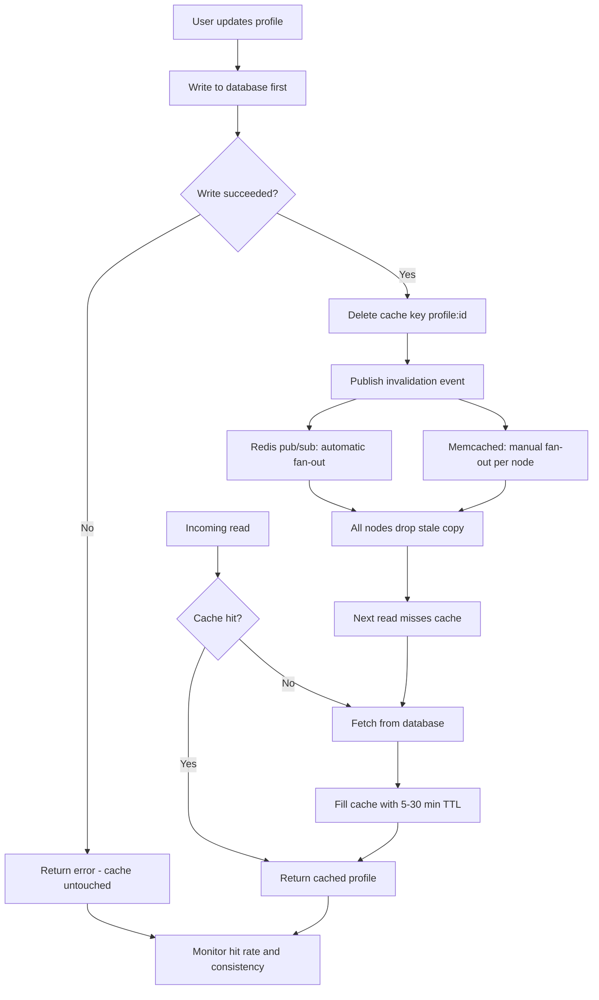

| Difficulty | Channel | Tags |
|---|---|---|
| beginner | backend | redis, memcached, cache-invalidation |

At Meta, a single cache inconsistency once left Bob's and Mary's messages to Alice in two different regions — neither saw a complete conversation, and to the user it looked exactly like data loss [1]. This was not a dramatic outage; it was a silent, one-in-a-billion interleaving hiding inside TAO, a system that serves over a quadrillion queries a day. Picture the stakes: when a cache is wrong, users do not file a ticket about cache invalidation — they simply stop trusting the product. That is the world of cache invalidation, and it is exactly where this story begins.

---

> ### Real-World Case — Meta (Facebook)
>
> Meta runs some of the world's largest cache deployments — TAO and Memcache — with TAO alone serving more than a quadrillion queries a day. Even at a 99% hit rate that means over 10 trillion cache fills daily, and cache state is mutated on both the read (fill) and write (invalidate) paths. In one messaging system, an inconsistent TAO replica after a user's primary message store was reshuffled caused Bob's and Mary's messages to Alice to land in two different regions, leaving neither with a complete conversation — indistinguishable from data loss to the user.
>
> | | |
> |---|---|
> | **Challenge** | A cache fill can race an invalidation: an old value fetched from the database arrives after the newer invalidation and gets written back, leaving stale data cached indefinitely. Version checks don't fully help because the newer version can be evicted before the stale fill lands, and logging every cache mutation at 10 trillion fills/day would turn a read-heavy workload into an unsupportable write-heavy logging load — so Meta had no way to even measure how inconsistent its caches were. |
> | **Solution** | Meta built Polaris, a service that treats the cache as a black box and checks client-observable invariants by pretending to be a cache server, receiving invalidation events and then querying cache replicas for violations. Multi-timescale (1/5/10-minute) reporting with retries avoids false positives and defers expensive cache-bypass database queries. They also built a stateful consistency-tracing library that logs mutations only inside the narrow window after an invalidation where races can occur, embedded across cache services and the invalidation pipeline — which exposed a five-step bug where an error handler's drop_cache(key, version) silently refused to evict a stale item that carried the latest version. |
> | **Outcome** | By one measure, TAO cache consistency improved from 99.9999% (six nines) to 99.99999999% (ten nines) — fewer than 1 in 10 billion cache writes remains inconsistent after five minutes. Polaris alarmed immediately on the rare interleaving bug, and consistency tracing let on-call engineers locate it in under 30 minutes instead of the weeks an expert would previously have needed. |
> | **Lesson** | Deleting a key or relying on TTL is not invalidation correctness — fills and invalidations race, and non-durable caches can lose the very version metadata needed to resolve them. The bigger lesson is that designing a consistent cache and operating one are different problems: you need a false-positive-free consistency SLO plus tracing restricted to the race window, or you'll never find the bugs hiding in error-handling code. |

---

## Hook — The Message That Vanished Into Thin Air

Picture this: Alice sends a message to Bob, then Mary sends her a message too. Both belong to the same conversation — except they do not. One lands in a replica in one region, the other in a different region, and Alice is left staring at half a conversation [1]. No error. No 500. Just silence where a reply should be.

Here is the thing about cache bugs: they rarely announce themselves. A stale key does not throw an exception; it confidently serves the wrong answer at lightning speed, which is arguably worse. When that answer is a user's profile picture or, in Meta's case, a message, the damage is measured in trust, not error logs.

Sound familiar? Many developers discover this only after a support ticket says 'the app deleted my messages' — when nothing was actually deleted. The data was there, quietly cached in the wrong place. That tension — fast but sometimes wrong — is the thread running through everything below. So how does a system serving a quadrillion queries keep its promises?

## Problem — When Fast Goes Wrong

Building on that unease, the core problem is deceptively simple: a cache is a copy, and copies drift. The moment a user updates their profile, two sources of truth exist — the database and the cache — and something has to reconcile them. Miss that handoff and stale data reaches millions of users who just refreshed their browser.

💡 Insight: Cache invalidation is hard not because deleting a key is hard, but because knowing exactly when and where to delete it across distributed nodes is hard.

The stakes rise with scale. Consider the numbers from Meta's own infrastructure: TAO alone handles more than a quadrillion queries daily, and even a 99% hit rate leaves over 10 trillion cache fills every day [1]. Cache state is mutated on both the read path (fills) and the write path (invalidations), so the surface area for mistakes is enormous.

- Stale reads: users see old avatars, old bios, old permissions.
- Thundering herds: a bad invalidation stampede can hammer the database.
- Partial failure: the database write succeeds, the cache delete fails, and nobody notices until Monday.

You might think 'just set a short TTL and move on.' However, TTLs are a trade-off: shorten them and you trade consistency for load; lengthen them and you trade load for staleness. What happens when even a short TTL is not good enough?

## Real-World Case — Meta (Facebook)

This leads directly to one of the most-documented cache consistency journeys in the industry. Meta runs some of the world's largest cache deployments — TAO and Memcache — and its engineers published a detailed account of making cache state consistent [1].

In one messaging system, an inconsistent TAO replica appeared after a user's primary message store was reshuffled. Consequently, Bob's and Mary's messages to Alice ended up in two different regions, leaving neither with a complete conversation — indistinguishable from data loss to the user [1].

🔥 Hot Take: At a billion-user scale, 'eventually consistent' can be indistinguishable from 'broken.' Users do not care about your consistency model; they care that their messages are there.

The fix was not a single line of code but a program of work. Polaris alarmed immediately on the rare interleaving bug, and consistency tracing let on-call engineers locate it in under 30 minutes instead of the weeks an expert previously needed [1]. By one measure, TAO cache consistency improved from 99.9999% (six nines) to 99.99999999% (ten nines) — fewer than 1 in 10 billion cache writes remains inconsistent after five minutes [1].

Think about that: six nines sounds almost perfect, yet it was not good enough. What does that tell you about your own 'good enough' assumptions?

## Deep Dive — Write-Through, Cache-Aside, and the Redis vs Memcached Riddle

Building on Meta's lesson, the practical question becomes: what pattern should your profile service actually use? Most teams land on a hybrid. Reads follow the cache-aside pattern — check the cache first, fall back to the database, then fill the cache. Writes use a write-through approach: update the database, then write the new value or delete the key in the cache, with a TTL as a safety net.

⚠️ Watch Out: Deleting the key on update is often safer than blindly overwriting the cache. If two writes race, an overwrite can resurrect stale data; a delete forces the next read to fetch the truth. This is the classic delete-versus-update debate.

TTLs for user profiles typically sit in the 5–30 minute range — long enough to absorb traffic spikes, short enough that a missed invalidation heals itself. The broader principle, that freshness and speed are negotiable, even shows up in HTTP caching standards [6][7] and general caching literature [9].

Now the plot twist: the Redis-versus-Memcached choice is not really about speed. Both are extremely fast [2][3]. The real difference is what else they bring to the party.

| Option | What it gives you | The real trade-off |
|---|---|---|
| Redis [2][4] | Pub/sub for distributed invalidation, persistence, advanced data structures | More moving parts; higher memory overhead |
| Memcached [3][8] | Simpler architecture, lower memory overhead, easy horizontal scaling | No persistence, no pub/sub — manual coordination across nodes |

Redis pub/sub lets every application node subscribe to invalidation events, so a profile update in one region can instantly evict stale keys everywhere else [4]. Memcached, by contrast, requires manual coordination — every node must be told, or staleness lingers until the TTL expires [3]. Managed offerings such as AWS ElastiCache let teams run either engine without babysitting servers [5].

🎯 Key Point: Choose Redis when invalidation patterns are complex or durability matters; choose Memcached when you need boring, cheap, horizontal caching and can tolerate manual invalidation.

Moreover, distributed invalidation across multiple servers is where theory meets pain. Consequently, monitoring cache hit rates and write latency is not optional — it is how teams notice that a deployment quietly dropped hit rates from 98% to 70%. What does the actual sequence look like end to end?

## Workflow — Mapping the Invalidation Journey

Building on the pattern above, here is the workflow your profile service can follow, illustrated in the diagram below. The Mermaid flowchart labeled 'Profile Cache Invalidation Flow' shows the read and write paths converging on a single source of truth.

1. Read request arrives → check the cache for key profile:{id}.
2. Cache hit → return immediately, no database touch.
3. Cache miss → query the database, then fill the cache with a 5–30 minute TTL.
4. Update request arrives → write to the database first (the authoritative store).
5. Invalidate → delete the key locally and publish an invalidation event (Redis pub/sub) or fan out manually (Memcached).
6. Observe → track hit rate, eviction count, and write latency.

⚠️ Watch Out: Always write to the database before invalidating the cache. Reversing the order can let a concurrent read refill the cache with old data right after your delete — a bug that feels personally offended by your existence.

Picture the flow in the diagram: the write path fans out to every node, while the read path always knows where to find the truth. But what does this look like in code that could actually run? That is next.

## Code Example — A Profile Service That Actually Invalidates

Building on that workflow, here is the thing: diagrams are easy, code is where the trade-offs get real. The Python example in the code block implements cache-aside reads, write-through updates with delete-based invalidation, TTL safety nets, and Redis pub/sub fan-out using the standard redis-py client [4].

Step by step, here is what happens. First, a small `ProfileDB` stand-in represents the authoritative database layer, so the pattern stays obvious. Next, `get_profile` checks the cache and returns JSON on a hit; on a miss it queries the database and fills the cache with `setex`, which atomically sets a value and a TTL. Then `update_profile` writes to the database first, deletes the key rather than overwriting it, publishes an invalidation event, and optionally warms the cache with the fresh value. Finally, `listen_for_invalidations` runs in a background thread on each application node and deletes stale copies whenever an event arrives.

🔥 Hot Take: The delete-then-publish order is deliberate. Publish first and a node can refill stale data between your delete and its eviction — a race that only shows up under load, naturally.

This pattern directly solves the problem from earlier: two writes racing can no longer resurrect old profile data, and a missed event still self-heals when the TTL expires. Would this survive a multi-region deploy? That depends on the engine you picked — and on what you choose to measure.

## Lessons Learned — What Ten Nines Teaches Your Next Deploy

Building on the code above, the final chapter is about habits, not libraries. Meta's journey from six nines to ten nines [1] shows that consistency is a program, not a configuration flag.

Battle scars worth avoiding:

- Assuming a TTL alone is invalidation. It is a safety net, not a strategy.
- Overwriting cache entries on write instead of deleting them — races will bite.
- Forgetting the fan-out: one node's delete is not a cluster's delete.
- Ignoring observability: without hit-rate and consistency metrics, the bug finds you first.

🎯 Key Point: Treat every cache write as a distributed transaction you cannot roll back — design the invalidation path before the happy path.

So what changes tomorrow? Add a consistency metric to your profile service, pick a TTL in the 5–30 minute band, and write down which engine you chose and why. If invalidation patterns are simple and cost matters, Memcached is a perfectly respectable choice [3][8]; if you need pub/sub and durability, Redis earns its keep [2][4].

The memorable line to take to your team: a cache never lies on purpose — it just tells the truth from five minutes ago, and at scale that is close enough to a lie to matter.

---

## Profile Cache Invalidation Flow

<strong>Original Interview Question</strong>

**Q:** You're building a user profile service that caches frequently accessed profiles. How would you implement cache invalidation when a user updates their profile, and what trade-offs would you consider between Redis and Memcached?

**A:** Implement write-through caching with TTL-based expiration. On profile update, invalidate the cache by deleting the key and writing new data to both the database and cache. Redis offers pub/sub for automatic distributed invalidation, while Memcached requires manual coordination across nodes.

## Conclusion

Alice's split conversation started with a single inconsistent replica [1]. The journey through that bug led you through the problem of drifting copies, the staggering numbers behind a quadrillion queries, the Redis-versus-Memcached trade-off, a concrete workflow, and working code. The moral: cache invalidation is not a footnote in system design — it is the moment your architecture either keeps its promise to users or quietly breaks it. Tomorrow, audit one invalidation path, add one metric, and make your cache honest about its age.

---

## References

1. [Meta (Facebook) incident report](https://code-dev.fb.com/2022/06/08/core-infra/cache-made-consistent/) — article
2. [Redis - Wikipedia](https://en.wikipedia.org/wiki/Redis) — documentation
3. [Memcached - Wikipedia](https://en.wikipedia.org/wiki/Memcached) — documentation
4. [redis/redis GitHub repository](https://github.com/redis/redis) — documentation
5. [What is Amazon ElastiCache? - AWS Documentation](https://docs.aws.amazon.com/AmazonElastiCache/latest/dg/WhatIs.html) — documentation
6. [HTTP caching - MDN Web Docs](https://developer.mozilla.org/en-US/docs/Web/HTTP/Caching) — documentation
7. [RFC 7234: HTTP/1.1 Caching](https://datatracker.ietf.org/doc/html/rfc7234) — documentation
8. [memcached/memcached GitHub repository](https://github.com/memcached/memcached) — documentation
9. [Cache (computing) - Wikipedia](https://en.wikipedia.org/wiki/Cache_(computing)) — documentation

---

**Author:** Satishkumar Dhule — [GitHub](https://github.com/satishkumar-dhule) · [LinkedIn](https://linkedin.com/in/satishkumar-dhule) · [Website](https://satishkumar-dhule.github.io)
