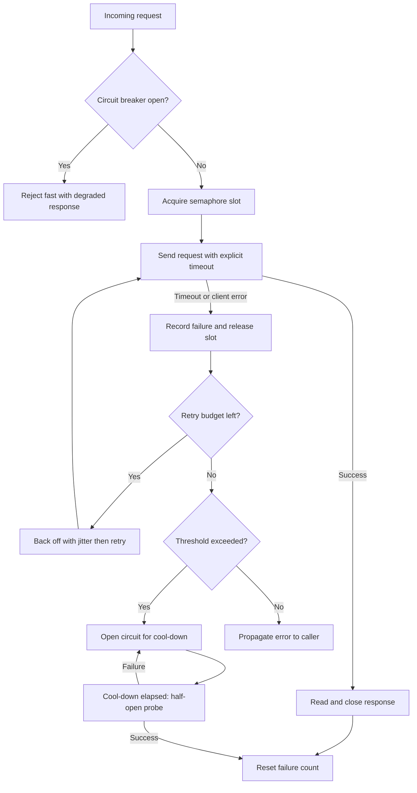

| Difficulty | Channel | Tags |
|---|---|---|
| advanced | backend | asyncio, aiohttp, concurrency |

Picture a single API handling more than one billion incoming calls a day, fanning each one out roughly six times into dozens of backend subsystems, and peaking above 100,000 dependency requests per second [1]. That was Netflix's reality, and one hung downstream service could saturate every Tomcat request thread in seconds and take the whole API down. The fallout gave the world Hystrix, which eventually executed more than 10 billion thread-isolated and 200 billion semaphore-isolated calls daily across 100+ command types and 40+ thread pools [1]. The lesson lands squarely in modern async Python: a connection pool without graceful degradation is just a very organized way to collapse.

---

> ### Real-World Case — Netflix
>
> Netflix's API was a single point of failure for 1,000+ devices: each of its 1+ billion daily incoming calls fanned out roughly 1:6 into several billion calls across dozens of backend subsystems, peaking above 100,000 dependency requests per second. Because those dependencies were treated as black-box client libraries, one slow or hung downstream service could saturate every Tomcat request thread in seconds and take down the whole API — Hystrix was born directly from a string of production incidents involving saturated connection/thread pools, misconfigured queues and timeouts.
>
> | | |
> |---|---|
> | **Challenge** | Isolate network calls so a latent or failing dependency cannot exhaust the shared pool and cascade into a full outage, while still serving users instead of letting requests pile up. Even 30 dependencies at 99.99% uptime yields only ~99.7% composite uptime (~2+ hours of downtime/month) without fault tolerance. |
> | **Solution** | Built Hystrix: wrap every dependency call in a command guarded by a small per-dependency bulkhead — non-blocking tryable semaphores for trusted/in-memory calls and bounded thread pools for network calls — with aggressive timeouts set near the 99.5th percentile, retries, and a circuit breaker that trips at ~50% errors over 10 seconds to shed load. Any timeout, semaphore/pool rejection, or short-circuit routes through a fallback (stale cache, queued writes, defaults, or an empty 'fail silent' response) for graceful degradation, with properties tunable live in production. |
> | **Outcome** | Hystrix came to execute 10+ billion thread-isolated and 200+ billion semaphore-isolated calls per day across 100+ command types and 40+ thread pools, with Netflix reporting a dramatic improvement in uptime. In real incidents and Latency Monkey chaos tests, a single latent circuit could be short-circuited across nearly the whole cluster while all other circuits stayed healthy — users got a degraded but functional experience with no spike in 500s. |
> | **Lesson** | The counterintuitive part: when a dependency goes slow, the worst response is enlarging pools, queues, and timeouts to 'give it breathing room.' If 10 threads are saturated, 20 will be too — now 2,000 hung connections pound an already-struggling backend, effectively DDoS-ing yourself. Circuit breakers are the release valve: shed load, fail fast, let the downstream recover, then re-admit traffic via health checks. |

---

## Hook — The Deploy Looked Fine. Then the Pager Woke Up.

A dependency nobody had thought about in months started answering in 4 seconds instead of 40 milliseconds. The fan-out did the rest: each incoming call triggered about six more, so a modest trickle of slow calls became a wall of waiting coroutines [1]. HTTP keep-alive keeps TCP connections reusable [8], which is wonderful until every reusable connection is parked on the same unhealthy endpoint. Now picture 100,000 dependency requests per second arriving at a pool with no opinion about failure. What breaks first: the pool, the queue, or the caller's patience?

Here is the thing though — the pool rarely crashes. It quietly fills up, and everything behind it inherits the slowness. That is the failure mode worth fearing, because the dashboard still shows green while users stare at a spinner. Sound familiar?

## Problem — When a Pool Becomes a Queue for Pain

Building on that slow-burn failure, the real challenge is not opening connections; it is deciding who waits, who fails fast, and who gets a second chance. In asyncio, a Semaphore is the natural concurrency valve, and Python's docs describe it as a counter that suspends waiters once the count reaches zero [3]. aiohttp already exposes a connector with its own limit and keepalive settings [5], so developers often ask why another layer is needed. The answer is policy: the connector caps sockets, while the manager owns retries, timeouts, and failure state.

⚠️ Watch Out: a naive `async with session.get(url)` that returns the response object is a classic leak. Once the context exits, the response is released; callers who read its body later discover an unpleasant surprise. Read and close inside the context.

Here is what you need to know:
- Timeouts must be explicit; asyncio does not magically interrupt a hung socket read [4].
- Cancellation should propagate, not vanish inside a bare `except Exception`.
- SSL verification belongs in the connector, never in a `ssl=False` shortcut added on a bad Friday afternoon.
- Browser-style AbortController cancellation has an asyncio analogue in task cancellation [10].

Many developers think more retries equal more resilience. Actually, retries without backoff are an amplifier: three retries across a fan-out of six can turn one slow call into twenty-one attempts. So what stops the amplification before it stops the service?

## Real-World Case — Netflix

That question was answered the hard way at Netflix. Its edge API was a single point of failure for more than 1,000 device types, handling over one billion incoming calls per day and fanning them out roughly 1:6 into dozens of backend subsystems, with peaks above 100,000 dependency requests per second [1]. Because dependencies arrived as black-box client libraries, one slow or hung service could saturate every Tomcat request thread in seconds and take the entire API down.

Consequently, Hystrix was born from a run of production incidents involving saturated thread and connection pools, misconfigured queues, and timeouts that were far too generous [2]. The plot twist: the fix was not 'tune the timeout again.' It was isolation plus fast failure. Later, Hystrix executed more than 10 billion thread-isolated and 200 billion semaphore-isolated calls per day across 100+ command types and 40+ thread pools [1].

💡 Insight: in Latency Monkey chaos tests, a single latent circuit could be short-circuited across nearly the whole cluster while every other circuit stayed healthy. Users received a degraded-but-functional experience, not a spike in 500s [1]. When would that matter for you? Any time one dependency is optional but its latency is not.

The lesson crossed directly into async Python: protect the caller from the dependency, not the dependency from the caller. But how does that protection behave once real traffic arrives?

## Deep Dive — Semaphores, Backoff, and the Circuit Breaker

Building on Netflix's isolation lesson, an aiohttp manager needs three cooperating mechanisms, and each one solves a different failure.

- **Semaphore limiting** caps concurrent in-flight requests. It is cheap, precise, and maps neatly onto Python's asyncio semaphore [3]. It does not make slow calls faster; it merely makes the waiting explicit.
- **Exponential backoff with jitter** spreads retries over time. Doubling the delay after each failure is the classic pattern [6], and jitter stops a synchronized herd of clients from retrying in lockstep.
- **Circuit breaker** tracks failure state and rejects calls before they consume a slot. The design pattern is documented well beyond Netflix's implementation [7], and modern reliability guidance treats graceful degradation as a first-class requirement [9].

Here is a comparison that tends to settle architecture debates:

| Option | Best for | Real tradeoff |
|---|---|---|
| Semaphore-only pool | Bounded concurrency, cheap calls | A slow dependency still occupies every slot |
| Thread/partition isolation | Blast-radius control, sync clients | Memory and context-switch overhead [2] |
| Retry with backoff | Transient blips | Adds load; needs a strict budget [6] |
| Circuit breaker | Persistent downstream failure | Needs careful thresholds or it flaps [7] |

🔥 Hot Take: a semaphore is not a bodyguard. It just counts chairs. If every chair is occupied by a request waiting on a dead service, the pool is healthy by every metric except the one users care about.

🎯 Key Point: keep-alive reduces TCP overhead [8], but it also means a poisoned connection can be reused. Health checks and pruning belong in the connector lifecycle, not in hope. For example, pass a verified SSL context and a bounded `keepalive_timeout`.

When would you actually use all three? Use semaphore limiting for every outbound fan-out client, add backoff only for idempotent calls, and add a breaker when a dependency has shown it can fail for minutes at a time. Theory is tidy; production is not. What does the flow look like once everything is wired together?

## Workflow — A Request Through the Manager

This leads directly to the flow below. The diagram traces one request from arrival to a fast rejection, a successful read, or a breaker-open cool-down.



Step by step:
1. Check breaker state before doing any work. An open circuit rejects immediately instead of queueing behind a doomed request [7].
2. Acquire a semaphore slot; this is the concurrency valve [3].
3. Send the request with an explicit total and connect timeout [4].
4. Read and close the response inside the context manager, then reset failure state on success [5].
5. On timeout or client error, record the failure, release the slot, and retry only within a small budget using jittered backoff [6].
6. Once the threshold is crossed, open the circuit for a cool-down window, then allow one half-open probe before closing it again.

⚠️ Watch Out: retries must respect the same timeout budget. Otherwise five retries of a 30-second timeout produce a 150-second 'quick' failure that nobody requested.

Now the interesting part: how much of this fits in a class a team can actually maintain?

## Code Example — A Pool That Refuses to Drown

Here is a production-shaped implementation. It keeps the session lifecycle explicit, reads responses inside the context, and makes the breaker state machine observable instead of magical.

```python
import asyncio
import random
import ssl
import time
from dataclasses import dataclass
from typing import Any, Optional

import aiohttp

@dataclass
class BreakerConfig:
    failure_threshold: int = 5
    reset_timeout: float = 60.0

class CircuitOpen(aiohttp.ClientError):
    # Breaker rejection before any network work.
    pass

class ConnectionPoolManager:
    def __init__(
        self,
        max_connections: int = 100,
        max_retries: int = 3,
        request_timeout: float = 30.0,
        breaker: Optional[BreakerConfig] = None,
    ) -> None:
        self._slots = asyncio.Semaphore(max_connections)  # concurrency valve
        self._timeout = aiohttp.ClientTimeout(total=request_timeout, connect=5.0, sock_connect=5.0)
        self._connector = aiohttp.TCPConnector(
            limit=max_connections,
            keepalive_timeout=30.0,
            ssl=ssl.create_default_context(),  # verify certificates, never ssl=False
        )
        self._session: Optional[aiohttp.ClientSession] = None
        self._breaker = breaker or BreakerConfig()
        self._max_retries = max_retries
        self._failures = 0
        self._last_failure = 0.0
        self._state = 'closed'
        self._probe_in_flight = False
        self._lock = asyncio.Lock()

    async def __aenter__(self) -> ConnectionPoolManager:
        self._session = aiohttp.ClientSession(timeout=self._timeout, connector=self._connector)
        return self

    async def __aexit__(self, exc_type: Any, exc: Any, tb: Any) -> None:
        await self.close()

    async def close(self) -> None:
        if self._session is not None:
            await self._session.close()  # release sockets and DNS caches on shutdown
            self._session = None

    async def _check_breaker(self) -> None:
        async with self._lock:
            now = time.monotonic()
            if self._state == 'open' and now - self._last_failure >= self._breaker.reset_timeout:
                self._state = 'half-open'  # allow one probe after cool-down
            if self._state == 'open':
                raise CircuitOpen('circuit open: failing fast')
            if self._state == 'half-open':
                if self._probe_in_flight:
                    raise CircuitOpen('half-open: probe already in flight')
                self._probe_in_flight = True

    async def _on_success(self) -> None:
        async with self._lock:
            self._failures = 0
            self._probe_in_flight = False
            self._state = 'closed'

    async def _on_failure(self) -> None:
        async with self._lock:
            self._failures += 1
            self._last_failure = time.monotonic()
            self._probe_in_flight = False
            if self._failures >= self._breaker.failure_threshold:
                self._state = 'open'

    async def make_request(self, url: str) -> Any:
        for attempt in range(self._max_retries + 1):
            await self._check_breaker()
            async with self._slots:
                try:
                    assert self._session is not None
                    async with self._session.get(url) as response:  # response closes here
                        response.raise_for_status()
                        payload = await response.json()  # read before context exits
                    await self._on_success()
                    return payload
                except (asyncio.TimeoutError, aiohttp.ClientError):
                    await self._on_failure()
                    if attempt >= self._max_retries:
                        raise
                    delay = min(0.5 * 2 ** attempt, 8.0)  # exponential backoff cap
                    await asyncio.sleep(delay + random.uniform(0.0, delay / 2))  # jitter
        raise RuntimeError('unreachable')
```

Walking through it:
- `__aenter__` creates one `ClientSession` and a `TCPConnector` with a verified SSL context; `__aexit__` closes it, which is the shutdown step most often forgotten [5].
- `_check_breaker` transitions an expired open state into half-open and allows exactly one probe, so a recovering dependency is tested gently.
- `make_request` acquires the semaphore, sends with the configured timeout, and reads JSON before the response leaves the context.
- `_on_failure` increments the count under a lock and opens the circuit after the threshold; `_on_success` resets it. Locking avoids concurrent failures overwriting the counter [3].
- The retry loop uses `0.5 * 2 ** attempt`, capped at 8 seconds, plus jitter, then re-raises the original error [6].
- `CircuitOpen` subclasses `ClientError`, so callers can catch it alongside ordinary aiohttp failures.

🎯 Key Point: the response is never returned raw. Returning a `ClientResponse` after its context closes is the most common bug in home-grown aiohttp pools. Here is the thing though — even this class cannot save a caller that treats an optional dependency as mandatory. That is a design decision, not a code decision.

## Lessons Learned — Traffic Cops With Memories

Bringing the journey back to that billion-call API: resilience is a set of decisions made before the incident, not a heroic patch during it.

- **Bound concurrency early.** A semaphore is cheap; an unbounded queue is a latency bomb [3].
- **Fail fast, then recover slowly.** Breakers protect the pool; backoff protects the dependency [7][6].
- **Clean up rigorously.** Close sessions, read responses, and propagate cancellation [4][5].
- **Measure the right thing.** Track breaker openings, slot wait time, and retry counts, not just 500s [9].

Battle scars worth remembering:
- Threshold too low: a breaker flaps and turns a blip into an outage. Threshold too high: it never opens before saturation.
- `ssl=False` in production is how 'temporarily' becomes forever.
- Retries on non-idempotent POSTs can duplicate writes; use an idempotency key.
- No half-open probe means recovery can require a manual restart.

So what changes tomorrow? Add one semaphore to your outbound client, set an explicit total timeout, and write a single test that trips the breaker. Then tell your team this: 'A connection pool is not a pipe; it is a traffic cop with a memory.' That is the insight that survives the next 3am page.

---

## Request Flow Through the Pool


<details>
<summary><strong>Original Interview Question</strong></summary>

**Q:** How would you implement a connection pool manager for aiohttp that handles graceful degradation under high load and connection timeouts?

**A:** Implement a connection pool manager for aiohttp using a semaphore to limit concurrent connections, exponential backoff for retrying failed requests, and circuit breaker pattern to gracefully degrade under high load and connection timeouts.

</details>

## Conclusion

Netflix turned a string of saturated-pool incidents into Hystrix, and the same shape of thinking fits an aiohttp client today: isolate, bound, back off, and degrade on purpose [1][2]. The one idea worth carrying forward is that slowness is contagious, and a pool without a breaker is simply a very polite way to spread it. Tomorrow, pick one outbound dependency, cap its concurrency, set its timeout, and add a single test that trips the breaker. Your future on-call self will send a thank-you note.

---

## References

1. [Netflix incident report](https://netflixtechblog.com/introducing-hystrix-for-resilience-engineering-13531c1ab362) — article
2. [Netflix Hystrix GitHub repository](https://github.com/Netflix/Hystrix) — documentation
3. [Python asyncio synchronization primitives](https://docs.python.org/3/library/asyncio-sync.html) — documentation
4. [Python asyncio tasks and cancellation](https://docs.python.org/3/library/asyncio-task.html) — documentation
5. [aiohttp GitHub repository](https://github.com/aio-libs/aiohttp) — documentation
6. [Exponential backoff](https://en.wikipedia.org/wiki/Exponential_backoff) — documentation
7. [Circuit breaker design pattern](https://en.wikipedia.org/wiki/Circuit_breaker_design_pattern) — documentation
8. [RFC 7230: HTTP/1.1 Message Syntax and Routing](https://datatracker.ietf.org/doc/html/rfc7230) — documentation
9. [AWS Well-Architected Framework: Reliability Pillar](https://docs.aws.amazon.com/wellarchitected/latest/reliability-pillar/welcome.html) — documentation
10. [MDN: AbortController](https://developer.mozilla.org/en-US/docs/Web/API/AbortController) — documentation

---

**Author:** Satishkumar Dhule — [GitHub](https://github.com/satishkumar-dhule) · [LinkedIn](https://linkedin.com/in/satishkumar-dhule) · [Website](https://satishkumar-dhule.github.io)
