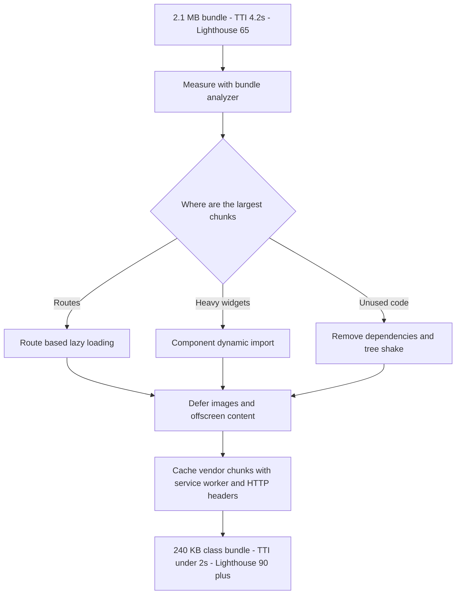

| Difficulty | Channel | Tags |
|---|---|---|
| intermediate | frontend | lighthouse, bundle, lazy-loading |

Picture this: a support chat widget loads on thousands of customer websites, and every visitor downloads 600 KB of JavaScript before a single pixel of the interface appears. That was Intercom's Messenger, whose frame.js bundle nearly doubled from 400 KB to 600 KB gzipped in a single year while shipping dozens of new versions daily [1]. The fix was not a heroic rewrite; it was a systematic dismantling of the bundle that cut it to 240 KB, saved up to 11 seconds on slow 3G, and pushed Lighthouse from 59 to 100 [1]. The same playbook applies to any React app staring down a 2.1 MB bundle and a 4.2-second Time to Interactive.

---

> ### Real-World Case — Intercom
>
> Intercom's Messenger — a React app embedded on thousands of customer websites — had grown from a 400 KB to nearly 600 KB gzipped single JavaScript bundle (frame.js) in a single year. Because it ships dozens of new versions daily, every visitor was re-downloading the entire app, including code and styles they never used.
>
> | | |
> |---|---|
> | **Challenge** | Reduce the initial payload of a third-party React widget that must feel instant on other companies' sites, without breaking features or slowing down hosts' pages (a factor in Google search rankings). |
> | **Solution** | Analyzed the bundle with webpack-bundle-analyzer, then: split stable vendor packages (React, Redux, Lodash) into a separately cached bundle; added route-based code splitting via a modified Loadable component; moved Sass styles to CSS-in-JS (Emotion) so 4,000+ CSS rules load only with their components; used dynamic imports to load just one translation locale (saving 55 KB); removed a 36 KB public-suffix-list package by moving cookie logic server-side; stopped bundling Sentry by default (25 KB); used babel-plugin-lodash to cut Lodash from 25 KB to 11.7 KB; and switched a CSS package import to CSS/lib/parse (10 KB to 1.7 KB). Counterintuitively, since splitting added network latency, they preload the Messenger chunk the instant a user hovers over the launcher — before any click. |
> | **Outcome** | Messenger bundle fell from ~600 KB to 240 KB gzipped (65% smaller), cutting up to 5 seconds of load time on fast 3G and up to 11 seconds on slow 3G. Lighthouse score rose from 59 to 100, and returning visitors no longer re-download unchanged vendor code. |
> | **Lesson** | Bundle size is a cumulative tax: measure with an analyzer, split by cache lifetime (vendor vs. app), defer non-critical code and styles with dynamic imports, and hide the latency cost of code splitting by prefetching on intent signals like hover. |

---

## Hook — The deploy looked fine. Then the bundle doubled.

Nothing breaks. No red error page. No angry customer ticket. The build passes, the feature ships, and the widget still opens. Yet somewhere between release 1 and release N, a 400 KB JavaScript file quietly became 600 KB, and every visitor on every customer site paid for that growth with their connection [1].

That is the uncomfortable thing about bundle bloat: it never announces itself. It accumulates one import at a time, one convenience library at a time, until a Lighthouse score of 65 starts looking normal and a 4.2-second Time to Interactive gets shrugged off as "just how the app is."

Sound familiar? The stakes are not academic. On fast 3G, Intercom's heavy bundle cost up to 5 extra seconds; on slow 3G, up to 11 [1]. A visitor who abandons a chat before it opens is a visitor who never sees the product. So what exactly is hiding inside those megabytes, and how does a team pull the thread without unraveling the app?

## Problem — Shipping the whole app to everyone, everywhere, every time

The core problem is deceptively simple: a monolithic bundle forces every visitor to download, parse, compile, and execute code for features they may never touch. A 2.1 MB bundle is not just 2.1 MB over the wire. It is also main-thread work, and main-thread work is what pushes Time to Interactive to 4.2 seconds.

Three forces make this worse:

- **Frequent releases.** When a widget ships dozens of versions a day, cache invalidation becomes brutal. Returning visitors re-download unchanged vendor code simply because it was bundled next to code that did change [1].
- **Embedded contexts.** A React app living inside someone else's page cannot assume a fast device, a warm cache, or a clean network. Every kilobyte competes with the host site.
- **Developer convenience.** Importing an entire charting library for one sparkline feels harmless. Multiplied across a codebase, it becomes a 600 KB invoice.

Many developers discover this the hard way: the profiler shows parsing, not rendering, as the bottleneck. The render function is innocent. The download is the crime scene.

💡 **Insight:** Bundle size is a product metric wearing a developer costume. Lighthouse scores move when bytes and main-thread work move, not when the component tree gets prettier.

## Real-World Case — Intercom

Intercom's Messenger is a React app embedded on thousands of customer websites, delivered as a single frame.js file. Over one year, that file grew from roughly 400 KB to nearly 600 KB gzipped. Because the Messenger shipped dozens of new versions daily, every visitor re-downloaded the entire application, including styles and code that never rendered for them [1].

The team treated the bundle as a budget, not a metric. They broke the monolith apart so unchanged vendor code could be cached independently, loaded features only when needed, and stopped forcing every page view to carry the full app.

The result: frame.js fell from about 600 KB to 240 KB gzipped, a 65% reduction. Load time dropped by up to 5 seconds on fast 3G and up to 11 seconds on slow 3G. Lighthouse climbed from 59 to 100, and returning visitors stopped re-downloading unchanged vendor code [1].

⚠️ **Watch Out:** The counterintuitive lesson here is that splitting code can *increase* the total bytes downloaded in some sessions. It still wins, because the browser fetches far less up front and caches stable pieces across the dozens of daily releases. Faster first paint beats theoretical byte efficiency.

## Deep Dive — Bytes, boundaries, and the art of loading less

Building on that case, the optimization work divides into four levers. Each one answers a different question, and confusing them is where most teams lose a week.

**Lever 1: See before slicing.** Run a bundle analyzer such as webpack-bundle-analyzer to map which modules actually occupy the 2.1 MB [3]. Teams often guess wrong; the largest chunk is rarely the component somebody complained about in standup. ES modules and static analysis make tree shaking possible because unused exports can be dropped at build time [4], [9].

**Lever 2: Split along real boundaries.** Dynamic `import()` creates separate chunks loaded on demand [2]. Route-based splitting puts whole screens behind that boundary; component-based splitting isolates expensive widgets such as charts or editors.

| Option | Best for | Real tradeoff |
| --- | --- | --- |
| Route-based splitting | Distinct screens with separate URLs | Simple, but a heavy widget inside a route still loads with it |
| Component-based splitting | Charts, maps, rich text editors | Granular, but adds Suspense boundaries and loading states |
| Vendor chunk splitting | Large stable third-party libraries | Great caching, but too many chunks can cause request waterfalls |
| Tree shaking only | Unused exports from ES modules | Zero runtime cost, but cannot help CommonJS dependencies |

**Lever 3: Defer non-critical assets.** Native lazy loading and the Intersection Observer API let images and offscreen widgets wait until they are near the viewport [5], [6]. Use this when a component exists in the DOM but should not spend a single byte until a human might look at it.

**Lever 4: Make the network forget less.** Service workers and HTTP caching keep unchanged vendor chunks on disk across releases [7], [8]. This is the quiet hero in the Intercom story: dozens of daily deploys stopped meaning dozens of full re-downloads.

🔥 **Hot Take:** Adding `React.lazy()` everywhere is not a strategy; it is a confetti cannon. Every boundary needs a meaningful fallback and an error path, or the app trades a slow load for a flickering one.

## Workflow — From 2.1 MB to a measurable target

Consequently, the workflow is less about clever tricks and more about a repeatable loop. The visual story below, referenced inline, shows the path from a bloated bundle to a cached, chunked one:



1. **Establish the baseline.** Record bundle size, Lighthouse score, and Time to Interactive before touching anything. A number without a baseline is a rumor.
2. **Analyze composition.** Use webpack-bundle-analyzer to rank modules by size [3]. Look for duplicate versions of the same library, moment-style locale payloads, and full-library imports.
3. **Set a chunk budget.** Decide that no initial route may exceed, for example, 150 KB gzipped. Budgets turn optimization from a mood into a gate.
4. **Split routes first.** Wrap route components in `React.lazy()` and `Suspense` [10]. This is the highest-leverage move for initial load.
5. **Split heavy components next.** Isolate charts, editors, and maps behind their own dynamic imports [2], with an error boundary around each one.
6. **Defer assets.** Enable lazy image loading and Intersection Observer-driven mounts for offscreen content [5], [6].
7. **Cache the stable parts.** Give vendor chunks long-lived cache headers and let a service worker serve them on repeat visits [7], [8].
8. **Re-measure and repeat.** Lighthouse is a scoreboard, not a finish line. Run it against a production build with throttling enabled.

Here is the thing though: step 3 is the one teams skip, and it is the one that keeps gains from evaporating three sprints later.

## Code Example — Route and component boundaries that survive production

The snippet below implements two layers of splitting: route-level chunks for the initial load, and a component-level chunk for an expensive chart. It also adds an error boundary, because a lazy chunk that fails over a flaky network should degrade gracefully instead of taking the page down.

```javascript
import React, { Component, Suspense, lazy } from 'react';
import { BrowserRouter, Routes, Route } from 'react-router-dom';

// Route-level chunks: fetched only when the URL matches
const Dashboard = lazy(() => import('./Dashboard'));
const Analytics = lazy(() => import('./Analytics'));

// Component-level chunk: fetched only when this page mounts
const HeavyChart = lazy(() => import('./HeavyChart'));

class ErrorBoundary extends Component {
  constructor(props) {
    super(props);
    this.state = { failed: false };
  }

  static getDerivedStateFromError() {
    return { failed: true };
  }

  render() {
    return this.state.failed ? <p>Chart unavailable.</p> : this.props.children;
  }
}

function LoadingSpinner() {
  return <div role="status">Loading…</div>;
}

function AnalyticsPage() {
  return (
    <ErrorBoundary>
      <Suspense fallback={<LoadingSpinner />}>
        <HeavyChart />
      </Suspense>
    </ErrorBoundary>
  );
}

export default function App() {
  return (
    <BrowserRouter>
      <Suspense fallback={<LoadingSpinner />}>
        <Routes>
          <Route path="/dashboard" element={<Dashboard />} />
          <Route path="/analytics" element={<AnalyticsPage />} />
        </Routes>
      </Suspense>
    </BrowserRouter>
  );
}
```

The explanation, line by line:

- `lazy(() => import('./Dashboard'))` registers a component that lives in its own chunk; the dynamic import is the actual network boundary [2].
- The outer `Suspense` catches every route-level chunk load and shows one shared fallback, so the shell never blanks out.
- `HeavyChart` gets a second, narrower boundary. Its chunk is not requested when a visitor lands on `/dashboard`, which is exactly how a 2.1 MB initial payload shrinks.
- `ErrorBoundary` converts a failed chunk fetch into a small message. Without it, one offline second produces a white screen of regret.
- Naming chunks through the import path also makes analyzer output readable, which sounds trivial until somebody is staring at `chunk-4f8a2.js` at midnight.

🎯 **Key Point:** Prefer one Suspense boundary at the route level plus targeted boundaries around truly expensive widgets. Too many boundaries turn the interface into a slot machine of spinners.

## Lessons Learned — Battle scars and the next morning's standup

The journey from a 600 KB monolith to a 240 KB bundle is really a story about boundaries: what loads now, what loads later, and what never loads at all [1]. Before closing the loop, here are the scars teams collect along the way.

**Battle scars to avoid:**

- **Splitting without measuring.** Adding lazy boundaries before analysis often splits the wrong code and leaves the largest module untouched [3].
- **Importing the whole library.** `import { format } from './date-utils'` beats importing an entire date library when tree shaking is configured correctly [4], [9].
- **Fallback flicker.** A spinner that appears for 80 milliseconds is worse than no spinner. Delay fallback rendering for fast chunks.
- **Cache poisoning by versioning.** Bundling stable vendor code with daily-changing app code forces re-downloads; separate chunk fingerprints fix this [8].
- **Ignoring the parse cost.** Fewer bytes parsed on the main thread matter as much as fewer bytes downloaded [5].
- **No budget enforcement.** Gains decay without a CI check that fails when the initial bundle crosses its limit.

**What to do differently tomorrow:**

- Pick one route and one heavy widget, add lazy boundaries, and measure the delta in a production build.
- Add a bundle size budget to CI so the next convenience import has to justify itself.
- Split stable vendor code from frequently changing app code, then set long-lived caching headers [7], [8].
- Run Lighthouse on throttled 3G once a week and treat the score as a team health check.

If this feels overwhelming, teams have all been there. Start with the analyzer, not the refactor. The data usually points to a single guilty import, and removing it feels suspiciously easy after all the dread.

One memorable insight to take to the team: **a bundle is not a file, it is a delivery schedule.** Ship the code a visitor needs now, schedule the rest, and let the cache remember what never changed.

---

## Bundle Optimization Flow


<details>
<summary><strong>Original Interview Question</strong></summary>

**Q:** You're tasked with improving a React app's Lighthouse performance score from 65 to 90+. The bundle size is 2.1MB and Time to Interactive is 4.2s. What specific steps would you take to optimize the bundle and implement lazy loading?

**A:** Implement code splitting with React.lazy() and Suspense, analyze bundle composition with webpack-bundle-analyzer to identify largest chunks, remove unused dependencies and optimize imports, add dynamic imports for heavy components and third-party libraries, implement route-based splitting for better initial load times, and utilize tree shaking with proper ES module configuration.

</details>

## Conclusion

Intercom's journey from a 600 KB frame.js to 240 KB proves that performance work is not a rewrite; it is a series of deliberate boundaries [1]. Analyze first, split routes, isolate heavy widgets, defer offscreen assets, and cache the pieces that never change. The "so what?" for tomorrow is simple: add a bundle budget to CI and split one route before the next feature lands. Teams that treat a bundle as a delivery schedule, not a file, stop paying for code nobody opens.

---

## References

1. [Intercom incident report](https://www.intercom.com/blog/reducing-intercom-messenger-bundle-size) — article
2. [MDN: import() dynamic import operator](https://developer.mozilla.org/en-US/docs/Web/JavaScript/Reference/Operators/import) — documentation
3. [webpack-bundle-analyzer on GitHub](https://github.com/webpack-contrib/webpack-bundle-analyzer) — documentation
4. [MDN: Modules guide](https://developer.mozilla.org/en-US/docs/Web/JavaScript/Guide/Modules) — documentation
5. [MDN: Lazy loading](https://developer.mozilla.org/en-US/docs/Web/Performance/Guides/Lazy_loading) — documentation
6. [MDN: Intersection Observer API](https://developer.mozilla.org/en-US/docs/Web/API/Intersection_Observer_API) — documentation
7. [MDN: Service Worker API](https://developer.mozilla.org/en-US/docs/Web/API/Service_Worker_API) — documentation
8. [MDN: HTTP caching](https://developer.mozilla.org/en-US/docs/Web/HTTP/Caching) — documentation
9. [MDN: Tree shaking glossary](https://developer.mozilla.org/en-US/docs/Glossary/Tree_shaking) — documentation
10. [React repository on GitHub](https://github.com/facebook/react) — documentation

---

**Author:** Satishkumar Dhule — [GitHub](https://github.com/satishkumar-dhule) · [LinkedIn](https://linkedin.com/in/satishkumar-dhule) · [Website](https://satishkumar-dhule.github.io)
