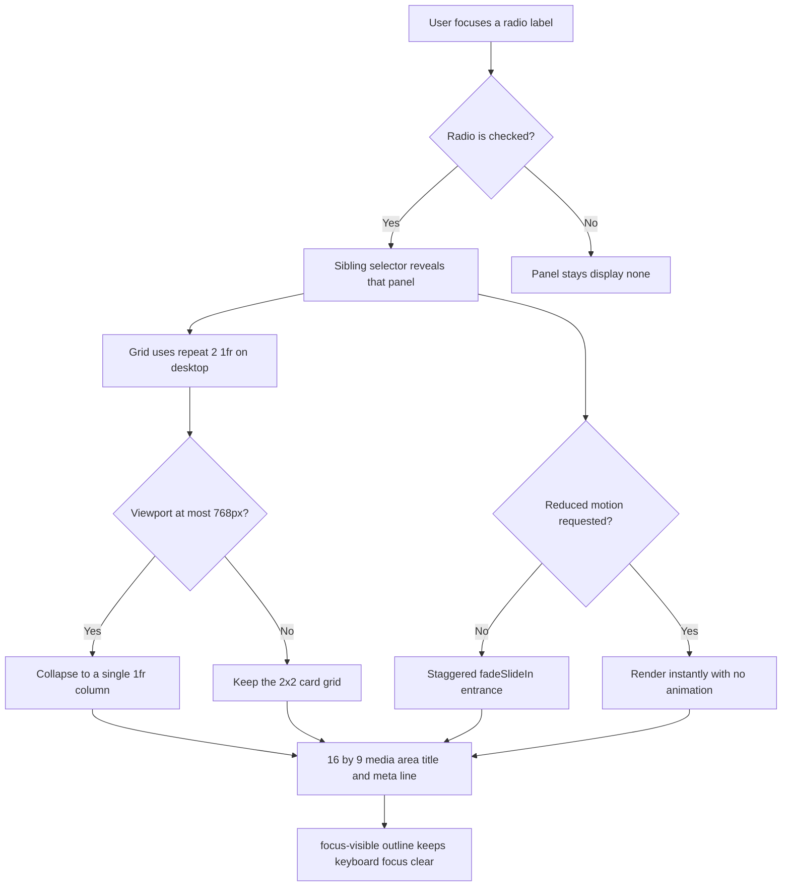

| Difficulty | Channel | Tags |
|---|---|---|
| beginner | frontend | css, flexbox, grid, animations |

When the BBC's GEL team rebuilt BBC News under the WebCore unified design system, they put three tab implementations in front of users with disabilities — including one that followed the W3C ARIA Authoring Practices spec to the letter [1]. Two days of usability testing later, the spec-perfect version still failed: most participants rejected the plain-links variant because it misdescribed the content, and arrow-key navigation was either never discovered or actively fought with screen-reader virtual cursors [1]. The team shipped a compromise implementation instead, and it became the official GEL tabs reference for BBC News and the wider design system [1]. The lesson lands hard: accessible tabs are not a checkbox you tick in a spec — they are a behavior you have to watch real humans use.

---

> ### Real-World Case — BBC
>
> While rebuilding BBC News as part of the WebCore unified design system, the BBC's GEL team needed a tabs component that worked for keyboard-only, blind, and partially sighted users. They ran two days of usability testing with three tab implementations, including one that followed the W3C ARIA Authoring Practices spec exactly.
>
> | | |
> |---|---|
> | **Challenge** | The spec-compliant tab pattern relies on left/right arrow-key navigation, but testing showed users either never discovered it or found it hijacked the screen reader's virtual cursor (up/down browsing). A pure radio-input CSS tab panel has the same core risk: screen readers announce a radio group, not tabs, so semantics and focus behavior must be validated with real users, not assumed from a spec. |
> | **Solution** | The BBC documented a progressive-enhancement tab pattern in GEL: a no-JS baseline of same-page links with solid 2px focus outlines and all panels visible, enhanced with ARIA tablist/tab/tabpanel roles when JavaScript runs. They deliberately diverged from the ARIA spec — activation moves focus to the panel (table-of-contents behavior) instead of arrow-key roving focus, inactive panels use `hidden`, the tab strip collapses to a single column below 400px, and Windows High Contrast Mode gets transparent-border and `aria-current` fallbacks. |
> | **Outcome** | Qualitative but decisive: the majority of participants rejected the plain-links version because it misdescribed the content, while arrow-key navigation was undiscovered or interfered with virtual-cursor browsing. The BBC adopted the compromise version as the official GEL tabs reference implementation for BBC News and the wider design system. |
> | **Lesson** | Following W3C ARIA guidance is not the same as serving users — the 'correct' arrow-key tab spec performed worse than a simpler table-of-contents model for real screen-reader users. Always validate focus semantics, focus-visible outlines, and responsive tab collapse with assistive-tech users before shipping a CSS-only or ARIA-based widget. |

---

## Hook — The Tab That Passed Every Audit and Still Failed Everyone

Everyone says the answer is to follow the spec. The BBC followed it to the letter, and two days of testing still handed back a rejection from the very people the spec was written to protect [1]. Sound familiar? A component clears the automated audit, every ARIA role is present, the keyboard diagram looks gorgeous in the pull request — and then a screen-reader user glides right past your "tab panel" because nothing announced it as one. That gap between technically correct and actually usable is where this whole journey happens. By the end, you will have a tabs component built from plain radio inputs, a CSS Grid that folds from 2×2 to one column, and motion that politely disappears when asked.

## Problem — JavaScript-Free Tabs Are an Accessibility Tightrope

A design-system docs page looks harmless. Tabs, cards, a bit of metadata — what could go wrong? Plenty, as it turns out. Tabs are one of the most deceptively tricky widgets on the web because their entire contract is behavioral: focus management, selection state, and panel visibility all have to agree, or assistive technology tells a different story than the pixels do [10]. Now add the constraint that no JavaScript is allowed — static hosting, a strict content security policy, or a docs pipeline that ships HTML and CSS only — and the usual ARIA machinery (roving tabindex, arrow-key handlers, aria-selected juggling) vanishes with it [8]. Here is what you are really solving:

- One choice at a time, with no custom state management.
- A layout that survives a 768px viewport without media-query spaghetti.
- Focus outlines that stay visible for keyboard users but do not decorate every mouse click [3].
- Motion that adds polish without making sensitive users nauseous [4].

Many developers reach for a JavaScript component library here, and that is a legitimate choice. But the constraint itself points somewhere quieter: the browser already ships a one-of-N selection widget with keyboard semantics baked in. Figuring out how to borrow it is the fun part.

## Real-World Case — BBC's Two-Day Usability Gamble

Back to the BBC, where the GEL team was rebuilding BBC News inside the WebCore unified design system. They lined up three tab implementations for two days of usability testing with keyboard-only, blind, and partially sighted participants — one of them an implementation that matched the W3C ARIA Authoring Practices spec exactly [1]. The plot twist nobody expected: the spec-perfect version did not win. The majority of participants rejected the plain-links variant because it misdescribed the content, while arrow-key navigation was either never discovered at all or actively interfered with virtual-cursor browsing [1]. Consequently, the team adopted a compromise version as the official GEL tabs reference implementation for BBC News and the wider design system [1]. The impact is qualitative but decisive: two days of testing, three candidates, and a spec-grade design dethroned by observed human behavior. That is the tension every docs-page component lives with — and it is exactly why the radio-input approach deserves a closer look.

## Deep Dive — Radios, Sibling Selectors, and the Grid That Folds

Building on that tension, consider what a radio group already gives you. Radios sharing one name are mutually exclusive by definition, and the browser hands you native keyboard movement between them at no cost [7]. You might think arrow-key behavior is a feature you must carefully recreate — but that is the same behavior the BBC found users never discovered or fought with in a custom tabs widget [1]. Here, it is simply how radios work; no event listeners, no ARIA role theatre. The reveal is driven by :checked paired with the general sibling combinator: when a radio is checked, a rule like `#tab-overview:checked ~ #panel-overview { display: grid; }` unhides exactly that radio's panel [2] [9]. Layout is straightforward CSS Grid: `repeat(2, 1fr)` makes a 2×2 card arrangement on desktop, and a single `1fr` column takes over at 768px [6]. Each card reserves its media slot with `aspect-ratio: 16 / 9`, so nothing jumps while images load [5]. Motion is wrapped in `@media (prefers-reduced-motion: no-preference)`, meaning the stagger only exists for people who have not asked for less movement [4].

⚠️ Watch Out: the tempting shortcut `input:not(:checked) ~ .panel { display: none }` looks clever and is quietly catastrophic. With two radios, checking the second one leaves the first unchecked — and that unchecked input hides every panel after it, including the active one. Target each panel by id instead.

| Approach | What you ship | Real tradeoff |
|---|---|---|
| Native radio + sibling selector | Pure HTML/CSS, zero JS | Great for simple docs panels; weak for dynamic tab counts or deep ARIA semantics |
| W3C ARIA tabs with JavaScript | roving tabindex, arrow handlers, aria-selected | Full screen-reader contract, but the BBC found arrow navigation undiscovered or conflicting [8] [1] |
| Plain links | Anchors to sections | Failed BBC testing because links misdescribed the content [1] |

💡 Insight: the radio trick wins on simplicity, not on purity. It is a compromise in the same spirit as the one the BBC shipped.

## Workflow — From Radio Group to Responsive Panel

This leads naturally to a build order you can repeat. The flow is captured in the Tab Panel Rendering Flow diagram below.

1. Group the radios. Give every input the same name so only one can be checked [7].
2. Pair each radio with a `` whose `for` matches the input id — that pairing is what makes both mouse and keyboard activation work.
3. Place each panel immediately after its own radio/label pair, with an id you can target directly [9].
4. Set the default with `checked` on the first radio, then let `:checked` drive panel visibility [2].
5. Apply the grid, then collapse it at 768px with one media query [6].
6. Wrap the staggered entrance in `prefers-reduced-motion: no-preference` and keep `:focus-visible` outlines intact [4] [3].

The diagram shows the branch that matters most: reduced-motion users skip the animation entirely, but everybody still lands on the same focused, readable card grid. 🔥 Hot Take: treating motion as a branch, not an afterthought, is the difference between "accessible" and "accessibly animated."

## Code Example — Generating the Markup Without a Single Event Listener

The walkthrough below generates the exact markup the CSS expects, which is the production pattern for a docs system that renders tabs from data. The TypeScript function emits one radio, one label, and one panel per tab, in that order, so a checked radio can reach only its own panel through `~`. The name parameter is shared across every emitted input, which is where native exclusivity comes from [7]. The first tab gets `checked`, and `revealRules` emits one id-specific rule per panel — that is the deliberate fix for the sibling-selector trap described earlier [2] [9]. The card markup uses a `card__image` div for the 16:9 media area, a title, and a meta line, matching the grid contract [5] [6]. Note how the code contains no event handlers at all: interaction is delegated to the platform. 🎯 Key Point: generating markup and CSS rules from the same data source keeps the id / for / selector trio from drifting apart — the single most common cause of "why is my panel blank?" bugs.

## Lessons Learned — Ship the Compromise, Not the Spec

Here is what the whole journey adds up to. The BBC's compromise teaches that real usability beats spec purity, and the CSS-only implementation teaches that the platform already owns most of the behavior teams rush to rebuild [1]. Battle scars worth pinning above your desk:

- Wrong selector scope: `:not(:checked) ~ .panel` hides the active panel; target each panel by id [9].
- Broken label pairing: a `for` that does not match the input id makes the tab unclickable by label.
- Forgotten name: radios with different names are not exclusive, so several panels can appear at once [7].
- Motion without an escape hatch: always guard the stagger with `prefers-reduced-motion` [4].
- Outline amnesia: keep `:focus-visible` so keyboard focus stays legible without decorating mouse clicks [3].

Where would this actually be used? Static docs sites, component-library sandboxes, and marketing pages under strict CSP — anywhere a 2×2 card grid needs tabbed switching without a JavaScript bundle. The transformation is subtle but real: what started as an accessibility headache ends as a handful of declarative rules that anyone on the team can read.

---

## Tab Panel Rendering Flow

<strong>Original Interview Question</strong>

**Q:** Build a CSS-only tab panel for a design-system docs page. Use radio inputs to switch tabs (no JavaScript). Desktop: a 2x2 grid of cards under each tab; mobile: single column. Each card has a fixed 16:9 image area, a title, and a short meta line. Add a subtle entrance animation with a stagger and keep focus-visible outlines; ensure prefers-reduced-motion is respected?

**A:** Use a set of radio inputs with a shared `name` attribute and corresponding `` elements for each tab section. The `:checked` state of each radio controls visibility of its associated panel via adjacent sibling selectors. Each panel renders a 2×2 card grid on desktop and collapses to a single column on mobile. Cards use `aspect-ratio: 16/9` for fixed image containers, with a title and meta line below.

## Conclusion

The BBC did not ship the spec-perfect tabs; they shipped the ones humans could actually use [1]. You can do the same tomorrow: reach for radios before reaching for a framework, target each panel by id, fold the grid at 768px, and let `prefers-reduced-motion` decide whether your cards dance. The one insight worth taking to your next design review: correctness is what the spec says, usability is what the screen reader says — and the radio-powered tab panel is where those two finally agree.

---

## References

1. [BBC incident report](https://bbc.github.io/gel/components/tabs/) — article
2. [MDN: :checked pseudo-class](https://developer.mozilla.org/en-US/docs/Web/CSS/:checked) — documentation
3. [MDN: :focus-visible pseudo-class](https://developer.mozilla.org/en-US/docs/Web/CSS/:focus-visible) — documentation
4. [MDN: prefers-reduced-motion media query](https://developer.mozilla.org/en-US/docs/Web/CSS/@media/prefers-reduced-motion) — documentation
5. [MDN: aspect-ratio property](https://developer.mozilla.org/en-US/docs/Web/CSS/aspect-ratio) — documentation
6. [MDN: CSS Grid Layout](https://developer.mozilla.org/en-US/docs/Web/CSS/CSS_grid_layout) — documentation
7. [MDN: input type radio](https://developer.mozilla.org/en-US/docs/Web/HTML/Element/input/radio) — documentation
8. [W3C ARIA Authoring Practices](https://github.com/w3c/aria-practices) — documentation
9. [MDN: General sibling combinator](https://developer.mozilla.org/en-US/docs/Web/CSS/General_sibling_combinator) — documentation
10. [MDN: ARIA tab role](https://developer.mozilla.org/en-US/docs/Web/Accessibility/ARIA/Roles/tab_role) — documentation

---

**Author:** Satishkumar Dhule — [GitHub](https://github.com/satishkumar-dhule) · [LinkedIn](https://linkedin.com/in/satishkumar-dhule) · [Website](https://satishkumar-dhule.github.io)
