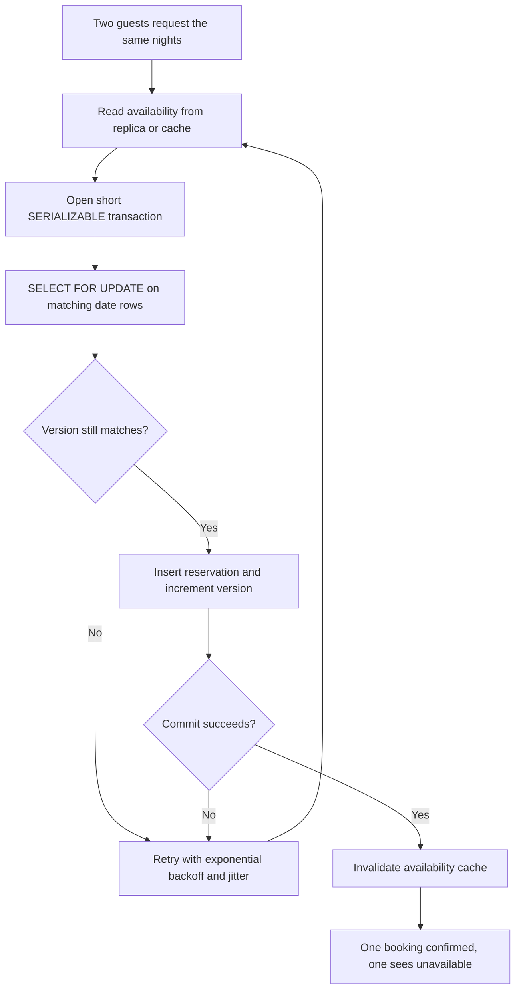

| Difficulty | Channel | Tags |
|---|---|---|
| intermediate | database | acid, isolation-levels, mvcc |

Booking.com set out to make its Connected Trip real by building a centralized Order Platform that could serve as the single source of truth for hotel, flight, and car reservations [1]. The team first leaned on sharded MySQL, but failover downtime pushed the platform toward Cassandra — a system built for availability, not for the transactional nature of reservation data [1]. The consequence was a highly denormalized model, a custom lock layer on lightweight transactions, and timeouts that could not distinguish a legitimate failed condition from a real infrastructure failure [1]. Today that platform holds roughly 20TB of reservation data at 99.999% availability across three regions, and the lesson for anyone building a booking system is impossible to ignore [1].

---

> ### Real-World Case — Booking.com
>
> Booking.com built a centralized 'Order Platform' to be the source of truth for all reservations across hotels, flights, and cars as part of its 'Connected Trip' initiative. After sharded MySQL caused failover downtime, they built the platform on Cassandra — but reservation data is transactional by nature, and Cassandra only offered row-level isolation, forcing highly denormalized models and a custom lock layer built on lightweight transactions that would sometimes time out with no way to tell whether it was a legitimate failed condition or a real infrastructure failure.
>
> | | |
> |---|---|
> | **Challenge** | Guarantee atomic multi-step read-modify-write operations on reservation data across partitions, with strong ACID consistency and CDC, without the operational burden of replicating massive datasets into OpenSearch for secondary indexes — while keeping the booking path highly available at global scale. |
> | **Solution** | They migrated Order Platform to CockroachDB, a distributed SQL database with native ACID transactions, serializable consistency, secondary indexes, and built-in change data capture. This let them delete the hand-rolled lightweight-transaction locking system, extra cross-checks, and the separate OpenSearch sync pipelines. They run a single managed cluster across three regions (Frankfurt, London, Ireland), deliberately trading a small amount of write availability for strong consistency. |
> | **Outcome** | The platform now holds ~20TB of reservation data at 99.999% availability across 3 regions, with a 99.99998% write SLI — and the team eliminated redundant services and 'cognitive overload' while preparing for a tenfold traffic increase. |
> | **Lesson** | Counterintuitively, the NoSQL database chosen to escape MySQL failover pain made correctness harder: Paxos-based lightweight transactions timed out ambiguously, so the team could never distinguish 'conflict' from 'failure.' Accepting a tiny reduction in write availability in exchange for real ACID transactions removed entire classes of race-condition bugs and simplified the architecture — for booking data, consistency is worth more than a few extra nines of write uptime. |

---

## Hook — The checkout button that sold the same room twice

Picture two travelers, 200 milliseconds apart, both clicking Reserve on the same beachfront room for the same weekend. The deploy looked fine. Then the confirmation emails went out — twice, for one apartment, one date range.

Sound familiar? Teams have all been there, staring at a 500 error at 2am while support tickets pile up and someone asks whether the database is 'being weird'. A booking is not a normal insert. It is a promise that a specific resource will be unavailable to everyone else, and a transaction is the only thing standing between that promise and chaos [2].

The stakes are refreshingly simple: one lost reservation costs a refund and an apology; a thousand lost reservations cost trust. So how do teams let thousands of guests book at once without ever selling the same night twice? Here is the uncomfortable part — the obvious fix is usually the one that breaks first.

## Problem — Race conditions hiding inside a normal INSERT

Building on that scenario, the bug is rarely dramatic. Two requests read the same availability row, both see free dates, and both write a reservation. Nothing crashes. The database happily accepts two facts that cannot both be true [2].

You might think adding an IF NOT EXISTS check is enough, but actually the check and the insert are two separate steps, and another transaction can slip neatly between them. This is the classic check-then-act race, and it gets worse when availability reads come from replicas that lag behind the writer.

⚠️ Watch Out: A read replica is excellent for browsing calendars and terrible for deciding who won the last room. Replica lag turns a 'free' date into a stale opinion, and stale opinions are what double bookings are made of.

Consequently, the real problem is not concurrency itself; it is deciding which operations must be serialized and which can stay optimistic. Get that boundary wrong and the system either double-books or becomes a single-file queue with the throughput of a dial-up modem. Many developers discover this only after a support ticket lands.

So when would you actually use this pattern? Any time two users can claim the same finite resource: seats, time slots, inventory, or hotel nights.

## Real-World Case — Booking.com

Building on the race condition above, the most instructive version of this story comes from Booking.com's Connected Trip initiative, where a centralized Order Platform was meant to become the source of truth for hotel, flight, and car reservations [1]. The ambition was elegant: one place that knows every reservation, so customers get a coherent trip instead of three disconnected confirmations.

However, the first foundation was sharded MySQL, and failover downtime pushed the team toward Cassandra instead [1]. Cassandra is built for availability and scale, but it only guarantees row-level isolation, which is a rough fit for reservation data that is transactional by nature [6].

Here is the plot twist: the team did not abandon that direction because it was slow; they hit the wall because correctness required a highly denormalized model plus a custom lock layer built on lightweight transactions. Those locks could time out with no reliable way to distinguish a legitimate failed condition from a real infrastructure failure [1].

💡 Insight: Ambiguous failure is worse than a clean failure. A clean 'no' can be retried or shown to a user; an ambiguous 'maybe' forces the system to guess, and guessing with money involved is how trust evaporates.

The platform now holds roughly 20TB of reservation data at 99.999% availability across three regions, with a 99.99998% write SLI, while redundant services were eliminated to cut cognitive overload and prepare for tenfold traffic growth [1]. Teams under similar pressure often evaluate distributed SQL engines that provide serializable transactions across regions instead of hand-rolling a lock layer [8]. The question is not whether Cassandra was wrong; it is whether the consistency contract matched the workload.

## Deep Dive — Isolation, versions, and the cost of being right

Building on Booking.com's experience, the first decision is the consistency contract. SERIALIZABLE is the strongest isolation level: transactions behave as if they ran one at a time, even when the database executes them in parallel [3]. That makes it the natural choice for the handful of operations where two guests must never both succeed.

🔥 Hot Take: Running an entire application at SERIALIZABLE is like wearing a tuxedo to buy groceries. Correct, yes. Convenient, no. Reserve it for the booking path, then let read-heavy browsing use lighter isolation.

Under the hood, PostgreSQL-style MVCC gives each transaction a snapshot of the database, so availability checks can read a consistent view without blocking writers [4]. The catch is that a snapshot can go stale between the check and the commit, which is exactly why serializable transactions detect conflicts and abort one transaction instead of silently accepting both.

Optimistic concurrency control takes a different tack: every availability row carries a version column, and an update only succeeds if the version still matches what was read [5]. No long-held lock, no queue of increasingly annoyed guests — just a compare-and-swap that fails fast when someone else got there first.

🎯 Key Point: Optimistic control assumes conflicts are rare; pessimistic control assumes they are likely. Choose based on how hot the properties are, not on which pattern sounds cleaner in a design doc.

This leads to the tradeoff table below. Row-level locks are precise but can serialize hot properties into a slow line, while optimistic retries stay cheap until contention turns them into a retry storm.

| Approach | Best for | Failure mode | Real tradeoff |
| --- | --- | --- | --- |
| Pessimistic SELECT FOR UPDATE | Hot properties, short transactions | Lock contention and timeouts | Predictable winner, lower throughput |
| Optimistic version column | Cold or medium traffic, read-heavy flows | Failed compare-and-swap | High throughput, retry logic required |
| SERIALIZABLE transactions | Multi-row invariants, money movement | Serialization failures | Strongest correctness, aborts under contention |
| Eventual consistency + cache | Browsing calendars only | Stale 'available' views | Fast reads, never trusted for the final decision |

Battle scars collected from real teams: locking an entire table instead of specific date rows, forgetting an index on (property_id, stay_date) so locks widen, trusting a cached calendar at commit time, and retrying instantly so every failed transaction returns at the same moment. PostgreSQL's locking behavior is documented in the server source and manuals [7], and distributed variants add their own conflict-detection rules [8].

## Workflow — From click to confirmed booking

This leads directly to the workflow: cheap checks first, expensive serialization last. The Booking Transaction Flow diagram embedded with this article follows two competing requests through the same path; only one leaves with a confirmed reservation.

1. Serve the calendar from a read replica or cache so browsing stays fast — never treat this as the final answer.
2. Open a short SERIALIZABLE transaction and lock only the exact date rows with SELECT FOR UPDATE, backed by an index on (property_id, stay_date) [7].
3. Re-read availability inside the transaction, verify the version column, then insert the reservation and increment the version atomically [5].
4. Commit. On a serialization failure, retry with exponential backoff and jitter rather than hammering the database [9].
5. Invalidate the availability cache after a successful commit so the next reader sees the truth [1].
6. Watch lock wait times for hot properties and trip a circuit breaker before one viral cabin drags the whole service down.

💡 Insight: Retry-after semantics are not unique to databases. HTTP expresses the same idea with Retry-After headers and 429 responses [10] [11], and the principle is identical: back off, add jitter, and do not pretend a failure was clean when it was not.

Consequently, the entire path stays boring under normal load and degrades predictably under contention — exactly what a booking system should do. But boring code still has to be written correctly, so the next section shows a production-shaped implementation.

## Code Example — A transaction that refuses to lie

Building on those six steps, here is the shape of the booking transaction in Python, using a version column and a bounded retry loop. The full version appears in the codeExample block below; the core sequence is worth reading twice.

BEGIN ISOLATION LEVEL SERIALIZABLE;
SELECT stay_date, version, booked_by FROM availability WHERE property_id = 42 AND stay_date >= check_in AND stay_date < check_out FOR UPDATE;
UPDATE availability SET booked_by = guest_id, version = version + 1 WHERE property_id = 42 AND stay_date = row.stay_date AND version = row.version;
INSERT INTO reservations (property_id, guest_id, check_in, check_out) VALUES (42, guest_id, check_in, check_out);
COMMIT;

Step by step: the transaction starts at SERIALIZABLE so conflicting writers cannot both commit [3]; FOR UPDATE locks only the requested nights; the UPDATE carries the original version, turning it into a compare-and-swap [5]; the reservation insert records the outcome; and the commit makes both changes visible at once.

⚠️ Watch Out: A failed compare-and-swap must be retried from a fresh read. Reusing the stale snapshot is how a 'safe' optimistic loop quietly becomes an infinite loop.

When a serialization failure arrives, the loop sleeps for a few milliseconds with exponential backoff and jitter before trying again [9]. Five attempts with a 10ms base keep the client fast while giving hot-property contention room to clear. Production teams also set statement timeouts and cap lock wait duration so a stuck request cannot hold the line hostage.

## Lessons Learned — What to do differently tomorrow

Returning to the Booking.com story, the durable lesson is that availability is a consistency problem wearing a UI costume [1]. The platform's 20TB footprint, three regions, and five-nines availability did not come from pretending reservations were simple; they came from choosing the right consistency contract and removing layers that blurred failure signals.

Here is what to carry into the next sprint:

- Classify operations before choosing storage: browsing can be eventual, committing a reservation cannot.
- Use SERIALIZABLE only where a multi-row invariant is at stake, and keep those transactions short [3].
- Combine row-level locks with a version column so pessimistic protection and optimistic detection reinforce each other [4] [5].
- Retry with backoff and jitter, and cap attempts; exponential backoff is a few lines of code that prevents self-inflicted outages [9].
- Invalidate caches only after commit, and never let a replica answer the final availability question [1].
- Instrument lock waits, abort rates, and retry counts — if those graphs spike, one popular listing is about to teach the team about contention the hard way.

💡 Insight: The best booking system is one where the database, the cache, and the application all agree on who won the room. Disagreement is not a bug to patch; it is design debt paid with interest.

If this feels overwhelming, start small: pick one booking endpoint, add a version column, wrap it in a short serializable transaction, and measure the abort rate before touching anything else. Sound familiar? That is usually the moment teams realize the hardest part was never the SQL — it was deciding which failures are allowed to be ambiguous.

---

## Booking Transaction Flow

<strong>Original Interview Question</strong>

**Q:** You're building a booking system for Airbnb where multiple users can reserve the same property simultaneously. How would you design the transaction handling to prevent double bookings while maintaining high availability?

**A:** Use SERIALIZABLE isolation with optimistic concurrency control. Implement row-level locks on property availability tables, use MVCC snapshot reads for checking availability, and apply application-level validation to ensure atomic booking operations.

## Conclusion

Booking.com's journey from MySQL failovers to a carefully engineered Order Platform shows that high availability is not the absence of locks; it is knowing exactly where locks belong [1]. The journey ran from a race condition that looked harmless, through a consistency mismatch that produced ambiguous failures, to a combination of SERIALIZABLE transactions, MVCC snapshots, version columns, and disciplined retries. Tomorrow, classify one endpoint: decide whether it is browsing or claiming, then give the claiming path a short transaction, a version column, a backoff policy, and a cache invalidation step after commit. Here is the insight worth sharing with the team: availability is a promise, and transactions are how a system keeps it.

---

## References

1. [Booking.com incident report](https://www.cockroachlabs.com/customers/booking-com) — article
2. [Database transaction - Wikipedia](https://en.wikipedia.org/wiki/Database_transaction) — documentation
3. [Isolation (database systems) - Wikipedia](https://en.wikipedia.org/wiki/Isolation_(database_systems)) — documentation
4. [Multiversion concurrency control - Wikipedia](https://en.wikipedia.org/wiki/Multiversion_concurrency_control) — documentation
5. [Optimistic concurrency control - Wikipedia](https://en.wikipedia.org/wiki/Optimistic_concurrency_control) — documentation
6. [Apache Cassandra - Wikipedia](https://en.wikipedia.org/wiki/Apache_Cassandra) — documentation
7. [PostgreSQL source repository on GitHub](https://github.com/postgres/postgres) — documentation
8. [CockroachDB source repository on GitHub](https://github.com/cockroachdb/cockroach) — documentation
9. [Python time module documentation](https://docs.python.org/3/library/time.html) — documentation
10. [Retry-After header - MDN Web Docs](https://developer.mozilla.org/en-US/docs/Web/HTTP/Headers/Retry-After) — documentation
11. [RFC 6585: Additional HTTP Status Codes](https://datatracker.ietf.org/doc/html/rfc6585) — documentation
12. [Apache Cassandra source repository on GitHub](https://github.com/apache/cassandra) — documentation

---

**Author:** Satishkumar Dhule — [GitHub](https://github.com/satishkumar-dhule) · [LinkedIn](https://linkedin.com/in/satishkumar-dhule) · [Website](https://satishkumar-dhule.github.io)
