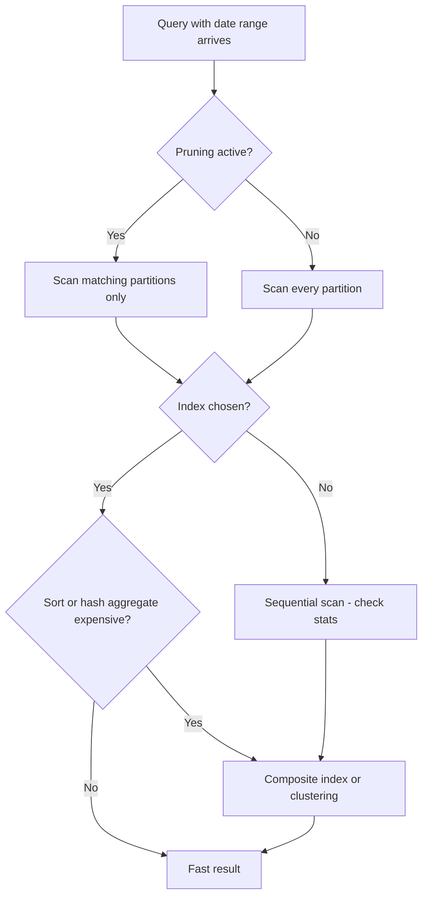

| Difficulty | Channel | Tags |
|---|---|---|
| intermediate | database | explain, query-plan, partitioning |

During the December shopping rush, a routine schema change turned into a CPU fire drill at Adyen: adding one more partition to 20TB+ payment tables pushed utilization past 100%, because every new partition multiplied the index scans and locks required by joins until queries fell out of PostgreSQL's 16 fast-path locks into slow LockManager contention [1]. The remedy was not bigger hardware; it was a harder look at how partitioning, indexes, and lock behavior interact, and it made those joins up to 50-70x faster [1]. That same trap waits in any 100M-row table where a date-filtered query still crawls.

---

> ### Real-World Case — Adyen
>
> Adyen's payment database had tables exceeding 20TB, so they partitioned them, including range-partitioned transaction and ledger tables. But during the critical December shopping season, CPU spiked above 100% when simply adding one more partition: each new partition multiplied the index scans and locks required by joins, pushing queries past PostgreSQL's 16 fast-path locks into slow LockManager contention.
>
> | | |
> |---|---|
> | **Challenge** | Queries joining partitioned tables could not prune partitions on the joined side, so a lookup of one transaction scanned all 40+ ledger and ledger-line partitions (80+ index scans and 160 locks), degrading performance with every partition added. |
> | **Solution** | They adopted a 'leading figure' design: partition every related table on the transaction ID, denormalizing ledgers to carry it, then aligning partition boundaries exactly and enabling enable_partitionwise_join so the planner prunes each side of the join. They also converted inheritance-based partitions to native declarative partitioning for better pruning. |
> | **Outcome** | Joining transaction and ledger tables became almost 70x faster (up to 50-70x in talks), CPU contention dropped from saturating the database to a healthy profile, and CPU no longer climbed each time a partition was added. |
> | **Lesson** | Partition pruning is only useful if the partition key matches the query and join patterns: partitioning tables individually can make things worse, while aligning all tables on a shared key with matching boundaries plus partitionwise joins is what actually makes the plan fast. |

---

## Hook — The partition that pushed CPU past 100%

During the December shopping rush, adding a single extra partition to range-partitioned transaction and ledger tables pushed CPU past 100% [1]. The tables had already crossed 20TB, and the team had done the sensible thing by splitting them on date. Sound familiar? Many developers assume partitioning is the final boss of scaling, then discover the planner has a few more plot twists. When every join touches more partitions, the query plan stops being a detail and becomes the whole story. So what actually breaks first when pruning stops working?

## Problem — When pruning lies and indexes coast

Building on that fire drill, the pain point is rarely that partitioning itself is slow; it is that partitioning changes the shape of the plan. A 100M-row events table with a date filter can look perfectly tuned while the planner still scans too many partitions, ignores a usable index, or sorts millions of rows before returning a handful [2]. Developers often reach for more RAM first, but the plan usually tells a cheaper story. Here is what you need to know:
- Partition pruning: fewer partitions touched means fewer scans and fewer locks.
- Index utilization: an unused index is just expensive decoration [4].
- Sort and hash aggregate costs: they often hide the real bottleneck.

Use this diagnostic when a date-range query is slow but the table design looks correct on paper. ⚠️ Watch Out: a plan from `EXPLAIN` without `ANALYZE` is a guess; actual row counts and buffers tell the truth [5]. The next question is why pruning fails at all, and that is where the partition key starts to matter.

## Real-World Case — Adyen

Now zoom in on the documented case that opened this story. Adyen's payment database had tables exceeding 20TB, including range-partitioned transaction and ledger tables [1]. During the critical December shopping season, adding one more partition made CPU climb above 100%: each new partition multiplied the index scans and locks required by joins, pushing queries past PostgreSQL's 16 fast-path locks and into slow LockManager contention [1]. When the team corrected the partitioning-and-index interaction, joining transaction and ledger tables became up to 50-70x faster, CPU contention dropped from saturating the database to a healthy profile, and CPU no longer climbed with each added partition [1]. 🔥 Hot Take: the hardware did not change; the plan shape did. Managed PostgreSQL deployments show a similar pattern when storage scales but access patterns stay stale [8]. But why did extra partitions make joins so expensive? The answer hides in the plan shape.

## Deep Dive — Pruning, plans, and the lock cliff

Building on the puzzle above, the first nuance is that partition pruning only works when the predicate matches the partition key in a form the planner can recognize [3]. A filter such as `event_date BETWEEN ...` prunes cleanly, while wrapping the column in a function or casting it can quietly disable pruning, and the planner then visits every child. 💡 Insight: partitioning is a data-layout decision, not a magic acceleration button.

This leads to the second nuance: a composite index on `(date, status)` serves queries that filter in that order, while a date-only index leaves status filtering to heap scans [4][6]. Use a composite index when the query pairs a date range with a stable, low-cardinality column such as status; skip it when writes dominate and the extra B-tree pages cost more than they save [6].

Consequently, an expensive sort or hash aggregate in `EXPLAIN ANALYZE` often matters more than the scan itself. If the plan shows `Sort` over a huge row count before returning a small result, the fix is usually an access path that delivers rows in the needed order, not more CPU [5].

⚠️ Watch Out: `CREATE INDEX CONCURRENTLY` avoids blocking writers, but it cannot run inside a transaction block; `CLUSTER` is heavier still and needs a maintenance window. The PostgreSQL source tree shows how much machinery sits behind these choices [7].

Between the options below, the tradeoff is real:

| Option | When it shines | Real tradeoff |
|---|---|---|
| Date-only index | Narrow date filters | Leaves secondary filters to heap scans |
| Composite (date, status) | Date range plus status | Bigger index, slower writes |
| BRIN on date | Naturally ordered, huge tables | Coarse granularity, needs rechecks |
| More partitions | Retention and archival | More plans, more locks, more overhead |

The next question: how does a team turn that knowledge into a routine instead of a heroic debugging session?

## Workflow — From slow query to stable plan

This leads to a repeatable workflow, and the Mermaid diagram below (Query Plan Decision Flow) tells the visual story from query arrival to stable plan:

- Step 1: capture `EXPLAIN (ANALYZE, BUFFERS)` for the exact slow query [2].
- Step 2: verify pruning by counting how many partitions appear in the plan.
- Step 3: confirm whether an index scan or sequential scan was chosen [4].
- Step 4: flag expensive `Sort` or `HashAggregate` nodes [5].
- Step 5: add a composite index on `(date, filtered_column)` with `CONCURRENTLY`, then re-measure.
- Step 6: evaluate clustering or BRIN only after the plan is stable [3].

🎯 Key Point: measure, change one thing, measure again. If this feels overwhelming, start with steps 1 and 2; that alone catches most partitioning mistakes. Many developers discover that the second measurement is where the real discovery happens. A managed-service checklist helps keep the routine consistent across environments [9]. Everything above becomes concrete in a short script.

## Code Example — A reproducible psql playbook

Consequently, the workflow turns into a bash playbook you can run against any environment with `$DATABASE_URL` set. The script below does four things: reads the real plan with buffer counts, builds the composite index without blocking writers, re-reads the plan, and checks whether the index is actually used.

Step by step: the first `EXPLAIN (ANALYZE, BUFFERS)` executes the query and reports real rows plus cache behavior, so a pruning failure shows up as extra partitions in the output. The second command creates `idx_events_date_status` with `CONCURRENTLY`, which keeps writes flowing during creation; column order matters because the leading date column supports the range predicate. The third command repeats the measurement, proving whether the planner chose the new index. The fourth queries `pg_stat_user_indexes`, where a rising `idx_scan` means the index earns its keep and a flat zero means it is dead weight. ⚠️ Watch Out: `ANALYZE` actually runs the statement, so point it at a safe environment. Which of those checks would have caught the 100% CPU spike before it hit production?

## Lessons Learned — Battle scars worth keeping

After walking through the plan, the script, and the lock cliff, the Adyen lesson lands differently: partitioning is not the finish line, it is a new set of rules [1]. 🎯 Key Point: keep the partition key aligned with the dominant filter, keep composite indexes narrow, and watch lock behavior as partition count grows. Battle scars worth avoiding:
- Adding partitions without re-checking join plans.
- Assuming an index exists means it is used.
- Treating a `Sort` node as cosmetic.
- Running `CLUSTER` or `CREATE INDEX` at peak traffic without a lock budget.

Use this approach when a date-filtered query slows down after a partitioning change, or when CPU rises every time a partition is added [1][8]. The memorable line to share with your team: partitions decide what data is eligible, but indexes and locks decide how expensive the journey actually gets. Tomorrow, open one slow query, read the plan with buffers, and count the partitions it touches before proposing any hardware change. That single habit is what turns a 100% CPU incident into a 70x improvement story.

---

## Query Plan Decision Flow

<strong>Original Interview Question</strong>

**Q:** You have a PostgreSQL table with 100M rows partitioned by date. A query filtering on a specific date range is still slow. What would you check in the EXPLAIN plan and how would you optimize it?

**A:** Check partition pruning effectiveness, index utilization patterns, and expensive sort operations. Create composite indexes on (date, filtered_columns) and evaluate clustering strategies for optimal data access.

## Conclusion

The story started with a December CPU spike caused by one extra partition and ended with joins up to 50-70x faster after plan shape, indexing, and locks were treated as one system [1]. Your next move is simple: pick a slow date-range query, run `EXPLAIN (ANALYZE, BUFFERS)`, and verify pruning before proposing bigger hardware. Remember that partitions decide what data is eligible, while indexes and locks decide how expensive the journey gets — share that line with your team and the next scaling surprise will feel a lot less mysterious.

---

## References

1. [Adyen incident report](https://www.adyen.com/knowledge-hub/partitioning-an-environment-not-individual-tables) — article
2. [PostgreSQL - Wikipedia](https://en.wikipedia.org/wiki/PostgreSQL) — documentation
3. [Partition (database) - Wikipedia](https://en.wikipedia.org/wiki/Partition_(database)) — documentation
4. [Database index - Wikipedia](https://en.wikipedia.org/wiki/Database_index) — documentation
5. [Query optimization - Wikipedia](https://en.wikipedia.org/wiki/Query_optimization) — documentation
6. [B-tree - Wikipedia](https://en.wikipedia.org/wiki/B-tree) — documentation
7. [PostgreSQL source repository - GitHub](https://github.com/postgres/postgres) — documentation
8. [Amazon RDS PostgreSQL User Guide - AWS Documentation](https://docs.aws.amazon.com/AmazonRDS/latest/UserGuide/CHAP_PostgreSQL.html) — documentation
9. [How To Install and Configure PostgreSQL on Ubuntu 22.04 - DigitalOcean](https://www.digitalocean.com/community/tutorials/how-to-install-and-configure-postgresql-on-ubuntu-22-04) — blog

---

**Author:** Satishkumar Dhule — [GitHub](https://github.com/satishkumar-dhule) · [LinkedIn](https://linkedin.com/in/satishkumar-dhule) · [Website](https://satishkumar-dhule.github.io)
