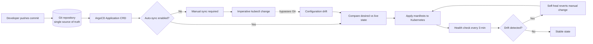

| Difficulty | Channel | Tags |
|---|---|---|
| beginner | devops | argocd, flux, declarative |

Fifty isolated Kubernetes testing environments, roughly 500 services each, deployments that dragged up to 30 minutes — and a Git repository that claimed to be the source of truth while the real one lived inside every cluster. That was Cabify's world, where concurrent pipelines reverted each other's hotfixes and one failed CI run could block an urgent fix [1]. Then the team handed authority to ArgoCD, and their own auto-sync setup promptly broke both the controller and GitLab. Sound like a disaster? It turned into a masterclass in what declarative delivery gets right — and what happens when the small print is ignored.

---

> ### Real-World Case — Cabify
>
> Cabify ran 50+ isolated Kubernetes Testing Environments (KTEs) with ~500 services each, deploying via an internal CI-driven 'pseudo-GitOps' tool. Concurrent pipelines could revert each other's changes, hotfixes were blocked by failed CI runs, and the claimed Git source of truth was actually the live state of each cluster. They adopted ArgoCD to make Git authoritative — then their own auto-sync setup broke both the ArgoCD controller and GitLab.
>
> | | |
> |---|---|
> | **Challenge** | A single ArgoCD instance could not handle 25K+ Applications (50 KTEs x 500 services). Splitting into per-KTE instances fixed that but their 3-minute Git pull interval generated roughly 8.3K requests/minute to GitLab. An ApplicationSet controller refresh loop then triggered a Git fetch every second per cluster, invisible in monitoring because that controller exported different metrics, forcing a tradeoff between self-healing/manual-change overrides and stability. |
> | **Solution** | They switched to webhook-triggered syncs (~50 fetches per deploy) with the manifest-generate-paths annotation, forked ArgoCD to patch applicationset-controller so child Application status changes no longer caused reconcile loops, routed webhooks through a proxy, and moved to centralized ArgoCD instances isolated per KTE namespace in one management cluster. They also disabled custom health checks, orphan-resource monitoring, and reconciliation of status-only updates to cut controller load. |
> | **Outcome** | Deployment times dropped from up to 30 minutes to seconds, Git fetch load fell from ~8.3K requests/minute to about one per KTE per deploy, and developer satisfaction with deployments improved. The fix came at a real cost: patched KTEs no longer auto-reverted manual changes and the progressive-sync alpha feature was unavailable. |
> | **Lesson** | Declarative GitOps removes imperative pipeline drift, but continuous reconciliation is not free — at scale the reconciler itself becomes the failure mode. 'Git is the source of truth' only holds if the controller can keep up with Git, which may require deliberately weakening the very self-healing and health checks the model promises. |

---

## Hook — The repository that quietly lied

Picture the dashboard: every pipeline green, every commit merged, every environment supposedly reproducible. Underneath, though, an internal CI-driven tool applied changes straight to live clusters, then read those clusters back to decide what existed [1]. Consequently, the Git history looked pristine while reality drifted away like a stale GPS route. Here is the uncomfortable question: if Git says one thing and the cluster says another, which one is actually deploying the software? Many developers answer 'Git' out loud and 'the cluster' in practice. That gap is where the story gets interesting — and where Cabify decided to stop pretending.

## Problem — When two pipelines fight over the same cluster

To understand the stakes, zoom in on a single afternoon. Two pipelines ship to the same testing environment at once; the slower one finishes last and reverts the hotfix the faster one just shipped. Nobody is malicious, nobody is careless — the tooling simply has no concept of ownership. Moreover, when CI is red, a hotfix cannot get through, because the gate meant to protect quality has become the bottleneck [7]. This leads to the classic imperative trap: direct cluster mutations through tools like kubectl are fast, flexible, and completely invisible to version control [5][3]. Sound familiar? The result is configuration drift between environments, manual rollbacks at 2am, and a Git log that tells a comforting but fictional story.

💡 Insight: the danger is not that imperative commands exist — it is that they silently break the audit trail teams rely on during incidents.

## Real-World Case — Cabify

Now the plot twist. Cabify did not lack GitOps tooling; the team had an internal CI-driven 'pseudo-GitOps' system running 50+ isolated Kubernetes Testing Environments with roughly 500 services each [1]. Concurrency was the villain: pipelines reverted one another, failed CI runs blocked hotfixes, and the advertised Git source of truth was really the live state of each cluster. Consequently, the team adopted ArgoCD to make Git authoritative — and their own aggressive auto-sync configuration broke the ArgoCD controller and GitLab under load [1].

⚠️ Watch Out: a sync loop that checks too often can turn a control plane into a DDoS target. The payoff was still dramatic: deployment times fell from as much as 30 minutes to seconds, Git fetch load dropped from about 8.3K requests per minute to roughly one per testing environment per deploy, and developer satisfaction improved [1]. But wait, it gets better — or worse, depending on taste. Patched testing environments no longer auto-revert manual changes, and the progressive-sync alpha feature became unavailable [1].

🔥 Hot Take: that tradeoff is not a bug; it is the price of keeping a shared controller alive at that scale.

## Deep Dive — Declarative and imperative, without the folklore

Building on Cabify's experience, the distinction stops being academic. A declarative approach means the complete desired state lives in Git as YAML manifests, Helm charts, or Kustomize overlays, and a controller continuously reconciles live state toward that description [2]. Kubernetes itself documents this as declarative configuration, where the API server accepts the desired object and the control plane does the work [2]. Imperative management, by contrast, issues commands such as kubectl create or kubectl scale directly against the cluster, with no durable description left behind [3]. Importantly, Kubernetes documents both styles, and each has a legitimate use [2][3].

| Option | What wins | What costs | Use it when |
| --- | --- | --- | --- |
| Declarative via ArgoCD | Single source of truth, audit trail, rollbacks via git revert | Slower feedback loop, controller tuning required | Shared or long-lived environments [4] |
| Imperative via kubectl | Instant feedback, no repo round-trip | Drift, no history, manual rollback | Disposable debugging sessions [5] |

So when does each actually earn its keep? Declarative wins for anything shared, repeated, or audited — production, staging, fifty testing environments. Imperative wins for short-lived debugging in a throwaway namespace, where speed beats permanence.

💡 Insight: self-healing is reconciliation with a memory — ArgoCD notices drift and reverts it, which is magical until an emergency patch gets erased. Teams wanting staged rollouts often reach for progressive delivery tooling built for that purpose [9].

🎯 Key Point: GitOps is a contract about authority, not a folder full of YAML [6].

## Workflow — From commit to healthy cluster

This leads naturally to the mechanics. The GitOps Sync Flow diagram below maps the journey a change takes, including the drift path that causes so much pain.

[Mermaid diagram: GitOps Sync Flow]

Step one: store manifests or Helm charts in a repository and define an ArgoCD Application CRD that points at that repo and target cluster [4]. Step two: enable automated sync with a health check interval around three minutes, staying inside the common one-to-five-minute window. Step three: turn on self-heal and prune so manual edits and orphaned resources get reverted. Step four: watch the diff before syncing, because previewing a change is cheaper than explaining an outage. Step five: measure controller and Git load — Cabify's fetch spike is proof that 'more frequent' is not 'better' [1].

⚠️ Watch Out: if the controller and Git server share a network path, an overzealous poll interval can take out both, exactly as it did at Cabify. Consequently, treat sync frequency as a capacity decision, not a default.

## Code Example — An Application that syncs without melting GitLab

The bash snippet below creates a production-style ArgoCD Application with automated sync, self-healing, and pruning, ready to paste into a terminal. The walkthrough that follows explains why each block earns its place.

[Full code and explanation: see codeExample]

First, the apiVersion and kind register an ArgoCD custom resource rather than a core Kubernetes object. Second, source.repoURL and source.path declare Git as the single source of truth while targetRevision pins the branch. Third, destination names the cluster and namespace that receive the workloads. Fourth, syncPolicy.automated enables auto-sync, prune removes resources deleted from Git, and selfHeal reverts manual drift [4]. Fifth, syncOptions.CreateNamespace handles namespaces that do not yet exist, and revisionHistoryLimit keeps rollbacks affordable.

🔥 Hot Take: selfHeal is the feature developers love right up until it deletes their 2am hotfix — pair it with branch protection rather than hope. When does this earn its keep? Use it for shared environments where drift must not survive; disable it in patched testing environments, exactly as Cabify did [1].

## Lessons Learned — Battle scars worth keeping

Cabify's journey circles back to the opening question: the repository only matters if the tooling treats it as authority. Here is what sticks.

- Make Git authoritative explicitly, not aspirationally — an Application CRD plus automated sync does that [4].
- Budget for reconciliation cost; poll intervals are capacity planning, and 8.3K Git fetches per minute is a warning shot [1].
- Decide up front whether self-healing should erase manual patches; Cabify's patched environments gave up that safety net consciously [1].
- Keep an imperative escape hatch for disposable debugging, but never let it become the deployment path [3][5].

Battle scars worth memorizing: shipping to shared environments with kubectl and promising to 'commit it later' — the promise expires at the next incident; leaving selfHeal on where developers patch live state to unblock tests — expect erased fixes and confused teammates; treating a failed CI gate as sacred during a hotfix — build an explicit break-glass path instead; cranking sync frequency to 'instant' without measuring controller and Git load.

🎯 Key Point: if a change cannot be traced to a commit, it does not exist in GitOps terms.

---

## GitOps Sync Flow

<strong>Original Interview Question</strong>

**Q:** You're setting up GitOps for a microservices deployment. How would you configure ArgoCD to automatically sync changes from your Git repository to Kubernetes, and what's the difference between declarative and imperative approaches in this context?

**A:** I'd configure ArgoCD by setting up a Git repository containing Kubernetes manifests or Helm charts, creating an Application CRD that points to the Git repository, enabling auto-sync with a health check interval of 3 minutes, and implementing self-healing to automatically revert any manual changes. The declarative approach involves defining the desired state in Git through YAML manifests, Helm charts, or Kustomize configurations, where ArgoCD continuously reconciles the actual state with the desired state. In contrast, the imperative approach uses kubectl commands to make direct changes to the cluster, bypassing the Git repository as the single source of truth.

## Conclusion

Fifty environments, 500 services each, and a 30-minute deploy became seconds once Git stopped being decoration [1]. The journey from pseudo-GitOps to real reconciliation is not about installing ArgoCD; it is about deciding who wins when Git and the cluster disagree. Tomorrow, pick one shared environment, write an Application CRD, enable auto-sync with a sane interval, and deliberately choose whether self-heal is friend or foe. Remember this line at the next design review: a GitOps pipeline is only as honest as the moment it refuses to accept a change that never landed in Git.

---

## References

1. [Cabify incident report](https://tech.cabify.com/blog/engineering/scaling-argocd-to-dozens-testing-environments) — article
2. [Kubernetes Documentation — Declarative Configuration Management](https://kubernetes.io/docs/tasks/manage-kubernetes-objects/declarative-config/) — documentation
3. [Kubernetes Documentation — Imperative Configuration Management](https://kubernetes.io/docs/tasks/manage-kubernetes-objects/imperative-config/) — documentation
4. [argoproj/argo-cd GitHub repository](https://github.com/argoproj/argo-cd) — documentation
5. [Kubernetes Documentation — kubectl Overview](https://kubernetes.io/docs/reference/kubectl/) — documentation
6. [Wikipedia — GitOps](https://en.wikipedia.org/wiki/GitOps) — documentation
7. [DigitalOcean — An Introduction to GitOps](https://www.digitalocean.com/community/tutorials/an-introduction-to-gitops) — blog
8. [AWS Documentation — What is Amazon EKS?](https://docs.aws.amazon.com/eks/latest/userguide/what-is-eks.html) — documentation
9. [argoproj/argo-rollouts GitHub repository](https://github.com/argoproj/argo-rollouts) — documentation

---

**Author:** Satishkumar Dhule — [GitHub](https://github.com/satishkumar-dhule) · [LinkedIn](https://linkedin.com/in/satishkumar-dhule) · [Website](https://satishkumar-dhule.github.io)
