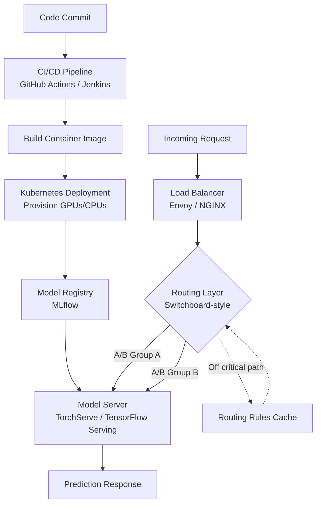

| Difficulty | Channel | Tags |
|---|---|---|
| beginner | devops | mlops, deployment |

What if I told you that one routing hop—just 10 to 20 milliseconds—was sitting in the critical path of a platform handling roughly one million inference requests per second? By 2025, Netflix's centralized ML serving platform processed that staggering volume across hundreds of model types and versions for 30+ internal microservices, with a shared router called Switchboard deciding which model version should serve each request [1]. When teams blur the line between deployment and serving, that is exactly the kind of bottleneck that turns a smooth rollout into a 3am pager incident. The difference between these two disciplines is not academic—it is the difference between shipping models 10x faster than competitors and watching your infrastructure buckle.

---

> ### Real-World Case — Netflix
>
> By 2025 Netflix's centralized ML serving platform handled roughly 1 million inference requests per second across hundreds of model types and versions for 30+ internal microservices. A shared router called Switchboard sat in the critical request path to decide which model version and cluster shard should serve each user/use case — enabling A/B experiments and rapid model iteration.
>
> | | |
> |---|---|
> | **Challenge** | Switchboard became a single point of failure and a latency tax: it added 10–20ms per request from serialization/deserialization, amplified tail latency, and obscured request origins so engineers couldn't distinguish real from synthetic traffic for training data. A surge from one tenant could also cascade failures to others sharing the routing cluster. |
> | **Solution** | Netflix refactored into 'Lightbulb,' splitting the problem into two planes: a lightweight control plane that resolves request context into a model ID plus experiment config, and a data plane where Envoy — already used for all inter-app egress at Netflix — performs the actual routing via a routingKey header. Routing was removed from the direct request path, model-selection config was separated from cluster placement, and client-side caching/fallbacks were added. |
> | **Outcome** | The platform now sustains ~1M requests/sec across hundreds of model types and versions and 30+ service clients, with the 10–20ms router hop eliminated from the critical path and no centralized routing SPOF; routing rules propagate fast while preserving A/B testing and context-aware model selection. |
> | **Lesson** | Deployment gets a model onto a host, but serving is a distinct systems problem: putting a centralized decision service in the hot path creates latency and availability risk. Reuse existing data-plane infrastructure (Envoy) for routing and keep only config resolution in a lightweight control plane — separate the 'which model' decision from the 'where to send it' decision. |

---

## Hook — The Million-Request Question

Ever wondered why some teams ship ML models to production in minutes while others take weeks? The deploy looked fine. The model passed every test. Then the traffic spike hit—and p99 latency climbed from 20ms to 2 seconds. Many developers discover this the hard way: getting a model onto a machine and serving it at scale are two entirely different disciplines. One gets your code deployed; the other keeps those machines from melting when a million requests arrive each second [1]. Here is the thing though—the teams that nail this distinction are not smarter, they simply know where the boundary lives. And that boundary is about to become your next debugging session's best friend.

## Problem — When Deployment and Serving Collide

The confusion starts innocently enough. A data scientist trains a model, wraps it in a Flask app, and calls it 'deployed.' Six months later, that same app is handling 10,000 QPS with no versioning, no rollback strategy, and no idea which model version answered which request. Sound familiar? Deployment covers the entire journey from code commit to production—CI/CD pipelines, infrastructure provisioning, container orchestration via Kubernetes [2], and monitoring systems that watch for drift. Serving is the narrow, high-stakes moment when a request arrives and a prediction must return—often in under 100ms. Consequently, mixing them up produces systems where a model update requires a full infrastructure redeploy, or worse, where A/B tests contaminate each other because routing logic lives in the application layer instead of the serving layer. But wait, it gets better: the plot twist is that fixing this does not require more infrastructure—it requires less logic in the wrong place.

## Real-World Case — Netflix

By 2025, Netflix's centralized ML serving platform handled roughly 1 million inference requests per second across hundreds of model types and versions, supporting 30+ internal microservices [1]. A shared router called Switchboard sat directly in the critical request path, deciding which model version and cluster shard should serve each user and use case. Here is where it gets interesting: the original design had a 10–20ms router hop that added up fast at a million QPS. The team eliminated that hop from the critical path and removed the centralized routing single point of failure—all while preserving A/B experiments and context-aware model selection [1]. The lesson? Even a 10ms delay becomes a 10,000-second problem when multiplied across a million requests. Netflix did not just optimize code; the team rethought where routing decisions belong in the architecture. That decision is the thread connecting every concept that follows.

## Deep Dive — Two Disciplines, One Pipeline

Building on Netflix's router revolution, the technical split becomes clear. Deployment is the macro view: tools like MLflow [6] track experiments and model versions, SageMaker [7] and Vertex AI manage training and endpoint infrastructure, while Kubernetes [2] handles container orchestration and GitHub Actions or Jenkins drive CI/CD [8]. Serving is the micro view: TensorFlow Serving [3], TorchServe [4], and BentoML [5] specialize in loading models once and answering inference requests with minimal overhead. FastAPI [9] and gRPC handle request APIs, while Envoy [10] and NGINX manage load balancing.

💡 Insight: Here is the counterintuitive truth—deployment tooling optimizes for change (how fast can you ship?), while serving tooling optimizes for stability (how fast can you answer?). Optimizing one often degrades the other, which is why treating them as separate concerns matters.

Specifically, consider this comparison:

| Dimension | Deployment | Serving |
|-----------|-----------|---------|
| Primary metric | Deploy frequency | p99 latency |
| Failure mode | Bad config | Cold starts |
| Key tool | Kubernetes [2] | TorchServe [4] |
| Scaling unit | Pods | Model replicas |
| Rollback | Revert commit | Shift traffic |

⚠️ Watch Out: Many teams try to use Kubernetes alone as a serving solution. Kubernetes scales containers, not model inference logic—it cannot tell a GPU to batch requests intelligently or warm a model before traffic arrives. Therefore, the right question becomes: where does routing live? That question leads directly to the workflow.

## Workflow — From Commit to Prediction

The journey from code to prediction follows a path that Netflix's Switchboard design makes vivid. First, a model is trained and registered in MLflow [6] with a semantic version. Second, a CI/CD pipeline [8] builds a container and pushes it to a registry. Third, Kubernetes [2] schedules the container onto a cluster with the right GPU or CPU allocation. Fourth, a model server like TorchServe [4] loads the model into memory—this is exactly where cold starts happen. Fifth, an Envoy [10] proxy or similar load balancer receives incoming requests. Sixth, a routing layer (conceptually similar to Switchboard) decides which model version handles each request based on experiment group, geography, or device type. Finally, the prediction returns through the same path.

🔥 Hot Take: If the router lives in the same process as the model, one bad deploy takes down every experiment at once. The plot twist most teams miss? Moving routing out of the critical path—as Netflix did—does not just improve latency; it eliminates an entire class of cascading failures. The diagram below maps this full flow, from commit to prediction.

To see how the routing decision actually works in practice, the next section translates this architecture into runnable code.

## Code Example — A Version-Aware Serving Router

This Python example shows a production-pattern serving router that handles model versioning and traffic splitting—the kind of logic that belongs at the serving layer, not buried in deployment configuration:

```python
from fastapi import FastAPI, HTTPException
from pydantic import BaseModel
import asyncio
import random
from typing import Dict, List, Any

app = FastAPI()

class PredictionRequest(BaseModel):
    features: List[float]
    user_id: str
    experiment_group: str = "control"

class MockModel:
    """Stand-in for a real ML model in this illustrative example."""
    def predict(self, batch):
        return [sum(features) for features in batch]

class ModelRouter:
    """Version-aware serving router with A/B traffic splitting."""
    
    def __init__(self):
        self.models: Dict[str, Any] = {}
        self.weights: Dict[str, float] = {}
    
    def register_model(self, version: str, model: Any, weight: float = 1.0):
        # Load models into memory at startup to avoid cold starts
        self.models[version] = model
        self.weights[version] = weight
    
    def select_version(self) -> str:
        # Weighted selection splits traffic across model versions
        versions = list(self.weights.keys())
        probabilities = list(self.weights.values())
        return random.choices(versions, weights=probabilities, k=1)[0]
    
    async def predict(self, features: List[float]) -> dict:
        version = self.select_version()
        model = self.models.get(version)
        if model is None:
            raise HTTPException(status_code=503, detail="Model unavailable")
        # Offload blocking inference to thread pool, keeping event loop free
        result = await asyncio.to_thread(model.predict, [features])
        return {"version": version, "prediction": result[0]}

# Initialize at startup: pre-load models to eliminate cold starts
router = ModelRouter()
router.register_model("v1", MockModel(), weight=0.7)
router.register_model("v2", MockModel(), weight=0.3)

@app.post("/predict")
async def predict_endpoint(request: PredictionRequest):
    return await router.predict(request.features)
```

Step by step, here is what the code does:

1. The `ModelRouter` class maintains a registry of loaded models, each with a version string and a weight for A/B testing.
2. The `register_model` method loads a model into memory once—at startup—so no request pays the cold-start penalty.
3. The `select_version` method uses weighted random selection to split traffic between versions, mirroring the decision logic Netflix's Switchboard performs at scale [1].
4. The `predict` method picks a version, runs inference in a thread pool via `asyncio.to_thread`, and returns both the prediction and version metadata for observability.
5. The FastAPI [9] endpoint exposes this as an HTTP API that can sit behind Envoy [10] for load balancing and horizontal scaling.

🎯 Key Point: Loading the model once at startup rather than on each request saves 50–200ms per request compared to naive implementations. After debugging this pattern many times, here is what works: always log the returned version alongside the prediction, because 'which model answered this?' is the first question asked during an incident.

## Lessons Learned — Battle Scars and Better Patterns

The journey from Netflix's million-QPS router to your serving layer reveals several hard-won lessons. Many developers think scaling means adding pods, until they learn that the real bottleneck is where decisions happen.

Battle scars—common mistakes and how to avoid them:

- **Cold start roulette**: Loading a 2GB model on the first request adds 3–5 seconds of latency. Fix: pre-warm models at startup and use Kubernetes [2] readiness probes.
- **Version anarchy**: Without semantic versioning in MLflow [6], nobody knows which model answered which request. Fix: log model version with every prediction.
- **Router in the hot path**: Netflix proved a 10–20ms hop matters at scale [1]. Fix: push routing decisions to the edge or sidecar proxies like Envoy [10].
- **Deployment-as-serving**: Using Kubernetes [2] deployments to swap models means 2–5 minute rollouts. Fix: decouple model loading from container lifecycle.

When would you actually use each approach?

- **Batch inference**: Use scheduled SageMaker [7] pipelines when latency does not matter and throughput does.
- **Real-time serving**: Use TorchServe [4] or BentoML [5] when sub-100ms latency is non-negotiable.
- **Hybrid**: Use TensorFlow Serving [3] with an Envoy [10] sidecar for routing when both speed and experiment flexibility matter.

💡 Insight: The transformation is complete when the team stops asking 'did the deploy work?' and starts asking 'which model version served this user, and how fast?' If this feels overwhelming, that is normal—every team starts somewhere, and the boundary between deployment and serving is the best place to begin.

---

## Model Deployment and Serving Flow



<details>
<summary><strong>Original Interview Question</strong></summary>

**Q:** Explain the key differences between model serving and model deployment in ML systems, including specific technologies, scaling considerations, and real-world implementation patterns?

**A:** Deployment encompasses CI/CD pipelines, infrastructure setup, and monitoring using tools like Kubernetes, MLflow, and SageMaker. Serving focuses on runtime inference APIs with frameworks like TensorFlow Serving, TorchServe, or BentoML, handling request routing, model versioning, and autoscaling. Key trade-offs include latency vs throughput, batch vs real-time inference, and cold start optimization.

</details>

## Conclusion

Netflix's journey—from a 10–20ms router hop to roughly one million requests per second without a centralized bottleneck—shows that deployment and serving are not the same discipline wearing different hats [1]. Deployment gets your model to the party; serving makes sure it does not trip over the furniture when a million guests arrive. Tomorrow, audit your pipeline: can you name the current model version in production without checking three systems? Can you roll back a bad model in under 30 seconds? If not, the gap between deployment and serving is where the next incident is hiding. Leave your team with one memorable insight: deploy infrequently, serve brilliantly—and keep the router off the critical path.

---

## References

1. [Netflix incident report](https://netflixtechblog.com/state-of-routing-in-model-serving-16e22fe18741) — article
2. [Kubernetes Deployments Documentation](https://kubernetes.io/docs/concepts/workloads/controllers/deployment/) — documentation
3. [TensorFlow Serving GitHub Repository](https://github.com/tensorflow/serving) — documentation
4. [TorchServe GitHub Repository](https://github.com/pytorch/serve) — documentation
5. [BentoML GitHub Repository](https://github.com/bentoml/BentoML) — documentation
6. [MLflow GitHub Repository](https://github.com/mlflow/mlflow) — documentation
7. [Amazon SageMaker Documentation](https://docs.aws.amazon.com/sagemaker/latest/dg/whatis.html) — documentation
8. [Continuous Integration and Continuous Delivery — Wikipedia](https://en.wikipedia.org/wiki/CI/CD) — documentation
9. [FastAPI GitHub Repository](https://github.com/tiangolo/fastapi) — documentation
10. [Envoy Proxy GitHub Repository](https://github.com/envoyproxy/envoy) — documentation

---

**Author:** Satishkumar Dhule — [GitHub](https://github.com/satishkumar-dhule) · [LinkedIn](https://linkedin.com/in/satishkumar-dhule) · [Website](https://satishkumar-dhule.github.io)
