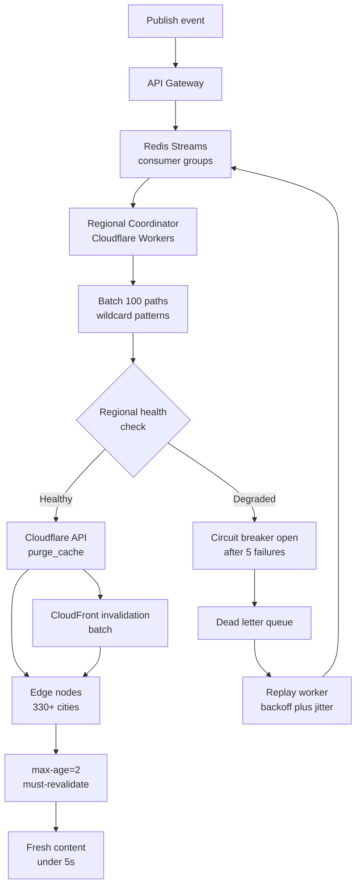

| Difficulty | Channel | Tags |
|---|---|---|
| intermediate | system-design | edge, caching, purging |

In May 2022, Cloudflare measured its decade-old purge system and found a nasty surprise: global P99 latency of 5.97s for tag, prefix, and hostname purges, and 6.35s for a single URL, well past the five-second promise [1]. A customer in Australia watched a request cross the Pacific and back before local users saw fresh content. The twist is that the fix did not involve faster hardware or more data centers. It involved deleting an entire hop from the journey.

---

> ### Real-World Case — Cloudflare
>
> By 2022, Cloudflare's decade-old cache purge system had become a bottleneck: purge requests were backhauled from the nearest edge to a handful of central core data centers, then fanned out globally via Quicksilver. Real-user benchmarks in May 2022 showed global P99 purge latency of 5.97s (tag/prefix/hostname) and 6.35s (single URL) — breaching a 5-second propagation SLA — while a customer in Australia had to cross the Pacific and back before local users saw fresh content.
>
> | | |
> |---|---|
> | **Challenge** | Propagate invalidations to every data center in 330+ cities within seconds while handling millions of purge keys per day, without the central core becoming a write bottleneck or the purge-history storage (kept to defeat lazy-purge staleness) stealing disk space from actual cached content. Kafka buffering and batching smoothed spikes but added latency, so scaling and speed were in direct conflict. |
> | **Solution** | They rebuilt it as 'Coreless Purge': API gateway Workers in the nearest data center now do auth, validation and filtering locally (discarding >50% of purge requests for URLs that were never cacheable). A Durable Object per region maintains a persistent queue with per-data-center pointers, so a disconnected or restarting datacenter can catch up by replaying missed purges; regional fanout Workers broadcast to peers. On each machine, a Rust sidecar called CacheDB (built on RocksDB) holds per-machine indexes, a local purge queue, and does active deletion — the proxy checks CacheDB on every HIT to suppress stale content immediately, even while disk deletion is still in flight. Token-bucket rate limiting with 100-key batches caps Enterprise at 5,000 keys/sec. |
> | **Outcome** | Global P50 purge latency fell from 1,570ms to 149ms across 330+ cities and 120+ countries — a 90.5% improvement — with regions like Western North America at 115ms and single-file P50 at ~234ms. The new active purge cut storage requirements by 10x versus lazy purge, freed disk for higher cache HIT ratios and lower origin egress, and let Cloudflare open tag/prefix/hostname purge to all plans in April 2025. |
> | **Lesson** | The best tool in the fleet became the bottleneck: Quicksilver replicated config in sub-second p99, so purges were bolted onto it — until millions of daily writes, backhaul round trips and purge-history storage made it the limiting factor. Moving coordination to the edge with sharded durable queues and per-machine indexes beat both a global index and a centralized core: decentralizing the control plane, not just the data plane, is what makes a 5-second SLA achievable at 10K/sec. |

---

## Hook — The six-second silence after publish

That Australian publish is the whole story in miniature. You ship a fix, the pipeline turns green, and then nothing happens for six seconds while users keep seeing the old bytes. Everyone has been there — staring at a dashboard that says success while a customer screenshots stale content. 💡 Insight: a cache purge is not a delete call; it is a distributed consensus problem wearing a `DELETE` method as a costume. For a team spanning 330+ edge cities, every millisecond of backhaul is a tax on trust. When the SLA says five seconds, six is not 'close enough' — it is a breach with a customer-facing consequence. Consequently, the question is not whether the CDN is fast; it is where the decision to purge actually lives. So where does the time go?

## Problem — The backhaul trap and the five-second wall

Building on that question, the pain starts with a simple architectural habit: send every invalidation to a central core, then fan it out. That design was fine when purges were rare. However, at 10,000 invalidations per second, the backhaul becomes a queue nobody intended to build. 🔥 Hot Take: most 'slow CDN' incidents are not CDN problems at all; they are routing problems between the customer and the CDN. The non-functional requirements make the tension obvious:

- **Latency:** under 5s propagation, globally, at P99
- **Throughput:** 10K invalidations/sec without collapsing the provider API
- **Availability:** 99.99%, roughly 4.4 minutes of downtime per month
- **Consistency:** strong across regions, or at least a reconciliation story that converges fast

A CDN keeps a copy of your content nearer to users [2], and a `Cache-Control: max-age=2, must-revalidate` header can hide a slow purge path — until it cannot [4]. RFC 9111 spells out exactly how freshness and revalidation interact [8], which is why a two-second TTL is a seatbelt, not an airbag. Moreover, provider APIs charge and rate-limit by request, so naive per-key purges melt the bill before they melt the SLA. What breaks first when volume spikes?

## Real-World Case — Cloudflare

This leads straight to Cloudflare's own reckoning. By 2022, its decade-old purge system backhauled requests from the nearest edge to a handful of central core data centers, then fanned them out through Quicksilver. Real-user benchmarks in May 2022 measured global P99 purge latency of 5.97s for tag, prefix, and hostname purges and 6.35s for a single URL — both past the five-second line [1]. A customer in Australia had to cross the Pacific and back before local users saw fresh content. Then came the counterintuitive part. Instead of adding more central capacity, engineers moved purge to the edge with an active design. Global P50 fell from 1,570ms to 149ms across 330+ cities and 120+ countries, a 90.5% improvement, with Western North America at 115ms and single-file P50 around 234ms [1]. Active purge also cut storage needs by 10x versus lazy purge, freeing disk for higher hit ratios and less origin egress; by April 2025, tag/prefix/hostname purge opened to all plans. Providers such as AWS CloudFront expose similar invalidation primitives, but the batching discipline is still your job [5]. If a 10x storage win hides inside a purge redesign, what else is hiding in yours?

## Deep Dive — Queues, batches, and the consistency illusion

However, copying that outcome is not a matter of flipping a switch. The discovery is that throughput and propagation are different problems that share one pipeline. You need a queue that absorbs spikes, a coordinator that lives near the edge, and a batching layer that turns 10,000 messages into 100 API calls.

- **Invalidation queue:** Redis Streams with consumer groups give each worker an exclusive slice of work, so a hot key cannot stampede every purger at once [6].
- **Edge coordination:** Cloudflare Workers run the coordinator close to users, which is exactly the hop Cloudflare removed from its own legacy path [9].
- **Batch processing:** 100 invalidations per call turns 10,000 requests into 100. Wildcard patterns collapse whole path families into a single purge.
- **Retry logic:** exponential backoff with capped attempts (three here) and jitter stops synchronized retries from turning a blip into an outage [7].

Many developers discover this the hard way: more throughput does not automatically mean faster propagation if every worker still waits on a distant core. 🎯 Key Point: when would you actually use this? Reach for it when stale content has real cost — pricing pages, incident banners, auth-dependent assets. Do not reach for it when a short TTL is already acceptable; a two-second TTL with revalidation is cheaper than a purge pipeline [4].

The tradeoff is honest:

| Approach | Propagation | Operational cost | Best fit |
|---|---|---|---|
| Central fan-out | P99 around 6s | Low API cost, high backhaul | Rare purges, loose SLA |
| Edge active purge | P50 around 149ms | More logic, 10x storage | Strict SLA, high volume |
| TTL only | Up to the TTL window | Near zero | Tolerant content |

⚠️ Watch Out: strong consistency is a marketing phrase until you define the reconciliation path. Network partitions make eventual convergence the realistic target, with a replay worker closing the gap. Which layer would you trust with the SLA clock?

## Workflow — From publish event to fresh bytes

This leads to a concrete sequence, illustrated in the flowchart below. The diagram tells the same story as the Cloudflare incident: the purge decision moves out of the core and into the edge.

1. A publish event enters the API gateway and lands in a Redis Stream.
2. Consumer groups hand batches of 100 to regional coordinators running on edge workers [9].
3. Each coordinator checks regional health before calling the provider API.
4. Healthy regions get a batched `purge_cache` call; degraded ones trip the circuit breaker after five consecutive failures and route to a dead letter queue.
5. CloudFront invalidations are batched in parallel, and parked entries are replayed with backoff and jitter [5].
6. Fresh content reaches caches with `Cache-Control: max-age=2, must-revalidate`, closing the loop under five seconds.

The reconciliation loop mirrors a Kubernetes controller: observe desired state, compare actual state, repair the difference [10]. 💡 Insight: a dead letter queue is not a graveyard; it is the receipt that proves the system noticed its own failure. Therefore, observability is part of the SLA, not a dashboard added later. Now, how does this look in code you could actually run?

## Code Example — A batched, retried purge drainer

With the flow mapped, here is a production-style drainer. It solves the exact problem from the story: turn a burst of invalidations into batched, retried, observable purges. The example uses Python's asyncio for concurrent I/O [11].

```python
import asyncio
import random
import aiohttp

ZONE_ID = 'zone_id'
CF_API = f'https://api.cloudflare.com/client/v4/zones/{ZONE_ID}/purge_cache'
BATCH_SIZE = 100
MAX_RETRIES = 3

class CircuitBreaker:
    def __init__(self, threshold=5):
        self.failures = 0
        self.threshold = threshold

    def allow(self):
        return self.failures < self.threshold

    def record(self, ok):
        self.failures = 0 if ok else self.failures + 1

async def purge_batch(session, token, paths, breaker):
    if not breaker.allow():
        raise RuntimeError('circuit breaker open - route to DLQ')
    payload = {'files': paths}
    headers = {'Authorization': f'Bearer {token}'}
    for attempt in range(MAX_RETRIES):
        async with session.post(CF_API, headers=headers, json=payload) as resp:
            if resp.status == 200:
                breaker.record(True)
                return await resp.json()
        breaker.record(False)
        await asyncio.sleep((2 ** attempt) + random.uniform(0, 0.3))
    raise RuntimeError('purge failed after retries - dead letter it')

async def drain(stream, session, token, breaker):
    while True:
        entries = await stream.read(count=BATCH_SIZE)
        paths = [e['path'] for e in entries]
        if not paths:
            await asyncio.sleep(0.05)
            continue
        try:
            await purge_batch(session, token, paths, breaker)
            await stream.ack(entries)
        except RuntimeError:
            await stream.dead_letter(entries)
```

Walking through it: the `CircuitBreaker` refuses new work after five consecutive failures, which is the fail-fast behavior from the design. `purge_batch` sends one `files` payload with up to 100 wildcard paths, collapsing 100 invalidations into a single provider call. The retry loop uses `2 ** attempt` plus jitter so concurrent workers do not retry in lockstep [7]. A success resets the breaker; exhausted retries raise, and the caller parks the batch. Finally, `drain` acknowledges only after the provider accepts the purge.

⚠️ Watch Out: acknowledge after acceptance, not after enqueue. Otherwise a crash silently loses invalidations. But wait, it gets better — what happens when the provider accepts the call yet an edge region still serves stale bytes?

## Lessons Learned — Battle scars and the next deploy

Consequently, the journey from a 6.35s P99 to a 149ms P50 is less about magic and more about moving work to where the user is. Here are the battle scars worth memorizing:

- **Battle scar 1:** batching only helps if the batch is capped. Unbounded `files` arrays get rejected by provider rate limits.
- **Battle scar 2:** retries without jitter turn one regional hiccup into a synchronized storm [7].
- **Battle scar 3:** a TTL is a fallback, not a consistency strategy. Treat `max-age=2` as damage control [4].
- **Battle scar 4:** skipping the dead letter queue means silent staleness. Every failure needs a receipt.

🔥 Hot Take: the 10x storage reduction from active purge mattered as much as the latency number, because freed disk raised hit ratios and cut origin egress [1]. Faster purges and cheaper infrastructure are the same story viewed from different angles. Moreover, the pattern works well because it treats invalidation as a stream of events, not a series of heroic synchronous calls. Freshness rules from RFC 9111 remain the safety net underneath it all [8]. So the next time a deploy looks fine and users disagree, you will know where to look first. What is your purge path's P99, really?

---

## Cache Invalidation Flow



<details>
<summary><strong>Original Interview Question</strong></summary>

**Q:** How would you design a multi-region CDN cache purging system that guarantees content propagation within 5 seconds while handling 10,000 concurrent invalidations per second?

**A:** Implement Cloudflare API + AWS CloudFront with distributed invalidation queue, edge compute coordination, and 2-second TTL. Use batch invalidation, exponential backoff, and regional cache headers for 5-second SLA.

</details>

## Conclusion

The Australian publish that took six seconds is the same publish that now lands in about 149ms at P50 [1]. The lesson is not to buy a faster CDN; it is to stop asking a distant core to make a decision that belongs at the edge. Tomorrow, measure your purge P99, cap and batch what you can, add jitter to every retry, and give every failure a dead letter home. Remember this one line to share with your team: a purge is a promise, and promises need a clock, a queue, and a receipt.

---

## References

1. [Cloudflare incident report](https://blog.cloudflare.com/instant-purge/) — article
2. [Content delivery network - Wikipedia](https://en.wikipedia.org/wiki/Content_delivery_network) — documentation
3. [Web cache - Wikipedia](https://en.wikipedia.org/wiki/Web_cache) — documentation
4. [HTTP caching - MDN Web Docs](https://developer.mozilla.org/en-US/docs/Web/HTTP/Caching) — documentation
5. [Invalidating files - Amazon CloudFront Developer Guide](https://docs.aws.amazon.com/AmazonCloudFront/latest/DeveloperGuide/Invalidation.html) — documentation
6. [Redis - GitHub repository](https://github.com/redis/redis) — documentation
7. [Exponential backoff - Wikipedia](https://en.wikipedia.org/wiki/Exponential_backoff) — documentation
8. [RFC 9111: HTTP Caching](https://datatracker.ietf.org/doc/html/rfc9111) — documentation
9. [Cloudflare Workers SDK - GitHub repository](https://github.com/cloudflare/workers-sdk) — documentation
10. [Kubernetes controllers - Kubernetes documentation](https://kubernetes.io/docs/concepts/architecture/controller/) — documentation
11. [asyncio — Asynchronous I/O - Python documentation](https://docs.python.org/3/library/asyncio.html) — documentation

---

**Author:** Satishkumar Dhule — [GitHub](https://github.com/satishkumar-dhule) · [LinkedIn](https://linkedin.com/in/satishkumar-dhule) · [Website](https://satishkumar-dhule.github.io)
