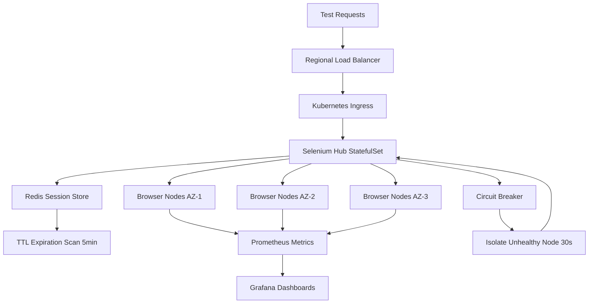

| Difficulty | Channel | Tags |
|---|---|---|
| advanced | system-design | selenium, webdriver, grid |

By late 2014, Expedia Group had crammed roughly 9,000 UI automation tests into more than 350 Jenkins jobs, launching browsers directly on executors that could barely handle a few at a time [1]. Stale browser processes wedged those executors repeatedly, and a full run stretched into hours. The team set a bold goal: finish every UI test within the runtime of the slowest single test. What they built next — 1,000 tests in 5 minutes — became a blueprint for anyone facing the same distributed testing nightmare [1].

---

> ### Real-World Case — Expedia Group
>
> By late 2014, roughly 9,000 UI automation tests were crammed into 350+ Jenkins jobs, with browsers launched directly on Jenkins executors. Each executor could handle only a few browsers, stale browser processes repeatedly wedged executors, and a full run took hours, so Expedia set a goal to finish every UI test within the runtime of the slowest single test.
>
> | | |
> |---|---|
> | **Challenge** | Achieve genuine concurrent browser execution at hundreds of sessions without permanently provisioned machines, eliminate leaked/stale browser state between runs, and keep the Grid hub stable during bursty WebDriver session creation. |
> | **Solution** | Built 'Distributed Automation' using SeleniumGridScaler (Selenium Grid wired to the EC2 API): a hub auto-provisions c5.xlarge nodes, each running 15 parallel Chrome/Firefox sessions, attaches them on the fly, then terminates every node immediately after the run so no stale session or browser survives. Hubs were sized by concurrency (c5.large for ~300 parallel, c5.2xlarge for ~1,000), hub and nodes were placed in the same subnet to avoid FORWARDING_TO_NODE_FAILED errors, and artifacts were persisted for normalized failure analysis. A counterintuitive finding: Dockerizing the hub caused instability at hundreds of concurrent sessions; running it as a plain Java process removed the problem. |
> | **Outcome** | 1,000 UI automation tests executed in 5 minutes; 90+ autoscaling hubs run by independent teams; over 150,000 tests per day; infrastructure paid for only during test runs, with t2.medium hubs cutting small-project cost by 45%. |
> | **Lesson** | Treat browser nodes as disposable: terminating the entire node fleet after each run eliminates leaked browser state far more reliably than reclaiming long-lived nodes. At grid scale the hub's session-creation burst, not raw browser count, is the real bottleneck — and an extra container layer around the coordinator can itself be the failure. |

---

## Hook — The Build That Never Finished

Picture this: a Jenkins job starts at 6am, and by noon it is still churning through browser tests while developers refresh the page in disbelief. Sound familiar? That was the daily reality for teams running UI automation the old way [1]. Many developers discover the hard way that launching browsers on shared executors is like hosting a dinner party where every guest leaves a dirty dish — eventually the kitchen stops working. ⚠️ **Watch Out:** A single zombie Chrome process can hold a port, memory, and a lock, silently poisoning every subsequent test on that executor. The stakes are real: slow feedback means slow releases, and slow releases mean competitors ship while flaky tests are still being debugged. So what does it take to flip the script and finish a full suite before the coffee gets cold?

## Problem — Why Browser Sessions Wedge Everything

Building on that frustration, the core problem is not raw compute — it is lifecycle chaos. Browsers are stateful, memory-hungry processes that do not clean up after themselves, and Selenium Grid in its vanilla form does not solve that by default [6]. Here is what you are really fighting:

- **Process leakage:** Every abandoned session leaves a browser, a webdriver, and a temp profile behind.
- **Resource contention:** Each executor in the Expedia setup could handle only a handful of browsers before grinding to a halt [1].
- **Blast radius:** Without isolation, one failing node can cascade through the entire grid.
- **Cost blindness:** Paying for idle browser infrastructure 24/7 is like renting a stadium for a daily standup [5].

You might think adding more Jenkins slaves fixes this, but actually it just multiplies the mess. The real question is: how do you make sessions disposable, nodes replaceable, and failures boring?

## Real-World Case — Expedia Group's 1,000-Test Breakthrough

The turning point came when Expedia Group stopped treating browsers as pets and started treating them as cattle. Their distributed automation platform split tests across autoscaling hubs, with each hub owned by an independent team [1]. The results were staggering: 1,000 UI automation tests executed in 5 minutes, more than 90 autoscaling hubs run by independent teams, and over 150,000 tests per day [1]. 💡 **Insight:** Infrastructure was paid for only during test runs, and t2.medium hubs cut small-project costs by 45% [1]. This was not just a speed win — it was a cultural shift, because teams could self-serve their own grids without waiting for a central ops team. But wait, it gets better: the same architecture that made this speed possible also made failures nearly invisible to developers. How? That is where the real engineering begins.

## Deep Dive — Engineering for 10,000 Sessions

Building on Expedia's blueprint, scaling to 10,000 concurrent sessions requires deliberate math, not hope. The hub-and-node pattern is well documented [6], and the SeleniumHQ codebase shows exactly how the router and nodes interact [3], but vanilla Grid will collapse under this load without Kubernetes orchestration [2].

**The numbers that matter:**

- **Throughput:** 10,000 sessions ÷ 50 sessions per node = 200 nodes minimum.
- **Memory:** 200 nodes × 2GB = 400GB baseline + 30% buffer = 520GB cluster memory.
- **Latency:** P99 session initiation under 2s via regional load balancing.
- **Availability:** 99.9% uptime through multi-AZ deployment and automatic failover [2].

🔥 **Hot Take:** Most teams over-provision CPU and under-provision session cleanup. The memory leak is not a bug — it is a missing policy.

**Trade-offs you will face:**

| Option | Benefit | Real cost |
|---|---|---|
| Redis session store with TTL | Automatic cleanup, shared state | Extra network hop, needs persistence tuning |
| In-memory hub state | Lowest latency | No failover, leaks on restart [3] |
| Horizontal pod autoscaling [8] | Elastic capacity | Cold-start latency spikes |
| Fixed node pool | Predictable performance | Wasted spend at night [5] |

🎯 **Key Point:** Redis TTL-based expiration with scans every 5 minutes turns garbage collection from a manual chore into a background guarantee. When would you actually use this? Any time the suite outgrows a single machine — typically around 200+ concurrent sessions. Kubernetes concepts like Deployments and health probes make the rest repeatable [7].

## Workflow — From Test Request to Graceful Recovery

This leads naturally to the runtime flow. The diagram titled *Distributed Selenium Grid Architecture* below maps the journey from an incoming test request to a cleaned-up session, including the failure paths that keep the grid honest.

Step by step, here is what happens:

1. **Route:** Regional load balancing spreads requests, keeping P99 initiation under 2s.
2. **Register:** The hub writes session metadata to Redis with a TTL, so state is shared and expiring [3].
3. **Execute:** Browser nodes run tests under strict 2GB RAM / 1 CPU limits, enforced by the cluster [2].
4. **Monitor:** Prometheus scrapes the `/status` endpoint every 10s; 3 consecutive failures remove a node [4].
5. **Recover:** A circuit breaker isolates failing nodes for 30 seconds while autoscaling replaces them [8].
6. **Clean:** TTL expiration plus init containers sweep stale volumes and keys before they accumulate.

⚠️ **Watch Out:** Never skip the Pod Disruption Budget — it is the guardrail that keeps 85% capacity during rolling updates [2]. Without it, a routine upgrade can quietly erase the uptime number you promised.

## Code Example — Session Lifecycle Management That Cleans Itself

The workflow above only works if the session registry never lies. The Python snippet shown in the implementation block below uses Redis `SETEX` for atomic TTL-backed writes [9] and mirrors the health-check pattern described earlier. Here is the code:

```python
import redis
import time
from dataclasses import dataclass
from typing import Dict

@dataclass
class NodeHealth:
    url: str
    consecutive_failures: int = 0
    circuit_open_until: float = 0.0

class SessionLifecycleManager:
    def __init__(self, redis_client: redis.Redis, ttl_seconds: int = 300):
        self.redis = redis_client
        self.ttl = ttl_seconds
        self.nodes: Dict[str, NodeHealth] = {}

    def register_session(self, session_id: str, node_url: str) -> bool:
        # Atomic write with TTL: abandoned sessions vanish automatically
        return self.redis.setex(f"session:{session_id}", self.ttl, node_url)

    def health_check(self, node_url: str, is_healthy: bool) -> None:
        health = self.nodes.setdefault(node_url, NodeHealth(node_url))
        if is_healthy:
            health.consecutive_failures = 0
        else:
            health.consecutive_failures += 1
            if health.consecutive_failures >= 3:
                # Three strikes opens a 30-second circuit
                health.circuit_open_until = time.time() + 30

    def is_node_available(self, node_url: str) -> bool:
        health = self.nodes.get(node_url)
        if not health:
            return True
        return time.time() >= health.circuit_open_until

    def cleanup_stale_sessions(self) -> int:
        # Proactive sweep catches keys TTL missed under heavy churn
        removed = 0
        for key in self.redis.scan_iter(match="session:*"):
            if self.redis.ttl(key) == -2:
                removed += 1
        return removed
```

Here is the breakdown:
- `register_session` writes a node mapping with a 300-second TTL, so orphaned sessions disappear without manual intervention.
- `health_check` tracks consecutive failures and opens a 30-second circuit after 3 strikes, matching the removal rule from the workflow.
- `is_node_available` gives the circuit time to recover instead of hammering a dying node.
- `cleanup_stale_sessions` scans proactively every 5 minutes, catching what pure TTL expiry can miss during heavy churn.

💡 **Insight:** This is the same principle behind the 45% cost saving — infrastructure is only paid for while it is genuinely alive [1].

## Lessons Learned — Battle Scars Worth Sharing

After tracing the whole journey — from wedged Jenkins executors to a self-healing grid — a few lessons stand out. Here are the battle scars:

- **Never trust a browser to clean itself up.** Init containers and TTL policies are the only reliable friends here.
- **Circuit breakers are cheaper than heroes.** Isolating a bad node for 30 seconds beats a 2am page [4].
- **Measure memory trends, not just current usage.** Prometheus and Grafana catch slow leaks before they become incidents [4].
- **Canary new node versions.** Traffic splitting catches zero-day browser bugs before they reach every suite [2].
- **Budget for replacement, not prevention.** Pod Disruption Budgets protect the 85% capacity floor during updates [2].

🔥 **Hot Take:** The 99.9% uptime figure is mostly an artifact of graceful degradation, not perfect components. Design for replacement, not prevention.

If this feels overwhelming, teams are not alone — almost every grid starts life as a single hub on a tired machine. Start small, measure, then scale.

---

## Distributed Selenium Grid Architecture



<details>
<summary><strong>Original Interview Question</strong></summary>

**Q:** Design a scalable Selenium Grid architecture to handle 10,000 concurrent test sessions with 99.9% uptime, ensuring zero memory leaks through automatic session lifecycle management, real-time monitoring, and graceful node failure recovery across multiple data centers?

**A:** Deploy Kubernetes cluster with auto-scaling node pools, Redis session store with TTL policies, Prometheus metrics for memory monitoring, circuit breakers for node isolation, and sidecar containers for session cleanup. Implement health checks, resource quotas, and rolling updates.

</details>

## Conclusion

By late 2014, Expedia's 9,000 tests were stuck in hours-long runs [1]. That same pattern — distributed hubs, TTL-backed sessions, and circuit-broken nodes — can now deliver 1,000 tests in 5 minutes and 150,000 per day [1]. The journey from a wedged executor to a self-healing grid is not about buying more servers; it is about making every session disposable and every failure uninteresting. The next step is simple: pick one session store, set a TTL on every key, and write down the single metric that signals the grid is about to fail. That is the insight worth sharing with the team over coffee.

---

## References

1. [Expedia Group incident report](https://medium.com/expedia-group-tech/distributed-automation-how-to-run-1000-ui-automation-tests-in-5mins-cf9a84ca32d1) — article
2. [Kubernetes Deployments documentation](https://kubernetes.io/docs/concepts/workloads/controllers/deployment/) — documentation
3. [SeleniumHQ/selenium GitHub repository](https://github.com/SeleniumHQ/selenium) — documentation
4. [Prometheus monitoring system GitHub repository](https://github.com/prometheus/prometheus) — documentation
5. [Amazon EC2 Auto Scaling user guide](https://docs.aws.amazon.com/autoscaling/ec2/userguide/what-is-amazon-ec2-auto-scaling.html) — documentation
6. [Selenium (software) overview](https://en.wikipedia.org/wiki/Selenium_(software)) — documentation
7. [An Introduction to Kubernetes](https://www.digitalocean.com/community/tutorials/an-introduction-to-kubernetes) — blog
8. [Kubernetes Horizontal Pod Autoscaling documentation](https://kubernetes.io/docs/tasks/run-application/horizontal-pod-autoscale/) — documentation
9. [Python contextlib documentation](https://docs.python.org/3/library/contextlib.html) — documentation

---

**Author:** Satishkumar Dhule — [GitHub](https://github.com/satishkumar-dhule) · [LinkedIn](https://linkedin.com/in/satishkumar-dhule) · [Website](https://satishkumar-dhule.github.io)
