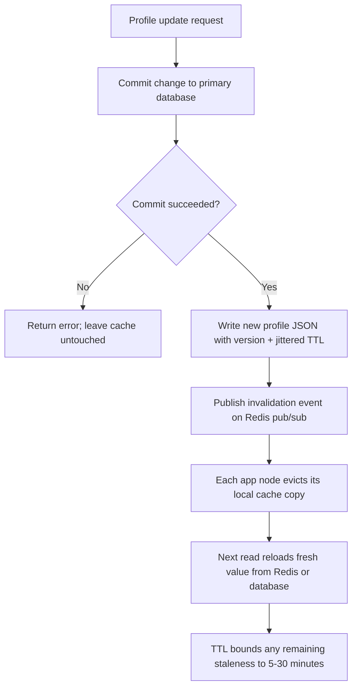

| Difficulty | Channel | Tags |
|---|---|---|
| beginner | backend | redis, memcached, cache-invalidation |

LinkedIn serves more than 4.8 million member profiles per second at peak, and its old memcached read cache made every expansion, node replacement, and warm-up painful [1]. Simply adding Espresso storage nodes eventually hit a scaling limit, so the team reworked the caching layer instead of throwing more hardware at the problem [1]. The payoff: a cache hit rate above 99%, multi-get p99 latency down from 31.6 ms to 12.41 ms, 90% fewer storage nodes, and roughly 10% saved annually on profile-request serving cost [1]. That is the stakes of cache invalidation — get it right and nobody notices, get it wrong and the database pays the bill.

---

> ### Real-World Case — LinkedIn
>
> LinkedIn serves over 4.8 million member profiles per second at peak, with storage traffic doubling yearly. Its old memcached read cache had caused pain during expansion, node replacement, and warm-up, while simply adding Espresso nodes had hit a scaling limit.
>
> | | |
> |---|---|
> | **Challenge** | Keep a distributed profile cache fresh across multiple applications and data centers without letting cache failures fall back to the source-of-truth datastore, while handling missed deletes, cache-fill races, and strict data-divergence limits. |
> | **Solution** | LinkedIn built an Espresso-integrated hybrid cache: local OHC for hot keys plus Couchbase for full-profile caching, chosen over memcached for persistence, replication, and no-downtime scaling. Profile writes still persist to Espresso, while Brooklin change streams and Samza updaters apply committed changes to Couchbase using finite TTLs as a backstop, periodic bootstrap, SCN-ordered last-writer-wins updates, CAS, and tombstone records instead of hard deletes. |
> | **Outcome** | The cache achieved over 99% hit rate, cut multi-get p99 latency from 31.6 ms to 12.41 ms (-60.73%) and p99.9 from 66.87 ms to 24.3 ms (-63.66%), reduced Espresso storage nodes by 90%, and saved about 10% annually on profile-request serving cost. |
> | **Lesson** | For frequently updated profiles, simple caches like Memcached can be cheaper but distributed invalidation, missed deletes, warm-up, and replication become the real cost; a richer cache can pay off only if you add explicit ordering, tombstones, TTL safety nets, and divergence monitoring. |

---

## Hook — The 12-Millisecond Difference Nobody Sees

Ever wondered why a profile page feels instant one week and sluggish the next? At 4.8 million profile reads per second, a single stale entry is a shrug, but a cache that misses at that scale is a five-alarm fire [1]. LinkedIn's old memcached read cache turned routine expansion and node replacement into warm-up exercises, and piling on more storage nodes eventually stopped moving the needle [1]. Many developers think caching is the hard part; the real boss fight is deciding when cached data stops being true. That is the journey ahead.

## Problem — When "Delete the Key" Is Not Enough

However, the obvious fix — delete the key when a profile changes — quietly falls apart the moment more than one application server exists. One node invalidates a key while another keeps serving its cached copy, so stale data survives the update and nobody notices until a user refreshes twice. Cache-aside reads make this worse: a read that misses right after a write can repopulate the cache with the old row if the database write has not committed yet [2].

Here is what you need to know:
- A TTL is a safety net, not a consistency strategy; for profiles, 5-30 minutes caps the damage but does not prevent it.
- Write-through updates shrink the window of staleness, yet two concurrent updates can still land in the wrong order.
- Cold starts and synchronized expiry create thundering herds that hammer the primary store.
- ⚠️ Watch Out: deleting before the database commit is the classic way to guarantee stale data instead of preventing it.

So how does a team keep millions of reads fast without lying to users about their own profiles?

## Real-World Case — LinkedIn

Building on that tension, LinkedIn's profile datastore story reads like a case study in refusing to accept the usual trade-off [1]. Storage traffic doubled year over year, the memcached read cache caused pain during expansion and node replacement, and adding Espresso nodes hit a scaling limit. Instead of buying more hardware, the team reworked the caching approach around how profiles are actually read.

🔥 Hot Take: the impressive part is not the cache itself — it is that measurements drove the architecture. The new cache sustained a hit rate above 99%, cut multi-get p99 latency from 31.6 ms to 12.41 ms (-60.73%) and p99.9 from 66.87 ms to 24.3 ms (-63.66%), reduced Espresso storage nodes by 90%, and saved about 10% annually on profile-request serving cost [1].

When the cache behaves, the database disappears from the conversation. What happens when it does not?

## Deep Dive — Redis vs Memcached and the Patterns That Matter

This leads to the inevitable question: Redis or Memcached? The answer depends less on raw benchmarks and more on how much coordination the invalidation story requires [3][4].

| Option | What you get | The real trade-off | Reach for it when |
| --- | --- | --- | --- |
| Redis | Pub/sub, persistence, rich data structures [5] | More moving parts and operational surface area | Distributed invalidation or durability matters [3] |
| Memcached | Simple architecture, lower memory overhead, easy horizontal scaling [6] | No pub/sub, so nodes need manual coordination | Pure caching with short TTLs is enough [4] |

💡 Insight: the pub/sub row is the whole ballgame for profile updates. Redis can broadcast an invalidation event that every application node hears, while Memcached leaves teams wiring up custom fan-out or accepting longer staleness [5][6].

Cache-aside reads still make sense: read from cache, fall back to the database, then fill the cache with a jittered TTL. Write-through updates pair well with that pattern because the new value goes to both database and cache in the same request, while a version number stops an older write from overwriting a newer one. HTTP freshness rules are a surprisingly useful mental model even outside the browser: stale-while-revalidate thinking buys speed, while explicit expiry bounds how wrong things can get [7][8]. 🎯 Key Point: treat TTL as the seatbelt and versioned invalidation as the brakes.

Which failure mode would hurt your service more — a few extra database reads, or a profile showing yesterday's job title?

## Workflow — From Profile Edit to Invalidated Cache

With those trade-offs in mind, the write path becomes a short, boring sequence — and boring is exactly what production wants. The Profile Cache Invalidation Flow diagram below shows how one profile edit travels from the browser to every cache copy.

1. The update lands on an application node and commits to the primary database first.
2. Only after a successful commit does the node write the new profile JSON with a version and a jittered 5-30 minute TTL.
3. The node publishes an invalidation event, and Redis pub/sub fans it out to the other application nodes [5].
4. Each node evicts its local copy, so the next read reloads the fresh value from Redis or the database.
5. The TTL stays as the backstop for missed events, because distributed messaging is at-least-once, not magic [7].

⚠️ Watch Out: warming the cache eagerly on every publish can turn an invalidation storm into a database stampede. Lazy refill on the next read is usually calmer.

Ready to see the same pattern survive two updates arriving at nearly the same time?

## Code Example — A Versioned Write-Through Update

Here is the thing though: the ordering of those steps is where most implementations quietly break. The following Python example commits first, uses a small Lua script for a conditional write, and treats pub/sub eviction as idempotent — because duplicate events are normal.

```python
import json
import random

import redis

cache = redis.Redis(host="localhost", port=6379, decode_responses=True)
CHANNEL = "profile:invalidate"
TTL_SECONDS = 1800
LOCAL_CACHE: dict[str, dict] = {}

CAS_LUA = """
local current = redis.call('GET', KEYS[1])
if current then
  local cached = cjson.decode(current)
  if cached.version and cached.version > tonumber(ARGV[2]) then
    return 0  -- a newer write already won; do not overwrite it
  end
end
redis.call('SET', KEYS[1], ARGV[1], 'EX', ARGV[3])
return 1
"""

def profile_key(user_id: str) -> str:
    return f"profile:v1:{user_id}"

def update_profile(db, user_id: str, changes: dict) -> dict:
    row = db.update_user(user_id, changes)  # database commits first
    key = profile_key(user_id)
    ttl = TTL_SECONDS + random.randint(-120, 120)  # jitter avoids synchronized expiry
    cache.eval(CAS_LUA, 1, key, json.dumps(row), str(row["version"]), str(ttl))
    LOCAL_CACHE[key] = row
    cache.publish(CHANNEL, json.dumps({"key": key, "version": row["version"]}))
    return row

def listen_for_invalidations() -> None:
    pubsub = cache.pubsub()
    pubsub.subscribe(CHANNEL)
    for message in pubsub.listen():
        if message["type"] == "message":
            event = json.loads(message["data"])
            LOCAL_CACHE.pop(event["key"], None)  # safe to repeat
```

Step by step, `db.update_user` is the source of truth, so nothing touches the cache until it succeeds. The `CAS_LUA` script compares versions inside Redis, which prevents a slow update from overwriting a newer profile — the subtle race that plain delete-and-set code misses. Random TTL jitter keeps a fleet of profiles from expiring in lockstep. Finally, the local copy is updated on the writing node and evicted on every other node through pub/sub, while the shared Redis value stays fresh. The listener only pops a dictionary key, so duplicate or out-of-order events cost nothing [9].

## Lessons Learned — Keep the Promise Honest

Bringing the journey full circle, LinkedIn's numbers were not won by a cleverer cache key; they came from treating invalidation as a first-class design problem [1]. Here is the short version teams can steal:

- Commit to the database before touching the cache, then publish invalidation from the same code path.
- Use versions or compare-and-set so a slow write cannot resurrect stale data.
- Add TTL jitter to avoid synchronized expiry; 5-30 minutes with a random offset is a sane profile default [2].
- Prefer Redis when distributed invalidation matters; Memcached still wins on simplicity and pure caching throughput [3][4].
- 🎯 Key Point: monitor hit rate and p99 latency together — a rising hit rate with rising latency can mean the wrong things are being cached.

Battle scars are mostly boring: missing event listeners, cache writes before commits, and TTLs that line up like dominos. If this feels overwhelming, start with one versioned write path and one hit-rate graph, then expand.

The next profile-update bug in your queue is probably not a Redis bug at all — it is a consistency decision waiting to be made explicitly.

---

## Profile Cache Invalidation Flow



<details>
<summary><strong>Original Interview Question</strong></summary>

**Q:** You're building a user profile service that caches frequently accessed profiles. How would you implement cache invalidation when a user updates their profile, and what trade-offs would you consider between Redis and Memcached?

**A:** Implement write-through caching with TTL-based expiration. On profile update, invalidate the cache by deleting the key and writing new data to both the database and cache. Redis offers pub/sub for automatic distributed invalidation, while Memcached requires manual coordination across nodes.

</details>

## Conclusion

The lesson from LinkedIn's 4.8-million-per-second profile traffic is simple and uncomfortable: caches do not make consistency disappear, they just move it into the invalidation path [1]. You now know how write-through updates, versioned writes, jittered TTLs, and pub/sub eviction fit together, and when Memcached's simplicity beats Redis's feature set. Tomorrow, pick one cache in your service, trace its write path, and write down exactly what happens between a profile edit and the next read. The memorable line for your team: a cache is a promise with an expiry date — invalidation is how you keep it honest.

---

## References

1. [LinkedIn incident report](https://www.linkedin.com/blog/engineering/data-management/upscaling-profile-datastore-while-reducing-costs) — article
2. [Cache (computing) - Wikipedia](https://en.wikipedia.org/wiki/Cache_(computing)) — documentation
3. [Redis - Wikipedia](https://en.wikipedia.org/wiki/Redis) — documentation
4. [Memcached - Wikipedia](https://en.wikipedia.org/wiki/Memcached) — documentation
5. [redis/redis GitHub repository](https://github.com/redis/redis) — documentation
6. [memcached/memcached GitHub repository](https://github.com/memcached/memcached) — documentation
7. [MDN Web Docs: HTTP caching](https://developer.mozilla.org/en-US/docs/Web/HTTP/Caching) — documentation
8. [RFC 7234: HTTP/1.1 Caching](https://datatracker.ietf.org/doc/html/rfc7234) — documentation
9. [Python 3 documentation: functools](https://docs.python.org/3/library/functools.html) — documentation

---

**Author:** Satishkumar Dhule — [GitHub](https://github.com/satishkumar-dhule) · [LinkedIn](https://linkedin.com/in/satishkumar-dhule) · [Website](https://satishkumar-dhule.github.io)
